# 가전 도어 속도 측정 — ArUco marker 기반 profile 계측

:material-circle:{ style="color:#2e9e44" } **진행 중** · 산업체 수탁 과제

!!! abstract "문서 정보"
    고정 camera 하나와 도어에 붙인 **쌍 ArUco marker** 로 도어의 위치·속도·가속도 profile 을
    30 fps 로 잰다. 대상은 회전 도어(각도)와 슬라이드 서랍(직선)이다.

    이 페이지는 **추가 보정 없이 알고리즘만으로** 나쁜 촬영 조건(반사 띠·어두움·저대비·모션 블러)에서
    얼마나 개선되는지를 **기존 코드와 비교해** 정리한 공개 요약이다. 그림은 **합성 영상**과 수치만 싣는다.
    실측 녹화는 수치로만 인용한다.

    기준일 2026-10-29. 목표 플랫폼은 PC 와 Jetson Nano 급 CPU 다.
    **Jetson Nano 실기에서의 처리 시간은 아직 재지 않았다**(6 절).

---

## 1. 측정 방식

- 도어 바디마다 marker 2개를 붙인다. 두 marker 의 corner 8개로 바디 자세를 푼다.
- 도어는 자유도가 하나(회전축 또는 직선 레일)이므로, 자세를 프레임마다 따로 푸는 대신
  **1-DOF 모델에 corner 를 직접 맞춘다.** rolling shutter 의 행별 시간차도 이 맞춤에 넣는다.
- 출력은 프레임별 위치·속도·가속도 CSV 와 stroke 별 요약(최고 속도, 이동량, 등속 구간 평균 등)이다.
  stroke 마다 **결측 표시**(`ok` / `incomplete`)와 그 이유가 함께 나간다(6.1 절).
- 저장할 때 6-DOF 자세를 rolling shutter 보정해 따로 낸다(6.3 절). 실시간 열은 그대로 둔다.

## 2. 기존 코드 대비 차이

### 2.1 비교한 세 판

| 판 | 내용 |
|---|---|
| **기존 코드** | 2026-10-27 개선 작업 전 측정 앱 폴더에 있던 코드(1-DOF 분석 포함). 회전 도어의 marker 배치 설정이 실물과 달라 회전 도어를 거의 잡지 못한다 |
| **중간 판** | 기존 코드 + 배치 설정 수정 + corner 변 정제 |
| **현재 판** | 중간 판 + corner 직접 맞춤, ROI 추적 검출, 블러 추적, 반사 띠 해독, 프레임 시간 예산 |

### 2.2 처리 단계별 변경

| 문제 | 원인 | 현재 판의 처리 |
|---|---|---|
| 회전 도어를 못 잡음 | marker 배치 설정이 실물과 다름 | 실물 배치로 등록(중간 판부터) |
| corner 가 안쪽으로 치우침 | SUBPIX 창이 marker 안쪽 bit 무늬에 끌림 | 변 전체로 직선을 맞춰 교점을 corner 로(중간 판부터) |
| 고속에서 위치·peak 오차 | 프레임마다 PnP, rolling shutter 무시 | 1-DOF corner 직접 맞춤 + readout 시간 모델 |
| 어두운 장면·저대비에서 검출 실패 | adaptive threshold 상수가 흑백 차보다 크다 | 직전 위치로 예측한 ROI 만 검출하고, ROI 밝기 범위가 좁으면 늘려서 다시 검출 |
| 장노출 모션 블러에서 검출 실패 | marker 경계가 번져 사각형 후보가 없다 | 3D 자세 등속 외삽 → 블러를 입힌 marker 템플릿 NCC 로 이어 가기 |
| **반사 띠(glare)가 marker 를 덮으면 0 %** | 3 절 | 경계(Canny) 사각형 + 띠 밝기장 보정 해독 |
| 반사 띠 안 corner 오차 0.9~1.4 px | 변 정제가 변마다 밝기 기준 하나를 쓴다 | 표본별 가산광 보정 → 0.16~0.20 px |
| 추가 처리로 30 fps 초과 위험 | 처리마다 비용 | 블러 추적·glare 해독에 **벽시계 예산**(프레임 시작부터 20 ms). 느린 기기에서는 저절로 덜 돈다 |

### 2.3 열화 없는 실측 녹화

같은 녹화(회전 도어 2, 슬라이드 4)를 같은 camera 파라미터로 돌렸다. 이 표의 기존 코드는 1-DOF 분석을 넣기 전 판(10/21)이고, 위치는 같은 방식(주축 투영)으로 재서 비교했다. 회전 도어는 배치 설정만 고친 값이다. 마지막 줄만 2.1 절의 기존 코드다.

| 항목 | 기존 코드 | 현재 판 | 비 |
|---|---|---|---|
| 회전 도어 데이터 확보율(설정 그대로) | 0~7 % | 100 % | — |
| 정지 위치 σ, 슬라이드 4개 | 0.17~0.31 mm | 0.05~0.08 mm | 2.8~5.4배 |
| 정지 위치 σ, 회전 도어 2개 | 0.49~0.64 mm | 0.04 mm | 12~16배 |
| 정지 속도 RMS, 슬라이드 4개 | 3.5~5.3 mm/s | 0.34~0.41 mm/s | 9.6~14배 |
| 정지 속도 RMS, 회전 도어 2개 | 0.62~0.85 deg/s | 0.04~0.05 deg/s | 15~17배 |
| 슬라이드 이동량 8회 반복 | σ 5.93 mm | σ 0.70 mm | 8.5배 |
| 움직이는 동안 확보율, 슬라이드 70·100 | 86 %, 93 % | 100 % | — |

### 2.4 사용상 차이

- **추가 파일**: `dof_corner_fit.py`(corner 직접 맞춤). 측정 앱 폴더에 함께 둔다.
- **CSV**: 기존 열은 그대로 두고 `dof_fit_*`(맞춤 잔차·readout·쌍 배치 보정)와 `dof_pos_source` 열을 더했다.
- **설정**: `ROI_TRACKING`, `BLUR_TRACK`, `GLARE_DECODE` 와 각 시간 예산 상수를 더했다. 모두 기본값이 켜짐이고, 끄면 그 단계만 빠진다.
- **필요 환경**: Python ≥ 3.7, OpenCV(contrib) ≥ 4.7, **권장 4.11 이상**. 4.7~4.10 은 빠른 구간 검출이 약하다(6 절). 현장 측정 PC 는 OpenCV 5.0.0 이다.

## 3. 반사 띠(glare) 해독

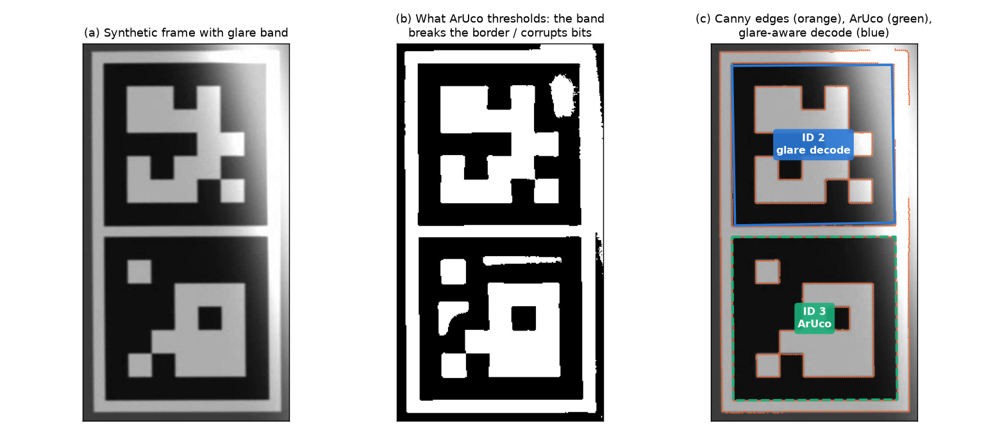

밝은 반사 띠가 marker 위를 지나가면 두 가지가 깨진다.

1. 띠의 밝기가 adaptive threshold 창 평균보다 높아서 띠 안이 전부 「흰색」이 된다. marker 바깥의 얇은 흰 여백선이
   묻혀 검정 테두리가 주변과 붙고, **사각형 후보 자체가 사라진다**((b)).
2. 띠가 흰 module 을 포화시키면 사각형은 잡혀도 비트 해독에서 떨어진다.

국소 정규화·black-hat·threshold 창 조정은 효과가 없었다(최대 23 %). 띠의 폭과 module 크기가 같아서 배경을 분리할 수 없기
때문이다. 대신 띠는 **매끄럽게 더해지는 빛**이라 marker 경계의 기울기는 살아 있다. 그래서 다음 순서로 읽는다((c)).

- **후보**: ArUco 탈락 후보, 추적 중인 marker 의 예측 corner, Canny 닫힌 사각형.
- **해독**: 늘 검정인 테두리 칸으로 띠 밝기장을 보간해 빼고 읽는다. 포화된 칸은 값이 하한일 뿐이므로 하한만으로 흰색이면
  흰색, 아니면 「모르는 칸」으로 지운다. 사전 전체와 대조해 오류가 12 % 이하이고 두 번째 후보와 3 비트 이상 벌어질 때만 받는다.
- **띠의 증거가 있을 때만**: 테두리가 포화됐거나 테두리 밝기장의 폭이 대비 이상일 때만 받는다. 이 조건이 없으면 블러·가림
  marker 까지 받아서 장노출 1 m/s peak 오차가 −0.4 % → −12 % 로 나빠졌다.
- **corner**: 윤곽 corner 는 3 px 안팎 틀리므로 변 직선 맞춤으로 다듬는다. 다듬지 못한 marker 는 버린다.

시험한 열화 녹화 전체에서 오검출은 0 건이었다.

### 3.1 여러 모양의 반사에 맞추기 (2026-10-28 추가)

위 해독은 한 가지 띠로만 맞췄다. 실제 반사는 폭·방향·세기·움직임이 제각각이므로 시험 반사를 9종으로 넓혔다.
폭은 marker module(한 변 / 7) 단위다.

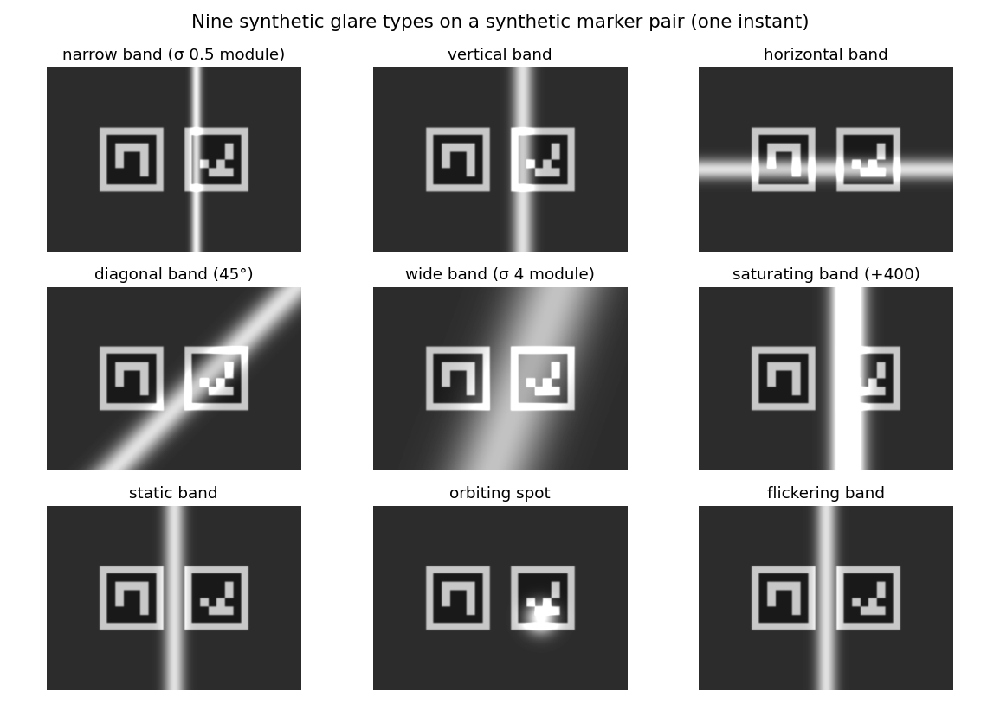

이 9종에서 실패는 세 가지였다.

1. **고정 경계 문턱이 작은 marker 에서 윤곽을 끊는다.** module 이 10 px 안팎이면 띠 옆면의 기울기가 경계 검출 문턱을 넘어
   사각형이 닫히지 않았다. 고정 문턱으로 못 찾으면 그 영역의 경계 세기(기울기 99 백분위)에 비례한 문턱으로 다시 찾는다.
   고정 문턱이 먼저다. 비례 문턱을 먼저 쓰면 고정 문턱으로 찾던 넓은 띠에서 다른 사각형을 먼저 받아 자세가 버려졌다.
2. **블러 추적의 상관이 반사에 끌려간다.** 반사는 빛을 더하기만 하므로, 그 marker 가 직접 잡혔을 때의 흰색보다 대비 1배
   넘게 밝은 화소와 포화 화소를 상관에서 뺀다. 예전 상관이 실패하고 움직임이 느릴 때만 쓰므로 열화 없는 녹화의 결과는 같다.
   대비 0.3배로 두었을 때는 도어가 움직이며 바뀌는 조명만으로 켜졌다.
3. **0 위치가 열린 자세로 잡힌다.** 닫힌 자세를 반사 때문에 못 보고 열리는 도중에 처음 잡으면, 처음 샘플을 0 으로 삼아
   각도 전체가 33~37° 밀렸고 경고도 없었다. 이제 **첫 정지 구간**을 0 으로 삼고, 그것이 처음 샘플이 아니면 저장 로그에
   경고를 남긴다.

실측 녹화 9개(슬라이드 4, 회전 도어 2, 작은 회전 도어 3: 40 mm marker)에 반사 9종을 입혀 움직이는 동안의 확보율을 비교했다
(열화 seed 고정, 녹화 범위, 이전 판 → 현재 판).

| 반사 | 슬라이드 | 회전 도어 | 작은 회전 도어 | 작은 회전 도어 위치 RMS 최대 |
|---|---|---|---|---|
| 가는 띠 | 22~52 → 22~80 % | 72~83 → 72~89 % | 41~67 → 29~80 % | 13.1 → 1.19° |
| 세로 띠 | 67~100 → 67~100 % | 95~99 → 95~99 % | 35~82 → 47~85 % | 1.70 → 0.92° |
| 가로 띠 | 89~100 → 89~100 % | 88~95 → 94~95 % | 64~94 → 81~94 % | 1.60 → 0.34° |
| 사선 띠 | 56~93 → 56~93 % | 95~100 → 97~100 % | 80~93 → 82~95 % | 1.81 → 0.28° |
| 넓은 띠 | 95~100 % | 100 % | 65~100 % | 0.30° |
| 포화 띠 | 0~2 → 0~3 % | 51~52 % | 0~41 → 0~43 % | 19.7 → 5.9° |
| 멈춘 띠 | 71~100 → 71~100 % | 60~79 → 62~85 % | 0~23 → **6~90 %** | 35.8 → **0.62°** |
| 도는 반점 | 49~91 % | 88~98 % | 76~96 → 76~97 % | 1.00° |
| 깜박이는 띠 | 76~100 → 76~100 % | 88~97 → 89~97 % | 65~81 → 82~91 % | 0.11 → 0.27° |

- 열화 18종 전체 평균 확보율은 79.5 → 81.8 % 다. 1 %p 넘게 좋아진 조합이 33개, 나빠진 조합이 4개다.
  열화 없는 녹화와 반사가 아닌 열화(어둡게·잡음·대비·JPEG·블러)는 결과가 같다.
- **나빠진 곳**: 슬라이드 70 의 기존 반사 띠 98.5 → 95.5 %(비례 문턱이 거친 corner 로 marker 를 먼저 받아 그 프레임이 재투영
  기준에서 빠진다), 같은 녹화의 가림 조건 위치 RMS 0.057 → 0.277 mm(흰색보다 밝은 가림판을 반사로 본다).
- **포화 띠는 고치지 못했다.** 띠 안이 255 라 marker 정보가 없다.
- 반사가 있는 프레임은 처리 시간이 중앙값 1.3~1.5 ms 늘었다(PC). 열화 없는 프레임은 같다.
- 비교 도중 bench 자체의 결함을 찾았다. 열화 seed 가 실행마다 바뀌어서(문자열 hash), 같은 판을 다시 돌려도 가림·누락
  조건이 몇~수십 % 흔들렸다. 고친 뒤에는 같은 판을 두 번 돌리면 결과가 같다. 위 표는 고친 bench 의 결과다.

## 4. 결과

### 4.1 실측 녹화 + 합성 열화

실측 녹화 6개(회전 도어 2, 슬라이드 4: 구동 속도 설정 10·40·70·100)에 같은 열화를 입혀 **움직이는 동안 측정값이 나온
프레임 비율**을 세 판에서 비교했다. 기존 코드의 회전 도어 0 % 는 열화가 아니라 배치 설정 때문이다.

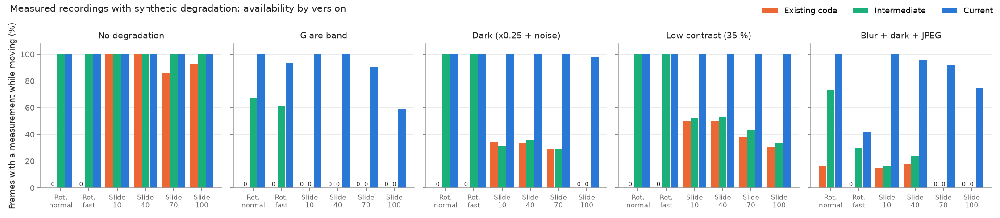

| 열화 | 기존 코드 | 중간 판 | 현재 판 |
|---|---|---|---|
| 열화 없음, 슬라이드 4개 | 86~100 % | 100 % | 100 % |
| 반사 띠, 슬라이드 4개 | 0 % | 0 % | 59~100 % |
| 반사 띠, 회전 도어 2개 | 0 % | 61~67 % | 94~100 % |
| 어둡게(×0.25 + 잡음), 슬라이드 | 0~34 % | 0~36 % | 98~100 % |
| 대비 35 %, 슬라이드 | 31~50 % | 34~53 % | 100 % |
| 블러 + 어둡게 + JPEG, 슬라이드 | 0~18 % | 0~24 % | 75~100 % |
| 블러 + 어둡게 + JPEG, 회전 도어 | 0~16 % | 30~73 % | 42~100 % |

- 잡음 σ10·가림 조건은 중간 판과 같은 수준이다(실행마다 몇 % 흔들린다).
- 가장 나쁜 칸은 「슬라이드 100 + 반사 띠」(59~71 %)와 「회전 도어 빠르게 + 블러·어둡게·JPEG」(42 %)다.

### 4.2 합성 녹화(참값 있음)

실측 장면 위에 참값 궤적으로 marker 를 다시 그려 만든 합성 녹화 36개(슬라이드 속도 3종 + 회전 도어 × 조건 9종)로 참값 대비 오차를 쟀다.

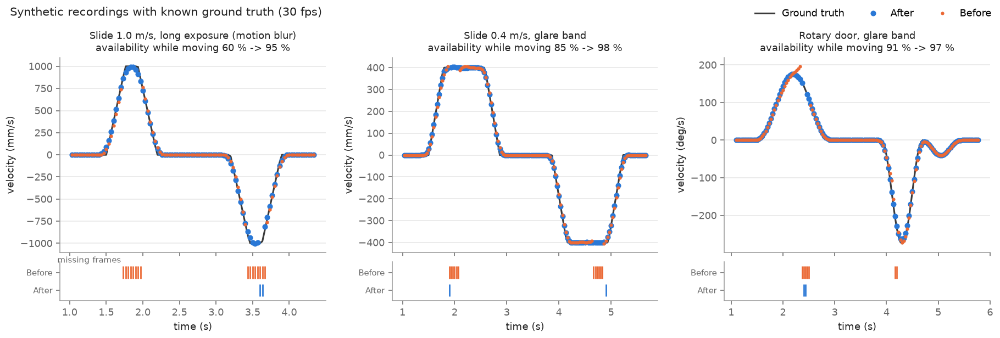

| 경우 | 기존 코드 | 중간 판 | 현재 판 |
|---|---|---|---|
| 슬라이드 1 m/s, 정상 노출 | 확보 70 %, 위치 2.32 mm, peak −12 % | 확보 100 %, 2.34 mm, +2.7 % | 확보 100 %, **0.31 mm**, +0.1 %(OpenCV ≥ 4.11) |
| 회전 도어, 정상 노출 | 확보 0 % | 0.61° | **0.026°** |
| 슬라이드 1 m/s, 장노출(블러) | 확보 43 %, peak −24 % | 확보 60 %, peak −24 % | 확보 **95 %**, peak −0.4 % |
| 회전 도어, 장노출 | 확보 0 % | 확보 85 %, 닫힘 peak −47 % | 확보 88 %, 닫힘 peak −18 % |
| 반사 띠, 슬라이드 0.4 m/s | 확보 85 %, 위치 1.31 mm | 확보 85 %, 1.32 mm | 확보 **98 %**, **0.15 mm** |
| 반사 띠, 회전 도어 | 확보 18 % | 확보 91 %, 0.62° | 확보 **97 %**, **0.060°** |

나머지 조건(광량 15 %, 대비 25 %, 가림, 지터)에서 현재 판의 회귀는 없었다.

- 「현재 판」 값은 OpenCV 4.11 이상(4.14·5.0 포함)에서 잰 것이다. **4.7~4.10 은 빠른 구간 검출이 약해** 슬라이드 1 m/s 확보율이
  57 %, peak 오차가 −36 % 였다. 0.1·0.4 m/s 와 회전 도어는 판과 상관없이 같다.

## 5. 처리 시간과 30 fps

30 fps 의 프레임 예산은 33.3 ms 다. 아래는 데스크톱 1 스레드에서 1080p 실측 녹화 6개를 하나씩 처리한 시간(중앙값 / p99)이다.

| 판 | 열화 없음 | 반사 띠 |
|---|---|---|
| 기존 코드 | 3.1~3.7 / 3.7~4.6 ms | — |
| 중간 판 | 4.0~4.5 / 4.6~5.4 ms | — |
| 현재 판 | **2.2~2.5** / 3.3~5.0 ms | 4.2~4.6 / 6.0~7.6 ms |

- 직전 위치 주변만 검출하므로, 추가 처리를 넣고도 열화 없는 녹화는 기존 코드보다 빠르다.
- 블러 추적과 glare 해독은 프레임 시작부터 20 ms 를 넘을 것 같으면 건너뛴다. 예산을 1/10 로 줄인 시험에서 프레임 시간은 예산 안에
  묶였지만, 반사 띠 확보율은 0 % 로 떨어졌다. **느린 기기에서는 30 fps 를 지키는 대신 확보율이 PC 결과보다 낮을 수 있다.**

## 6. 검증 범위와 결과

| 항목 | 범위 | 결과 |
|---|---|---|
| 단위 시험 9종(검출·1-DOF·stroke·calibration·corner 정제·rolling shutter 보정 자세·속도 구간·캡처 대기열·반사 적응) | Python 3.8 + OpenCV 4.11, Python 3.13 + OpenCV 5.0 | **자동 판정 154건 전부 PASS**(OpenCV 4.7 은 FAIL 0·SKIP 8). 판정마다 PASS/FAIL/SKIP 을 찍고 종료 코드로 낸다(SKIP 은 통과가 아니다) |
| 합성 bench 자동 판정 | 요구사항(처리 시간·확보율·위치·peak) 57건 | OpenCV 4.11·5.0 전부 PASS, 4.7 은 고속 5건 FAIL |
| 실측 열화 bench | 녹화 9개 × 열화 9종 + 반사 9종 | 3.1·4.1 절. 오검출 0 |
| 합성 bench(참값) | 녹화 36개 | 4.2 절. 회귀 없음 |
| 합성 marker 기준 bench(참값) | 도어 3종 + 노브 2종 × 조건 10종 = 녹화 60개, 다이얼 180°·270° | 6.6 절 |
| 그림 생성·bench 실행 | Python 3.8 + OpenCV 4.11.0 + matplotlib 3.7.5 | 통과(x86_64. Nano 설치 절차와 같은 package 판, aarch64 wheel 존재 확인) |
| 배포본 일치 | 개발본 · 측정 앱 폴더 · 공유 폴더 · 비공개 저장소 | 바이트 단위 일치 |
| Jetson Nano 실기 | — | **미실측**. 설치·측정 절차서만 준비했다 |

재검증에서 새로 확인한 것:

- **「슬라이드 100 + 반사 띠」는 stroke 요약값도 틀릴 수 있다.** 두 번째 stroke 의 결측 위치가 실행마다 달라서, 같은 녹화에서
  peak 0.872 → 0.518 m/s(−41 %)가 나오거나 측정이 일찍 끊겨 이동량 0.433 → 0.289 m 가 나왔다. 앞선 실행에서는 peak 차이가
  3 % 였다. 확보율만 보면 이 위험이 드러나지 않는다. → 6.1 절의 결측 표시로 대응했다.
- OpenCV 4.7.0 의 Python `cv2.aruco.Board` 생성자에 결함이 있어, 그 판에서는 짝 marker 복구만 빠진다. 측정 경로에는 영향이 없다.

### 6.1 Stroke 결측 표시 (2026-10-28 추가)

틀린 요약값을 고칠 수는 없으므로, **믿으면 안 되는 stroke 를 표시**한다. 값은 바꾸지 않는다.
아래 넷 중 하나라도 걸리면 그 stroke 는 `incomplete` 이고, 이유가 같은 행에 적힌다.

| 기준 | 문턱 | 잡는 경우 |
|---|---|---|
| 확보율(속도 샘플 / 구간 프레임) | < 80 % | 전체적으로 성긴 stroke |
| 샘플 사이 최대 빈틈 | > 0.20 s | 한 구간이 통째로 빠짐 |
| 잘림 | 움직이는 중에 구간이 시작·끝나고, 그 너머 0.10 s 에 샘플 없음 | 추적이 끊겨 이동량·지속 시간이 짧게 나옴 |
| peak 창(최고 속도 ±0.10 s) 확보율 | < 80 % | peak 근처만 성김 |

peak 창 기준이 핵심이었다. 처음에는 앞의 셋만 두었는데, **전체 확보율이 83~90 % 로 정상인데 peak 가 +9~12 % 틀린 stroke** 를
놓쳤다. peak 는 최대값이라 그 주변이 성기면 잡음이 값을 끌어올린다.

실측 녹화 6개 × 열화 9종에서, 열화 실행의 stroke 를 열화 없는 실행의 같은 stroke 와 짝지어 대조했다
(「틀림」 = peak 5 % 초과 또는 이동량 3 % 초과 차이).

| 항목 | 결과 |
|---|---|
| 틀린 stroke 중 표시된 것 | **6 / 6** (놓침 0) |
| 열화 없는 실행에서 잘못 표시된 것 | 0 |
| 값이 맞는데 표시된 것 | 16 / 102 (데이터가 성겨 근거가 약한 경우) |
| 반복성(슬라이드 100, 전 조건) 이동량 CV | 표시된 stroke 제외 **0.1 %** · 포함 24.8 % |

- 그림에서는 표시된 stroke 에 빗금과 「!」를 붙이고, 반복성 리포트는 기본으로 뺀다(옵션으로 포함 가능).
- 위 「슬라이드 100 + 반사 띠」 사례(측정이 일찍 끊겨 이동량이 짧게 나온 경우)는 「잘림」으로 잡혔다.
- 단위 시험에 이 표시의 자동 판정 3건(결측 없음 · peak 창 결손 · 끝 잘림)을 넣었다.

### 6.2 속도 구간: 가속 · 등속 · 감속 (2026-10-28 추가)

stroke 마다 속도 profile 을 **가속 → 등속 → 감속**으로 나누고, 저장할 때 구간 그림을 따로 만든다.
가로로 긴 그림의 위 칸은 기록 전체의 속도다. 아래 칸은 stroke 마다 앞뒤 0.3 s 를 붙여 확대한 진행 방향 속도와 가속도다.
구간마다 시간, 평균 가속·감속(구간 양 끝 속도 차 / 시간), 이동량을 적는다. 등속 구간에는 평균 ± σ 띠를 그린다.

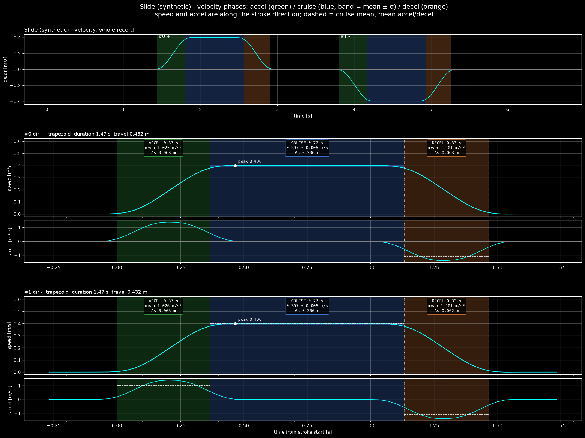

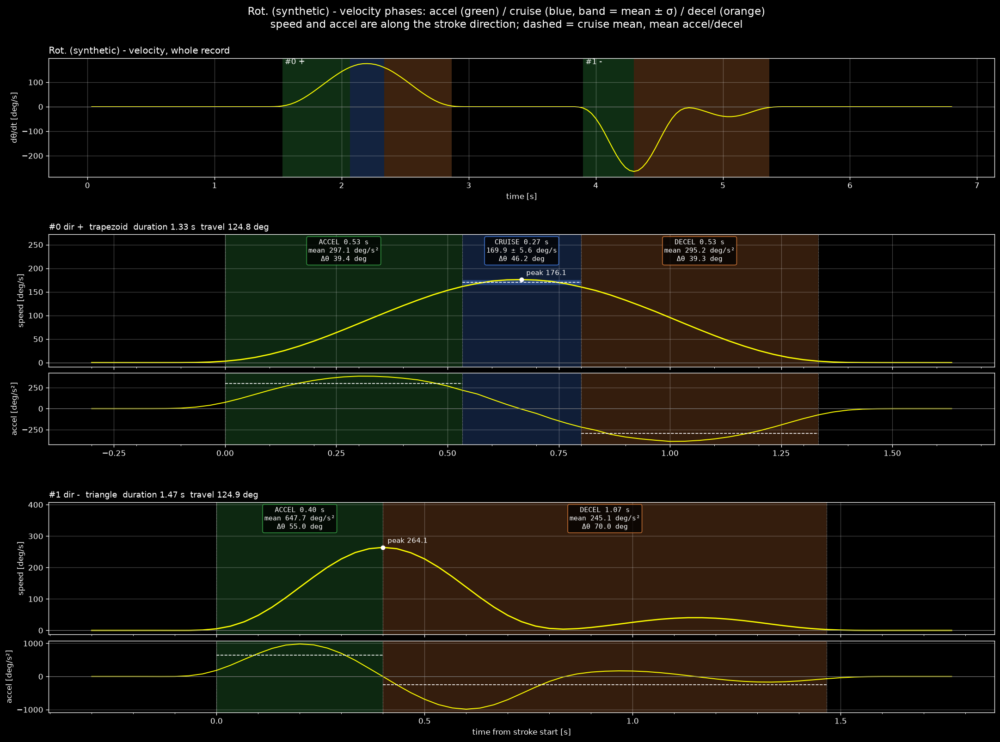

**나누는 기준**

- 등속은 진행 방향 속도가 **처음 0.9·peak 에 닿은 때부터 마지막으로 그 위에 있던 때까지**다. 그 사이에 잠깐 내려간 것은
  등속 중 리플로 보고 σ 에 남긴다. 연속 구간으로 자르면 저속 녹화의 4.0 s 등속이 리플 때문에 0.43 s 로 끊겼다.
- 등속이 0.25 s 보다 짧으면 등속 없는 **삼각형** profile 로 보고 peak 에서 가속·감속을 나눈다.
- peak 둘레에 0.20 s 넘는 속도 공백이 있으면 구간을 나누지 않는다(`unknown`). 공백을 건너 경계를 이으면
  **없는 등속이 생긴다**. 합성 1 m/s 블러 녹화에서 0.37 s 공백이 「0.62 m/s 등속」으로 나왔던 것을 게시 전에 고쳤다.

**참값 대비 (합성 녹화)**

| 항목 | 슬라이드 0.4 m/s | 회전 도어 |
|---|---|---|
| 사다리꼴 / 삼각형 판정 | 참값과 같음 | 참값과 같음 |
| 등속 시작·끝 시각 | ±1 frame (0.033 s) | ±1 frame |
| 등속 속도 | 0.397 / 참값 0.398 m/s | 169.9 / 참값 172.1 deg/s |
| 가속 시간 | 0.37 / 참값 0.23 s | 0.53 / 참값 0.50 s |
| 평균 가속 | 1.02 / 참값 1.40 m/s² (−27 %) | 297 / 참값 318 deg/s² (−7 %) |

- 등속 경계와 등속 속도는 참값에 맞는다. **가속·감속 시간은 길고 평균 가속·감속은 작게** 나온다. 속도 미분 창(±0.10 s)이
  급출발·급정지를 번지게 해서 stroke 시작이 0.03~0.10 s 앞당겨지기 때문이다. 합성 슬라이드는 가속이 계단처럼 바뀌어 이 효과가 가장 크다.
- 실측 녹화 6개 × 열화 9종에서 열화 없는 실행과 짝지은 정상 stroke 82개는 판정이 모두 같았고, 등속 경계는 최대 1 frame 움직였다.
- 실측 슬라이드는 저속·중속에서 사다리꼴(등속 3.97 s · 0.63 s), 고속 두 단계에서 삼각형으로 나뉜다. 열림·닫힘이 대칭이다.
- 반복성(실측 슬라이드 중속, 같은 녹화 × 조건 10종): 등속 시작·끝 시각 CV 0~3 %, 등속 속도 CV 0.1~0.4 %.
  등속이 평평하면 peak 가 그 안 어디서든 잡히므로 「시작부터 peak 까지 시간」은 CV 9~14 % 다. 시점 비교에는 등속 경계를 쓴다.

### 6.3 Rolling shutter 보정 자세 (2026-10-28 추가)

실측 슬라이드 녹화에서 X-Y 궤적은 한 줄인데 **X-Z 궤적은 열림·닫힘이 두 줄로 갈라졌다.** 경로 차이가 아니라 rolling shutter 가
만든 깊이 오차다. 옆으로 움직이면 위·아래 marker 가 다른 시각에 찍혀 화면에서 기울어지고(shear), 프레임마다 푸는 PnP 가 이를
기울어짐·깊이 변화로 읽는다. 진행 방향이 바뀌면 부호도 바뀌어 두 줄이 된다.

- 근거: 저장된 corner 로 readout 을 0 → 45 ms 로 바꿔 가며 다시 풀면 열림−닫힘 Z 차의 부호가 26.5 ms 에서 바뀐다.
  1-DOF corner 맞춤이 따로 추정한 readout 과 같은 값이다. marker 의 화면 크기로 본 깊이 차는 약 1 mm 다.
- 보정: 저장할 때 corner 맞춤 모델로 corner 마다 노광 시각 차만큼의 화면 변위를 빼고 PnP 를 다시 푼다(`rs_pos_*`·`rs_rot_*`).
  고속에서 marker 하나만 보인 프레임은 4점 PnP 가 불안정해(회전 4~24° 튐) 회전을 모델 값으로 고정하고 위치만 푼다.
  1-DOF 결과와 실시간 열은 바뀌지 않는다.

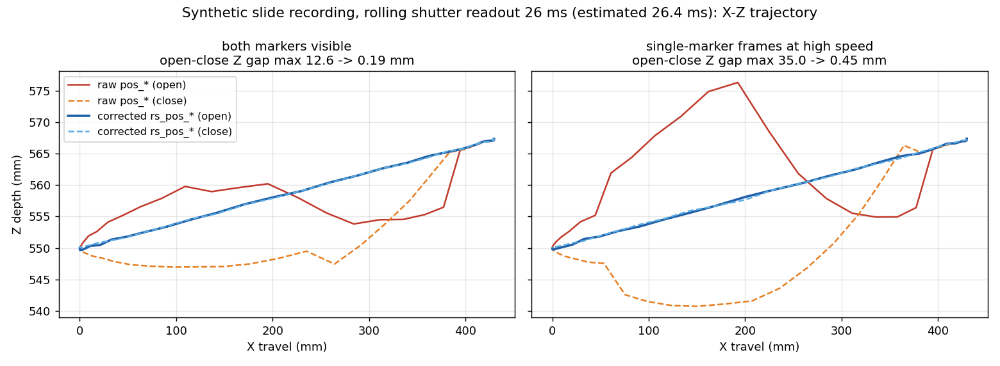

| 열림−닫힘 Z 차 | 보정 전 | 보정 후 |
|---|---|---|
| 합성(readout 26 ms, 블러 없음) 최대 | 12.6 mm | **0.19 mm** |
| 합성, marker 하나 프레임 섞임 · 최대 | 35.0 mm | **0.45 mm** |
| 실측 열화 없음 · 중앙값 평균(최대값 평균) | 5.6 (8.9) mm | **1.3 (4.9) mm** |
| 실측 어둡게·저대비·JPEG·잡음 | 5.0~5.7 mm | 1.0~1.3 mm |
| 실측 블러·가림·프레임 누락 | 5.7~6.9 mm | 1.0~1.7 mm |
| 실측 반사 띠 | 7.5 mm | 3.3 mm |
| 실측 최악 조합(블러+어둡게+JPEG) · 최대값 평균 | 9.1 mm | **13.9 mm**(나빠짐) |

실측은 녹화 4개 × 조건 10종이다. 남는 차이는 블러다. 블러 corner 의 marker 하나 프레임은 깊이가 ±5 mm 흔들려서,
최악 조합에서는 최대값이 오히려 커졌다. 심한 열화 60 실행 중 2 실행은 readout 추정이 52~58 ms 로 틀렸다.

### 6.4 실시간 속도 열은 늦다 (2026-10-28 추가)

화면 표시용 실시간 속도 열은 지난 프레임만 쓰는 이동평균 미분이라 늦다. 실측에서 직선 속도는 **0.09 s**, 각속도는 **0.21 s**
늦었고, 슬라이드 peak 는 저장 시 계산한 1-DOF 값보다 2~6 % 컸다.

- 실시간 열은 표시용이라 그대로 둔다. 속도 분석에는 저장 시 계산한 1-DOF 값(앞뒤 대칭 미분, 위상 지연 없음)을 쓴다.
- 3D 분석 그림의 속도·각속도 칸에 1-DOF 속도를 점선으로, 속도 구간을 색으로 겹치고 이 지연을 주석으로 적었다.

### 6.5 삼각형 profile 의 peak · 녹화 누락 원인 · 맞춤 잔차 (2026-10-28 추가)

10-28 슬라이드 실측 녹화 3개(보통 1회·5회, 빠르게 2회)를 검증하다가 세 가지를 찾아 반영했다.

**① 등속 없는 stroke 의 peak 를 꼭짓점 모형으로 잰다.** 슬라이드 빠르게 녹화는 peak 가 0.86~0.88 m/s 로 나왔다.
처음에는 행정이 짧아 1 m/s 에 못 닿은 것으로 보았지만 틀렸다. 실측 가속 2.3 m/s² 로 계산하면 v²/a = 0.43 m 로 행정(0.432 m)과 같다.
즉 약 1 m/s 까지 가속한 뒤 등속 없이 바로 감속한 것이고, ±0.10 s 다항식 미분이 그 뾰족한 꼭짓점을 깎았다.

- 고친 방법: 삼각형 profile 로 판정된 stroke 는 peak 앞뒤의 **위치** 샘플에 속도 모형을 적분해 맞춘다. 모형은 가속 직선 → 감속 직선이고, 꼭짓점을 너비 w 로 둥글린다.
  맞춤의 최고 속도를 peak 로 쓴다.
- 받는 조건: 잔차 RMS ≤ 이동량의 1 %, 결과가 다항식 peak 의 0.98~1.25 배. 조건을 못 넘으면 종전 다항식 값을 그대로 쓰고, 어느 쪽인지 열에 남긴다.
- 등속이 있는 사다리꼴 stroke 는 바뀌지 않는다.

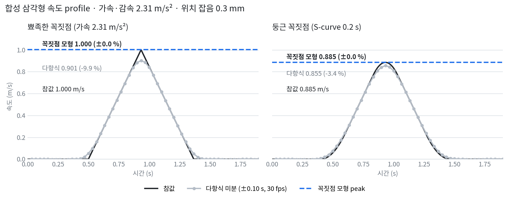

| 대상 | 다항식(종전) | 꼭짓점 모형 |
|---|---|---|
| 합성 삼각형·둥근 꼭짓점 10종(참값 있음) | 참값보다 작다(최대 −17 %) | **±2.2 % 안** |
| 실측 슬라이드 빠르게(10-28), stroke 4개 (m/s) | 0.861 / 0.874 / 0.884 / 0.875 | **0.962 / 0.956 / 0.979 / 0.966** |
| 실측 슬라이드 100 열림 / 닫힘 (m/s) | 0.871 / 0.874 | **0.958 / 0.963** |
| 실측 슬라이드 70 열림 / 닫힘 (m/s) | 0.695 / 0.690 | 0.716 / 0.714 |
| 사다리꼴 stroke, 회전 도어 | — | 바뀌지 않음 |

- 실측 녹화에는 참값이 없다. 실측 값이 맞다는 근거는 합성 시험과 v²/a = 행정 계산뿐이다. 엔코더 동시 측정으로 확인할 예정이다.
- 속도 그림의 곡선은 다항식 미분 그대로 두고, peak 표기에만 두 값을 함께 적는다.

**② 녹화에서 빠진 frame 의 원인을 남긴다.** 10-28 녹화 3개에 1 frame 짜리 빈틈이 16개 있었고, 모두 움직이는 중이었다.
camera 쪽 frame 번호는 이어져 있으므로 앱 안에서 빠진 것이다. 이 PC 의 재현 bench(8.1 절)에서는 0개라 원인을 가리지 못했다.

- 이제 빠진 frame 마다 원인을 별도 CSV 에 남긴다. 원인은 넷이다: 캡처 대기열 넘침, 저장 중 건너뜀, 녹화 인코더 대기열 넘침, 기록 밖. 그때의 적체도 함께 남긴다.
- 녹화를 끝낼 때 빠진 frame 수와 원인별 수를 출력한다. 현장 PC 에서 다시 녹화하면 원인을 가를 수 있다.

**③ corner 맞춤 잔차를 정지·움직임으로 나눠 본다.** 한 녹화(5회 왕복)만 정지 frame 의 corner 맞춤 잔차가 2.38 px 였다. 다른 녹화는 0.23~0.61 px 다.
움직임 frame 은 블러·rolling shutter 가 섞여 원래 잔차가 크므로, 정지 frame 만 따로 보고 1.5 px 를 넘으면 경고를 남긴다.
이동이 축 하나가 아니거나(레일 유격, camera 흔들림) marker 가 들떴을 때 나타나는 값이다. 그 녹화의 원인은 확인하지 못했다.

이 반영으로 단위 시험은 133 → 144건이 됐다(6.6 절 뒤 154건).

### 6.6 블러 corner 와 180° 넘는 회전 (2026-10-29 추가)

stroke 요약값이 아니라 **marker 하나하나의 위치·자세**를 참값과 비교하는 합성 bench 를 새로 만들었다.
장면은 슬라이드 도어(0.4·1.0 m/s), 회전 도어, 손잡이 노브, 다이얼 노브 다섯 가지이고, 조건은 노출 2·8·16 ms 와 어둡게·저대비·반사·잡음·흔들림·초점·가림 등 10종이다.
이 bench 로 결함 셋을 찾았고, 그중 두 개를 고쳤다.

**① 블러 marker 가 짧게 잡힌다 — 고침.** 1 m/s · 8 ms 에서 움직이는 frame 의 marker 3D 중심 오차가 8~11 mm 였다. 원인은 두 가지가 겹친 것이다.

- 블러 폭 문턱이 빠른 frame 을 기본 corner(SUBPIX)로 돌렸다. 기본 corner 는 블러 marker 를 블러 길이의 약 절반만큼 짧게 낸다.
- 문턱을 꺼도 변 정제가 marker 를 3.9 px 짧게 냈다. marker 둘레 흰 여백(약 12 px)이 블러(17.5 px)보다 좁아, 밝기가 흰색까지 오르지 못하고 꺾인다.
  그 봉우리를 흰 레벨로 쓰면 50 % 기준이 어두운 쪽으로 내려가 교차점이 안으로 들어간다.

고친 방법은 세 단계다.

1. 블러는 운동에 나란한 변을 넓히지 않는다. 그래서 블러로 넓어진 변은 경사가 가장 좁은 두 변의 안·밖 밝기 레벨을 빌려 기준을 다시 잡는다.
2. 빌린 기준에도 닿지 못한 변은 경사 아래쪽(대비 20·40 %)을 잇는 직선을 50 % 까지 늘려 잡는다. 경사 아래쪽에는 밖의 배경이 아직 섞이지 않는다.
3. 둘 다 안 되면 그 marker 는 기본 corner 를 쓴다. 블러 폭 문턱은 없앴다. 문턱을 중간값에 두면 한 stroke 안에서 두 방식이 frame 마다 바뀌어 1-DOF 샘플이 버려졌다.

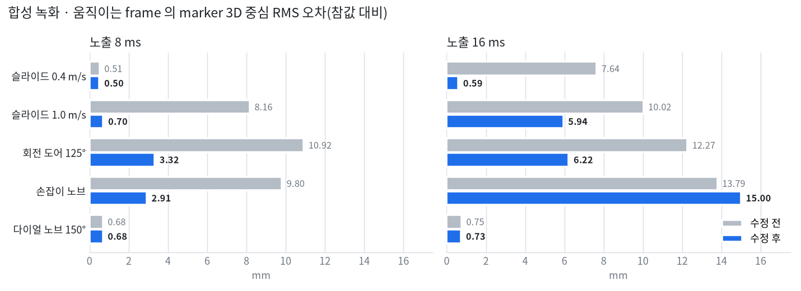

- 정지 frame 과 노출 2 ms 는 그대로다. 손잡이 노브 16 ms 는 검출이 끊긴 frame(블러 추적)이 섞여 조금 나빠졌다.
- 블러 6 px 에서 임의 방향·자세 20 회의 깊이 오차는 7.8~13.3 → 0.21~0.43 mm 다. 정제 처리 시간(12 marker, p99 1.88 ms)은 그대로다.
- 정제가 빠른 frame 에서도 맞게 되자, 상대 기준(주변 잔차의 중앙값)으로 이상 frame 을 고르는 1-DOF 판정이 원래 잔차가 큰 블러 추적 frame 을 버렸다.
  그래서 주변 중앙값을 직접 검출과 블러 추적으로 나눠 따로 낸다. 그래도 요구사항 밖의 반사 조건에서 확보율이 낮아진 곳이 있다(슬라이드 1 m/s 반사 100 → 92.5 %, 회전 도어 반사 97.3 → 90.5 %).
- 실측 녹화(참값 없음)의 빠른 frame 에서 1-DOF 축·레일 이탈은 다음과 같다.
  - 슬라이드 100: 2.90 → 1.59 mm, 슬라이드 70: 3.19 → 1.90 mm 로 줄었다.
  - **회전 도어 빠르게: 1.93 → 3.39° 로 늘었다.** 줄어든 몫과 늘어난 몫은 둘 다 2단계(늘려 잡기)에서 나온다.
  - 지표·gamma·문턱·readout·빌린 변의 블러는 원인이 아님을 확인했다. 남은 원인 후보는 실측에만 있는 요인(ISP 선명화·압축·노출 중 가속)이다. 참값이 있는 실측 회전 녹화로 확인할 예정이다.
  - 1-DOF 이동량과 peak 는 실측 6개 녹화 모두 ±0.15 %·±1.5 % 안에서 같다.

**② 회전 1-DOF 가 180° 를 넘지 못한다 — 고침.** 회전 1-DOF 는 기준 자세 대비 회전 벡터를 축에 투영한 값이다. 회전 벡터의 크기는 0~180° 라서 180° 를 넘으면 −(360° − θ) 로 접혔다.
이제 축 투영각을 시간 순으로 이어 붙인다. 축 밖 잔차가 큰 frame 은 잇는 데 쓰지 않고 이웃 값의 2π 배수에 맞춘다. 자세 하나를 잘못 잡았다고 360° 가 계속 더해지지 않게 하려는 것이다.

| 합성 다이얼 노브 | 1-DOF 위치 RMS 전 → 후 | 속도 RMS 전 → 후 |
|---|---|---|
| 180° | 127.07 → **0.026°** | 519 → 5.0 deg/s |
| 270° | 115.61 → **0.033°** | 599 → 7.6 deg/s |

180° 를 넘지 않는 장면(도어 3종·다이얼 150°)은 값이 그대로다.

**③ 검출 한계 — 그대로.** marker 한 변이 약 48 px 보다 작으면 검출되지 않는다(40 mm marker 는 약 1.0 m). 이것은 거리·marker 크기 선택의 문제로 남긴다.

## 7. 한계

- 반사 해독은 **합성한 반사 10종**(3·3.1 절)으로만 검증했다. 실제 반사로는 아직 확인하지 않았다.
- 포화 띠는 읽지 못한다. 흰색보다 밝은 가림판을 반사로 보아 가림 조건의 위치가 나빠진 경우가 있다(3.1 절).
- 띠가 marker 경계까지 포화시켜 경계 기울기가 사라지면 읽지 못한다(슬라이드 100 + 반사 띠 59~71 %). 이때 틀린 stroke 요약값은 **고쳐지지 않고 표시만 된다**(6.1 절) — 재측정이 필요하다.
- 블러 추적은 이미 한 번 잡은 marker 만 잇는다. 처음부터 심하게 번진 녹화에서는 효과가 없다.
- 회전 도어 장노출의 빠른 닫힘 stroke 는 peak 가 여전히 낮다. 6.6 절 수정 뒤 −18 → −26 % 로 더 낮아졌다.
- 노출 16 ms · 1 m/s 에서는 블러가 marker 둘레 흰 여백보다 훨씬 넓어 marker 3D 중심 오차가 6 mm 남는다(6.6 절). 6-DOF 자세가 필요하면 노출을 줄이는 것이 먼저다.
- 실측 회전 도어 빠르게에서는 6.6 절 수정 뒤 빠른 frame 의 축 이탈이 늘었다. 원인은 확인하지 못했다.
- 회전 1-DOF 는 frame 사이 회전이 180° 보다 작다고 가정한다. 추적이 끊긴 동안 180° 넘게 돌면 360° 틀린 값으로 이어진다.
- 속도 구간은 가속 → 등속 → 감속을 한 번씩만 나눈다. 사람이 연 도어처럼 속도가 중간에 여러 번 머물면 그 머묾이 가속·감속 구간에 들어간다.
  평균 가속·감속은 미분 창 때문에 작게 나온다(6.2 절, 급출발 합성 −27 %).
- 삼각형 stroke 의 peak 는 꼭짓점 모형으로 잰다(6.5 절). 꼭짓점의 둥글기가 모형(상자 둥글기)과 다르면 수 % 오차가 남는다. 조건을 못 넘은 stroke 는 종전 다항식 값이다.
- Rolling shutter 보정 자세는 블러가 심한 고속 stroke 에서 깊이가 흔들린다(6.3 절, 최악 조합 최대값 9.1 → 13.9 mm).
  심한 열화에서 readout 추정이 틀리면 보정도 틀린다.
- 캡처 대기열은 0.4 s 보다 긴 main loop 멈춤은 막지 못한다. 카메라 드라이버·USB 쪽에서 빠진 프레임도 대기열과 무관하다(따로 센다).
  현장 카메라로는 아직 다시 재지 않았다(8.1 절).
- Jetson Nano 기본 구성(JetPack 4.x: Python 3.6, OpenCV 4.1.1)은 기존 코드와 마찬가지로 조건에 맞지 않는다. Python 3.8 과 OpenCV 4.11 을
  따로 설치해야 하며, 실기 처리 시간은 그 뒤에 잰다.

## 8. 처리 구조와 설계 결정 (2026-10-28 추가)

측정 앱은 프레임마다 도는 부분과 저장할 때 한 번 도는 부분으로 나뉜다. 무거운 분석은 33 ms 프레임 루프 밖에 둔다.

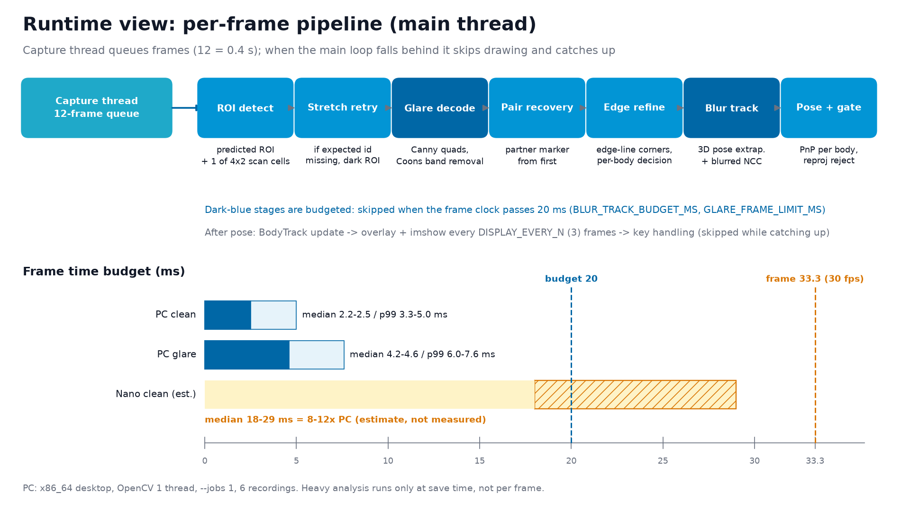

- capture thread 는 프레임을 대기열(12장, 0.4 s)에 쌓는다. main thread 가 밀리면 화면 갱신을 건너뛰고 측정부터 따라잡는다(8.1 절).
  시각은 capture thread 가 프레임을 받은 순간이라, 검출 시간의 흔들림이 시간 간격에 섞이지 않고 늦게 처리해도 속도 값은 같다.
- 진한 파랑 두 단계(반사 띠 해독, 블러 추적)는 프레임 시작부터 20 ms 안에서만 돈다. Nano 막대는 PC 대비 8~12배를 가정한 **추정**이다.

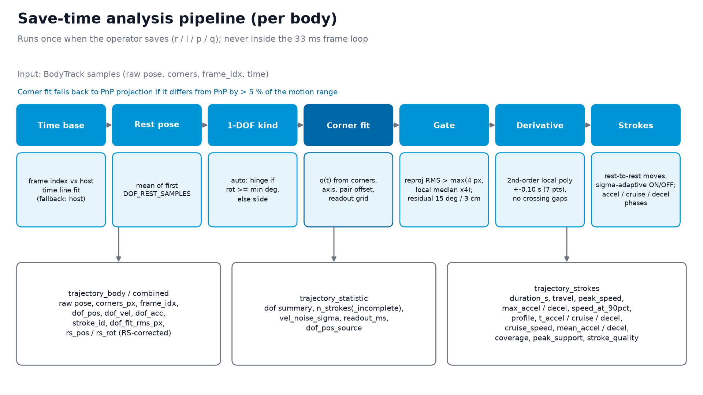

**주요 설계 결정** — 해 보고 나빠진 대안을 수치로 남겼다.

| 결정 | 버린 대안 | 이유(수치) |
|---|---|---|
| corner 를 변 직선으로 정제 | SUBPIX 창 키우기, APRILTAG 정제 | 창 키우기 z RMS 7 → 17 mm, APRILTAG 24 ms/프레임 |
| 정제 적용 여부를 바디 단위로 판정 | marker 단위 | 섞인 프레임이 계단을 만들어 고속 σ 0.83 → 2.39 mm |
| readout 을 1차원 격자로 탐색 | 기하와 함께 LM | LM 은 축 기울기와 맞바꿔 20 → 4~6 ms 로 틀림 |
| ROI 추적 + 칸 훑기 | 매 프레임 전체 화면 | 열화 없음 4.2~4.6 → 2.2~2.4 ms, 어둡게 검출 10 → 100 % |
| 블러 추적은 3D 자세 외삽 | corner 별 속도, 2D 닮음 변환 | 재투영 3 → 8.6 px, 회전 도어 원근 5.5 px |
| 반사 띠: 경계 + 띠 밝기장 제거 | 국소 정규화·black-hat·threshold | 확보율 0 → 최대 23 % 에 그침(띠 폭 ≈ module 크기) |
| 반사 띠 해독은 띠 증거가 있을 때만 | 늘 해독 | 블러·가림 marker 를 받아 peak −0.4 → −12 % |
| 경계 문턱은 고정 먼저, 못 찾으면 비례 | 비례 문턱만 | 비례 먼저면 넓은 띠에서 자세 버림. 고정만이면 작은 marker 반사 0 % |
| 반사 화소를 뺀 상관은 예전 상관 실패·느린 움직임일 때만 | 늘 / 문턱 대비 0.3배 | 늘 쓰면 열화 없는 고속 녹화가 바뀜(100 → 96 %). 0.3배는 조명 변화만으로 켜짐 |
| 0 위치는 첫 정지 구간 | 처음 15 샘플 | 열리는 도중 처음 보면 각도 전체가 33~37° 밀림 |
| 보정 자세의 화면 속도는 1-DOF 맞춤의 미분 | corner 별 시계열 미분 | 고속에서 marker 가 한 프레임씩 빠져 Z 차 중앙 3.5 mm 에 그침(모델 기반 1.1) |
| 캡처 대기열 + 밀리면 화면 갱신 건너뛰기 | 창 처리를 별도 thread 로, 최신 1장 유지 | 창 라이브러리(Qt)는 main thread 전용. 최신 1장은 창 멈춤 주입 3000 프레임에 79개 손실, 대기열은 0 |

### 8.1 프레임 누락: 창 멈춤과 캡처 대기열 (2026-10-28 추가)

현장 구동에서 500 프레임마다 1~2개가 빠졌다. 실제 main loop 를 창·키 처리까지 그대로 돌리고, 카메라 자리에
녹화 영상을 30 fps 벽시계로 흘리는 재현 bench 를 만들어 반복마다 단계별 시간을 쟀다.

- 누락은 모두 **화면 창 갱신(`cv2.waitKey`)이 한 번에 40~176 ms 멈춘 반복**에서 생겼다. 검출(2~7 ms), 실시간 그래프(2~5 ms),
  가비지 컬렉션(최대 0.6 ms)은 원인이 아니었다. 멈춤은 1.4 s 동안 몰려 오기도, 홀로 오기도 했다.
- 최신 프레임 하나만 두면 main loop 가 두 프레임(약 66 ms) 넘게 멈출 때 그 사이 프레임이 덮어써진다.
  창 라이브러리가 Qt 라 창 처리를 다른 thread 로 옮길 수도 없다.
- 대응: capture thread 가 프레임을 **대기열 12장**에 쌓고, main loop 는 밀린 프레임이 있으면 화면 그리기·그래프·키 처리를 건너뛰고
  측정부터 따라잡는다. 키 입력이 막히지 않게 연속 건너뛰기는 15번까지로 묶었다.

| 실측 모양의 창 멈춤 주입(1.4 s 묶음 2번 + 500 프레임마다 150 ms), 3000 프레임 | 최신 1장(이전) | 대기열 12장 |
|---|---|---|
| 버린 프레임 | 79 | **0** |
| 저장 CSV 의 프레임 번호 빈칸 | 79 | **0** |
| 연속 두 샘플의 최대 시간 간격 | 166.6 ms | **39.1 ms** |
| 최대 적체 | — | 6 / 12 |

- 멈춤은 창 시스템 사정이라 그냥 돌리면 나오지 않는 실행도 있다. 그래서 비교는 측정한 멈춤 모양을 주입해서 했다.
- 처리 지연 경고는 이제 「대기열이 넘쳐 버린 프레임」과 「카메라 쪽 빈틈」(대기열에 들어오기 전에 빠진 것)을 나눠 센다.
- **저장 중 녹화 정지**: CSV·그래프 저장은 main loop 를 수 초 멈춘다(재현: 그래프 포함 2.3 s, CSV 만 0.6 s). 녹화를 이어 두면 영상에
  시간 구멍이 생기므로, 저장 전에 녹화를 끝내 파일을 확정하고 저장 뒤 새 파일로 다시 녹화한다. 저장하는 동안의 프레임은
  누락이 아니라 「측정 안 함」으로 따로 센다. 재현에서 녹화가 세 벌로 나뉘었고, 덮어쓴 파일과 누락은 없었다.
- 녹화 영상에서 빠진 frame 은 원인별로 따로 남긴다(6.5 절 ②).
- 현장 카메라로는 아직 다시 재지 않았다.
