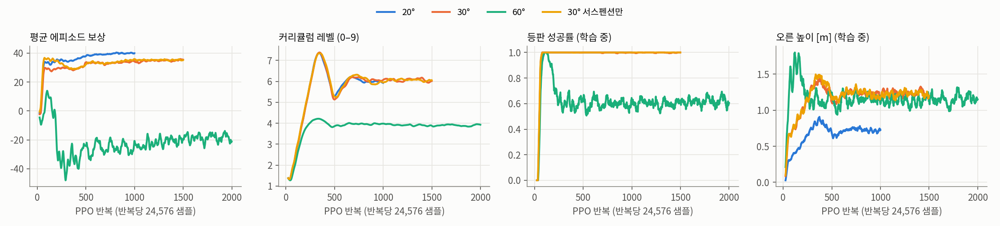
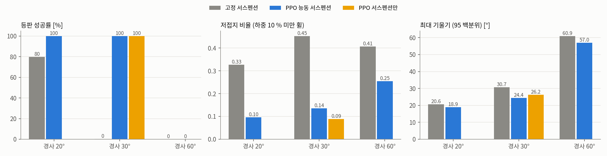
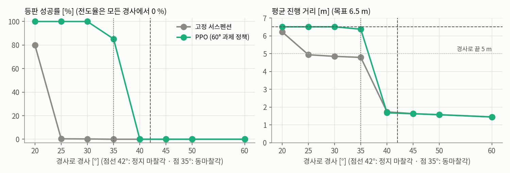
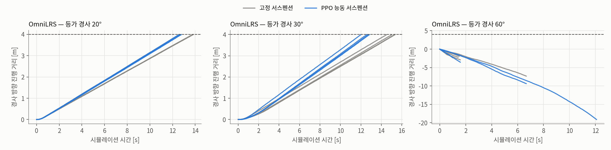

# 달 경사로 등판을 위한 PPO 기반 능동 서스펜션 제어

**1024 병렬 환경 강화학습 — 20° · 30° · 60° 등판 능력 평가와 OmniLRS 검증**

:material-circle:{ style="color:#2e9e44" } **연구 보고** · 현대자동차 L-Project · 기준일 **2026-10-29**

!!! abstract "요약"
    L-Project 달 탐사 로버는 4륜 독립 조향과 4축 능동 서스펜션을 갖춘 12축 차량입니다. 현행 주행 제어는
    서스펜션 지령을 0으로 고정합니다. 본 연구는 서스펜션 4축과 휠 속도 보정 4축을 출력하는 정책을 **PPO**로
    학습해, **달 지형 직선 경사로의 등판 능력**과 등판 중 안정성을 높이는 것을 목표로 합니다.

    경사로는 평지 접근 구간 → 경사 구간(수평 4 m) → 상단 평지로 이루어지며, 경사를 **20°·30°·60°**로 둔 세 과제를
    **1024개 병렬 환경**(Isaac Lab, RTX 5080, 약 7,600 step/s)에서 각각 학습했습니다. 성공은 로버 전체가
    상단 평지에 올라선 것입니다.

    목표 경사 고정 평가(과제당 경사로 832 에피소드)에서 고정 서스펜션 대비 결과는 다음과 같습니다.

    | 경사 (경사로 높이) | 등판 성공률 (고정 → PPO) | 오른 높이 (고정 → PPO) | 전도율 (고정 → PPO) |
    |---|---|---|---|
    | 20° (1.46 m) | 79.9 % → **100.0 %** | 1.27 m → **1.30 m** | 0.0 % → 0.0 % |
    | 30° (2.31 m) | 0.2 % → **100.0 %** | 1.91 m → **2.12 m** | 0.0 % → 0.0 % |
    | 60° (6.93 m) | 0.0 % → **0.0 %** | 0.57 m → **0.55 m** | 0.0 % → 0.0 % |

    30°에서 고정 서스펜션은 경사로가 상단과 만나는 볼록 꺾임(정상)에서 앞바퀴만 상단에 걸친 채 멈췄고(832회 중 2회 성공),
    PPO 정책은 832회 모두 올랐습니다. 저접지 비율(정적 하중 10 % 미만 휠의 시간 비율)은 0.452에서 0.136으로 줄었습니다.
    60° 과제 정책을 경사별로 평가하면 **35°에서 85.2 %**(고정 0 %)를 올랐고, **40° 이상은 고정·PPO 모두 0 %**였습니다.
    고정 서스펜션은 25°에서 이미 0.4 %였으므로, 이 강체 마찰 모델(정지 0.90 / 동 0.70)에서 능동 서스펜션은 등판 한계를 20°대 초반에서 35°까지 넓혔습니다.
    40° 이상은 미끄러짐(견인 한계)이라 서스펜션으로 넘을 수 없었습니다. 60° 경사로는 두 제어 모두 오르지 못했고, Isaac Lab 평가의 전도는 모든 경사에서 0이었습니다.
    서스펜션만 학습한 ablation도 30°를 100 % 올랐습니다. 휠 속도 보정은 등판 속도(속도 비율 0.86 → 0.97)를 높이는 데 기여했습니다.
    학습 환경 밖인 OmniLRS lunaryard 플랜트에서 중력을 기울인 등가 경사(꺾임 없는 경사면)로 시험하면, 20°·30°는 두 제어 모두 4/4로 올랐고
    PPO는 30°에서 더 빨리(4 m 도달 평균 12.6 대 15.1 s), 차체를 약 7° 덜 기울인 채(기울기 RMS 평균 22.6 대 29.3°) 올랐습니다. 60°는 둘 다 미끄러져 내려갔습니다.

    경사로·크레이터 밀집·암석·평지를 섞은 **혼합 달 지형**(6.4절, 1024 환경)에서는 최고 난도 성공률이 고정 서스펜션 0.507,
    **차체만 올려 고정한 기준선 0.877**, 학습한 정책 0.894였습니다. 이득의 대부분은 차고에서 나오며, 정책이 기준선보다 나은 것은 암석 지형뿐입니다.
    관절 좌표 그대로 학습하면 정책이 상수 기울임 자세(roll 9°)에 갇혀, 행동을 heave·pitch·roll·twist 모드로 바꾸고 차체 올림 자세를 기준으로 한 잔차를 학습했습니다.
    OmniLRS **지형 변형 엔진을 켠** 31° 크레이터 탈출(6.5절, 자국은 렌더링 전용)에서는 세 제어 모두 4/4로 탈출했습니다.

    **모든 결과는 강체 지형 시뮬레이션 결과이며 실물 로버·월면토 검증이 아닙니다.** 한계는 8절에 정리했습니다.

[:octicons-arrow-right-24: 프로젝트 상세](l-project-hils.md) ·
[:octicons-arrow-right-24: 로버 USD 설명](l-project-usd-asset.md) ·
[:octicons-arrow-right-24: 지형 변형 엔진 분석](l-project-deformation.md) ·
[:octicons-arrow-right-24: 차년도 과제 제안](l-project-terramechanics.md)

---

## 1. 서론

### 1.1 배경 — 고정 서스펜션의 등판 한계

로버의 서스펜션은 축당 상·하부 암으로 구성된 4절 평행 링크이며, 상부 암 조인트
(`body_to_upper_arm_sus_*`)가 위치 지령을 받는 액추에이터입니다. 12축 계약상 서스펜션은
±0.35 rad(±20.05°) 범위의 위치 제어 축이지만, 현행 주행 제어(텔레옵·Nav2 경로)는 이 축에
**항상 0을 지령**합니다. 본 문서에서 「고정 서스펜션」은 이 상태를 의미합니다.

경사로를 오를 때 차체는 경사만큼 기울고, 하중은 후륜으로 옮겨 가며, 경사로 발(오목 꺾임)과 정상(볼록 꺾임)에서는
네 휠의 접지 조건이 순간적으로 달라집니다. 서스펜션을 움직이면 차체 자세와 휠 하중 분배를 바꿀 수 있으므로,
같은 휠과 같은 마찰에서도 오를 수 있는 경사와 등판 중 안정성이 달라질 수 있습니다. 본 연구는 이것을 정량화합니다.

### 1.2 목표와 기여

1. **등판 능력** — 경사 20°·30°·60° 경사로를 상단까지 오릅니다. 경사별 성공률로 등판 한계를 측정합니다.
2. **안정 주행** — 등판 중 전도(roll)·차체 흔들림·휠 하중 편차를 줄이고, 속도 지령을 지킵니다.

본 연구의 기여는 다음과 같습니다.

- 달 지형 경사로를 **경사 지정형 Isaac Lab 지형**으로 만들어 1024개 환경을 병렬화했습니다(4.1절).
- 실기에 있는 신호(IMU·조인트 상태·서스펜션 토크)만 쓰는 정책과, 지상 진실을 쓰는 critic의
  **비대칭 actor-critic** 구조와 보상 설계를 제시합니다(4.3~4.5절).
- 경사 20°·30°·60° 세 과제의 학습 결과, **경사 20~60° 등판 한계 곡선**, **서스펜션 단독 ablation**, 그리고 학습 환경 밖인
  **OmniLRS lunaryard 플랜트에서의 등가 경사 검증**을 보고합니다(5~6절).

---

## 2. 대상 시스템

| 항목 | 값 | 출처 |
|---|---|---|
| 축 구성 | 구동 4(속도) · 조향 4(위치) · 서스펜션 4(위치), 순서 FL·FR·RL·RR | 12축 계약 `axes.py` |
| 윤거 / 축거 / 휠 반경 | 1.2867 / 1.4910 / 0.2133 m | `final_rover_HH` asset 실측 |
| 총질량 / 차체 | 450 / 302 kg | NASA VIPER 공개 제원 참조 **추정** |
| 서스펜션 한계 | ±0.35 rad (암 길이 0.247 m) | asset 조인트 한계 |
| 서스펜션 drive | kp 2865 N·m/rad · kd 1146 N·m·s/rad · 최대 1000 N·m | asset (PhysX 환산값) |
| 휠 속도 한계 | 10 rad/s | 12축 계약 |
| 중력 | 1.62 m/s² | 달 |
| 휠–지면 마찰 | 정지 0.90 / 동 0.70 | HILS 월면토 마찰 설정 |

정책은 HILS와 같은 asset(`Rover_hyundai_omnilrs.usd`)과 같은 조인트 drive 값을 사용합니다.

**마찰이 정하는 상한.** 강체 쿨롱 마찰에서 정지 상태를 유지할 수 있는 최대 경사는 arctan(μ_s) = arctan(0.90) ≈ **42.0°**이고,
미끄러지는 중의 견인 상한은 arctan(0.70) ≈ 35.0°입니다. 휠 구동력은 마찰력을 넘을 수 없으므로 **42°를 넘는 경사로는 어떤 제어로도
정지·등판이 성립하지 않습니다.** 60° 과제는 이 상한을 넘는 조건에서 정책이 무엇을 하는지(전도를 피하며 머무는지)를 보기 위한 과제입니다.

---

## 3. 문제 정의

| 구분 | 정의 |
|---|---|
| 지형 | 평지 접근 9 m → 경사로(수평 4 m, 경사 θ) → 상단 평지 3 m. 폭 8 m |
| 초기 상태 | 경사로 발 **1 m 앞** 평지에서 정지, 방위 **+x ± 10°**(무작위) |
| 주행 지령 | 지면 속도 v_cmd ~ U(0.25, 0.4) m/s, 조향 0(직진) |
| 성공 | 출발 방위 방향 진행 거리 **6.5 m 이상** — 경사로 4 m를 지나 상단에 1.5 m(축거 1.49 m) 올라선 상태 |
| 실패 | 차체 **roll 50° 초과** 또는 기울기 85° 초과(전도), 지형 이탈 |
| 시간 제한 | 40 s (시뮬레이션 시간) |

진행 거리는 출발 방위에 투영한 변위입니다. 경사로에서 미끄러져 내려간 거리는 진행으로 세지 않습니다. 크레이터 과제와 달리
경사로에서는 차체가 경사만큼 기울어 있는 것이 정상이므로, 전도 판정을 **좌우 기울기(roll)**와 85° 한계로 바꿨습니다.

경사로 높이는 20° 1.46 m, 30° 2.31 m, 60° 6.93 m입니다. 「오른 높이」는 에피소드 중 차체 기준점 높이의 최댓값에서 출발 높이를 뺀 값입니다.
출발 높이는 스폰 높이(지면 위 0.15 m에서 떨어뜨림)라, 경사로를 끝까지 올라도 오른 높이는 경사로 높이보다 약 0.2 m 작게 나옵니다
(PPO 성공 100 %에서 20° 1.30 m, 30° 2.12 m). 등판 여부는 오른 높이가 아니라 성공(6.5 m 진행)으로 판정합니다.

---

## 4. 학습 환경 설계

### 4.1 경사 지정형 경사로 지형

| 항목 | 값 |
|---|---|
| 타일 | 16 × 8 m, 격자 0.1 m, 높이 분해능 5 mm, 10단계 × 16열 = 160 타일 |
| 경사로 | 수평 4 m, 경사 = 커리큘럼 레벨에 따라 선형 증가 |
| 기저 잡음 | OmniLRS 고주파 잡음 방식, ±1 cm (월면 요철) |
| 타일 구성 | 경사로 80 % · 평지 20 %(소형 크레이터 r 0.25~0.5 m, 2~8개 — 안정 주행 학습용) |
| 커리큘럼 | 20° 과제 5→20°, 30° 과제 10→30°, 60° 과제 20→60°(레벨 0→9). 성공 시 한 단계 위, 3 m 미만 진행 시 한 단계 아래 |

Isaac Lab의 기본 경사 보정(`slope_threshold`)은 급경사를 수직 벽으로 바꾸므로 끄고, 경사로를 그대로 삼각형 메시로 만들었습니다.

### 4.2 시뮬레이션 설정

| 항목 | 값 |
|---|---|
| 시뮬레이터 | Isaac Sim 5.0 + Isaac Lab 0.54 (PhysX GPU) |
| 물리 / 정책 주기 | 200 Hz / **50 Hz** (HILS `/sim/axes_cmd` 주기와 같음) |
| 병렬 환경 | **1024** |
| 도메인 무작위화 | 휠 마찰 정지 0.75~1.0·동 0.55~0.80, 차체 질량 ×0.85~1.15 |

### 4.3 관측 — 비대칭 actor-critic

정책(actor)은 **실기 로버에 있는 신호만** 받습니다. 지상 진실이 필요한 값은 학습 중 가치 함수(critic)에만 줍니다.

| 관측 | 차원 | actor | critic | 실기 출처 |
|---|---|---|---|---|
| 중력 방향(차체 좌표) | 3 | ✓ | ✓ | **IMU 센서** 자세 |
| 차체 각속도 | 3 | ✓ | ✓ | **IMU 센서** 자이로 |
| 선가속도(proper, 정지 시 +g) | 3 | ✓ | ✓ | **IMU 센서** 가속도계 |
| 서스펜션 각 / 각속도 | 4 + 4 | ✓ | ✓ | 엔코더 |
| 휠 각속도 | 4 | ✓ | ✓ | 엔코더 |
| 서스펜션 토크 | 4 | ✓ | ✓ | 드라이버 전류 |
| 속도 지령 / 직전 행동 | 1 + 8 | ✓ | ✓ | 제어기 내부 |
| 차체 선속도 | 3 | | ✓ | (지상 진실) |
| 휠 수직 하중 | 4 | | ✓ | (지상 진실) |
| 진행 거리 · 진행 속도 · 차체 접촉 · 지형 레벨 | 4 | | ✓ | (지상 진실) |
| **합계** | | **34** | **45** | |

정책은 경사를 직접 관측하지 않습니다. 경사는 IMU의 중력 방향과 서스펜션 토크(하중 이동)로 간접적으로 드러납니다.

#### IMU 센서 모델

정책의 자세·각속도·가속도 입력은 시뮬레이터의 차체 상태값이 아니라 **IMU 센서 출력**입니다. 로버 asset 의
`IsaacImuSensor`(OmniLRS 가 `/rover/imu_pub`으로 발행하는 센서)와 같은 위치에 Isaac Lab IMU 를 두었습니다.

| 항목 | 값 | 근거 |
|---|---|---|
| 장착 위치 | 차체 body 원점 위 0.2201 m, 축 정렬 | asset `Rover_hyundai/world/IMU_sensor` 실측(2026-10-28) |
| 가속도 규약 | proper acceleration — 정지 시 +1.62 m/s²(위쪽) | OmniLRS `/rover/imu_pub` 정지 시 z = +1.59 m/s² 실측 |
| 가속도 산출 | IMU 지점 속도의 **제어 주기(20 ms) 차분** | 물리 서브스텝(5 ms) 미분은 휠 접촉 채터로 평지에서도 4.8 m/s² RMS. OmniLRS 는 33 ms 물리 주기마다 1회 |
| 잡음(관측에만) | 중력 방향 0.01 · 자이로 0.02 rad/s · 가속도 0.05 m/s² (백색) | **가정값** — 센서 사양 미확보 |
| 충격 항 제외 구간 | 출발 후 1 s | 스폰 낙하(0.15 m) 착지 충격 제외 |

### 4.4 행동

| 행동 | 차원 | 변환 |
|---|---|---|
| 서스펜션 각 지령 | 4 | 0.35·a [rad], 변화율 1 rad/s 제한 |
| 휠 속도 보정 | 4 | (v_cmd / r)·(1 + 0.75·a), 0~10 rad/s |
| 조향 | — | 0 고정 |

a ∈ [−1, 1]. 서스펜션 변화율 1 rad/s는 액추에이터 사양이 없어 둔 **가정값**입니다.
**ablation(서스펜션 단독)**은 휠 보정 계수를 0으로 두어 휠이 항상 공칭 속도로 돕니다.

### 4.5 보상 설계

보상은 「진행」 항과 「안정」 항, 그리고 정규화 항으로 구성되며, 매 스텝 값에 제어 주기(0.02 s)를 곱해
합산합니다(일회성 항 제외). 크레이터 탈출 연구(부록 A)에서 쓴 보상 v3을 그대로 사용했습니다.

| 구분 | 항 | 식 | 가중치 | 설계 의도 |
|---|---|---|---|---|
| 진행 | 진행 | clip(v_fwd, −0.5, v_cmd) / v_cmd | +2.0 | 출발 방위 방향 수평 속도. v_cmd 초과분은 보상하지 않습니다 |
| 진행 | 성공 | 6.5 m 도달 시 1회 | +20 | 상단 도달 자체를 목표로 고정합니다 |
| 진행 | 과속 | max(v_fwd − 1.05·v_cmd, 0) / v_cmd | −10 | 속도 지령을 지키게 합니다 |
| 안정 | 기울기 | 차체 기울기 각 θ [rad] (선형) | −3.0 | 차체를 수평에 가깝게 유지합니다 |
| 안정 | 각속도 | ω_x² + ω_y² (**IMU 자이로**) | −0.5 | roll·pitch 흔들림을 억제합니다 |
| 안정 | 충격·진동 | \|a_dyn\|² (**IMU 가속도** − 정지 시 중력 값) | −0.2 | 경사로 발·정상의 충격과 진동을 줄입니다 |
| 안정 | 접지 상실 | 정적 하중 10 % 미만인 휠 비율 | −1.0 | 네 휠 접지를 유지합니다 |
| 안정 | 하중 편차 | 휠 하중의 변동계수(std/mean) | −0.5 | 등판 중 후륜 하중 편중을 줄입니다 |
| 안정 | 슬립 | 평균 \|ω·r − v_x\| / v_cmd | −0.5 | 헛바퀴를 억제합니다 |
| 안정 | 차체 접지 | 차체–지면 접촉 시 1 | −2.0 | 정상(볼록 꺾임)에서 하부 걸림을 피합니다 |
| 정규화 | 행동 변화 | Σ(Δa)² | −0.02 | 지령 떨림 억제 |
| 정규화 | 서스펜션 토크 | Σ τ² | −2×10⁻⁶ | 에너지 |
| 정규화 | 자세 | mean((q / 0.35)²) | −0.2 | 필요할 때만 중립에서 벗어나게 합니다 |
| 정규화 | 한계 근접 | Σ max(\|q\| − 0.32, 0) / 0.03 | −0.5 | 조인트 스톱 충돌 방지 |
| 종료 | 전도·이탈 | 1회 | −20 | 실패 회피 |

**경사로에서의 기울기 항.** 경사로 위에서 차체 기울기는 경사만큼 피할 수 없으므로, 기울기 항은 경사 구간 동안 일정한 벌점을 줍니다.
이 벌점을 줄일 수 있는 수단은 앞 서스펜션을 내리고 뒤 서스펜션을 올려 차체를 경사보다 덜 기울이는 것뿐이며(최대 약
arctan(2·0.247·sin 0.35 / 1.491) ≈ 6.5°), 이것이 곧 하중을 앞쪽으로 되돌리는 자세입니다. 즉 기울기 항은 등판 자세를 유도하는 항으로 작동합니다.

### 4.6 PPO 설정

| 항목 | 값 |
|---|---|
| 구현 | rsl_rl 3.0.1 `OnPolicyRunner` |
| 네트워크 | actor·critic 각각 MLP 256-128-64, ELU, 관측 정규화 |
| 수집 | 1024 환경 × 24 step = **24,576 샘플/반복** |
| 갱신 | 5 epoch × 4 미니배치, clip 0.2, 적응 학습률 5×10⁻⁴(목표 KL 0.01) |
| 할인 / GAE | γ 0.99, λ 0.95 |
| 탐색 | 초기 표준편차 0.6, 엔트로피 0.004 |
| 반복 수 | 20°: 1000, 30°: 1500, 60°: 2000 (서스펜션 단독 30°: 1500) |
| 학습 시간 | 20° 25분(1000회) · 30° 44분(1500회) · 60° 154분(2000회) · 30° 서스펜션 단독 97분(1500회) |

### 4.7 구현 — 보상 함수와 학습 스크립트

환경은 Isaac Lab `DirectRLEnv`를 상속한 `ActiveSuspensionEnv`(`lrover_rl/env.py`)이고, 학습 진입점은 `scripts/train.py`입니다.
아래 코드는 비공개 저장소 `l-project-rl`에서 핵심 부분만 발췌했습니다(로깅·통계 집계 줄은 생략).

**보상 함수 — `_get_rewards()`.** 제어 주기(20 ms)마다 호출됩니다. 각 항은 4.5절 표와 1:1로 대응하고, 가중치는 `env_cfg.py`의
`w_*` 필드입니다. 연속 항에는 제어 주기 `dt`를 곱하고, 성공·실패는 한 번만 주는 항이라 곱하지 않습니다.

```python
def _get_rewards(self) -> torch.Tensor:
    d, dt = self._robot.data, self.step_dt
    v_cmd = self._v_cmd.clamp(min=0.05)
    v_fwd = self._v_forward()                        # 출발 방위로 투영한 수평 속도
    progress = v_fwd.clamp(-0.5, 1.0).minimum(v_cmd) / v_cmd
    overspeed = (v_fwd - 1.05 * v_cmd).clamp(min=0.0) / v_cmd
    tilt = torch.acos((-d.projected_gravity_b[:, 2]).clamp(-1.0, 1.0))   # 차체 기울기 [rad], 선형
    imu = self._imu.data
    ang_rate = torch.sum(torch.square(imu.ang_vel_b[:, :2]), dim=1)      # IMU 자이로 roll·pitch
    v_w = math_utils.quat_apply(imu.quat_w, imu.lin_vel_b)               # IMU 동가속도: 20 ms 속도차
    self._imu_acc_dyn = math_utils.quat_apply_inverse(imu.quat_w, (v_w - self._imu_v_prev) / dt)
    self._imu_v_prev = v_w
    settled = (self.episode_length_buf.float() * dt > 1.0).float()        # 스폰 착지 1 s 제외
    imu_accel = torch.sum(torch.square(self._imu_acc_dyn), dim=1) * settled
    f = self._wheel_forces()                       # 휠 4개 접촉력 크기, 최근 물리 서브스텝 평균
    lift = (f < 0.1 * (self._weight / 4.0).unsqueeze(1)).float().mean(dim=1)
    load_cv = f.std(dim=1) / f.mean(dim=1).clamp(min=1.0)
    slip = (d.joint_vel[:, self._drive_ids] * WHEEL_RADIUS - d.root_lin_vel_b[:, :1]).abs().mean(dim=1) / v_cmd
    ...                                                                   # body_contact, action_rate, sus_* 동일 형식
    c = self.cfg
    terms = {
        "progress":  c.w_progress * progress * dt,       # +2.0
        "goal":      c.w_goal * self._success.float(),   # +20, 1회
        "overspeed": -c.w_overspeed * overspeed * dt,    # −10
        "tilt":      -c.w_tilt * tilt * dt,              # −3.0
        "ang_rate":  -c.w_ang_rate * ang_rate * dt,      # −0.5
        "imu_accel": -c.w_imu_accel * imu_accel * dt,    # −0.2
        "lift_off":  -c.w_lift_off * lift * dt,          # −1.0
        "load_cv":   -c.w_load_cv * load_cv * dt,        # −0.5
        "slip":      -c.w_slip * slip.clamp(max=2.0) * dt,
        ...                                               # body_contact, action_rate, sus_torque, sus_pose, sus_limit
        "fail":      -c.w_fail * self._failed.float(),   # −20, 1회
    }
    return torch.stack(list(terms.values())).sum(dim=0)
```

이 코드에서 짚어 둘 설계 결정은 네 가지입니다. 모두 앞선 학습에서 실제로 문제가 된 것을 고친 결과입니다.

- **진행 항은 v_cmd에서 자르고, 과속은 따로 벌합니다.** 성공 보상은 할인되므로 일찍 도착할수록 커집니다. 과속 항이 없던 첫 학습에서는
  정책이 최대 지령 0.4 m/s에 대해 평지에서 0.43 m/s로 달렸습니다.
- **기울기는 각도에 선형으로 벌합니다.** 처음 쓴 sin²θ 형태는 10° 아래에서 거의 0이 되어, 하중 편차 항과의 경쟁에서 졌습니다(부록 A).
- **IMU 가속도는 20 ms 속도차로 다시 계산합니다.** Isaac Lab IMU의 `lin_acc_b`는 5 ms 서브스텝 미분값이라 휠 접촉 채터가 섞여,
  고정 서스펜션이 평지에서 기울기 0.3°로 달려도 4.8 m/s² RMS가 나왔습니다. 스폰 낙하(0.15 m) 착지 충격 때문에 첫 1 s는 제외합니다.
- **IMU 중력 기준은 달 중력입니다.** `ImuCfg.gravity_bias = (0, 0, 1.62)`로 두어, 정지 상태 출력이 OmniLRS `/rover/imu_pub`의
  proper acceleration(정지 시 z ≈ +1.6 m/s²)과 같은 규약이 되게 했습니다.

**종료 조건과 커리큘럼 — `_get_dones()`, `_reset_idx()`.** 경사로 위에서는 차체가 경사만큼 기울어 있는 것이 정상이므로,
경사로 모드의 전도 판정은 전체 기울기가 아니라 roll(옆으로 넘어감)을 봅니다.

```python
tilted = (roll > radians(50)) | (-g_b[:, 2] < cos(radians(85)))   # 옆 전도 또는 거의 뒤집힘
fell = root_z < env_origin_z - 3.0                                   # 지형 밖으로 이탈
self._failed = tilted | fell
self._success = (self._distance() >= 6.5) & ~self._failed           # 접근 1 m + 경사 4 m + 상단 1.5 m
# 커리큘럼: 성공하면 다음 경사 레벨, 3 m(경사로 중간)도 못 가면 한 레벨 아래
move_up = self._success[env_ids]
move_down = ~self._success[env_ids] & (self._distance()[env_ids] < 3.0)
self._terrain.update_env_origins(env_ids, move_up, move_down)
```

거리 `_distance()`는 출발 방위로 투영한 전진 거리입니다. 미끄러져 내려간 거리는 진행으로 치지 않습니다.

**보상 항별 기여 — 학습 마지막 반복.** 아래 값은 학습 로그의 `Episode_Reward/*`를 에피소드 합으로 환산한 것입니다
(로그 값 × 에피소드 길이 40 s). 마지막 반복에서 끝난 에피소드의 평균입니다.

| 항 | Ramp20 | Ramp30 |
|---|---|---|
| 진행 | +38.88 | +39.93 |
| 성공 | +20.00 | +20.00 |
| 과속 | −0.30 | −0.24 |
| 기울기 | −6.14 | **−11.02** |
| 하중 편차 | −5.88 | −6.68 |
| 충격·진동 (IMU 가속도) | −1.96 | −2.35 |
| 접지 상실 | −1.58 | −2.26 |
| 자세 | −0.16 | −1.54 |
| 슬립 | −1.02 | −1.04 |
| 서스펜션 토크 | −0.88 | −0.97 |
| 행동 변화 | −0.51 | −0.41 |
| 한계 근접 | 0.00 | −0.16 |
| 각속도 (IMU 자이로) | −0.03 | −0.04 |
| 차체 접지 | −0.03 | 0.00 |
| 전도·이탈 | 0.00 | 0.00 |
| **합계** | **+40.40** | **+33.22** |

경사가 20°에서 30°로 커지면 기울기 벌점은 −6.1에서 −11.0으로 거의 두 배가 되고, 자세 벌점은 −0.16에서 −1.54로 열 배가 됩니다.
30°에서는 정책이 서스펜션을 중립에서 크게 벗어나게 쓴다는 뜻이고, 이는 정상 꺾임을 넘을 때 서스펜션을 쓰는 영상의 모습과 일치합니다.
안정 항 가운데 가장 큰 것은 기울기와 하중 편차입니다. 각속도·차체 접지·전도 항은 학습이 끝난 시점에 거의 0입니다.

**학습 스크립트 — `scripts/train.py`.** 과제 이름 하나로 환경 설정과 PPO 설정을 함께 불러와 `rsl_rl`의 `OnPolicyRunner`로 학습합니다.

```python
from isaaclab.app import AppLauncher
app = AppLauncher(args).app                 # Isaac Sim을 먼저 띄운다. isaaclab 모듈 import는 이 뒤에만 가능하다

import lrover_rl                            # gym 등록: LRover-Ramp20/30/60-v0, LRover-Ramp30-SusOnly-v0 …
env_cfg   = load_cfg_from_registry(args.task, "env_cfg_entry_point")      # 지형·보상 가중치·커리큘럼
agent_cfg = load_cfg_from_registry(args.task, "rsl_rl_cfg_entry_point")   # PPO 설정(4.6절)
env_cfg.scene.num_envs = args.num_envs      # 1024
env_cfg.seed = agent_cfg.seed = args.seed
env = RslRlVecEnvWrapper(gym.make(args.task, cfg=env_cfg), clip_actions=agent_cfg.clip_actions)   # a ∈ [−1, 1]
runner = OnPolicyRunner(env, agent_cfg.to_dict(), log_dir=log_dir, device=agent_cfg.device)
dump_yaml(f"{log_dir}/params/env.yaml", env_cfg)        # 재현용으로 설정 전체를 실행 폴더에 남긴다
dump_yaml(f"{log_dir}/params/agent.yaml", agent_cfg)
runner.learn(num_learning_iterations=agent_cfg.max_iterations, init_at_random_ep_len=True)
```

```python
class ActiveSuspensionPPORunnerCfg(RslRlOnPolicyRunnerCfg):           # lrover_rl/agents/rsl_rl_ppo_cfg.py
    num_steps_per_env = 24                                             # 1024 × 24 = 24,576 샘플/반복
    save_interval = 100
    obs_groups = {"policy": ["policy"], "critic": ["critic"]}          # 비대칭 actor-critic (4.3절)
    clip_actions = 1.0
    policy = RslRlPpoActorCriticCfg(init_noise_std=0.6, actor_hidden_dims=[256, 128, 64],
                                    critic_hidden_dims=[256, 128, 64], activation="elu",
                                    actor_obs_normalization=True, critic_obs_normalization=True)
    algorithm = RslRlPpoAlgorithmCfg(clip_param=0.2, entropy_coef=0.004, num_learning_epochs=5,
                                     num_mini_batches=4, learning_rate=5.0e-4, schedule="adaptive",
                                     desired_kl=0.01, gamma=0.99, lam=0.95, max_grad_norm=1.0,
                                     value_loss_coef=1.0, use_clipped_value_loss=True)
```

- `init_at_random_ep_len=True`는 첫 에피소드 길이를 환경마다 무작위로 잘라, 1024개 환경이 한꺼번에 리셋되지 않게 합니다.
  환경 쪽 `_reset_idx()`도 첫 전체 리셋 때 `episode_length_buf`를 무작위로 흩어 둡니다.
- 반복 수는 실행 인자 `--max_iterations`로 과제마다 정합니다(20°: 1000, 30°: 1500, 60°: 2000). 실행 예:
  `python scripts/train.py --headless --task LRover-Ramp30-v0 --num_envs 1024 --max_iterations 1500 --run_name ppo1024`
- **PhysX 충돌 버퍼.** 시뮬레이션 설정에서 `gpu_collision_stack_size = 2**28`로 둡니다. 기본값 2²⁶으로는 1024개 환경이
  20~60° 경사로를 달릴 때 최대 약 2.3억 바이트가 필요해 버퍼가 넘쳤습니다. 넘치면 접촉이 버려져 로버가 경사로를 뚫고 떨어집니다.
  첫 Ramp60 학습은 이 때문에 실패 88 %, 행동 표준편차 0.6 → 2.7로 발산해 폐기했습니다. 20°·30° 학습 로그에는 이 오류가 0건이었습니다.

---

## 5. 학습 결과



네 과제 모두 1024 환경으로 학습했으며 처리량 중앙값은 약 7,600 step/s였습니다. 학습 중 성공률이 처음 0.9를 넘은 반복은
20° 39회, 30° 43회, 서스펜션 단독 44회, 60° 56회였습니다.

20°·30°·서스펜션 단독 과제는 학습이 끝날 때까지 학습 중 성공률 1.0을 유지했고, 커리큘럼 레벨 평균은 약 6에서 머뭅니다.
이는 최고 레벨을 넘긴 환경을 Isaac Lab 커리큘럼이 무작위 레벨로 되돌리기 때문에 생기는 **포화**이며 한계가 아닙니다.

**60° 과제는 커리큘럼 레벨 약 3.9에서 멈췄습니다.** 60° 과제의 레벨 간격은 4.4°(레벨 0 = 20°, 레벨 9 = 60°)이므로 레벨 3.9는 약 37°이고,
학습 중 성공률은 0.45~0.8 사이를 오갔습니다. 레벨 3(33.3°)은 오르고 레벨 4(37.8°)에서 막히는 상태가 학습 끝까지 이어진 것으로,
6.1절 경사별 평가의 35°/40° 경계와 일치합니다. 행동 표준편차는 0.60에서 0.12로 줄어 정책은 수렴했습니다.

**첫 60° 학습은 폐기했습니다.** PhysX GPU 충돌 버퍼(`gpu_collision_stack_size`, 기본 2²⁶)가 1024 환경의 20~60° 경사로에서 넘쳐
(최대 약 2.3억 바이트 요구) 접촉이 버려졌고, 로버가 경사로를 뚫고 떨어져 실패율 88 %, 행동 표준편차 2.7로 발산했습니다.
버퍼를 2²⁸로 늘려 다시 학습한 것이 위 결과입니다. 20°·30° 학습과 크레이터 과제 학습의 로그에는 이 오류가 없었습니다.

**1024개 병렬 학습 환경.** 아래 영상은 학습과 같은 지형·도메인 무작위화로 로버 1024대를 한꺼번에 돌린 장면입니다(Ramp30 과제, 경사 레벨 0~9 = 10~30°).
왼쪽은 학습 0회(초기화 직후) 정책, 오른쪽은 1499회 학습한 정책입니다. 영상에서는 비교가 잘 보이도록 두 가지를 학습과 다르게 두었습니다.
시작 레벨을 10줄 전체에 고르게 퍼뜨렸고(학습 후반 커리큘럼의 분포), 1024개 에피소드를 동시에 시작했습니다.
화면의 `climbed` 숫자는 각 로버의 첫 에피소드만 셉니다. 31.6 s 시점에 학습 0회 정책은 1024대 중 728대, 1499회 정책은 1024대 전부가 상단에 올랐고,
전도·이탈은 둘 다 0입니다.
카메라는 전체 지형 조감(16 m × 8 m 타일 10줄 × 16열)에서 경사로 쪽으로 다가갑니다.

<video controls preload="metadata" muted playsinline width="100%" src="../../assets/l-project-rl/ramp30_parallel_compare.mp4"></video>

**학습 과정 — 0·50·100·300회.** 같은 Ramp30 과제를 50회마다 체크포인트를 남기도록 다시 학습하고(`--save_interval 50`, seed 동일),
0·50·100·300회 체크포인트를 위와 같은 조건으로 1024대씩 돌려 2×2로 붙였습니다(왼쪽 위부터 0, 50, 100, 300회).
0회 정책은 위 영상의 0회와 같은 728대입니다. 다만 GPU 물리의 비결정성 때문에 별도 학습의 50·100·300회 정책이 1499회 정책의 중간 상태와 같다고 볼 수는 없습니다.

| 학습 횟수 | 0 | 50 | 100 | 300 |
|---|---|---|---|---|
| 상단 도달(첫 에피소드, /1024) | 728 | 721 | 692 | **1024** |
| 전도·이탈 | 0 | 0 | 0 | 0 |

0~100회 구간은 **오히려 조금 나빠집니다.** 초기 정책은 행동 평균이 0에 가까워 사실상 고정 서스펜션이고,
50~100회 정책은 탐색 중인 서스펜션 움직임이 아직 등판에 도움이 되지 않는 단계입니다.
300회에서는 1024대 전부가 오릅니다. 그 뒤 학습이 무엇을 더 바꿨는지는 이 영상의 도달 수로는 보이지 않으므로 6.1절의 기울기 지표로 판단해야 합니다.

<video controls preload="metadata" muted playsinline width="100%" src="../../assets/l-project-rl/ramp30_progress_2x2.mp4"></video>

---

## 6. 평가

### 6.1 Isaac Lab 평가 — 목표 경사 고정

평가는 학습과 같은 지형 생성기를 쓰되 모든 경사로의 경사를 **목표값으로 고정**하고, 무작위화를 끄고
(마찰 0.90/0.70, 공칭 질량), 1024개 환경에서 환경당 한 에피소드를 수행했습니다(경사로 832 ·
평지 192). 학습과 다른 seed를 사용했습니다.



| 경사 | 제어 | 등판 성공률 | 전도율 | 등판 시간 중앙값 | 오른 높이 / 경사로 높이 | 평균 진행 거리 | 최대 기울기 p95 | 저접지 비율 | 속도 비율 | IMU 동가속도 RMS |
|---|---|---|---|---|---|---|---|---|---|---|
| 20° | 고정 서스펜션 | 79.9 % | 0.0 % | 21.7 s | 1.27 m / 1.46 m | 6.22 m | 20.6° | 0.327 | 0.80 | 0.62 m/s² |
| 20° | **PPO** | 100.0 % | 0.0 % | 20.1 s | 1.30 m / 1.46 m | 6.50 m | 18.9° | 0.096 | 0.97 | 0.72 m/s² |
| 30° | 고정 서스펜션 | 0.2 % | 0.0 % | 32.8 s | 1.91 m / 2.31 m | 4.85 m | 30.7° | 0.452 | 0.37 | 0.62 m/s² |
| 30° | **PPO** | 100.0 % | 0.0 % | 20.2 s | 2.12 m / 2.31 m | 6.50 m | 24.4° | 0.136 | 0.97 | 0.82 m/s² |
| 30° | PPO 서스펜션 단독 | 100.0 % | 0.0 % | 22.7 s | 2.14 m / 2.31 m | 6.50 m | 26.2° | 0.088 | 0.86 | 0.72 m/s² |
| 60° | 고정 서스펜션 | 0.0 % | 0.0 % | — | 0.57 m / 6.93 m | 1.45 m | 60.9° | 0.407 | 0.10 | 1.52 m/s² |
| 60° | **PPO** | 0.0 % | 0.0 % | — | 0.55 m / 6.93 m | 1.45 m | 57.0° | 0.254 | 0.10 | 0.61 m/s² |

평지 타일(소형 크레이터 지대, 6.5 m 주행) 결과입니다.

| 과제 | 제어 | 완주율 | 완주 시간 중앙값 | 기울기 RMS | 최대 기울기 p95 | 저접지 비율 | 속도 비율 | IMU 동가속도 RMS |
|---|---|---|---|---|---|---|---|---|
| 20° | 고정 서스펜션 | 100.0 % | 19.7 s | 0.3° | 0.9° | 0.123 | 0.99 | 0.79 m/s² |
| 20° | PPO | 100.0 % | 19.2 s | 0.9° | 2.1° | 0.059 | 1.02 | 0.68 m/s² |
| 30° | 고정 서스펜션 | 100.0 % | 19.7 s | 0.3° | 0.9° | 0.126 | 0.99 | 0.81 m/s² |
| 30° | PPO | 100.0 % | 19.5 s | 1.0° | 2.7° | 0.076 | 1.01 | 0.71 m/s² |
| 60° | 고정 서스펜션 | 100.0 % | 19.7 s | 0.3° | 0.9° | 0.121 | 0.99 | 0.89 m/s² |
| 60° | PPO | 100.0 % | 19.7 s | 1.5° | 5.9° | 0.079 | 1.00 | 0.70 m/s² |

오른 높이 = 차체 기준점 최고 높이 − 출발(스폰) 높이의 에피소드 평균. 스폰이 지면 위 0.15 m라 끝까지 올라도 경사로 높이보다 약 0.2 m 작습니다. 저접지 비율 = 정적 하중의 10 % 미만을 받는 휠의 시간 평균 비율. 속도 비율 = 에피소드 평균 (출발 방위 방향 전진 속도 / 속도 지령) — 등판 감속을 포함합니다.

**30° — 정상 꺾임 통과.** 고정 서스펜션의 30° 실패는 미끄러짐이 아니라 걸림입니다. 평균 진행 거리 4.85 m는 경사로 끝(접근 1 m + 경사 4 m = 5 m)
직전이고, 오른 높이(1.91 m)도 경사로 높이 근처입니다. 앞바퀴가 상단에 올라선 뒤 차체 하부와 뒷바퀴가 꺾임에 걸려, 네 휠 중 일부가 하중을
잃습니다(저접지 비율 0.452). PPO 정책은 같은 지점에서 서스펜션을 움직여 저접지 비율을 0.136으로 낮추고 모두 올랐습니다. 등판 시간 중앙값은 20.2 s,
속도 비율 0.97로 지령 속도를 유지했습니다.

**20°.** 고정 서스펜션도 79.9 %를 올랐고, 나머지는 모두 시간 초과(전도 0)였습니다. PPO는 100 %, 저접지 비율 0.327 → 0.096입니다.

**차체 기울기.** 경사로 위에서 차체는 경사만큼 기울어 있는 것이 정상이므로 기울기 RMS는 제어 품질 지표가 아닙니다.
대신 최대 기울기 p95를 보면, PPO는 30°에서 24.4°, 20°에서 18.9°로 **경사보다 덜 기울었습니다**. 서스펜션 행정(±0.35 rad, 암 0.247 m)과
축거(1.491 m)로 만들 수 있는 차체–경사 각 차이는 최대 약 6.5°로, 30° − 24.4° = 5.6°는 이 범위 안입니다.

**60°.** 두 제어 모두 0 %이며 전도도 0 %입니다. 평균 진행 1.45 m는 경사로 발(1 m) 바로 위이고, 로버는 경사로에 올라서자마자 미끄러집니다.
PPO는 이 상태에서 최대 기울기 p95 57.0°(고정 60.9°), IMU 동가속도 0.61 m/s²(고정 1.52 m/s²)로 덜 흔들리며 머뭅니다.

**불리한 지표.** 경사로 등판 중 PPO의 IMU 동가속도 RMS는 고정 서스펜션보다 높습니다(30° 0.62 → 0.82 m/s²). 고정 서스펜션은 대부분의 시간을
걸린 채 정지해 있어 낮게 나오는 면이 있지만, 성공한 20°에서도 0.62 → 0.72 m/s²로 높습니다. 평지 타일에서는 20° 정책이 지령의 105 %를 넘는
시간 비율이 28 %(평균 속도 비율 1.02)로, 과속 벌점이 평지에서 지령 상한을 완전히 지키게 하지는 못했습니다.

**서스펜션 단독 ablation.** 휠을 공칭 속도로 고정하고 서스펜션만 학습한 정책도 30°를 100 % 올랐습니다(시간 중앙값 22.7 s, 저접지 비율 0.088).
정상 꺾임 통과는 서스펜션만으로 가능하며, 휠 속도 보정은 경사 구간 감속을 보상해 속도 비율을 0.86에서 0.97로 높였습니다.

#### 등판 한계 — 경사별 평가

60° 과제 정책과 고정 서스펜션을 경사 20~60°에서 같은 조건으로 평가했습니다(경사당 경사로 832 에피소드).

| 경사 | 고정: 성공률 | 고정: 전도율 | 고정: 오른 높이 | PPO(60° 정책): 성공률 | PPO: 전도율 | PPO: 오른 높이 |
|---|---|---|---|---|---|---|
| 20° | 79.9 % | 0.0 % | 1.27 m | 100.0 % | 0.0 % | 1.28 m |
| 25° | 0.4 % | 0.0 % | 1.52 m | 100.0 % | 0.0 % | 1.69 m |
| 30° | 0.2 % | 0.0 % | 1.91 m | 100.0 % | 0.0 % | 2.13 m |
| 35° | 0.0 % | 0.0 % | 2.33 m | 85.2 % | 0.0 % | 2.61 m |
| 40° | 0.0 % | 0.0 % | 0.52 m | 0.0 % | 0.0 % | 0.59 m |
| 45° | 0.0 % | 0.0 % | 0.49 m | 0.0 % | 0.0 % | 0.51 m |
| 50° | 0.0 % | 0.0 % | 0.51 m | 0.0 % | 0.0 % | 0.49 m |
| 60° | 0.0 % | 0.0 % | 0.57 m | 0.0 % | 0.0 % | 0.55 m |



고정 서스펜션은 25°에서 이미 0.4 %로 떨어지고 30° 이상은 0 %입니다. 25~35°에서 고정 서스펜션의 평균 진행 거리는 4.8~4.9 m로,
모두 경사로 끝(5 m) 바로 앞입니다. 경사 자체는 올랐지만 정상 꺾임을 넘지 못했다는 뜻입니다. 60° 정책은 20~30°에서 100 %, **35°에서 85.2 %**(시간 중앙값 31.1 s)를 올랐고,
**40°·45°·50°·60°에서는 0 %**입니다. 35°와 40° 사이의 경계는 진행 거리로도 드러납니다. 35°에서는 평균 6.37 m를 갔지만, 40° 이상에서는
두 제어 모두 평균 1.6~1.7 m(경사로에 올라선 직후)에서 더 나아가지 못했습니다. 즉 40° 이상의 실패는 꺾임 통과가 아니라 **견인 부족**이며,
서스펜션 자세로 해결되는 문제가 아닙니다.

이 경계는 마찰 상한과 들어맞습니다. 동마찰 0.70의 마찰각은 35.0°, 정지 마찰 0.90의 마찰각은 42.0°입니다. 35°에서는 휠이 미끄러지기 시작하면
견인력이 부족해지는 경계에 있어 일부 에피소드가 시간 초과로 끝났고(14.8 %), 40°는 정지 마찰로도 여유가 거의 없는 경사입니다.
모든 경사에서 전도는 0 %였습니다.

### 6.2 결과 영상

같은 경사로·같은 출발 방위에서 고정 서스펜션(왼쪽)과 PPO 정책(오른쪽)을 옆에서 본 영상입니다.
화면 위 숫자는 시뮬레이션 시간, 진행 거리, 차체 기울기, 서스펜션 각입니다.

**경사 20°**

<video controls preload="metadata" muted playsinline width="100%" src="../../assets/l-project-rl/ramp_s20_compare.mp4"></video>

**경사 30°**

<video controls preload="metadata" muted playsinline width="100%" src="../../assets/l-project-rl/ramp_s30_compare.mp4"></video>

**경사 60°**

<video controls preload="metadata" muted playsinline width="100%" src="../../assets/l-project-rl/ramp_s60_compare.mp4"></video>

### 6.3 OmniLRS lunaryard 검증 — 중력 기울임 등가 경사

학습된 정책을 numpy로 내보내 ROS 2 노드로 구동하고, HILS가 쓰는 **OmniLRS lunaryard 플랜트**
(Isaac Sim 5.0 컨테이너, 브리지 `sim_isaac_bridge` 경유)에 `/sim/axes_cmd`로 지령했습니다.

lunaryard에는 경사가 지정된 직선 경사로가 없으므로, **야드를 평탄화**(크레이터 `z_scale` 0.05)하고 물리 장면의
**중력 벡터를 θ만큼 기울였습니다**(g = 1.62·(−sin θ, 0, −cos θ) m/s²). 평면 위에서 중력을 기울이는 것은 경사 θ 평면 위의
운동과 역학적으로 같으며, +x 방향 주행이 θ 등판이 됩니다. 정책의 중력 방향 관측도 같은 중력 벡터로 계산했습니다.

**중력은 USD 물리 장면에 직접 씁니다.** OmniLRS 설정의 `physics.physics_scene.gravity`에 벡터를 넣으면 Isaac `PhysicsContext`가
위쪽 축(z) 성분 하나만 크기로 쓰고 방향은 −z로 고정합니다. 이 설정으로 돌린 첫 시험은 평지에서 중력만 1.62·cos θ로 약해진 주행이었고,
60°에서 고정 서스펜션이 13.5 s 만에 4 m를 「오르는」 결과가 나와 발견했습니다. 이 결과는 폐기했습니다. 수정 후에는 실행기가 시작 직후
`UsdPhysics.Scene`의 중력 방향·크기를 직접 쓰고 되읽어 기록합니다(60°: 방향 (−0.866, 0, −0.500), 크기 1.62 m/s²).
60° 장면에서 지령 없이 둔 로버는 경사 아래로 미끄러져 8 s 동안 약 30 m 내려갔습니다. 마찰 0.9로는 60°에 머물 수 없다는 물리와 일치합니다.

| 항목 | Isaac Lab 학습 | OmniLRS lunaryard |
|---|---|---|
| 물리 / 정책 주기 | 200 Hz / 50 Hz | **30 Hz / 30 Hz** (`/sim/joint_states` 한 건마다 한 스텝) |
| 경사 | 평지 → 경사로 → 상단(발·정상 꺾임 있음) | **끝없는 경사면**(꺾임 없음), 처음부터 경사 위에서 출발 |
| 지형 | 경사로 + ±1 cm 잡음, 격자 0.1 m | lunaryard 평탄화 결과, 격자 0.05 m |
| 지형 모델 | 강체 | 강체 + 지형 변형 엔진 설정 활성(변형량 미측정), terramechanics solver **비활성** |
| 관측 경로 | 시뮬레이터 내부 값 | ROS 2 토픽(`/sim/joint_states`, `/rover/imu_pub`), DDS 경유 |

시험마다 로버를 같은 지점에 놓고 3 s 정지 후 40 s 동안 주행했습니다. 성공은 경사 방향 **4 m**(학습 경사로 길이) 진행,
방위는 −10°·−3°·+3°·+10°의 네 가지입니다.

| 등가 경사 | 제어 | 4 m 도달 | 방위별 결과 (−10° · −3° · +3° · +10°) | 기울기 RMS 평균 | 최대 기울기 |
|---|---|---|---|---|---|
| 20° | 고정 서스펜션 | 4/4 | 도달 13.9 s · 도달 13.8 s · 도달 13.8 s · 도달 13.8 s | 19.3° | 19.7° |
| 20° | **PPO** | 4/4 | 도달 12.8 s · 도달 12.8 s · 도달 12.6 s · 도달 12.6 s | 17.3° | 19.3° |
| 30° | 고정 서스펜션 | 4/4 | 도달 15.3 s · 도달 15.4 s · 도달 15.1 s · 도달 14.6 s | 29.3° | 29.7° |
| 30° | **PPO** | 4/4 | 도달 12.8 s · 도달 12.9 s · 도달 12.6 s · 도달 12.0 s | 22.6° | 29.3° |
| 60° | 고정 서스펜션 | 0/4 | 전도 판정 (-2.25 m) · 전도 판정 (-2.93 m) · 전도 판정 (-7.40 m) · 전도 판정 (-1.98 m) | 65.1° | 85.2° |
| 60° | **PPO** | 0/4 | 전도 판정 (-3.62 m) · 전도 판정 (-2.49 m) · 전도 판정 (-9.40 m) · 전도 판정 (-19.31 m) | 56.1° | 60.5° |

기울기는 기울어진 중력 기준(경사면 위 수평 자세 = 경사각)입니다. 괄호 안 거리는 경사 방향 진행 거리이며 음수는 미끄러져 내려간 것입니다.



**20°·30° — 꺾임이 없으면 고정 서스펜션도 오릅니다.** 두 제어 모두 네 방위 전부 4 m를 올랐습니다. Isaac Lab에서 고정 서스펜션의 30° 성공률이 0.2 %였던 것과
다른데, 등가 경사에는 경사로 발·정상의 꺾임이 없기 때문입니다. 이는 6.1절의 해석(고정 서스펜션의 30° 실패는 경사가 아니라 정상 꺾임 때문)과 일치합니다.

**PPO는 자세와 속도에서 차이를 냈습니다.** 30°에서 PPO의 기울기 RMS는 22.3~23.0°로 고정 서스펜션(29.2~29.3°)보다 약 7° 낮습니다. 경사면 위에서
서스펜션으로 차체를 경사보다 덜 기울인 것으로, 이론 최대 약 6.5°(4.5절)와 같은 크기입니다. 4 m 도달 시간은 PPO 12.0~12.9 s, 고정 14.6~15.4 s였습니다.
지령 0.3 m/s로 4 m는 13.3 s이므로, 고정 서스펜션은 30°에서 휠 슬립으로 늦어졌고 PPO는 휠 속도 보정으로 지령 속도를 지켰습니다. 다만 PPO의 평균 속도는
지령의 약 1.05배로, 과속 벌점의 허용 폭(1.05) 끝에 있습니다. 20°에서는 차이가 작습니다(PPO 12.6~12.8 s, 고정 13.8~13.9 s).

**60° — 둘 다 미끄러져 내려갔습니다.** 정지 마찰 0.9로는 60°에 머물 수 없으므로, 주행을 시작한 뒤
경사 아래로 2~19 m 내려가다 넘어짐 판정(roll 50° 초과 또는 기울기 85° 초과)으로 끝났습니다. 미끄러지며 방위가 돌면 경사가 roll로 나타나므로,
이 판정의 일부는 실제로 뒤집힌 것이 아니라 옆으로 돌아 미끄러진 것일 수 있습니다. 고정 서스펜션 두 건은 기울기가 85°를 넘어, 경사(60°)보다 25° 더 넘어간 상태에서 끝났습니다.

**검증의 범위.** 이 시험은 학습 지형(Isaac Lab 경사로)과 다른 플랜트·지형 격자·주기(30 Hz)·관측 경로(ROS 2 토픽)에서도 정책이 등판 자세를 만들고
지령 속도를 지킨다는 것을 보여 줍니다. 정상 꺾임 통과는 등가 경사로는 시험할 수 없어 Isaac Lab 평가로만 확인했습니다.


### 6.4 혼합 달 지형 1024 환경 — 안정 주행 구조 검증

경사로 하나만으로는 「달 환경에서 안정적으로 주행하는 구조」라고 말할 수 없으므로, 네 가지 지형을 한 장면에 섞은 과제 `LRover-MixedLunar-v0`를 만들어
1024 환경에서 학습·평가했습니다. 타일은 16 m × 8 m, 10줄(난도 레벨 0~9) × 16열이며 지형 유형마다 4열씩 배정했습니다(지형 seed 13).
모든 유형에서 타일 중앙에서 출발해 +x로 **6.5 m**를 주행하면 성공입니다.

| 지형 유형 | 내용 (레벨 0 → 9로 커짐) |
|---|---|
| ramp | 경사로 10° → 30° |
| crater_field | 반경 0.5~2.0 m 크레이터 3 → 8개, 벽 경사 상한 10° → 30° |
| rocky | 표면 거칠기 2 → 5 cm, 암석 높이 상한 5 → 20 cm, 8 → 30개 |
| plain | 소형 크레이터(반경 0.25~0.5 m) 2~8개가 있는 평지 |

**구조를 세 번 바꿨습니다.** 처음 세 번의 학습은 모두 지형과 무관한 **상수 자세 하나**로 수렴했고, 다음에 나오는 「차체 올림 고정」 기준선보다 나은 것이 없었습니다.

| 시도 | 행동 구조 | 수렴한 자세 | 평지 기울기 | 폐기 이유 |
|---|---|---|---|---|
| 1 | 관절 좌표, 행동 클립 ±1 | 서스펜션 행동 평균 −2.3(클립에 걸림) | roll −9° | 클립 밖에서는 모든 표본의 보상이 같아 기울기(gradient)가 사라짐 |
| 2 | 관절 좌표 + 행동 한계 초과 벌점(`action_bound`) | 네 관절 모두 +0.8~1 | roll +9° | 좌우 관절이 거울 배치라 「네 관절 같은 부호」가 차체 **roll** |
| 3 | **모드 좌표**(heave·pitch·roll·twist) | pitch 모드 1.9 | pitch 7.9° | 성공률이 차체 올림 고정과 같음(레벨 9 0.879 vs 0.877) |
| **4** | **모드 좌표 + 차체 올림 기준 잔차** | 잔차 0.23 이하 | **pitch 0.1°, roll −0.2°** | 채택 |

2차 결과를 보고 상수 관절 행동으로 자세를 따로 재 보니, 네 관절 +0.8은 차고 변화 없이 roll 8.1°를 만들었고 (+, −, +, −)는 차체를 8.7 cm 내렸습니다.
그래서 3차부터는 정책이 관절 네 개 대신 **heave(차체 상하)·pitch·roll·twist 모드**를 출력하고 고정 행렬로 관절 지령을 만듭니다.
이 행렬은 선형이라 내보낼 때 정책의 마지막 층에 접어 넣으므로, 배포되는 제어기의 입출력(관절 행동 4 + 휠 4)은 바뀌지 않습니다.
4차에서는 **행동 0이 「차체 올림(heave 0.8)」 자세**가 되도록 기준을 옮기고, 자세 벌점(`sus_pose`)도 그 자세를 기준으로 계산했습니다.
정책은 기준선에서 출발해 지형에 따른 보정만 배웁니다. 보상 가중치는 바꾸지 않았습니다.

**평가.** 무작위화를 끄고(마찰 0.90/0.70, 공칭 질량) 레벨을 고정해, 유형마다 256 환경씩 1024 환경에서 환경당 한 에피소드를 수행했습니다.
「차체 올림 고정」은 서스펜션을 heave 0.8 자세에 고정하고 휠은 공칭 속도로 돌린 것으로, 학습 없이 얻을 수 있는 기준선입니다.
Ramp30 정책은 6.1절의 경사로 전용 정책을 그대로 옮긴 것입니다.

| 레벨 9 (최고 난도) 성공률 | ramp | crater_field | rocky | plain | 전체 | 평지 기울기 RMS |
|---|---|---|---|---|---|---|
| 고정 서스펜션 | 0.008 | 0.945 | 0.074 | 1.0 | 0.507 | 0.30° |
| Ramp30 정책 | 1.0 | 0.906 | 0.027 | 1.0 | 0.733 | 0.94° |
| 차체 올림 고정 (기준선) | 1.0 | 1.0 | 0.508 | 1.0 | 0.877 | 0.29° |
| **혼합 지형 정책(4차)** | 1.0 | 1.0 | **0.574** | 1.0 | **0.894** | 0.85° |

| 레벨 5 (중간 난도) 성공률 | ramp | crater_field | rocky | plain | 전체 |
|---|---|---|---|---|---|
| 고정 서스펜션 | 0.492 | 1.0 | 0.695 | 1.0 | 0.797 |
| Ramp30 정책 | 1.0 | 0.996 | 0.375 | 1.0 | 0.843 |
| 차체 올림 고정 (기준선) | 1.0 | 1.0 | 0.984 | 1.0 | 0.996 |
| **혼합 지형 정책(4차)** | 1.0 | 1.0 | **1.0** | 1.0 | **1.0** |

모든 평가에서 전도·이탈은 0이었습니다(Ramp30 정책의 레벨 9 crater_field 1건 제외). 실패는 모두 시간 안에 6.5 m를 못 간 경우입니다.

**혼합 지형에서 얻은 이득은 대부분 차고(지상고)에서 나옵니다.** 레벨 9에서 고정 서스펜션 0.507 → 차체 올림 고정 0.877의 차이가 정책 없이 생기며,
경사로(0.008 → 1.0)와 암석(0.074 → 0.508)이 그 차이의 대부분입니다. 낮은 차체가 경사로 정상 꺾임과 암석에 걸리던 것이 차고를 올리자 사라졌습니다.
경사로 전용 Ramp30 정책은 암석 지형에서 오히려 고정 서스펜션보다 나빠(0.027), 한 지형에서 배운 정책이 다른 지형으로 그대로 옮겨 가지 않음을 보여 줍니다.

**학습한 정책이 기준선보다 나은 것은 암석 지형뿐이고, 차이도 작습니다.** 레벨 9 rocky 성공률은 정책 0.574, 기준선 0.508입니다.
평가 seed를 바꿔(7) 다시 재면 0.832 vs 0.758로 방향이 같아, 두 seed를 합치면 0.703 vs 0.633(각 512 에피소드, 차이 약 2.4 표준오차)입니다.
그 대가로 평지 기울기 RMS는 0.29° → 0.85°로 커졌습니다. 경사로 위 기울기 RMS는 22.6° → 21.4°로 약간 낮습니다.
따라서 이 결과는 「능동 서스펜션 정책이 혼합 지형 주행을 크게 개선했다」가 아니라, **「차고를 올린 자세가 혼합 지형 안정 주행의 대부분을 정하고,
학습된 잔차가 거친 암석 지형에서 그 위에 조금 더한다」**로 읽어야 합니다.

**영상.** 혼합 지형 정책으로 1024대를 동시에 출발시킨 장면입니다(시작 레벨을 10줄 전체에 분포, 32 s). 화면의 숫자는 각 로버의 첫 에피소드만 셉니다.
1019대가 에피소드를 마쳤고 1019대 모두 성공했으며 전도는 0입니다(나머지 5대는 32 s 안에 에피소드가 끝나지 않았습니다).

<video controls preload="metadata" muted playsinline width="100%" src="../../assets/l-project-rl/mixed_lunar_parallel.mp4"></video>


### 6.5 OmniLRS 변형 엔진 활성 — 31° 크레이터 탈출

HILS 플랜트인 OmniLRS lunaryard에서 **지형 변형 엔진(deformation engine)을 켜고** 세 제어기로 크레이터 탈출을 시험했습니다.
크레이터는 lunaryard의 (45.79, 38.44) 크레이터를 `z_scale` 0.78로 키운 것으로 벽 최대 경사는 31.2°입니다. 바닥(z 0.190)에서 출발해 네 방위(0·90·180·270°)로
40 s 동안 주행하며, 출발점에서 **4 m** 벗어나면 탈출입니다. 정책은 numpy로 내보내 ROS 2 노드(30 Hz)로 구동했습니다(6.3절과 같은 경로).

**변형 엔진이 실제로 무엇을 하는지.** 이 구성에서 변형 엔진은 바퀴 그라우저 무늬의 자국(`track_tiles`, 1 m 타일, 표본 간격 1.49 cm)을 **렌더링 메시에만** 찍습니다.
PhysX 충돌면은 강체 DEM 그대로라, 자국이 바퀴의 견인·침하에 영향을 주지 않습니다. 실행 스크립트는 `track_tiles` 활성 로그를 확인한 뒤에만 시험을 시작합니다.
엔진 내부 통계는 자국 찍기 약 1.3 ms/회, 바퀴 끝–메시 간격 평균 약 20~50 mm(방위별), 하중 침하 평균 −1 mm 내외였습니다.
고정 서스펜션·Ramp30 정책은 같은 컨테이너 세션에서 차례로 돌았으므로 뒤의 시험 화면에는 앞 시험의 자국이 남아 있습니다.

| 제어 | 탈출 | 탈출 시간 (0 · 90 · 180 · 270°) | 평균 | 기울기 RMS 평균 | 최대 기울기 평균 |
|---|---|---|---|---|---|
| 고정 서스펜션 | 4/4 | 15.9 · 13.6 · 21.0 · 13.6 s | 16.0 s | 5.7° | 10.0° |
| Ramp30 정책 | 4/4 | 13.4 · 13.9 · 14.6 · 13.4 s | 13.8 s | 3.7° | 6.9° |
| 혼합 지형 정책(4차) | 4/4 | 13.5 · 13.3 · 13.6 · 13.7 s | 13.5 s | 5.0° | 9.6° |

세 제어 모두 네 방위에서 탈출했습니다. 고정 서스펜션은 180° 방위에서 21.0 s가 걸려 방위에 따른 편차가 컸고, 두 정책은 13.3~14.6 s로 고르게 지령 속도(0.3 m/s → 4 m 13.3 s)에 가까웠습니다.
차체 기울기는 경사로 과제로 학습한 Ramp30 정책이 가장 낮고, 혼합 지형 정책은 고정 서스펜션과 Ramp30 사이입니다.
혼합 지형 정책은 차체를 올린 자세를 기본으로 하므로 무게중심이 높아진 만큼 기울기 이득이 줄어든 것으로 봅니다(확인하지 않은 해석입니다).

아래 영상은 180° 방위의 세 시험을 위에서부터 고정 서스펜션 · Ramp30 · 혼합 지형 정책 순으로 쌓은 것입니다. 각 줄의 왼쪽은 전방, 오른쪽은 후방 카메라이며,
후방 카메라에 그라우저 무늬가 이어진 바퀴 자국이 보입니다. 먼저 끝난 시험은 마지막 화면에서 멈춥니다.

<video controls preload="metadata" muted playsinline width="100%" src="../../assets/l-project-rl/omnilrs_deform_h180.mp4"></video>

---

## 7. 논의

**서스펜션이 바꾼 것은 「꺾임 통과」입니다.** 30° 고정 서스펜션의 실패는 견인 부족이 아니라 정상 꺾임에 걸리는 기하 문제였고, 능동 서스펜션은
이를 해소했습니다. 서스펜션 단독 정책도 30°를 오른 것이 이를 뒷받침합니다. 반면 40° 이상의 실패는 경사로 첫 구간에서의 미끄러짐으로,
휠–지면 마찰이 정하는 상한입니다. 강체 마찰 0.9/0.7에서 학습·평가한 이 정책의 등판 한계는 **35~40°**이며, 60°는 어떤 서스펜션 제어로도 오를 수 없습니다.

**경사로 등판에서 기울기 항의 의미.** 경사로 위에서는 기울기 벌점을 0으로 만들 수 없으므로, 이 항은 차체를 경사보다 덜 기울이는 자세를
유도합니다(4.5절). 실제로 PPO 정책의 최대 기울기(p95)는 경사보다 1~6° 작았습니다(20° 18.9°, 30° 24.4°, 35° 34.5°). 차체 앞을 낮추는 이 자세는 후륜으로 쏠린 하중을 앞쪽으로 옮기는 방향입니다.
보상 항별 기여(4.7절)에서도 30° 과제에서 기울기·자세 벌점이 20° 과제보다 커, 정책이 서스펜션을 실제로 쓰고 있음이 드러납니다.

**안정 주행의 대가.** 등판 성공과 접지 유지는 크게 좋아졌지만, 등판 중 IMU 동가속도는 오히려 높아졌고 평지에서 속도 지령을 넘는 시간도 남았습니다.
실기 적용 전에 충격·진동 항의 가중치와 과속 벌점의 크기를 다시 정해야 합니다.

**다음 단계.** (1) 월면토 침하·전단을 넣은 견인 모델(차년도 과제)에서 등판 한계를 다시 측정합니다. (2) 서스펜션 액추에이터의 실제 속도·토크
한계를 반영해 재학습합니다. (3) 측면 경사·경사로 위 암석과 비스듬한 등판 경로를 과제에 넣습니다.

---

## 8. 확인되지 않은 것과 한계

- **실물 검증이 없습니다.** 모든 결과는 강체 지형 시뮬레이션입니다. 월면토의 침하·전단에 따른 견인 한계는
  모델에 없습니다(차년도 과제 제안의 범위). 강체 마찰 0.9에서의 등판 한계를 실제 월면토 등판 한계로 읽으면 안 됩니다.
  실제 월면토의 등판 한계는 일반적으로 이보다 낮습니다.
- **60°는 강체 마찰 모델에서도 물리적으로 오를 수 없는 경사입니다**(2절). 60° 결과는 「오르지 못할 때 무엇을 하는가」의 결과입니다.
- **제원이 추정치입니다.** 질량 450 kg은 VIPER 참조 추정이며, 서스펜션 액추에이터의 속도·토크 한계(1 rad/s,
  1000 N·m)도 사양이 아니라 asset 값과 가정값입니다.
- **IMU 잡음은 가정값입니다.** 실제 센서의 잡음·편향·대역폭 사양이 없어 백색 잡음만 넣었습니다.
- **조향을 학습하지 않았습니다.** 경사로를 정면으로 오르는 경우만 다루며, 비스듬히 오르는 경로(switchback)는 범위 밖입니다.
- **경사로 형상이 한 가지입니다.** 길이 4 m의 직선 경사로만 학습했습니다. 더 긴 경사, 경사 중간의 암석·요철,
  측면 경사(cross slope)는 평가하지 않았습니다.
- **OmniLRS 검증은 등가 경사입니다.** 중력을 기울인 평면에는 경사로 발·정상의 꺾임이 없습니다. 꺾임 통과는 Isaac Lab 평가로만 확인했습니다.
  또 시험 수가 경사당 네 방위라 통계적 일반화를 주장할 표본 수가 아닙니다.
- **보드 경로를 거치지 않았습니다.** OmniLRS 검증에서 지령은 HILS 보드가 아니라 PC의 ROS 2 노드가 냈습니다.
- **변형 엔진은 렌더링만 바꿉니다(6.5절).** 바퀴 자국은 화면 메시에만 찍히고 충돌면은 강체입니다. 변형 엔진을 켠 시험은 「자국이 생기는 장면에서도
  정책이 같은 경로로 돈다」는 것까지만 보여 주며, 월면토 침하가 주행에 주는 영향은 시험하지 않았습니다. 시험 중 실시간 배율(RTF)도 재지 않았습니다.
  또 크레이터 하나·네 방위의 표본입니다.
- **혼합 지형 정책의 이득은 작습니다(6.4절).** 차체 올림 고정 기준선 대비 이득은 레벨 9 암석 지형에서만 보이고(두 seed 합산 0.703 vs 0.633),
  평지 기울기는 오히려 커졌습니다. 학습 seed는 하나이며, 4차 구조는 1~3차의 실패를 보고 정한 것이라 같은 평가 지형에 맞춰졌을 가능성이 있습니다.

---

## 9. 재현 방법

저장소 `parclab-hsu/l-project-rl`(비공개).

```bash
# 학습 (1024 환경)
python scripts/train.py --headless --task LRover-Ramp30-v0 --num_envs 1024 --max_iterations 1500
# 평가 (목표 경사 고정, 고정 서스펜션 기준선은 --passive, 다른 경사는 --slope)
python scripts/evaluate.py --headless --task LRover-Ramp30-v0 --checkpoint <model.pt> --out eval.json
# 영상
python scripts/record_video.py --headless --enable_cameras --task LRover-Ramp30-v0 --checkpoint <model.pt> --max_s 40 --out r30.mp4
# 전체 파이프라인 / OmniLRS 등가 경사 검증
scripts/run_ramp.sh && scripts/omnilrs_ramp.sh
# 혼합 달 지형 (6.4절): 학습 → 유형별 평가 · 1024 영상 · OmniLRS 변형 엔진
python scripts/train.py --headless --task LRover-MixedLunar-v0 --num_envs 1024 --max_iterations 1500
python scripts/evaluate.py --headless --task LRover-MixedLunar-v0 --level 9 --checkpoint <model.pt> --out eval_mixed.json
python scripts/evaluate.py --headless --task LRover-MixedLunar-v0 --level 9 --const_sus 0 0 0 0 --out heave_up.json   # 차체 올림 기준선
scripts/mixed_post.sh <run dir>
# 학습 과정 영상 (5절): 50회마다 저장 후 체크포인트별 녹화
python scripts/train.py --headless --task LRover-Ramp30-v0 --num_envs 1024 --max_iterations 300 --save_interval 50
python scripts/record_parallel.py --headless --enable_cameras --task LRover-Ramp30-v0 --checkpoint <model_50.pt> --label "iteration 50" --out it50.mp4
```

---

## 부록 A. 앞선 연구 — 크레이터 탈출

이 보고서 이전에 같은 정책 구조로 **크레이터 탈출**(OmniLRS 크레이터 프로파일, 벽 최대 경사 20°·30°·60°, 중심 바닥에서 출발해 4 m 밖으로)을 학습했습니다.
그 과정에서 보상을 두 차례 고쳤고, 고친 보상(v3)을 본 연구가 그대로 사용합니다.

**결과(보상 v2, 공개본 기준).** 목표 경사 고정 평가에서 고정 서스펜션 → PPO 탈출률은 20° 100 → 100 %, 30° 53.5 → 99.2 %, 60° 0 → 0 %였고,
차체 기울기 RMS는 20° 2.6 → 0.7°, 30° 5.2 → 2.4°로 낮아졌습니다. 60°에서는 PPO의 전도율이 37.7 %로 고정 서스펜션(1.1 %)보다 높았습니다.
60° 정책을 벽 경사 35·40·45·50°에서 평가하면 고정 서스펜션 8·0·0·0 % 대비 100·99·78·13 %를 탈출했습니다.
OmniLRS lunaryard 크레이터(네 방위)에서는 20° 둘 다 4/4, 30° 고정 3/4 · PPO 4/4, 60° 둘 다 0/4였습니다.

**보상을 고친 두 번.**

- **v1 → v2: 기울기 항의 크기.** 처음에는 기울기 항을 중력 벡터의 수평 성분 제곱(g_x² + g_y² = sin²θ, 가중치 2)으로 두었습니다. 5°에서 0.0076에 불과해
  다른 항보다 한 자릿수 작았고, 정책은 하중 편차를 줄이려 차체를 오히려 기울였습니다(20° 기울기 RMS 2.6° → 5.8°). 기울기 각에 선형(가중치 3/rad)으로 바꿨습니다.
- **v2 → v3: 속도 지령 초과.** v2 정책은 평지에서 평균 약 0.43 m/s로 지령 상한(0.4 m/s)을 넘겼습니다. 성공 보상이 할인율로 깎여 일찍 도착할수록
  이득이었기 때문입니다. 지령의 105 %를 넘는 속도에 벌점(가중치 10)을 두고, 같은 시점에 관측을 **IMU 센서 출력**으로 바꾸며 충격·진동 항을 더했습니다(v3).

크레이터 과제의 코드·결과(`LRover-ActiveSus-Slope*`, `results/v1_reward`, `results/v2_reward`)는 저장소에 그대로 남겨 두었습니다.
크레이터 비교 영상은 아래와 같습니다(v2 정책).

<video controls preload="metadata" muted playsinline width="100%" src="../../assets/l-project-rl/s30_compare.mp4"></video>

## 참고 문헌

1. J. Schulman et al., "Proximal Policy Optimization Algorithms," arXiv:1707.06347, 2017.
2. N. Rudin et al., "Learning to Walk in Minutes Using Massively Parallel Deep Reinforcement Learning," CoRL 2022.
3. M. Mittal et al., "Orbit: A Unified Simulation Framework for Interactive Robot Learning Environments," IEEE RA-L, 2023 (Isaac Lab).
4. A. Richard et al., "OmniLRS: A Photorealistic Simulator for Lunar Robotics," IEEE ICRA 2024.
5. NASA, VIPER Mobility System — surface operations mass 450 kg (제원 추정 근거).
