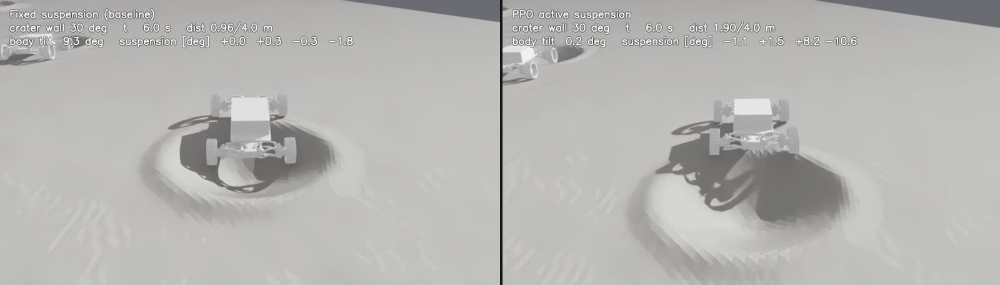
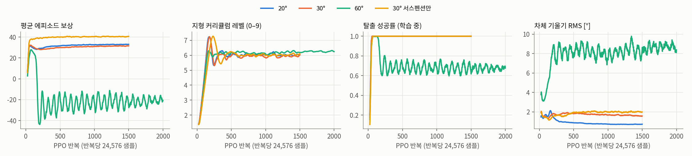
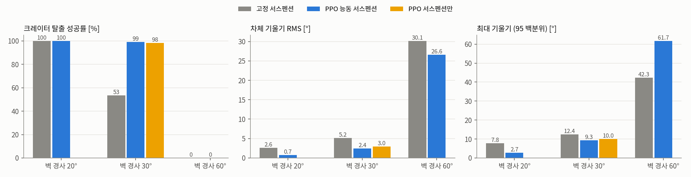
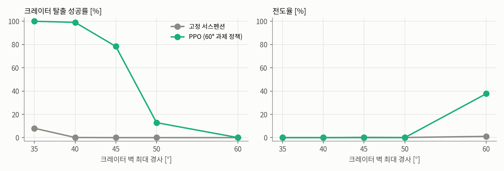
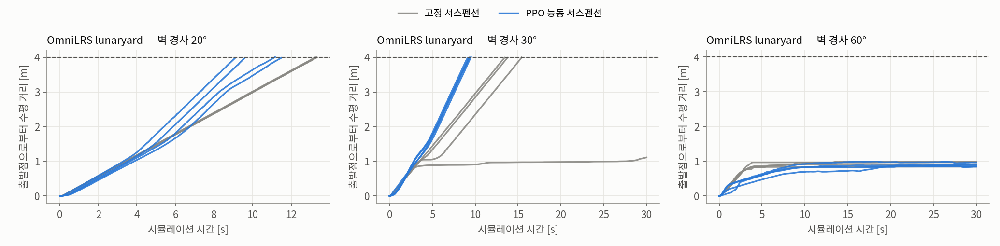

# 달 크레이터 탈출을 위한 PPO 기반 능동 서스펜션 제어

**1024 병렬 환경 강화학습과 OmniLRS lunaryard 검증**

:material-circle:{ style="color:#2e9e44" } **연구 보고** · 현대자동차 L-Project · 기준일 **2026-10-28**

!!! abstract "요약"
    L-Project 달 탐사 로버는 4륜 독립 조향과 4축 능동 서스펜션을 갖춘 12축 차량입니다. 그러나 현재
    주행 제어는 서스펜션 지령을 0으로 고정하며, 2026-08-25 시뮬레이션에서는 크레이터 안에서
    같은 휠 속도 지령만으로 탈출하지 못한 사례(slip ratio 약 100 %)가 기록되었습니다.

    본 연구는 서스펜션 4축과 휠 속도 보정 4축을 출력하는 정책을 **PPO**로 학습해, 크레이터 탈출과
    안정 주행을 함께 달성하는 것을 목표로 합니다. 학습 지형은 **OmniLRS lunaryard의 크레이터
    spline 프로파일 29종**을 그대로 사용하고, 벽 최대 경사를 **20°·30°·60°**로 맞춘 세 과제를
    **1024개 병렬 환경**(Isaac Lab, RTX 5080, 약 22,300 step/s)에서 각각 학습했습니다.

    목표 경사 고정 평가(과제당 크레이터 832 에피소드)에서 고정 서스펜션 대비 결과는 다음과 같습니다.

    | 벽 경사 | 탈출률 (고정 → PPO) | 전도율 (고정 → PPO) | 차체 기울기 RMS (고정 → PPO) |
    |---|---|---|---|
    | 20° | 100.0 % → **100.0 %** | 0.0 % → 0.0 % | 2.6° → **0.7°** |
    | 30° | 53.5 % → **99.2 %** | 0.0 % → 0.0 % | 5.2° → **2.4°** |
    | 60° | 0.0 % → **0.0 %** | 1.1 % → 37.7 % | 30.1° → **26.6°** |

    벽 경사를 35~50°로 나눈 평가에서 60° 과제 정책은 고정 서스펜션이 0~8 %에 그친 구간을 각각 **100 % · 99 % · 78 % · 13 %**로
    탈출해, 탈출률 50 %가 되는 경사를 약 31°에서 약 47°로 넓혔습니다. 반면 **60°에서는 두 조건 모두 탈출하지 못했고, PPO는 전도율이 37.7 %로
    고정 서스펜션(1.1 %)보다 높았습니다.** 학습 환경 밖인 OmniLRS lunaryard 플랜트에서는 30° 크레이터에서 고정 서스펜션 3/4, PPO 4/4가
    탈출했고, 20°에서는 둘 다 4/4가 탈출하되 PPO가 기울기 RMS를 절반 수준으로 낮췄습니다.

    **모든 결과는 강체 지형 시뮬레이션 결과이며 실물 로버·월면토 검증이 아닙니다.** 한계는 8절에 정리했습니다.

!!! note "진행 중 — 달 경사로 20° · 30° · 60° 등판 (2026-10-28)"
    과제를 크레이터 탈출에서 **직선 경사로 등판**으로 넓히고 있습니다. 평지 접근 → 경사로(수평 4 m) → 상단 평지 지형에서
    경사로 발 1 m 앞에서 출발해, 로버 전체가 상단에 올라서면 성공입니다. 보상은 본문의 v3(과속 벌점 + IMU)을 그대로 씁니다.
    아래는 **학습이 끝난 20° 정책의 중간 결과 영상**입니다(옆에서 본 경사 단면, 왼쪽 고정 서스펜션 · 오른쪽 PPO).
    이 에피소드에서 고정 서스펜션은 정상 꺾임(5 m 지점) 직전에서 멈춰 40 s 안에 오르지 못했고, PPO는 23.8 s에 상단에 올랐습니다.
    영상 한 편은 한 에피소드입니다.

    <video controls preload="metadata" muted playsinline width="100%" src="../../assets/l-project-rl/ramp_s20_compare.mp4"></video>

    **30° 중간 결과.** 30° 정책을 경사 30°로 고정한 지형에서 빠르게 확인했습니다(256 env, 경사로 208 에피소드).

    | 30° 경사로 | 고정 서스펜션 | PPO (30° 정책) |
    |---|---|---|
    | 등판 성공률 | 0 % | **100 %** |
    | 전도율 | 0 % | 0 % |
    | 오른 높이 평균 (경사로 높이 2.31 m) | 1.91 m | 2.12 m |
    | 등판 시간 중앙값 | — | 20.1 s |

    고정 서스펜션은 경사로가 상단과 만나는 꺾임에서 앞바퀴만 상단에 걸치고 차체가 걸려 멈춥니다. 아래 영상(22 s 시점)에서
    고정 서스펜션은 꺾임에 걸려 차체가 24° 기울어 있고, PPO는 서스펜션 관절을 5~11° 움직여(FL +10.9° · FR −10.1° · RL +5.1° · RR −7.3°, 좌우 관절 부호 규약 그대로)
    꺾임을 넘으며 차체 기울기를 1°로 유지합니다. 이 에피소드에서 PPO는 24.4 s에 상단에 올랐습니다.
    같은 정책을 40°에 두면 0 %입니다(학습 범위 10~30° 밖). 40° 이상은 학습 중인 60° 과제 정책으로 평가합니다.

    <video controls preload="metadata" muted playsinline width="100%" src="../../assets/l-project-rl/ramp_s30_compare.mp4"></video>

    정식 평가(경사당 약 820 에피소드), 60° 결과, OmniLRS 등가 경사 검증은 학습이 끝나는 대로 이 페이지에 반영합니다.

[:octicons-arrow-right-24: 프로젝트 상세](l-project-hils.md) ·
[:octicons-arrow-right-24: 로버 USD 설명](l-project-usd-asset.md) ·
[:octicons-arrow-right-24: 지형 변형 엔진 분석](l-project-deformation.md) ·
[:octicons-arrow-right-24: 차년도 과제 제안](l-project-terramechanics.md)

---

## 1. 서론

### 1.1 배경 — 고정 서스펜션과 크레이터 고착

로버의 서스펜션은 축당 상·하부 암으로 구성된 4절 평행 링크이며, 상부 암 조인트
(`body_to_upper_arm_sus_*`)가 위치 지령을 받는 액추에이터입니다. 12축 계약상 서스펜션은
±0.35 rad(±20.05°) 범위의 위치 제어 축이지만, 현행 주행 제어(텔레옵·Nav2 경로)는 이 축에
**항상 0을 지령**합니다. 본 문서에서 「고정 서스펜션」은 이 상태를 의미합니다.

2026-08-25 Isaac Sim 시험에서 로버가 크레이터에 진입한 뒤 네 휠을 +2.0 rad/s로 구동해도 이동 속도가
0.01 cm/s에 그쳤습니다(차체 pitch −11.2°, 서스펜션 토크 RL −41.3 N·m, 나머지 약 −13 N·m).
하중이 한 휠에 편중된 상태에서 같은 휠 속도 지령만으로는 탈출하지 못한 사례입니다.

### 1.2 목표와 기여

1. **크레이터 탈출** — 크레이터 바닥에서 출발해 벽을 넘어 4 m 밖으로 나갑니다.
2. **안정 주행** — 탈출 과정과 평지 주행에서 차체 기울기·각속도·휠 하중 편차를 줄입니다.

본 연구의 기여는 다음과 같습니다.

- OmniLRS 크레이터 생성기를 **경사 지정형 Isaac Lab 지형**으로 이식해 1024개 환경을 병렬화했습니다(4.1절).
- 실기에 있는 신호(IMU·조인트 상태·서스펜션 토크)만 쓰는 정책과, 지상 진실을 쓰는 critic의
  **비대칭 actor-critic** 구조와 보상 설계를 제시합니다(4.3~4.5절).
- 경사 20°·30°·60° 세 과제의 학습 결과와 **서스펜션 단독 ablation**, 그리고 학습 환경 밖인
  **OmniLRS lunaryard 실제 플랜트**에서의 검증 결과를 보고합니다(5~6절).

---

## 2. 대상 시스템

| 항목 | 값 | 출처 |
|---|---|---|
| 축 구성 | 구동 4(속도) · 조향 4(위치) · 서스펜션 4(위치), 순서 FL·FR·RL·RR | 12축 계약 `axes.py` |
| 윤거 / 축거 / 휠 반경 | 1.2867 / 1.4910 / 0.2133 m | `final_rover_HH` asset 실측 |
| 총질량 / 차체 | 450 / 302 kg | NASA VIPER 공개 제원 참조 **추정** |
| 서스펜션 한계 | ±0.35 rad (암 길이 0.247 m) | asset 조인트 한계 |
| 서스펜션 drive | kp 2865 N·m/rad · kd 1146 N·m·s/rad · 최대 1000 N·m | asset (PhysX 환산값) |
| 휠 속도 한계 | 10 rad/s | 12축 계약 |
| 중력 | 1.62 m/s² | 달 |
| 휠–지면 마찰 | 정지 0.90 / 동 0.70 | HILS 월면토 마찰 설정 |

정책은 HILS와 같은 asset(`Rover_hyundai_omnilrs.usd`)과 같은 조인트 drive 값을 사용합니다.
4절 링크의 종동 조인트 drive도 asset 값을 유지했습니다. 이 drive가 서스펜션을 잠그는지 확인하기 위해
0.28 rad 지령을 asset drive와 자유 힌지 두 조건으로 비교했으며, 두 조건 모두 0.25~0.30 rad에 도달해
**서스펜션 운동을 구속하지 않음**을 확인했습니다(2026-10-28).

---

## 3. 문제 정의

| 구분 | 정의 |
|---|---|
| 초기 상태 | 크레이터 중심 바닥(±1 m 최고 지점 + 0.15 m)에서 정지, **방위각 무작위** |
| 주행 지령 | 지면 속도 v_cmd ~ U(0.2, 0.4) m/s, 조향 0(직진) |
| 성공 | 출발점에서 수평 거리 **4.0 m 이상**(크레이터 림 반경 최대 1.74 m, 후륜이 림을 넘는 거리) |
| 실패 | 차체 기울기 **50° 초과**(전도) 또는 지형 이탈 |
| 시간 제한 | 30 s (시뮬레이션 시간) |

크레이터 중심에서 직진하면 진행 방향이 곧 반경 방향이므로 조향을 0으로 고정했습니다. 조향을 함께
학습하는 경우는 8절의 범위 밖 항목입니다.

---

## 4. 학습 환경 설계

### 4.1 OmniLRS 크레이터 지형의 경사 지정형 재현

OmniLRS lunaryard는 크레이터를 **반경 방향 spline 프로파일**(29종) × 반경으로 생성하고,
0.85~1.0의 타원 비, 0.95~1.0의 각도별 반경 변형, 무작위 회전을 더합니다. 본 환경은 이 생성 절차를
그대로 따르되 깊이 정의만 바꿨습니다.

- **OmniLRS**: 깊이 = 프로파일 × 반경 × `z_scale` — 벽 경사가 프로파일에 따라 15~35°로 흩어집니다.
- **본 환경**: 프로파일의 최대 기울기가 **목표 경사**와 같아지도록 깊이를 스케일합니다.
  같은 「30°」 과제 안에서도 29종 프로파일의 형상 차이는 유지됩니다.

| 항목 | 값 |
|---|---|
| 크레이터 반경 | 2.5 m (lunaryard 최대 등급, 2026-08-25 고착 사례와 같은 등급) |
| 림 반경 | 0.49~0.59 R (프로파일별) |
| 지형 격자 | 0.1 m, 타일 10 × 10 m, 10단계 × 16열 = 160 타일 |
| 기저 잡음 | OmniLRS 고주파 잡음 방식, ±1 cm |
| 타일 구성 | 크레이터 80 % · 평지 20 %(소형 크레이터 r 0.25~0.5 m, 2~8개 — 안정 주행 학습용) |
| 커리큘럼 | 20° 과제 5→20°, 30° 과제 10→30°, 60° 과제 20→60°(레벨 0→9) |

| 벽 경사 | 깊이(대표, R 2.5 m) |
|---|---|
| 20° | 0.30 (0.14~0.35) m |
| 30° | 0.47 (0.22~0.56) m |
| 60° | 1.40 (0.67~1.67) m |



### 4.2 시뮬레이션 설정

| 항목 | 값 |
|---|---|
| 시뮬레이터 | Isaac Sim 5.0 + Isaac Lab 0.54 (PhysX GPU) |
| 물리 / 정책 주기 | 200 Hz / **50 Hz** (HILS `/sim/axes_cmd` 주기와 같음) |
| 병렬 환경 | **1024** |
| 도메인 무작위화 | 휠 마찰 정지 0.75~1.0·동 0.55~0.80, 차체 질량 ×0.85~1.15 |

### 4.3 관측 — 비대칭 actor-critic

정책(actor)은 **실기 로버에 있는 신호만** 받습니다. 지상 진실이 필요한 값은 학습 중 가치 함수(critic)에만 줍니다.

| 관측 | 차원 | actor | critic | 실기 출처 |
|---|---|---|---|---|
| 중력 방향(차체 좌표) | 3 | ✓ | ✓ | IMU 자세 |
| 차체 각속도 | 3 | ✓ | ✓ | IMU |
| 서스펜션 각 / 각속도 | 4 + 4 | ✓ | ✓ | 엔코더 |
| 휠 각속도 | 4 | ✓ | ✓ | 엔코더 |
| 서스펜션 토크 | 4 | ✓ | ✓ | 드라이버 전류 |
| 속도 지령 / 직전 행동 | 1 + 8 | ✓ | ✓ | 제어기 내부 |
| 차체 선속도 | 3 | | ✓ | (지상 진실) |
| 휠 수직 하중 | 4 | | ✓ | (지상 진실) |
| 출발점 거리 · 진행 속도 · 차체 접촉 · 지형 레벨 | 4 | | ✓ | (지상 진실) |
| **합계** | | **31** | **42** | |

### 4.4 행동

| 행동 | 차원 | 변환 |
|---|---|---|
| 서스펜션 각 지령 | 4 | 0.35·a [rad], 변화율 1 rad/s 제한 |
| 휠 속도 보정 | 4 | (v_cmd / r)·(1 + 0.75·a), 0~10 rad/s |
| 조향 | — | 0 고정 |

a ∈ [−1, 1]. 서스펜션 변화율 1 rad/s는 액추에이터 사양이 없어 둔 **가정값**입니다.
**ablation(서스펜션 단독)**은 휠 보정 계수를 0으로 두어 휠이 항상 공칭 속도로 돕니다.

### 4.5 보상 설계

보상은 「탈출」 항과 「안정」 항, 그리고 정규화 항으로 구성되며, 매 스텝 값에 제어 주기(0.02 s)를 곱해
합산합니다(일회성 항 제외).

| 구분 | 항 | 식 | 가중치 | 설계 의도 |
|---|---|---|---|---|
| 탈출 | 진행 | clip(v_fwd, −0.5, v_cmd) / v_cmd | +2.0 | 출발 방위 방향 수평 속도. v_cmd 초과분은 보상하지 않아 과속을 막습니다 |
| 탈출 | 성공 | 4 m 도달 시 1회 | +20 | 탈출 자체를 목표로 고정합니다 |
| 안정 | 기울기 | 차체 기울기 각 θ [rad] (선형) | −3.0 | 차체를 수평으로 유지합니다. 5°에서 0.26/s로 진행 항과 같은 자릿수입니다 |
| 안정 | 각속도 | ω_x² + ω_y² | −0.5 | roll·pitch 흔들림을 억제합니다 |
| 안정 | 접지 상실 | 정적 하중 10 % 미만인 휠 비율 | −1.0 | 네 휠 접지를 유지합니다 |
| 안정 | 하중 편차 | 휠 하중의 변동계수(std/mean) | −0.5 | 고착 사례의 하중 편중을 직접 겨냥합니다 |
| 안정 | 슬립 | 평균 \|ω·r − v_x\| / v_cmd | −0.5 | 헛바퀴를 억제합니다 |
| 안정 | 차체 접지 | 차체–지면 접촉 시 1 | −2.0 | 하부 걸림을 피합니다 |
| 정규화 | 행동 변화 | Σ(Δa)² | −0.02 | 지령 떨림 억제 |
| 정규화 | 서스펜션 토크 | Σ τ² | −2×10⁻⁶ | 에너지 |
| 정규화 | 자세 | mean((q / 0.35)²) | −0.2 | 필요할 때만 중립에서 벗어나게 합니다 |
| 정규화 | 한계 근접 | Σ max(\|q\| − 0.32, 0) / 0.03 | −0.5 | 조인트 스톱 충돌 방지 |
| 종료 | 전도·이탈 | 1회 | −20 | 실패 회피 |

**설계 근거.** 진행 항만 두면 정책은 차체를 크게 기울이거나 휠을 헛돌려서라도 전진하려 합니다.
안정 항은 그 경로를 막는 제약으로 작동하며, 특히 하중 편차 항은 1.1절의 고착 원인 가설(하중 편중)을
보상에 직접 반영합니다. 기울기 항과 자세 항은 첫 학습의 실패를 고친 결과입니다(4.7절). 휠 하중과 출발점 거리는 실기에서 직접 측정할 수 없지만 보상 계산은 학습 중에만
필요하므로 문제가 되지 않습니다.

### 4.6 PPO 설정

| 항목 | 값 |
|---|---|
| 구현 | rsl_rl 3.0.1 `OnPolicyRunner` |
| 네트워크 | actor·critic 각각 MLP 256-128-64, ELU, 관측 정규화 |
| 수집 | 1024 환경 × 24 step = **24,576 샘플/반복** |
| 갱신 | 5 epoch × 4 미니배치, clip 0.2, 적응 학습률 5×10⁻⁴(목표 KL 0.01) |
| 할인 / GAE | γ 0.99, λ 0.95 |
| 탐색 | 초기 표준편차 0.6, 엔트로피 0.004 |
| 반복 수 | 20°·30°: 1500, 60°: 2000 (서스펜션 단독 30°: 1500) |
| 학습 시간 | 20° 25분(1500회) · 30° 27분(1500회) · 60° 45분(2000회) · 30° 서스펜션 단독 27분(1500회) |

### 4.7 첫 학습의 실패 — 기울기 항이 작동하지 않았다

첫 학습(2026-10-28 오전)에서는 기울기 항을 중력 벡터의 차체 수평 성분 제곱(g_x² + g_y², 가중치 2)으로 두었습니다.
20° 과제 정책은 탈출 성공률 100 %, 탈출 시간 중앙값 9.5 s로 고정 서스펜션(13.3 s)보다 빨랐지만,
**차체 기울기 RMS는 2.6° → 5.8°로 오히려 커졌고 평지에서도 0.3° → 4.7°였습니다**(크레이터 832·평지 192 에피소드).

진단 결과 정책은 평지에서도 서스펜션을 약 ±0.2 rad 비대칭으로 둔 채 자세를 계속 바꾸고 있었습니다.
원인은 항의 크기였습니다. g_x² + g_y² = sin²θ 이므로 5°에서 0.0076에 불과하고, 에피소드 합 기준 기울기 항은
−0.006으로 하중 편차 항(−0.11)·서스펜션 토크 항(−0.029)보다 한 자릿수 작았습니다. 정책에게 수평 유지는
사실상 목표가 아니었고, 하중 편차를 줄이려 차체를 기울이는 쪽이 이득이었습니다.

기울기 항을 **기울기 각에 선형**(가중치 3/rad)으로 바꾸고, 서스펜션 각의 제곱 평균에 작은 자세 항(0.2)을 더해
다시 학습했습니다. 같은 500회 시점의 학습 중 기울기 RMS가 5.1°에서 0.86°로 줄었습니다. 이하 결과는 모두 수정한 보상의 결과입니다.
첫 학습의 평가 결과는 저장소 `results/v1_reward`에 보존했습니다.

---

## 5. 학습 결과



네 과제 모두 1024 환경으로 학습했으며 처리량 중앙값은 약 2.0만~2.4만 step/s였습니다.
20°·30° 과제와 서스펜션 단독 과제는 약 100회 반복 안에 학습 중 탈출 성공률 1.0에 도달했고, 커리큘럼 레벨이 최고 단계에 닿은 뒤
평균 약 6에서 머뭅니다. 이는 최고 레벨을 넘긴 환경을 Isaac Lab 커리큘럼이 무작위 레벨로 되돌리기 때문이며, 정체가 아니라 포화입니다.
학습 중 기울기 RMS는 20° 0.74°, 30° 1.47°, 서스펜션 단독 1.83°로 수렴했습니다.

**60° 과제는 수렴하지 못했습니다.** 학습 중 성공률은 0.6~0.75 사이에서 진동했고, 정책 행동 잡음의 표준편차가 학습 종료 시점
2.56이었습니다(다른 과제 0.06~0.33). 행동을 [−1, 1]로 자르기 때문에 이 정도 잡음에서는 탐색 행동 대부분이 포화되며,
학습 중 통계는 커리큘럼으로 섞인 20~60° 지형의 평균이라 60° 자체의 성능을 나타내지 않습니다. 60° 성능은 6.1절의 고정 경사 평가를 따릅니다.

---

## 6. 평가

### 6.1 Isaac Lab 평가 — 목표 경사 고정

평가는 학습과 같은 지형 생성기를 쓰되 모든 크레이터의 벽 경사를 **목표값으로 고정**하고, 무작위화를 끄고
(마찰 0.90/0.70, 공칭 질량), 1024개 환경에서 환경당 한 에피소드를 수행했습니다(크레이터 832 ·
평지 192). 학습과 다른 seed를 사용했습니다.



| 벽 경사 | 제어 | 탈출률 | 전도율 | 탈출 시간 중앙값 | 평균 이동 거리 | 기울기 RMS | 최대 기울기 p95 | 저접지 비율 |
|---|---|---|---|---|---|---|---|---|
| 20° | 고정 서스펜션 | 100.0 % | 0.0 % | 13.3 s | 4.00 m | 2.6° | 7.8° | 0.132 |
| 20° | **PPO** | 100.0 % | 0.0 % | 9.6 s | 4.01 m | 0.7° | 2.7° | 0.144 |
| 30° | 고정 서스펜션 | 53.5 % | 0.0 % | 15.9 s | 2.69 m | 5.2° | 12.4° | 0.437 |
| 30° | **PPO** | 99.2 % | 0.0 % | 9.3 s | 3.98 m | 2.4° | 9.3° | 0.189 |
| 30° | PPO 서스펜션 단독 | 98.3 % | 0.1 % | 13.4 s | 3.96 m | 3.0° | 10.0° | 0.083 |
| 60° | 고정 서스펜션 | 0.0 % | 1.1 % | — | 0.90 m | 30.1° | 42.3° | 0.569 |
| 60° | **PPO** | 0.0 % | 37.7 % | — | 0.77 m | 26.6° | 61.7° | 0.384 |

평지 타일(소형 크레이터 지대, 4 m 주행) 결과입니다.

| 과제 | 제어 | 완주율 | 기울기 RMS | 최대 기울기 p95 | 저접지 비율 |
|---|---|---|---|---|---|
| 20° | 고정 서스펜션 | 100.0 % | 0.3° | 0.7° | 0.101 |
| 20° | PPO | 100.0 % | 1.0° | 3.0° | 0.165 |
| 30° | 고정 서스펜션 | 100.0 % | 0.3° | 0.7° | 0.105 |
| 30° | PPO | 100.0 % | 1.0° | 2.7° | 0.162 |
| 60° | 고정 서스펜션 | 100.0 % | 0.3° | 0.7° | 0.115 |
| 60° | PPO | 100.0 % | 1.0° | 3.0° | 0.331 |

저접지 비율 = 정적 하중의 10 % 미만을 받는 휠의 시간 평균 비율(0 = 네 휠 항상 접지).

**20°·30°.** PPO는 탈출률을 유지하거나 높이면서(30°: 53.5 % → 99.2 %) 기울기 RMS를 크게 낮췄습니다(20°: 2.6° → 0.7°,
30°: 5.2° → 2.4°). 탈출 시간 중앙값도 13.3 s → 9.6 s(20°), 15.9 s → 9.3 s(30°)로 줄었습니다. 휠 보정으로 휠 속도를 공칭보다 높여 쓰기 때문입니다.

**속도 지령을 지키지 않습니다.** 평지에서 PPO는 4 m를 9.1~9.4 s에 주행해 평균 약 0.43 m/s였습니다. 지령 속도 범위(0.2~0.4 m/s)의 상한보다도 빠르며,
고정 서스펜션의 평균 약 0.30 m/s(지령 평균과 일치)와 대비됩니다. 진행 보상은 지령 초과분을 보상하지 않지만, 성공 보상이 할인율(γ 0.99, 0.02 s당)로
깎이므로 일찍 도착할수록 이득입니다. 정책은 이 차이를 학습했습니다. 탈출 시간 단축의 일부는 이 과속이며, 운용 속도 지령을 따르게 하려면
지령 초과 속도에 벌점을 두거나 성공 보상을 시간과 무관하게 바꿔야 합니다.

**서스펜션 단독(30°).** 휠을 공칭 속도로 고정하고 서스펜션만 학습해도 탈출률은 98.3 %였습니다. 탈출 개선의 대부분은 서스펜션에서 오며,
휠 보정은 주로 탈출 시간(13.4 s → 9.3 s)에 기여합니다. 서스펜션 단독 정책은 저접지 비율이 0.083으로 세 조건 중 가장 낮았습니다.

**평지.** PPO의 평지 기울기 RMS는 약 1.0°로 고정 서스펜션(0.3°)보다 약간 큽니다. 저접지 비율도 0.10 → 0.16~0.33으로 늘었습니다.
크레이터용 자세 변화가 평지에서도 일부 남는 것이며, 평지 안정성만 놓고 보면 고정 서스펜션이 낫습니다(7절).

#### 경사 한계 — 60° 과제 정책의 경사별 평가

60° 과제 정책과 고정 서스펜션을 벽 경사 35~60°에서 같은 조건으로 평가했습니다(경사당 크레이터 832 에피소드).

| 벽 경사 | 고정: 탈출률 | 고정: 전도율 | 고정: 기울기 RMS | PPO(60° 정책): 탈출률 | PPO: 전도율 | PPO: 기울기 RMS |
|---|---|---|---|---|---|---|
| 35° | 8.1 % | 0.0 % | 8.5° | 100.0 % | 0.0 % | 4.9° |
| 40° | 0.1 % | 0.0 % | 11.9° | 99.0 % | 0.0 % | 5.9° |
| 45° | 0.0 % | 0.2 % | 15.7° | 78.4 % | 0.0 % | 8.6° |
| 50° | 0.0 % | 0.1 % | 19.8° | 12.9 % | 0.0 % | 16.0° |
| 60° | 0.0 % | 1.1 % | 30.1° | 0.0 % | 37.7 % | 26.6° |



60° 과제 정책은 35~45°에서 고정 서스펜션을 크게 앞섭니다. 고정 서스펜션은 35°부터 사실상 탈출하지 못하지만(8.1 %),
PPO는 40°까지 99 %, 45°에서 78 %를 탈출했고 이 구간의 전도율은 0 %였습니다. 50°에서 13 %로 떨어지고,
**60°에서는 탈출하지 못한 채 전도율만 37.7 %로 올랐습니다.** 60° 벽에서 정책은 차체를 크게 기울이며 오르려다 뒤집히는 반면,
고정 서스펜션은 벽 아래에서 미끄러진 채 머무릅니다. 강체 마찰 정지 0.90(마찰각 약 42°)에서 정면으로 오를 수 있는 경사에는 물리적 상한이 있으며,
PPO가 그 근처(45~50°)까지 탈출 한계를 끌어올린 것으로 해석합니다. 크레이터 벽의 최대 경사는 한 구간의 값이므로 평균 경사는 이보다 낮습니다. 60° 크레이터를 정면으로 오르는 것은 이 행동 공간(조향 0)으로는 성립하지 않습니다.

### 6.2 결과 영상

같은 크레이터·같은 출발 방위에서 고정 서스펜션(왼쪽)과 PPO 정책(오른쪽)을 비교한 영상입니다.
화면 위 숫자는 시뮬레이션 시간, 출발점 거리, 차체 기울기, 서스펜션 각입니다.

**벽 경사 20°**

<video controls preload="metadata" muted playsinline width="100%" src="../../assets/l-project-rl/s20_compare.mp4"></video>

**벽 경사 30°**

<video controls preload="metadata" muted playsinline width="100%" src="../../assets/l-project-rl/s30_compare.mp4"></video>

**벽 경사 60°**

<video controls preload="metadata" muted playsinline width="100%" src="../../assets/l-project-rl/s60_compare.mp4"></video>

### 6.3 OmniLRS lunaryard 검증 — 학습 환경 밖 플랜트

학습된 정책을 numpy로 내보내 ROS 2 노드로 구동하고, HILS가 쓰는 **OmniLRS lunaryard 플랜트**
(Isaac Sim 5.0 컨테이너, 브리지 `sim_isaac_bridge` 경유)에 `/sim/axes_cmd`로 지령했습니다.
학습 환경과 다른 점은 다음과 같습니다.

| 항목 | Isaac Lab 학습 | OmniLRS lunaryard |
|---|---|---|
| 물리 / 정책 주기 | 200 Hz / 50 Hz | **30 Hz / 30 Hz** (`/sim/joint_states` 한 건마다 한 스텝, 서스펜션 변화율 제한은 시뮬레이션 시간 간격 기준) |
| 지형 | 경사 지정형 재현, 격자 0.1 m | lunaryard 생성 결과 그대로(`z_scale`로 경사 조정), 격자 0.05 m |
| 지형 모델 | 강체 | 강체 + 지형 변형 엔진 설정 활성(본 시험에서 변형량은 측정하지 않음), terramechanics solver **비활성** |
| 관측 경로 | 시뮬레이터 내부 값 | ROS 2 토픽(`/sim/joint_states`, `/rover/imu_pub`), DDS 경유 |

야드 중앙 부근 크레이터(중심 x 45.79 · y 38.44 m, R 2.43 m)를 대상으로 OmniLRS 설정
`crater_generator.z_scale`을 조정해 벽 최대 경사를 맞췄습니다. 지형은 OmniLRS 생성기로 오프라인 재생성해
확인했으며, 로버를 25개 지점에 떨어뜨려 잰 차체 높이와 재생성 DEM의 상관이 **0.984**(잔차 1.8 cm)였습니다.

| 벽 경사 (z_scale) | 제어 | 탈출 | 방위별 결과 (0° · 90° · 180° · 270°) | 기울기 RMS 평균 | 최대 기울기 |
|---|---|---|---|---|---|
| 20° (0.45) | 고정 서스펜션 | 4/4 | 탈출 13.3 s · 탈출 13.3 s · 탈출 13.4 s · 탈출 13.4 s | 3.8° | 7.8° |
| 20° (0.45) | **PPO** | 4/4 | 탈출 9.6 s · 탈출 9.1 s · 탈출 11.2 s · 탈출 11.5 s | 1.9° | 3.6° |
| 30° (0.78) | 고정 서스펜션 | 3/4 | 탈출 15.5 s · 탈출 13.5 s · 시간 초과 (1.11 m) · 탈출 13.8 s | 6.4° | 11.6° |
| 30° (0.78) | **PPO** | 4/4 | 탈출 9.5 s · 탈출 9.4 s · 탈출 9.3 s · 탈출 9.2 s | 3.3° | 8.2° |
| 60° (2.25) | 고정 서스펜션 | 0/4 | 시간 초과 (0.92 m) · 시간 초과 (0.97 m) · 시간 초과 (0.99 m) · 시간 초과 (0.85 m) | 29.3° | 40.5° |
| 60° (2.25) | **PPO** | 0/4 | 시간 초과 (0.85 m) · 시간 초과 (0.97 m) · 시간 초과 (0.89 m) · 시간 초과 (0.85 m) | 26.8° | 39.4° |



**20°.** 두 조건 모두 네 방위에서 탈출했습니다. 고정 서스펜션의 탈출 시간 13.3~13.4 s는 Isaac Lab 평가의 중앙값 13.3 s와 같았고,
PPO는 9.1~11.5 s로 빨랐으며 기울기 RMS를 3.0~4.2°에서 1.4~2.2°로 낮췄습니다.

**30°.** 고정 서스펜션은 180° 방위에서 벽 1.1 m 지점에 고착되어 30 s 동안 빠져나오지 못했습니다(나머지 세 방위는 13.5~15.5 s).
PPO는 네 방위 모두 9.2~9.5 s에 탈출했습니다. Isaac Lab 평가에서 고정 서스펜션이 30°에서 절반가량 고착된 것과 같은 현상이 학습 환경 밖에서도 나타났고,
정책은 그 사례를 풀었습니다.

**60°.** 두 조건 모두 네 방위에서 0.85~0.99 m 지점에 머물렀습니다. Isaac Lab 평가와 달리 PPO도 전도하지 않았으며,
기울기 RMS는 네 방위 중 세 방위에서 고정 서스펜션보다 낮았습니다(23.5~31.1° 대 26.2~30.9°).

정책은 학습보다 낮은 30 Hz로 실행됐고 관측이 ROS 2 토픽을 거쳤지만 20°·30°에서 학습 환경과 같은 경향을 보였습니다.
시험 중 `/sim/axes_cmd`를 다른 노드가 발행한 건수는 모든 시험에서 0이었습니다(보드 `rover_mcu`와 `rover_control`이 발행자로 등록돼 있었으나 지령을 내지 않음).
시험 수가 크레이터 하나·방위 넷이라 통계적 일반화는 주장하지 않습니다.

---

## 7. 논의

**탈출과 안정은 같은 수단으로 얻어졌습니다.** 30° 영상의 6 s 시점에서 정책은 뒤쪽 서스펜션을 크게 움직여(RL +8.2°, RR −10.6° — 좌우 조인트 부호 규약이 서로 반대)
차체 기울기를 0.2°로 유지했고, 같은 시점의 고정 서스펜션은 9.3°였습니다. 서스펜션 단독 ablation이 98.3 %를 탈출한 것은 탈출 개선의 주된 수단이
서스펜션 자세임을 보여 줍니다. 다만 자세 변화가 휠 하중을 어떻게 재분배해 견인을 늘리는지는 휠별 하중으로 측정하지 않았으므로, 1.1절의 고착 가설(하중 편중)을
확인했다고 말할 수는 없습니다.

**보상 항의 크기는 이름보다 중요합니다.** 첫 학습은 「기울기 벌점」을 두었지만 그 항이 다른 항보다 한 자릿수 작아, 정책은 기울기를 오히려 키웠습니다(4.7절).
보상을 설계할 때는 항마다 에피소드 합의 크기를 먼저 비교해야 합니다.

**정책은 속도 지령을 따르지 않습니다.** 평지 평균 속도가 지령 상한을 넘었습니다(6.1절). 할인된 성공 보상이 빠른 도착을 보상한 결과이며, 다음 학습에서 고칠 첫 항목입니다.

**평지와 급경사에서는 고정 서스펜션이 더 안전한 경우가 있습니다.** 평지에서 PPO의 기울기와 저접지 비율은 고정 서스펜션보다 약간 나빴고,
60°에서는 전도가 늘었습니다. 실운용에는 (1) 지형 경사로 정책 사용을 켜고 끄는 상위 판단, (2) 전도 위험에 대한 별도 안전 감시
(예: 기울기 한계 접근 시 서스펜션 중립 복귀)가 필요합니다. 60° 과제의 수렴 실패(행동 잡음 발산)는 엔트로피 계수·전도 벌점·커리큘럼 상한을
조정해 다시 다뤄야 할 과제입니다.

**다음 단계.** 조향을 행동에 포함한 비스듬한 등판, 변형 지형(terramechanics) 위 학습, 실제 액추에이터 속도·토크 사양 반영, HILS 보드 경로에서의
실행 지연 검증 순으로 진행할 계획입니다.

---

## 8. 확인되지 않은 것과 한계

- **실물 검증이 없습니다.** 모든 결과는 강체 지형 시뮬레이션입니다. 월면토의 침하·전단에 따른 견인 한계는
  모델에 없습니다(차년도 과제 제안의 범위). 강체 마찰 0.9에서의 등판 한계를 실제 월면토 등판 한계로 읽으면 안 됩니다.
- **제원이 추정치입니다.** 질량 450 kg은 VIPER 참조 추정이며, 서스펜션 액추에이터의 속도·토크 한계(1 rad/s,
  1000 N·m)도 사양이 아니라 asset 값과 가정값입니다. 실제 액추에이터가 더 느리면 정책 성능이 달라집니다.
- **정책이 속도 지령을 넘깁니다.** 평지 평균 약 0.43 m/s로 지령 상한 0.4 m/s를 넘었습니다. 탈출 시간 비교는 이 과속을 포함한 값입니다.
- **조향을 학습하지 않았습니다.** 크레이터 중심 직진만 다루며, 비스듬히 오르는 경로(switchback)나 측면 진입은
  범위 밖입니다. 60° 과제의 결과는 이 제약 아래의 결과입니다.
- **크레이터 형상이 한 등급입니다.** 반경 2.5 m 크레이터 중심 출발만 학습했습니다. 더 큰 크레이터·벽면 중간 정지·
  암석 장애물은 평가하지 않았습니다.
- **휠 하중 신호의 차이.** 학습에서는 PhysX 접촉력으로 보상을 계산했고, HILS의 휠 하중 계측은 서스펜션 토크
  환산값(평균 0.562배, 산포 ±18 %)입니다. 정책은 하중을 직접 관측하지 않으므로 실행에는 영향이 없지만,
  두 환경의 하중 지표를 같은 값으로 비교할 수는 없습니다.
- **서스펜션 토크 관측의 차이.** 학습 환경의 토크는 implicit drive의 계산 토크이고, OmniLRS `joint_states`의
  effort는 PhysX 조인트 힘 보고값입니다. 두 값의 정의 차이를 정량 비교하지 않았습니다.
- **OmniLRS 검증은 한 크레이터·네 방위입니다.** 통계적 일반화를 주장할 표본 수가 아닙니다.
- **보드 경로를 거치지 않았습니다.** OmniLRS 검증에서 지령은 HILS 보드가 아니라 PC의 ROS 2 노드가 냈습니다.
  보드 펌웨어에 정책을 이식하는 일은 수행하지 않았습니다.

---

## 9. 재현 방법

저장소 `parclab-hsu/l-project-rl`(비공개).

```bash
# 학습 (1024 환경, 과제당 약 25~45분 / RTX 5080)
python scripts/train.py --headless --task LRover-ActiveSus-Slope30-v0 --num_envs 1024 --max_iterations 1500
# 평가 (목표 경사 고정, 고정 서스펜션 기준선은 --passive)
python scripts/evaluate.py --headless --task LRover-ActiveSus-Slope30-v0 --checkpoint <model.pt> --out eval.json
# 영상
python scripts/record_video.py --headless --enable_cameras --task LRover-ActiveSus-Slope30-v0 --checkpoint <model.pt> --out s30.mp4
# OmniLRS lunaryard 검증 (HILS 저장소의 컨테이너 기동 후)
HEADLESS=True tools/isaac/run_isaac_container.sh fastdds_profile.xml \
    environment.terrain_manager.moon_yard.crater_generator.z_scale=0.78
/usr/bin/python3 tools/omnilrs_trial.py --crater 45.79 38.44 --floor_z 0.190 \
    --policy results/policy_ppo_slope30.npz --out slope30_ppo.json
```

## 참고 문헌

1. J. Schulman et al., "Proximal Policy Optimization Algorithms," arXiv:1707.06347, 2017.
2. N. Rudin et al., "Learning to Walk in Minutes Using Massively Parallel Deep Reinforcement Learning," CoRL 2022.
3. M. Mittal et al., "Orbit: A Unified Simulation Framework for Interactive Robot Learning Environments," IEEE RA-L, 2023 (Isaac Lab).
4. A. Richard et al., "OmniLRS: A Photorealistic Simulator for Lunar Robotics," IEEE ICRA 2024.
5. NASA, VIPER Mobility System — surface operations mass 450 kg (제원 추정 근거).
