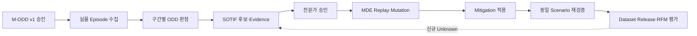
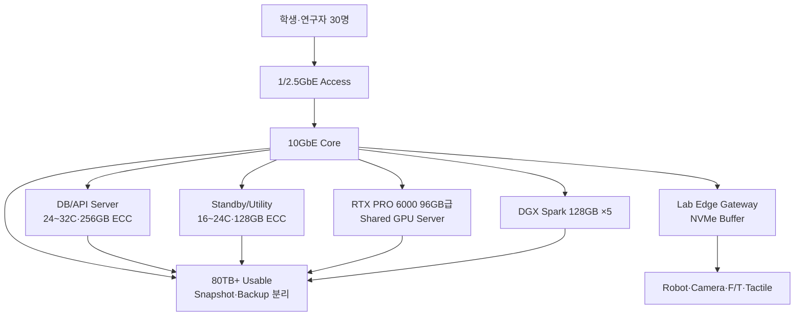
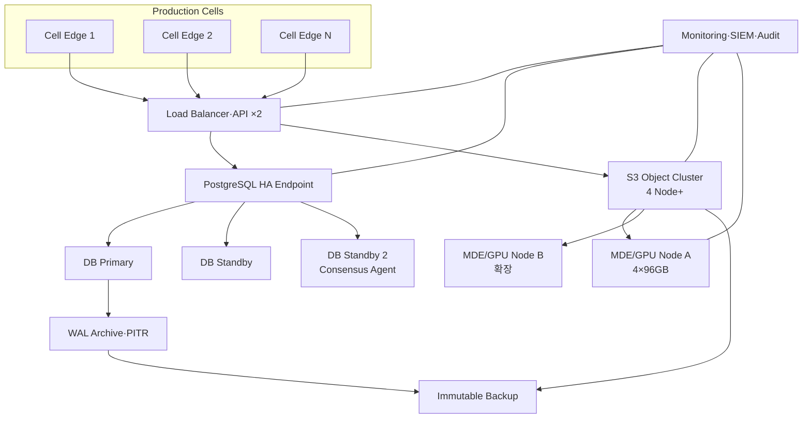
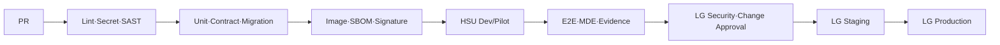
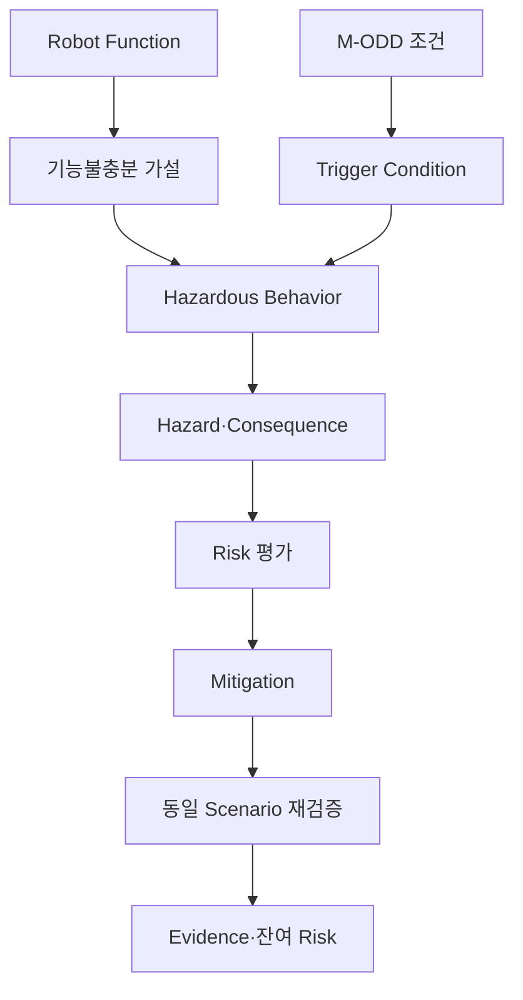
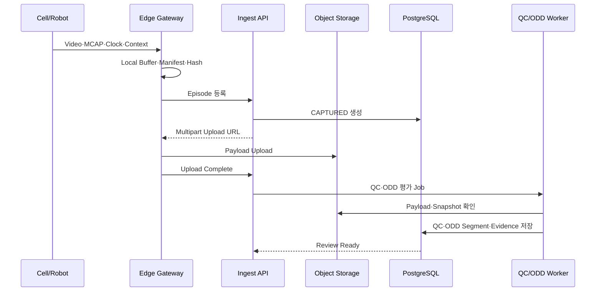

# SDP — 제조 ODD·SOTIF Episode 데이터 시스템 개발·구축계획서

!!! abstract "문서 목적"
    본 문서는 [ODD·SOTIF SRS](odd-sotif-srs.md)를 구현하기 위한 Software Development Plan입니다.
    LG전자 Production Site와 한성대학교 HSU-PAC Pilot Site의 Server·GPU·DB·Storage·Network 구축,
    M-ODD·SOTIF Schema 개발, Episode 수집, Portal, MDE 재현, Dataset 교환, 시험과 운영이관을
    43개월 연구개발 일정에 맞춰 정의합니다.

## 0. 문서 관리

| 항목 | 내용 |
|---|---|
| 문서 ID | HSU-RDF-ODD-SOTIF-SDP-001 |
| 버전 | v0.9 Draft Baseline |
| 기준일 | 2026-10-25 |
| 요구사항 기준 | HSU-RDF-ODD-SOTIF-SRS-001 |
| 적용 Site | LG전자 Production, 한성대 HSU-PAC Pilot |
| 개발 주기 | 2주 Sprint, 분기 Release, 연차 Gate |
| 작성 주체 | 한성대학교 PARC Lab |
| 상태 | 컨소시엄 검토용 기준안 |

### 0.1 개정 이력

| 버전 | 일자 | 변경 내용 | 상태 |
|---|---|---|---|
| 0.9 | 2026-10-25 | 2-Site 인프라·DB·ODD·SOTIF 개발계획 최초 작성 | 검토 요청 |
| 1.0 | TBC | Pilot·BOM·SLA·RACI·KPI 확정 | 기준선 예정 |

### 0.2 개발 원칙

1. **HSU-PAC에서 Pilot을 완성한 뒤 LG Production에 확장**한다.
2. **ODD·SOTIF Data Contract를 Server 구매보다 먼저 동결**한다.
3. LG 원본은 LG Site에 보관하고 Site 간에는 승인 Package만 이동한다.
4. Raw는 불변, ODD/SOTIF 판정은 Versioned, 자동판정은 인간 승인 전 후보로 둔다.
5. Production은 HA, Pilot은 단순성과 복구성을 우선하되 Schema·API는 동일하게 유지한다.
6. Hardware는 3년 최대치 일괄구매보다 실측·증설 Gate를 둔 단계구매를 원칙으로 한다.

---

## 1. 목표와 완료 기준

### 1.1 최종 목표

- 제조 M-ODD 정의·관측·Coverage를 Episode 시간축에 연결
- 기능불충분–Trigger–위험행동–Hazard–Mitigation Evidence를 DB에서 추적
- 실물·Teleoperation·MDE·RFM Evaluation Episode를 동일 Contract로 통합
- 한성대에서 Algorithm·MDE·검수 Workflow를 개발하고 LG Site에서 보안·규모·HA 실증
- LG↔한성대 간 데이터 소유권을 보존하는 Package 기반 협업체계 구축
- 6대 대표공정 Digital Twin과 심화 작업 1~2개에 대한 Closed Loop 검증

### 1.2 완료 정의



시스템 완료는 기능 시연만이 아니라 다음 조건을 모두 충족해야 합니다.

- SRS Must 요구사항과 End-to-End 인수시험 통과
- LG/HSU Site별 승인된 Hardware Inventory·Network Diagram·Backup Plan
- DB Schema, Migration, API, ODD Ontology, SOTIF Workflow Version 동결
- ODD Boundary를 포함한 실물 Episode와 MDE 재현·Mitigation Pair 확보
- Site 간 승인 Package 교환과 비인가 접근차단 시험 통과
- 운영 Runbook, 복원시험, 보안점검, 사용자교육, 기술이전 완료

---

## 2. Work Breakdown Structure

| WP | 명칭 | 주관 | 주요 산출물 |
|---|---|---|---|
| WP-01 | Governance·Requirement | 한성대+LG | SRS/SDP, Pilot Charter, Data/IP/Security Policy |
| WP-02 | M-ODD·SOTIF Data Model | 한성대 | Taxonomy, Ontology, Schema, Rule, Risk Matrix Adapter |
| WP-03 | HSU-PAC Pilot Infra | 한성대 | DB/API Server, Standby, NAS/S3, Edge, Monitoring |
| WP-04 | LG Production Infra | LG Infra+한성대 | HA DB, Object Cluster, GPU Node, Network, Backup |
| WP-05 | Episode Ingest·QC | 한성대+Robot 기관 | MCAP Connector, Manifest, Clock/QC, Timeline Index |
| WP-06 | Portal·Review | 한성대 | ODD Editor, Episode Viewer, SOTIF Review, Coverage |
| WP-07 | MDE·Scenario Generation | 한성대 | Replay, Mutation, Physics Ground Truth, Pairing |
| WP-08 | RFM·Dataset Interface | RFM기관+한성대 | LeRobot Export, Evaluation Feedback, Release |
| WP-09 | Site Exchange·Security | LG 보안+한성대 | Package Gateway, mTLS, IAM, Audit, SBOM |
| WP-10 | V&V·Operations | 공동 | E2E, 성능, HA/DR, Safety Evidence, Runbook, 교육 |

### 2.1 범위별 책임 경계

| 영역 | 한성대 | LG전자 | 모빌테크 | Robot/RFM 기관 |
|---|---|---|---|---|
| M-ODD Schema·Ontology | A/R | C | C | C |
| SOTIF Case·Review Workflow | A/R | C/A(현장승인) | I | C |
| HSU-PAC Pilot Infra | A/R | I | I | I |
| LG Production Infra | C | A/R | I | I |
| Geometry Twin·Asset | C | C | A/R | I |
| MDE·Physics Ground Truth | A/R | C | C | I |
| Cell Connector·Sensor | C | C | I | A/R |
| RFM Evaluation | C | C | I | A/R |
| 원본 소유·반출승인 | I | A/R | C | C |
| Dataset Release | R | A/C | C | C |

---

## 3. 단계·Gate·일정

### 3.1 착수 후 15개월 상세일정

| 기간 | 개발·구축 목표 | 산출물·Gate |
|---|---|---|
| M0~M1 | Pilot Charter·현황실사 | Use Case, 자산대장, Network·Data Survey, TBC Owner |
| M1~M2 | SRS/SDP·표준경계 동결 | M-ODD v0.1, SOTIF Workflow, Security/Data Policy |
| M2~M3 | Architecture·용량 Benchmark | ADR, ERD, Object Key, Sample Episode 20건 분석 |
| M3~M5 | HSU-PAC Pilot Infra 설치 | DB/API, Standby, 80TB급 Storage, Edge, 10GbE, Monitoring |
| M3~M6 | Core Platform MVP | 인증, Ingest, QC, Episode Viewer, Audit |
| M5~M7 | ODD Editor·구간판정 | ODD Version, Constraint, Snapshot, IN/BOUNDARY/OUT |
| M6~M8 | SOTIF Review·Coverage v1 | Case Chain, Evidence, Risk Adapter, Coverage Cell |
| M7~M10 | MDE Replay·Mutation | Scenario Package, Ground Truth, Mitigation Pair |
| M8~M10 | Dataset/RFM Interface | Release, LeRobot Export, Model Feedback |
| M9~M11 | LG Production 상세설계·조달 | 최종 BOM, Rack/Power/Cooling, Network, Security Review |
| M11~M13 | LG Infra 설치·Migration | HA DB, Object Cluster, GPU, Gateway, Monitoring |
| M13~M14 | Site 교환·통합시험 | Signature Package, mTLS, 권한·반출·부하·장애시험 |
| M14~M15 | Production Readiness | 운영교육, Runbook, DR, Pilot 인수·개선 Backlog |

### 3.2 43개월 연차 정렬

| 차년도 | 목표 | Release | Gate |
|---|---|---|---|
| 1차년도(9개월) | 심화 Task 선정, M-ODD·Schema v1, HSU Pilot, Portal MVP | v0.1~v0.6 | G0~G3 |
| 2차년도 | LG Production Infra, SOTIF/Coverage, MDE Replay, 4개 공정 누계 | v1.x | G4~G5 |
| 3차년도 | 6개 공정 누계, 다Robot/다Material, Unknown Mining, RFM Closed Loop | v2.x | G6 |
| 4차년도 | KPI·실증·Mitigation 검증, Version 동결, 기술이전·운영이관 | v3 LTS | G7~G8 |

### 3.3 Gate 정의

| Gate | 진입 조건 | 종료 조건 |
|---|---|---|
| G0 착수 | R&R 초안 | Pilot Charter·Owner·의사결정체계 승인 |
| G1 Requirement Baseline | Sample·현황실사 | SRS/SDP v1.0, 표준 적용경계, TBC 일정 승인 |
| G2 Data Contract | ODD/Case 초안 | JSON Schema·ERD·API·Ontology·Migration 승인 |
| G3 HSU MVP | Pilot Hardware 설치 | 실물 Episode 수집·Viewer·ODD 구간판정 통과 |
| G4 ODD/SOTIF Pilot | 검수자 교육 | Edge/SOTIF Case·Coverage·MDE Replay 인수 |
| G5 LG Readiness | BOM·전원·보안 승인 | HA/DR·부하·Site Exchange 시험 통과 |
| G6 Closed Loop | Production 수집 | Mitigation 전후·RFM Feedback·Unknown 환류 증적 |
| G7 LTS Freeze | KPI 달성 | Schema/API/Model/운영문서 동결 |
| G8 Transfer | LTS 승인 | 기술이전·교육·자산·Archive 인수 |

---

## 4. Pilot Use Case 선정계획

### 4.1 선정 기준

심화 Pilot Task는 다음 항목을 점수화해 1~2개를 선정합니다.

| 기준 | 질문 |
|---|---|
| 물리 복잡도 | 접촉·변형·미끄러짐·공차가 성패를 바꾸는가? |
| ODD 다양성 | 조명·재질·배치·사람·Network 등 경계조건이 충분한가? |
| 실측 가능성 | Camera·F/T·Tactile·Robot State를 동기 수집할 수 있는가? |
| 안전성 | 위험작업을 Simulation·Teleoperation으로 선행할 수 있는가? |
| 반복성 | 동일 조건과 변경조건을 반복시험할 수 있는가? |
| RFM 연계 | Observation–Action–Result와 Model Feedback을 받을 수 있는가? |
| 산업성 | LG 제조현장과 참여기관 공정에 재사용 가치가 있는가? |

### 4.2 Pilot Data Matrix

Pilot 시작 전 아래 Matrix를 승인합니다.

| 구분 | 최소 범위 |
|---|---|
| Robot | Robot/Controller/End-effector Version 1종 이상 |
| Task | 정상·실패·Fallback이 정의된 Task 1종 이상 |
| Object | 형상·공차·질량·물성 Profile 2개 이상 |
| Sensor | RGB 2대 이상, Robot State/Action, F/T 또는 Tactile 1종 이상 |
| ODD Boundary | 조명/가림, 물성, Pose, Network, 사람 중 3차원 이상 |
| SOTIF Case | 기능불충분·Trigger·위험행동 Chain 1종 이상 |
| Mitigation | Model/Rule/ODD 축소/운영제약 중 1종 이상 |
| Source | Real, Teleoperation, Simulation/MDE 모두 포함 |

---

## 5. Computing Infrastructure 구축계획

### 5.1 HSU-PAC Pilot Architecture



### 5.2 HSU 구매·재사용 순서

| 우선순위 | 항목 | 결정 |
|---:|---|---|
| 1 | 기존 GPU Server·DGX Spark·NAS·10GbE 자산실사 | 재사용 가능량 확정 |
| 2 | DB/API Server와 Standby | GPU와 DB I/O/장애 Domain 분리 |
| 3 | Object Storage/NAS 가용용량·Backup | Raw 불변·복원 확보 |
| 4 | Lab Edge Gateway와 Clock | 안정 수집·단절 Buffer |
| 5 | 25GbE Storage Uplink | 10GbE 부하시험 실패 시 증설 |
| 6 | GPU 추가 | Queue 대기·VRAM·처리량 KPI 초과 시 |

### 5.3 LG Production Architecture



### 5.4 LG 단계조달

| 단계 | 구매/구성 | 개시조건 |
|---|---|---|
| L0 설계 | Rack·Power·Cooling·Cable·IP·VLAN·BOM | G1 통과 |
| L1 Core | API×2, DB×3, Object×4, Backup, 25/100GbE | Volume/SLA 확정 |
| L2 Compute | 4GPU MDE Node×1 | Pilot MDE 처리량 Benchmark |
| L3 Expansion | Object Capacity·GPU Node×1 추가 | 70% Capacity/Queue Threshold 지속 |
| L4 DR | Secondary Site/Offline Copy | 데이터 중요도·RPO/RTO 승인 |

### 5.5 Hardware 인수시험

| 시험 | 방법 | 통과 기준 |
|---|---|---|
| Burn-in | CPU/GPU/Memory/Storage 48~72시간 부하 | ECC·Thermal·Power Error 0, Vendor 기준 통과 |
| Storage | Sequential/Random I/O, Small Object, Rebuild | 설계 Throughput·Latency, Rebuild 중 서비스 유지 |
| Network | East-West, Jumbo/MTU, Loss, Failover | 목표 Bandwidth·Packet Loss·Failover 통과 |
| GPU | Isaac Sim Scene, MDE Batch, RFM Inference | 목표 VRAM·처리량·안정성 |
| DB | OLTP·검색·Bulk Ingest·Failover | SRS p95·RPO·RTO |
| Clock | PTP/NTP Offset 측정 | Stream Profile별 허용오차 |
| UPS | 전원차단 Simulation | Graceful Shutdown 또는 목표 유지시간 |
| Backup | Bare Restore·PITR·Object Recovery | 무작위 Episode Hash 대조 성공 |

### 5.6 Rack·전력·냉각 계획

- GPU Server는 반드시 Server Edition GPU 지원 인증 섀시로 조달한다.
- RTX PRO 6000 Server Edition은 GPU당 최대 600W이므로 4GPU 구성의 GPU 전력만 최대 2.4kW이다.
- CPU, Memory, Fan, NIC, NVMe를 포함한 실제 최대소비전력은 Vendor Power Calculator와 Burn-in으로 확정한다.
- A/B 이중전원, UPS, PDU 원격계측, Rack 흡·배기 방향과 Hot/Cold Aisle을 검토한다.
- HSU DGX Spark 5대는 별도 Circuit과 통풍을 확보하고 책상 아래 밀집배치를 금지한다.
- 온도·전력·Fan·ECC·GPU Throttle을 Monitoring에 수집한다.

---

## 6. DB·Data Platform 개발계획

### 6.1 DB 구성

| 환경 | DB 구성 | 목적 |
|---|---|---|
| Local | Container PostgreSQL | Unit·Migration 개발 |
| HSU Dev | PostgreSQL 단일/소형 | Feature Integration |
| HSU Pilot | Primary + Standby, 정기 PITR | 교육·연구·Pilot |
| LG Staging | Production 동형 축소 HA | 성능·보안·Migration |
| LG Production | 3 Node HA + WAL Archive + PITR | 운영·Failover |

PostgreSQL 공식 문서의 [Streaming Replication·Hot Standby](https://www.postgresql.org/docs/current/high-availability.html)를
기준으로 Primary–Standby를 구성하고, Failover Manager는 운영기관 표준제품 또는 Patroni/동등 도구를
설계심의 후 선정합니다. Synchronous 범위는 Transaction 중요도와 Latency 시험으로 결정합니다.

### 6.2 Schema 개발순서

| Sprint | Schema | Exit Criteria |
|---|---|---|
| S1 | Organization·Project·Site·User·Policy | 기관/Site 권한시험 |
| S2 | Robot·Sensor·Task·Asset·Material·Model | Version·참조무결성 |
| S3 | Episode·Stream·Event·QC | Sample Package 등록·재생 |
| S4 | ODD Definition·Dimension·Constraint | Version Diff·Approval |
| S5 | ODD Snapshot·Segment·Verdict | IN/BOUNDARY/OUT 구간시험 |
| S6 | SOTIF Case·Trigger·Hazard·Evidence | Review·감사 Workflow |
| S7 | Coverage Model·Cell·Gap | Coverage Dashboard |
| S8 | Generation Job·Parentage·Pair | MDE Replay·Mutation |
| S9 | Dataset Release·Site Exchange | Signature·Import/Export |
| S10 | Partition·Archive·Performance | 부하·용량 Gate |

### 6.3 Migration 정책

- 모든 DDL은 Versioned Migration으로 Git에서 관리한다.
- 운영환경 수동 DDL을 금지한다.
- `expand → backfill → dual-read/write → contract` 순서로 호환변경한다.
- ODD/SOTIF 의미 변경은 DB Migration 외에 Ontology·Rule·Report Version을 함께 올린다.
- 대용량 Backfill은 Job ID·Checkpoint·실패재개·감사 Log를 지원한다.
- Production 적용 전 LG Staging에서 Snapshot 복원본으로 실행시간·Lock을 측정한다.
- Rollback 불가 변경은 Roll-forward와 이전 API 호환기간을 문서화한다.

### 6.4 Partition·Index·Archive

- Episode는 초기 단일 Table로 시작하고 Project·시간별 Query 통계를 수집한다.
- Event, ODD Segment, Audit가 임계량을 넘으면 월/분기 및 Project 기준 Partition을 적용한다.
- B-tree: ID, Status, Site, Task, Time; GIN: JSONB Tag/Constraint; GiST: PostGIS 공간; HNSW/IVF: Embedding.
- Raw Signal은 Parquet/MCAP, DB는 Range·Summary·URI만 저장한다.
- Hot Metadata와 Cold Object의 Lifecycle을 분리하되 Release/Evidence 참조가 있으면 자동삭제하지 않는다.
- Archive 전 Restore·검색·감사 요구를 확인한다.

### 6.5 Data Contract Repository

```text
contracts/
  episode/
    manifest.schema.json
    stream.schema.json
  odd/
    odd-definition.schema.json
    odd-snapshot.schema.json
    odd-segment.schema.json
  sotif/
    sotif-case.schema.json
    hazard-chain.schema.json
    evidence.schema.json
  exchange/
    release-manifest.schema.json
    policy.schema.json
  examples/
    valid/
    invalid/
```

Schema 변경 Pull Request에는 호환성, Sample, Migration, Producer/Consumer 영향, SRS ID를 포함합니다.

---

## 7. Software 개발계획

### 7.1 Repository 구조

```text
odd-sotif-platform/
  apps/portal-web/
  services/platform-api/
  workers/ingest-qc/
  workers/odd-evaluator/
  workers/sotif-detector/
  workers/coverage/
  workers/dataset-builder/
  adapters/ros2-mcap/
  adapters/mde/
  adapters/rfm/
  packages/contracts/
  packages/ontology/
  packages/sdk-python/
  migrations/
  infra/compose/
  infra/kubernetes/
  infra/iac/
  tests/contract/
  tests/integration/
  tests/e2e/
  tests/performance/
  tests/security/
  docs/adr/
  docs/runbooks/
```

### 7.2 Service Release 순서

| Release | 기능 |
|---|---|
| P0 | Auth, Organization/Site/Project, Audit Skeleton |
| P1 | Episode Register, Multipart Upload, Checksum, QC |
| P2 | Catalog, Timeline Viewer, Event Marker |
| P3 | ODD Editor, Constraint Evaluator, Snapshot·Segment |
| P4 | SOTIF Review, Hazard Chain, Evidence, Approval |
| P5 | Coverage Cube, Gap, Unknown Candidate Queue |
| P6 | MDE Replay·Mutation, Mitigation Pair |
| P7 | Dataset Release, Site Exchange, RFM Feedback |
| P8 | HA·Scale·DR·Production Hardening |

### 7.3 Git·CI/CD

- Protected `main`, 짧은 Feature Branch, Pull Request 1~2인 검토를 적용한다.
- PR은 SRS ID, Data/Safety/Security 영향, Test Evidence를 포함한다.
- Lint→Unit→Schema/Contract→Build→SBOM→Vulnerability Scan→Integration→E2E 순서로 실행한다.
- Container Image는 Digest와 Signature를 기록하고 Site별 Registry Promotion으로 배포한다.
- Production Database Migration과 ODD/Rule Version은 Change Approval 후 적용한다.
- Site 간 Source Code를 직접 동기화하지 않고 Release Artifact를 검증·Promotion한다.



---

## 8. ODD·SOTIF Engineering 개발계획

### 8.1 M-ODD Taxonomy 개발

1. Pilot Task의 Robot Function과 Success/Failure를 정의한다.
2. 9개 상위차원에서 실제 성패·위험에 영향을 주는 속성을 선별한다.
3. 각 속성의 단위·자료형·측정방법·Uncertainty·Source를 지정한다.
4. Nominal, Boundary, Out-of-ODD, Foreseeable Misuse를 정의한다.
5. 현장전문가·Robot·MDE·RFM 담당자가 Constraint를 교차 검토한다.
6. JSON Schema·Ontology·DB Migration·Sample로 Release한다.
7. Episode 관측을 통해 불필요·누락 속성을 분기별 개정한다.

### 8.2 SOTIF 분석 Workflow



### 8.3 Known·Unknown 영역 관리

| 영역 | 데이터 시스템 표현 | 다음 활동 |
|---|---|---|
| Known Safe | 검증된 Coverage Cell, 승인 Evidence | Regression 유지 |
| Known Unsafe | 승인 Case, 금지/제약 ODD | Mitigation·ODD 제한 |
| Unknown Safe 후보 | 미관측/희소 Cell, 위험 Evidence 없음 | Simulation·수집 확대 |
| Unknown Unsafe 발견 | 이전 미지 영역에서 실패/Hazard 발견 | Case 승격·재현·Mitigation |

“Unknown Unsafe”를 DB에 미리 안다고 표현하지 않습니다. 발견 전에는 `UNEXPLORED/LOW_EVIDENCE`,
발견 후에는 `DISCOVERED_UNSAFE`로 지식상태가 바뀌며 그 이력을 보존합니다.

### 8.4 Coverage 개발

- Pilot v1은 핵심 3~5차원 Projection으로 시작한다.
- 모든 9차원의 Cartesian Product를 생성하지 않는다.
- Coverage Cell마다 Real/Teleop/Simulation Source를 분리 집계한다.
- Episode 수 외에 Duration, Operator, Asset/Material, 성공·실패·Intervention, Model Version을 표시한다.
- 희소성 Threshold와 중요도는 Version 관리한다.
- 미관측 Cell은 MDE Generation Request 또는 Teleoperation Campaign으로 전환한다.

### 8.5 Detector 평가

| Detector | Baseline | 평가 |
|---|---|---|
| ODD Constraint | 명시 Rule | Rule별 TP/FP/FN, 미관측률 |
| 상태전이 | 허용/금지 Graph | 전이별 적중률, 선행탐지시간 |
| Rarity | 빈도·Coverage Cell | 전문가 승인율, 신규성 |
| Anomaly | Signal/Embedding | AUPRC, 검수절감시간 |
| RFM Uncertainty | Confidence/Ensemble | 실패 Recall, False Alarm |
| Sim-to-Real Gap | Pair 정렬·오차 | Gap–실패 상관, Calibration 개선 |

안전성 관련 KPI는 Precision/Recall 하나로 승인하지 않고 Missed Hazard, False Alarm으로 인한 운영영향,
전문가 판정, 적용 ODD와 Dataset Version을 함께 보고합니다.

---

## 9. MDE·Simulation 개발계획

### 9.1 개발단계

| 단계 | 개발내용 | Evidence |
|---|---|---|
| MDE-0 | Dummy Job·Scenario Contract | API/Queue/Result 시험 |
| MDE-1 | Material Profile·Contact·Deformation v1 | Coupon/단순 Object 실측대조 |
| MDE-2 | State History·Residual Deformation | 반복하중·복원 시험 |
| MDE-3 | ODD Boundary Replay | 실물 Episode Pair·오차 Report |
| MDE-4 | Parameter Mutation·Unknown Mining | Coverage 증가·신규 Case |
| MDE-5 | Mitigation Regression | 전후 Pair·잔여 Risk Evidence |

### 9.2 MDE Job 재현 Package

모든 Job은 다음을 보존합니다.

- Source Episode/SOTIF Case/Coverage Gap ID
- ODD·Scenario·Asset·Material·Robot·Sensor·Model Version
- Seed, Physics Step, Solver, Render, GPU/Driver/Engine Version
- Container Image Digest, Code SHA, Parameter Delta
- Input/Output Manifest와 Checksum
- Ground Truth, Log, Metric, 실패원인
- Reviewer와 Approval Status

### 9.3 GPU Scheduling

- HSU 공용 GPU는 교육 Session, MDE Batch, RFM 학습 Queue를 분리한다.
- DGX Spark는 Arm64 지원 Image와 128GB Unified Memory가 필요한 실험에 우선한다.
- LG GPU Node는 Production 생성과 Evaluation을 Namespace/Queue로 분리한다.
- Interactive Isaac Sim과 Batch Generation의 Resource Profile을 분리한다.
- VRAM OOM, GPU Utilization, Job Queue Age, Episode/시간을 수집한다.
- Queue 대기 p95와 GPU 사용률이 4주 연속 Threshold를 넘으면 GPU 증설 Gate를 연다.

---

## 10. Episode Data Operations

### 10.1 수집 Workflow



### 10.2 검수 운영

| 단계 | 담당 | 결과 |
|---|---|---|
| 자동 QC | Data Worker | 누락·Clock·단위·Calibration·Hash |
| ODD 자동평가 | Rule Worker | IN/BOUNDARY/OUT/UNRESOLVED Segment |
| 후보 탐지 | Detector | SOTIF/Unknown 후보와 Evidence |
| 학생 1차검수 | HSU 유급 참여자 | Marker·Tag·수정·기각 제안 |
| 전문가 검수 | ODD/Safety/MDE/RFM | Confirm·Reject·Replay·Mitigation 요청 |
| Data Steward | Site별 담당 | Release 적합성·정책·Split |

### 10.3 학생 활용 원칙

- 교육 30명·5개 조와 과제 Dataset 생산 6~9명·3개 조를 구분한다.
- 유급 참여자는 사전교육·안전·보안·Annotation 시험을 통과해야 한다.
- 자신이 생성한 Episode를 최종 승인하지 못한다.
- Golden Set과 이중검수로 Reviewer 일치도를 분기별 측정한다.
- LG Restricted 원본은 승인된 원격환경 또는 비식별 Release로만 접근한다.
- 화면녹화·로컬 Download·외부 AI 업로드 금지정책을 기술적으로 통제한다.

---

## 11. Site Exchange·보안개발

### 11.1 Package 흐름

```mermaid
flowchart LR
    SRC["Source Site"] --> SELECT["승인 대상 Selection"]
    SELECT --> SAN["비식별·정책 Filter"]
    SAN --> MAN["Manifest·SBOM·Hash"]
    MAN --> SIGN["전자서명"]
    SIGN --> SCAN["Malware·Secret Scan"]
    SCAN --> XFER["mTLS 전송/반입매체"]
    XFER --> VERIFY["Signature·Policy 검증"]
    VERIFY --> QUAR["Quarantine"]
    QUAR --> APPROVE["수신 Site 승인"]
    APPROVE --> IMPORT["Catalog Import"]
```



### 11.2 Security Review

| 단계 | 검토 |
|---|---|
| Requirement | 자산·Actor·Trust Boundary·반출·개인정보 |
| Architecture | Threat Model, Network Zone, IAM, Key, Audit |
| Code | SAST, Dependency, Secret, IaC Scan |
| Artifact | SBOM, Signature, Container/Model Scan |
| Test | IDOR, 권한우회, Signed URL, Replay, Package 변조 |
| Operation | Account Review, Patch, Key Rotation, Incident Drill |

### 11.3 데이터 등급

| 등급 | 예 | HSU 반출 |
|---|---|---|
| PUBLIC | 공개 Schema·API·Benchmark 설명 | 가능 |
| CONSORTIUM | 승인된 합성·비식별 Episode | 정책에 따라 가능 |
| ORGANIZATION | 공정 Metadata·내부 Asset | 기본 불가, 개별승인 |
| RESTRICTED | 원본 영상·현장 Layout·물성 실측 | 원칙적 불가 |
| EXPORT_PROHIBITED | 법무·보안 지정 | 불가 |

---

## 12. 시험·검증계획

### 12.1 시험계층

| 시험 | 대상 | 자동화/주기 |
|---|---|---|
| Unit | Constraint, Risk Adapter, Parser, 권한 | PR마다 |
| Contract | Manifest, ODD, SOTIF, MDE/RFM API | PR마다 100% |
| Migration | DB Upgrade·Backfill·호환 | PR/Release |
| Integration | DB/S3/Queue/IdP/Worker | PR/야간 |
| E2E | Capture→ODD→SOTIF→MDE→Release | Release |
| Scientific V&V | MDE 실측대조, Detector 성능 | Model Release |
| Performance | 검색·Ingest·Viewer·Queue·DB | 분기/Release |
| Security | 인증·격리·Package 변조·취약점 | Release/연 1회 심화 |
| HA/DR | Failover·PITR·Object 복원 | LG 분기, HSU 분기 |
| Human Factors | 검수시간·오류·Reviewer 일치도 | Pilot/분기 |

### 12.2 E2E Test Set

- 완전 정상 IN-ODD Episode
- 한 속성만 Boundary에 진입하는 Episode
- 여러 속성이 동시에 Boundary에 진입하는 Episode
- Out-of-ODD지만 위험하지 않은 Episode
- In-ODD에서 기능불충분으로 실패하는 SOTIF 핵심 Episode
- Reasonably Foreseeable Misuse Episode
- Clock Drift·Stream 누락·Calibration 만료 Episode
- RFM 불확실성 증가 후 Intervention이 발생한 Episode
- 실물–MDE Pair와 Mitigation 전–후 Pair
- LG→HSU Restricted Field 제거 Package
- 변조된 Manifest·Hash·Signature Package

### 12.3 Release Gate

- Must 요구사항 자동/수동시험 100% 통과
- Critical/High 미조치 보안취약점 0건 또는 공식 Risk Acceptance
- Migration·Backup·Rollback/Forward 절차 검증
- ODD/SOTIF Version·적용범위·알려진 한계 문서화
- MDE/Detector의 Dataset·Code·Parameter·Metric 재현 Package 등록
- Performance, HA/DR, Site 격리, Package 교환 시험 통과
- Traceability Matrix와 운영 Runbook 갱신

---

## 13. 운영·관측성·SLA

### 13.1 핵심 SLI

| 영역 | Metric |
|---|---|
| API | Request, Error, p50/p95/p99, 인증실패 |
| DB | Query, Lock, Connection, WAL, Replication Lag, Backup |
| Object | Capacity, Growth, Error, Rebuild, Version/Object Lock |
| Ingest | Upload, Buffer Age, Hash Failure, QC Time |
| Clock | PTP/NTP Offset, Unsynchronized Episode |
| ODD | IN/BOUNDARY/OUT/UNRESOLVED 분포, 미관측 속성 |
| SOTIF | 후보, 승인율, 위험도, 미해결 Case, 검수 Lead Time |
| Coverage | 미관측·희소·Boundary·Unsafe Cell |
| MDE | Queue, GPU, 성공률, 재현오차, Episode/시간 |
| Exchange | 반출요청, 승인, 실패, 변조탐지, Import Time |

### 13.2 Alert 기준안

- DB Replication Lag·Backup 실패·Disk 70/85/95%
- Object Capacity 70/80/90%, Erasure/Rebuild 상태
- Edge Buffer 70% 또는 가장 오래된 미전송 Episode Threshold 초과
- Clock Offset Profile 초과
- Queue Age p95, Job Failure율, GPU OOM/Throttle
- 비정상 대량검색·Download·서명 URL 발급
- Critical SOTIF Case 미검수 SLA 초과

Threshold는 4주 Pilot Baseline 후 Site별로 확정합니다.

### 13.3 운영 Runbook

- Edge Network 단절·Buffer Full
- Clock Sync 이상
- Checksum/Manifest 불일치
- PostgreSQL Failover·Split Brain 방지·PITR
- Object Node 장애·Rebuild·Version 복구
- GPU/MDE Job 장애·Checkpoint 재개
- 권한오류·데이터노출·계정탈취
- Site Exchange Package 검증실패
- ODD Version 긴급철회
- SOTIF Critical Case Escalation
- Dataset Release 폐기·Model Recall

---

## 14. 인력·RACI·교육

### 14.1 최소 Core Team

| 역할 | 기준 투입 | 책임 |
|---|---:|---|
| Product/Project Lead | 0.5 FTE | 범위·Gate·기관조정 |
| System Architect | 1 FTE | 2-Site·DB·API·Security Architecture |
| Backend/Data Engineer | 2 FTE | DB, Ingest, QC, Release, Migration |
| Frontend Engineer | 1 FTE | ODD Editor, Viewer, Review, Coverage |
| Ontology/SOTIF Engineer | 1 FTE | Taxonomy, Rule, Case, Evidence |
| MDE/Simulation Engineer | 1~2 FTE | Replay, Calibration, Mutation |
| ML/RFM Engineer | 1 FTE | Uncertainty, Detector, Evaluation |
| DevOps/DBA | LG 1 + HSU 0.5 FTE | Infra, HA, Monitoring, Backup |
| Security/Data Steward | Site별 0.5 FTE | IAM, 반출, Audit, Incident |
| QA/V&V | 1 FTE | Traceability, Test, KPI, DR |
| 학생 유급 참여자 | 6~9명 | Teleoperation·1차 검수·재현 |

### 14.2 교육과정

| 대상 | 교육 |
|---|---|
| 개발자 | Secure Coding, Data Contract, Migration, SOTIF 경계 |
| DBA/운영 | PostgreSQL HA/PITR, Object Recovery, Monitoring, Incident |
| Robot Operator | MCAP·Clock·Calibration·Manifest·Safety Protocol |
| 학생 Reviewer | ODD Dimension, Trigger/Hazard, Annotation, 보안·윤리 |
| Expert Reviewer | Risk Matrix, Evidence, Approval, Mitigation Pair |
| Data Steward | 등급·License·반출·Release·삭제/보존 |

---

## 15. 비용·조달 의사결정 구조

본 문서는 금액을 임의 확정하지 않고 조달단위를 정의합니다. 견적은 동일 사양으로 2개 이상 Vendor를
비교하고 TCO를 반영합니다.

| 비용군 | 포함항목 | 비교기준 |
|---|---|---|
| Server | 섀시, CPU, RAM, NVMe, NIC, PSU, Rail | 5년 Warranty, 현장지원, 확장성 |
| GPU | Server Edition, License, Cooling | VRAM, 처리량, Power, 인증구성 |
| Storage | Node/Controller, Disk, Erasure, Snapshot | Usable TB, Rebuild, Support, 증설단위 |
| Network | 10/25/100GbE Switch, Optic, Cable | 이중화, Port, Buffer, Telemetry |
| Backup | Secondary Storage, Tape/Cloud, Object Lock | RPO/RTO, Restore, Egress |
| Software | OS, DB Support, IdP, Monitoring, MLOps | Open Source 운영인력 vs 상용 Support |
| Facility | Rack, PDU, UPS, 냉각, 전기공사 | 최대전력, A/B Feed, 유지보수 |

### 15.1 구매 승인 Checklist

- [ ] Sample Episode 기반 1/3/5년 용량 산정
- [ ] GPU Pilot 처리량과 Queue 목표
- [ ] DB 동시사용·Ingest·Query 부하시험
- [ ] Rack U, 최대전력, 냉각, PDU, UPS 확인
- [ ] Server Edition GPU·NIC·Storage HCL 확인
- [ ] Warranty·부품수급·On-site Support 확인
- [ ] Expansion Slot·Drive Bay·Port 여유 25% 이상
- [ ] Backup·DR가 본 Storage 견적과 분리 포함
- [ ] Software Subscription·Support·교육·운영인력 TCO 포함
- [ ] 폐기·데이터삭제·자산이관 절차 포함

---

## 16. 위험관리

| ID | 위험 | 영향 | 대응 | Owner |
|---|---|---|---|---|
| R-01 | 자동차 SOTIF 표준을 제조 인증으로 오해 | 대외 신뢰·심사 문제 | 적용경계 명시, ISO 10218 우선 | Safety Lead |
| R-02 | ODD 차원 과다·조합폭발 | Schema 지연·Coverage 무의미 | Pilot 3~5 핵심 Projection부터 | ODD Lead |
| R-03 | Sensor Clock 미지원 | Episode 정렬·원인분석 실패 | PTP 가능범위 조사, Offset 기록·QC | Robot Lead |
| R-04 | HSU 자산정보 불일치 | 조달중복·용량부족 | 실물·자산대장·Benchmark Gate | HSU Infra |
| R-05 | LG 원본 반출 불가 | 공동개발 지연 | 비식별 Release, Algorithm-to-Data 방식 | Data Steward |
| R-06 | Storage 증가율 과소산정 | 수집중단·긴급증설 | 70% Gate, Lifecycle, 단계증설 | Infra |
| R-07 | GPU 전력·냉각 부족 | Throttle·장애 | 인증 Server, Power Survey, Burn-in | Facility |
| R-08 | DB에 Raw Signal 적재 | 성능·비용 급증 | Parquet/MCAP 분리, Summary만 DB | Architect |
| R-09 | 자동 SOTIF 판정 과신 | Hazard 누락·오승인 | 인간승인, 적용범위·Confidence 표시 | SOTIF Lead |
| R-10 | MDE Fidelity 부족 | 잘못된 Mitigation | 실측 Pair, 불확실성, 적용한계 | MDE Lead |
| R-11 | 학생 검수 편향·보안위반 | Label 품질·유출 | Golden Set, 역할분리, VDI/통제 | HSU Data QA |
| R-12 | HA 구성 복잡도 | 운영장애 | HSU 단순 Pilot, LG Staging 반복시험 | DBA |
| R-13 | Site Schema Drift | Package Import 실패 | Contract Test, Version Matrix | Architect |
| R-14 | Framework/Hardware 변경 | 재현성 상실 | Image Digest, Driver/Engine Version | DevOps |

위험은 매 Sprint 검토하고 Gate마다 가능성·영향·잔여 Risk를 승인합니다.

---

## 17. KPI·관리지표

### 17.1 Platform KPI

- Episode 수집성공률, QC 통과율, Clock 품질
- ODD Snapshot·Segment 연결 완전성
- 검색·Viewer·Ingest p95와 동시사용자
- DB Failover·Backup Restore 실측 RPO/RTO
- Storage 증가율·Rebuild·Capacity Forecast 정확도
- Site 교환 Package 검증·Import 성공률

### 17.2 ODD·SOTIF KPI

- 핵심 ODD 차원·Boundary Coverage
- 미관측/희소 Cell 감소율
- SOTIF 후보 전문가 승인율과 검수시간
- 발견된 Unknown-Unsafe Case 수와 재현율
- Mitigation 전·후 위험행동·실패 Metric 변화
- SOTIF Case의 Requirement–Episode–Evidence–Mitigation 추적률

### 17.3 MDE·RFM KPI

- 실물–MDE 접촉·변형·Event 재현오차
- 동일 Seed 재현 성공률
- Edge/Boundary Episode 생성 처리량
- 생성 데이터가 RFM 강건성에 미치는 개선량
- 정상 ODD 성능 비열화 여부
- 실패 Evaluation의 신규 Case 환류율

모든 KPI는 Dataset, ODD, Model, Code, Metric Version과 분모·제외조건을 함께 저장합니다.

---

## 18. 산출물

| 분류 | 산출물 |
|---|---|
| 요구·계획 | SRS, SDP, Pilot Charter, RACI, TBC Decision Log |
| 표준·데이터 | M-ODD Taxonomy, Ontology, JSON Schema, ERD, Data Dictionary |
| Interface | OpenAPI, MCAP Profile, MDE/RFM ICD, Exchange Manifest |
| 인프라 | HLD/LLD, Rack/Power/Network, BOM, Asset Inventory, IaC |
| Software | Portal, API, Worker, Connector, SDK, Migration, Container |
| MDE | Engine Adapter, Material/Scenario, Calibration, Replay·Mutation |
| 시험 | Traceability, Contract/E2E/Performance/Security/HA/DR Report |
| 운영 | Monitoring, Alert, Runbook, Backup/Incident, Account Review |
| 교육·이관 | 관리자·개발자·검수자 교육, 기술이전, LTS Package |

### 18.1 문서 Version 규칙

- SRS/SDP·ICD·ADR·Schema·Ontology는 Git Tag로 동결한다.
- 기업 비공개 값·원본 URI·Credential은 공개 Repository에 저장하지 않는다.
- 승인본은 PDF 또는 불변 문서 저장소에도 보존하되 Markdown을 원본으로 유지한다.
- Release Note는 요구사항, Migration, Known Limitation, Security, Rollback을 포함한다.

---

## 19. 착수 Checklist

### M0~M1 현황실사

- [ ] LG Pilot Cell·Task·Robot·Sensor·Network 목록
- [ ] HSU GPU/DGX/NAS/Network 실제 자산·보증·사용률
- [ ] Sample Episode 20개 이상과 Stream Bitrate
- [ ] 데이터 소유·등급·반출·보존·개인정보 정책
- [ ] ISO 10218 기반 현장 위험성평가 담당·자료 Interface
- [ ] ODD/SOTIF 승인자와 독립검토자
- [ ] Rack·Power·Cooling·UPS·Cable Route
- [ ] Site 간 VPN/전용망·IdP·PKI·Registry 정책

### M1~M3 설계

- [ ] M-ODD 9차원 중 Pilot 핵심차원 선정
- [ ] Robot Function·Success/Failure·Fallback 정의
- [ ] SOTIF Case·Risk Matrix Adapter 승인
- [ ] ERD·JSON Schema·Object Key·API·ICD
- [ ] Capacity·Performance·GPU Benchmark
- [ ] HSU Pilot BOM과 LG Production Reference BOM
- [ ] Threat Model·Privacy·IP·Export Review

### M3~M6 HSU MVP

- [ ] DB/API·Standby·Storage·Edge 설치
- [ ] Backup/PITR·Monitoring·Account·VLAN
- [ ] Capture→QC→Viewer 수직기능
- [ ] ODD Snapshot·구간 판정
- [ ] 학생·전문가 Review Workflow
- [ ] MDE Dummy/Replay Job

### M9~M15 LG Production

- [ ] Vendor HCL·Factory Acceptance·Burn-in
- [ ] Rack/Power/Cooling/Network 인수
- [ ] HA DB·Object·Backup·GPU 설치
- [ ] Staging Migration·부하·보안·Failover
- [ ] LG↔HSU Package 교환
- [ ] Production Readiness Review·Runbook·교육

---

## 20. 승인란

| 구분 | 소속/성명 | 결과 | 일자 | 승인 ID |
|---|---|---|---|---|
| 작성 | 한성대학교 PARC Lab |  |  |  |
| LG 인프라·운영 |  |  |  |  |
| LG 보안·데이터 |  |  |  |  |
| ODD·SOTIF |  |  |  |  |
| MDE·RFM |  |  |  |  |
| 최종 승인 |  |  |  |  |

---

## 관련 문서

- **[ODD·SOTIF SRS — 시스템 요구사항 명세서](odd-sotif-srs.md)**
- [통합 데이터팩토리 SRS](srs.md)
- [통합 데이터팩토리 SDP](sdp.md)
- [기술 상세](technical.md)
- [한성대학교 HSU-PAC](../hsu-pac.md)

[:octicons-arrow-left-24: 대표 프로젝트로](index.md)
