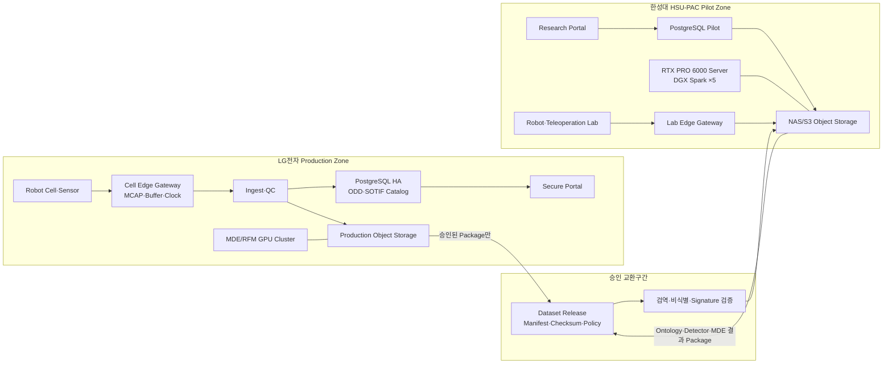
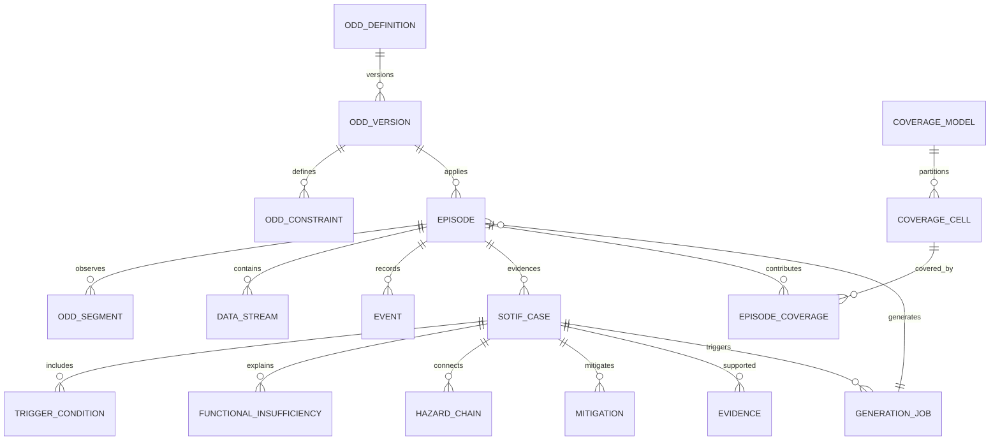
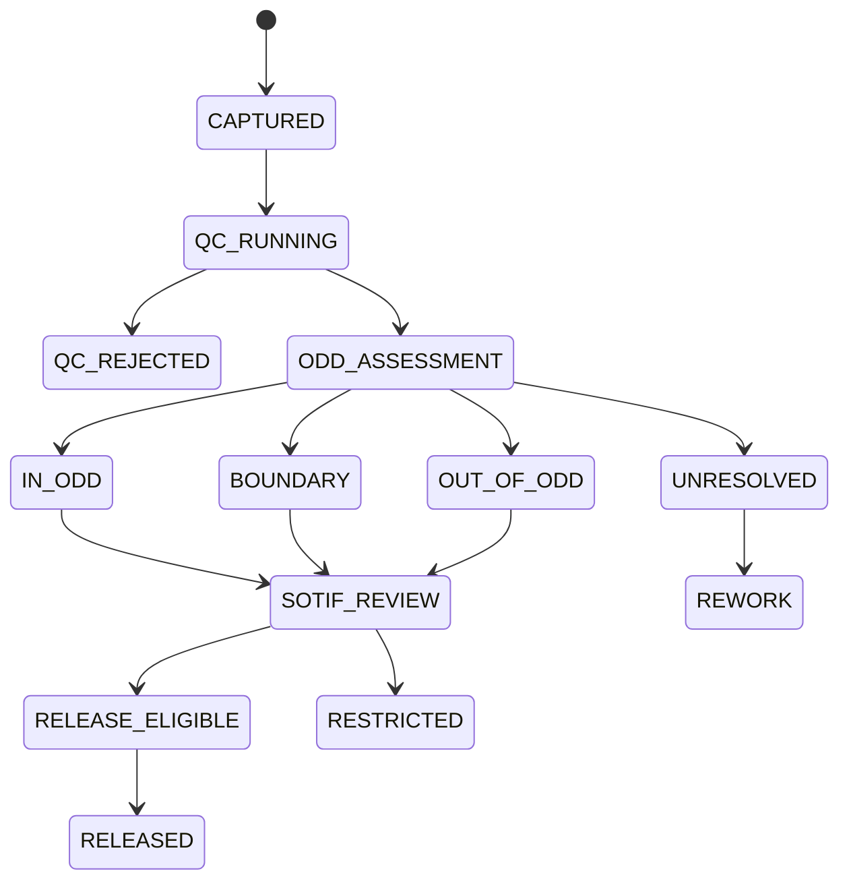

# SRS — 제조 ODD·SOTIF Episode 데이터 시스템 요구사항 명세서

!!! abstract "문서 목적"
    본 문서는 LG전자 제조현장과 한성대학교 Physical AI 실습실(HSU-PAC)에서 공동 활용할
    **제조 ODD(M-ODD)·SOTIF Episode 데이터 시스템**의 Software Requirements Specification입니다.
    실제 로봇·Teleoperation·Digital Twin·MDE·RFM 평가에서 발생한 Episode를 ODD 조건과
    기능불충분·Trigger·Hazard·Mitigation Evidence에 연결하여 저장·검색·재현·생성하는 서버,
    DB, Object Storage, GPU 및 Web Portal 요구사항을 정의합니다.

    본 문서는 조달 사양의 기준안을 포함하지만 특정 제조사 제품 구매를 확정하지 않습니다.
    저장용량·GPU 수량·고가용성 등급은 Pilot 실측 후 `TBC` 항목을 기준선으로 확정합니다.

## 0. 문서 관리

| 항목 | 내용 |
|---|---|
| 문서 ID | HSU-RDF-ODD-SOTIF-SRS-001 |
| 버전 | v0.9 Draft Baseline |
| 기준일 | 2026-10-25 |
| 상위 문서 | [통합 데이터팩토리 SRS](srs.md) |
| 연계 계획 | [ODD·SOTIF SDP](odd-sotif-sdp.md) |
| 적용 Site | LG전자 Production Zone, 한성대학교 HSU-PAC Pilot Zone |
| 작성 주체 | 한성대학교 PARC Lab |
| 검토 주체 | LG전자, 한성대, 모빌테크, Robot/RFM/실증 참여기관 |
| 상태 | 컨소시엄 검토용 기준안 |

### 0.1 개정 이력

| 버전 | 일자 | 변경 내용 | 상태 |
|---|---|---|---|
| 0.9 | 2026-10-25 | 제조 ODD·SOTIF Episode, DB, 2-Site Computing 기준안 최초 작성 | 검토 요청 |
| 1.0 | TBC | Pilot Task·Volume·보안등급·BOM·KPI 확정 | 기준선 예정 |

### 0.2 요구사항 표기

| 접두어 | 구분 | 예시 |
|---|---|---|
| FR-ODD | ODD 정의·관측·Coverage | FR-ODD-001 |
| FR-SOTIF | SOTIF 분석·Evidence | FR-SOTIF-001 |
| FR-EPI | Episode 수집·재생 | FR-EPI-001 |
| FR-GEN | MDE·Scenario 생성 | FR-GEN-001 |
| DR | DB·Object·Schema | DR-ODD-001 |
| HR | Hardware·Site | HR-LG-001 |
| IF | 외부 Interface | IF-ROS-001 |
| NFR | 품질·성능·보안·복구 | NFR-SEC-001 |
| AC | 인수시험 | AC-ODD-001 |

우선순위는 `Must/Should/Could`, 검증은 `시험/분석/검사/시연`으로 기록합니다. `TBC`는 관계기관
협의 후 확정, `TBD`는 실측·시험 후 결정할 항목입니다.

---

## 1. 적용범위와 표준 경계

### 1.1 적용 목적

본 시스템은 제조 Physical AI에서 다음 질문에 근거를 갖고 답할 수 있어야 합니다.

1. 이 Episode는 어떤 작업·설비·물성·사람·센서·Network 조건에서 발생했는가?
2. 그 조건은 승인된 ODD 안, 경계, 밖 중 어디인가?
3. 정상 고장이 없어도 인지·추론·제어의 기능불충분이 위험행동을 만들었는가?
4. 어떤 Trigger와 조건 조합이 실패·Near Miss·Hazard를 일으켰는가?
5. 동일 조건을 Digital Twin/MDE에서 재현할 수 있는가?
6. Mitigation 또는 RFM 개선 후 같은 ODD Cell에서 위험이 감소했는가?

### 1.2 표준 적용 원칙

!!! warning "SOTIF·ODD의 적용 한계"
    [ISO 21448:2022](https://www.iso.org/standard/77490.html)는 도로차량의 의도된 기능 안전,
    [ISO 34503:2023](https://www.iso.org/standard/78952.html)는 ADS의 ODD 분류·정의 형식을
    대상으로 합니다. 본 시스템은 두 표준의 **기능불충분–Trigger–Validation 논리와 계층형 ODD
    표현 방법을 제조 로봇 데이터 엔지니어링에 참조 적용**합니다.

    따라서 본 문서만으로 ISO 21448 또는 ISO 34503 적합성·인증을 주장하지 않습니다. 산업용
    로봇과 Cell 안전은 [ISO 10218-1:2025](https://www.iso.org/standard/73933.html),
    [ISO 10218-2:2025](https://www.iso.org/standard/73934.html)를 우선 적용하고, 협동작업에는
    [ISO/TS 15066:2016](https://www.iso.org/standard/62996.html)을 함께 검토합니다.

### 1.3 제조 ODD(M-ODD) 정의

**M-ODD**는 로봇 기능이 의도한 성능과 안전제약 안에서 작동하도록 설계·검증된 제조환경,
공정, 객체, 사람, 로봇, Sensor, Computing 및 운영정책 조건의 집합입니다.

| M-ODD 차원 | 예시 속성 |
|---|---|
| Site·Cell | 공장, Line, Cell, Zone, Layout, 좌표계, 안전Fence, 바닥 |
| Process·Task | 공정, 작업단계, 선후행조건, Cycle Time, 성공·실패 정의 |
| Robot·Tool | Robot/AMR, Controller, Payload, End-effector, TCP, Firmware |
| Object·Material | Part, Container, Shape, 공차, 질량, CoM, 마찰, 강성, 변형성 |
| Sensor·Perception | Camera/LiDAR/F-T/Tactile, FoV, 해상도, Calibration, 가림, Noise |
| Environment | 조도, 반사, 온도, 습도, 먼지, 진동, 소음, 바닥마찰 |
| Human·Dynamic Agent | 작업자 위치·속도·PPE, 다른 Robot, Forklift, 이동물체 |
| Control·Compute·Network | Control Rate, Latency, Jitter, Packet Loss, GPU/Model Version |
| Operation·Policy | 운영 Mode, Shift, Maintenance, 금지조건, Fallback, 승인된 Misuse |

### 1.4 시스템 범위

**포함**

- M-ODD Taxonomy·Definition·Version·Constraint 관리
- Episode 구간별 ODD 관측값과 In/Boundary/Out 판정
- 기능불충분, Trigger, Hazardous Behavior, Hazard, Mitigation, Evidence 관리
- Known/Discovered/Unknown 영역의 Coverage와 검증상태 관리
- 실물·Teleoperation·Simulation·MDE·RFM 평가 Episode 수집
- 영상·Robot State·Action·F/T·Tactile·Network·Model Inference 동기화
- LG–한성대 간 승인된 Dataset Package 교환
- 2-Site Server, PostgreSQL, Object Storage, GPU, Network, Backup

**제외**

- Safety PLC, E-stop, 안전Scanner의 Certified Safety Function 대체
- ISO 10218 위험성평가 자체의 자동 승인
- LG 제조 원본 데이터의 자동 외부 복제
- 모든 공정에 대한 무제한 ODD 완전성 보장
- SOTIF 분석만으로 Cybersecurity·고장안전·기계안전을 대체하는 것

---

## 2. 시스템 컨텍스트

### 2.1 2-Site 논리구성



### 2.2 보안 경계 원칙

- LG Production DB를 한성대 DB와 직접 Streaming Replication하지 않는다.
- Site 간에는 승인된 Dataset Release 또는 Algorithm Package만 교환한다.
- 원본 Object URI, 사용자 ID, 공정 비밀값은 정책에 따라 제거·가명화·범주화한다.
- Package는 Manifest, Hash, Signature, Source, License, 만료·재배포 조건을 포함한다.
- Site 간 연결은 VPN 또는 전용망 위 mTLS를 사용하며 모든 전송을 감사한다.

### 2.3 사용자 역할

| 역할 | 주요 책임 |
|---|---|
| Safety/ODD Owner | M-ODD 정의·경계·금지조건·Risk Acceptance 승인 |
| SOTIF Analyst | 기능불충분·Trigger·Hazard Chain·Evidence 검토 |
| Data Steward | Schema, QC, License, Release, 보존·반출정책 |
| Robot/Cell Engineer | Robot·Sensor·Clock·Edge Gateway·실증조건 관리 |
| MDE Engineer | Physics Parameter, Replay, Mutation, Simulation Evidence |
| RFM Engineer | Model·Inference·Uncertainty·Evaluation Feedback 등록 |
| Student Reviewer | 승인된 Pilot 데이터 1차 검수·Tag·재현·Recovery 수집 |
| Expert Reviewer | Edge/SOTIF Case 최종 판정·Mitigation 검증 |
| Platform Administrator | Server, DB, IAM, Monitoring, Backup, Incident 대응 |
| Auditor | Requirement–Episode–Evidence–Release 추적성 확인 |

---

## 3. 기능 요구사항

### 3.1 M-ODD 정의·Version·관측

| ID | 요구사항 | 우선순위 | 검증 |
|---|---|---:|---|
| FR-ODD-001 | 시스템은 M-ODD를 9개 상위 차원과 확장 가능한 하위 속성으로 관리해야 한다. | Must | 검사 |
| FR-ODD-002 | ODD Definition은 Project, Robot Function, Task, Site/Cell, 유효기간에 연결되어야 한다. | Must | 시험 |
| FR-ODD-003 | 각 ODD 속성은 단위, 자료형, 허용범위/집합, 측정방법, Source, 불확실성을 가져야 한다. | Must | 검사 |
| FR-ODD-004 | ODD 변경은 불변 Version을 생성하고 변경 전·후와 승인자를 보존해야 한다. | Must | 시험 |
| FR-ODD-005 | Episode는 수집 당시 적용된 ODD Version을 고정 참조해야 한다. | Must | 검사 |
| FR-ODD-006 | 시스템은 Episode 전체뿐 아니라 시간구간별 ODD 관측값을 저장해야 한다. | Must | 시험 |
| FR-ODD-007 | ODD 판정은 `IN/BOUNDARY/OUT/UNRESOLVED/NOT_APPLICABLE`을 지원해야 한다. | Must | 시험 |
| FR-ODD-008 | 판정은 Rule Version, 관측값, Threshold, 불확실성, Evidence를 남겨야 한다. | Must | 검사 |
| FR-ODD-009 | 두 개 이상 ODD 속성이 동시에 경계에 접근하는 조합조건을 표현해야 한다. | Must | 시험 |
| FR-ODD-010 | Reasonably Foreseeable Misuse를 정상 ODD와 구분해 등록·검색해야 한다. | Must | 시험 |
| FR-ODD-011 | 사용자는 ODD Version 간 범위·Constraint·Coverage 차이를 비교해야 한다. | Should | 시연 |
| FR-ODD-012 | 공간조건은 Cell 좌표계의 Point/Polygon/Volume 또는 Asset Zone으로 표현해야 한다. | Must | 시험 |
| FR-ODD-013 | ODD Snapshot은 수집 시점의 실제 관측과 기준정보 Version을 Freeze해야 한다. | Must | 검사 |
| FR-ODD-014 | Unknown 또는 미관측 속성은 정상값으로 간주하지 않고 명시적 Unknown으로 저장해야 한다. | Must | 시험 |

### 3.2 Episode 수집·동기화·재생

| ID | 요구사항 | 우선순위 | 검증 |
|---|---|---:|---|
| FR-EPI-001 | 모든 Episode에 UUID, Source Site, Source Type, Parent, Schema Version을 부여해야 한다. | Must | 시험 |
| FR-EPI-002 | Raw MCAP·영상·Parquet·Inference·ODD Snapshot·SOTIF Evidence를 Package로 수집해야 한다. | Must | 시험 |
| FR-EPI-003 | Edge Gateway는 Network 단절 시 로컬에 Buffer하고 재연결 후 중복 없이 재전송해야 한다. | Must | 장애시험 |
| FR-EPI-004 | 모든 Stream은 UTC/TAI 기반 Timestamp, Clock Source, Clock Quality를 기록해야 한다. | Must | 검사 |
| FR-EPI-005 | 영상, Robot State, Action, F/T, Tactile, Network, Model Inference를 Timeline에 정렬해야 한다. | Must | 시연 |
| FR-EPI-006 | Stream 누락·Gap·Drift·Calibration·단위·좌표계를 자동 QC해야 한다. | Must | 시험 |
| FR-EPI-007 | Portal은 ODD Boundary, Trigger, Intervention, Hazard Marker를 영상·Signal 위에 표시해야 한다. | Must | 시연 |
| FR-EPI-008 | 원본 Payload는 Object Storage에, Metadata·Range·Hash·관계는 DB에 저장해야 한다. | Must | 검사 |
| FR-EPI-009 | Raw Object는 덮어쓰지 않고 수정·가공본은 새 Derivation으로 생성해야 한다. | Must | 시험 |
| FR-EPI-010 | 사용자 개입, E-stop, Safety Stop, Fallback, Recovery 구간을 별도 Event로 저장해야 한다. | Must | 시험 |
| FR-EPI-011 | Operator 개인식별정보는 가명화 ID로 분리해야 한다. | Must | 보안시험 |
| FR-EPI-012 | Episode는 `CAPTURED→QC→ODD_ASSESSED→SOTIF_REVIEWED→RELEASED` 상태를 가져야 한다. | Must | 시험 |

### 3.3 SOTIF Case·Evidence

| ID | 요구사항 | 우선순위 | 검증 |
|---|---|---:|---|
| FR-SOTIF-001 | SOTIF Case는 기능불충분, Trigger, Operational Situation, Hazardous Behavior, Hazard를 연결해야 한다. | Must | 검사 |
| FR-SOTIF-002 | 기능불충분은 Specification Insufficiency와 Performance Insufficiency를 구분해야 한다. | Must | 시험 |
| FR-SOTIF-003 | Case는 ODD 속성·Episode 시간구간·Robot Function·Model Version을 참조해야 한다. | Must | 시험 |
| FR-SOTIF-004 | Case 상태는 `CANDIDATE/CONFIRMED/MITIGATED/ACCEPTED/REJECTED`를 지원해야 한다. | Must | 시험 |
| FR-SOTIF-005 | Case는 Severity, Exposure/Occurrence, Controllability/Recoverability 또는 프로젝트 Risk Matrix를 기록해야 한다. | Must | 검사 |
| FR-SOTIF-006 | Risk Matrix와 분류규칙은 Version으로 관리해야 한다. | Must | 검사 |
| FR-SOTIF-007 | 알려진 안전, 알려진 불안전, 발견 전 Unknown 후보, 발견된 Unknown-Unsafe의 이력을 구분해야 한다. | Must | 시험 |
| FR-SOTIF-008 | 발견 시점의 지식상태와 현재 재분류 상태를 함께 보존해야 한다. | Must | 검사 |
| FR-SOTIF-009 | Evidence는 실물, Teleoperation, Simulation, 분석, 시험, 전문가판정을 구분해야 한다. | Must | 시험 |
| FR-SOTIF-010 | Mitigation은 설계·Model·ODD 축소·운영제약·Fallback·추가검증으로 유형화해야 한다. | Must | 시험 |
| FR-SOTIF-011 | Mitigation 전·후 Episode와 Metric을 Pair로 비교해야 한다. | Must | 시연 |
| FR-SOTIF-012 | 최종 승인·Risk Acceptance는 지정된 독립 Reviewer만 수행해야 한다. | Must | 권한시험 |
| FR-SOTIF-013 | Safety 관련 자동분류는 추천값이며 인간 승인 없이 최종상태로 전환하지 않아야 한다. | Must | 시험 |
| FR-SOTIF-014 | Case의 모든 변경·승인·Evidence 교체를 감사해야 한다. | Must | 검사 |

### 3.4 Coverage·Unknown 발굴

| ID | 요구사항 | 우선순위 | 검증 |
|---|---|---:|---|
| FR-COV-001 | 연속 ODD 속성을 Versioned Bin 또는 Parameter Range로 이산화할 수 있어야 한다. | Must | 시험 |
| FR-COV-002 | Coverage Cell은 ODD 조건조합, Episode 수, 시간, Source, 결과를 집계해야 한다. | Must | 검사 |
| FR-COV-003 | Coverage는 정상 Episode 수가 아니라 성공·실패·Intervention·SOTIF Case 분포를 함께 표시해야 한다. | Must | 시연 |
| FR-COV-004 | 미관측 Cell, 희소 Cell, 경계 Cell, 불안전 Cell을 구분해야 한다. | Must | 시험 |
| FR-COV-005 | 고차원 조합폭발을 제어하기 위해 중요 차원 Set과 Projection Version을 관리해야 한다. | Must | 분석 |
| FR-COV-006 | RFM 불확실성·모델불일치·Sim-to-Real Gap을 Unknown 후보 발굴에 사용할 수 있어야 한다. | Must | 시험 |
| FR-COV-007 | Coverage Gap으로부터 Simulation/Teleoperation 수집요청을 생성해야 한다. | Must | 시연 |
| FR-COV-008 | 생성 데이터가 실제 Coverage를 대체하지 않도록 Source별 Coverage를 분리해야 한다. | Must | 시험 |

### 3.5 MDE·Scenario 생성·재검증

| ID | 요구사항 | 우선순위 | 검증 |
|---|---|---:|---|
| FR-GEN-001 | 승인 Case 또는 Coverage Gap으로부터 실행 가능한 Scenario Package를 생성해야 한다. | Must | 시험 |
| FR-GEN-002 | Package는 ODD Version, Asset, Material, Robot, Sensor, Model, Seed, 초기상태를 포함해야 한다. | Must | 검사 |
| FR-GEN-003 | MDE는 접촉, 힘, 변형, 미끄러짐, 잔류상태 Ground Truth를 출력해야 한다. | Must | 시험 |
| FR-GEN-004 | Boundary 주변의 Parameter Sweep, Constraint 조합, Counterfactual 생성을 지원해야 한다. | Must | 시험 |
| FR-GEN-005 | 생성 Episode는 Source Case, Mutation Operator, Parameter Delta, Engine Image Digest를 기록해야 한다. | Must | 검사 |
| FR-GEN-006 | 동일 Version·Seed 실행의 재현성을 지표별 허용오차로 검증해야 한다. | Must | 시험 |
| FR-GEN-007 | Simulation에서 발견한 Case를 실물/Teleoperation 검증 Queue로 보낼 수 있어야 한다. | Must | 시연 |
| FR-GEN-008 | Mitigation 적용 전·후 동일 Scenario를 실행하고 결과를 Pairing해야 한다. | Must | 시험 |
| FR-GEN-009 | ODD 밖 또는 위험도가 높은 Scenario 실행에는 승인·격리·실물실행 금지 Flag가 있어야 한다. | Must | 권한시험 |

### 3.6 Dataset Release·Site 교환

| ID | 요구사항 | 우선순위 | 검증 |
|---|---|---:|---|
| FR-REL-001 | Release는 Episode, ODD Snapshot, SOTIF Case, Schema, License, Manifest, Hash를 포함해야 한다. | Must | 검사 |
| FR-REL-002 | Release 전 소유기관·보안등급·반출정책·개인정보·IP 검사를 수행해야 한다. | Must | 시험 |
| FR-REL-003 | 파생 Episode는 Parent와 동일 Split에 배치해 Leakage를 방지해야 한다. | Must | 시험 |
| FR-REL-004 | Release 후 수정하지 않고 변경 시 새 Version을 생성해야 한다. | Must | 시험 |
| FR-REL-005 | Site 간 Package는 전자서명·Checksum·Malware Scan·Import 승인 절차를 거쳐야 한다. | Must | 보안시험 |
| FR-REL-006 | Restricted 원본 URI와 내부 사용자 ID를 Site 외부 Manifest에 포함하지 않아야 한다. | Must | 검사 |
| FR-REL-007 | Robot Learning Export는 LeRobotDataset 표준 Field와 ODD/SOTIF 확장 Table을 함께 제공해야 한다. | Must | 시험 |
| FR-REL-008 | LG에서 HSU로는 승인 Dataset만, HSU에서 LG로는 승인된 Algorithm/Model/Evidence Package만 전송해야 한다. | Must | 시험 |

---

## 4. 데이터·DB 요구사항

### 4.1 저장계층

| 계층 | 기술 기준안 | 저장 대상 |
|---|---|---|
| Metadata DB | PostgreSQL HA | Episode, ODD, SOTIF, Workflow, 권한, 계보 |
| Spatial | PostGIS | Cell Zone, Robot Workspace, Human/Dynamic Agent 위치 |
| Similarity | pgvector | Episode/Scene/Signal/Case Embedding |
| Object Storage | S3 호환, Versioning, Object Lock 선택 | MCAP, MP4, Parquet, USD, MDE 결과, Model |
| Cache/Queue | Redis/Workflow Engine | 비동기 Job, Lock, 짧은 Cache |
| Search | PostgreSQL FTS 우선, 필요 시 별도 Search | 용어·설명·Log Index |
| Model Registry | MLflow 또는 동등 기능 | Model, Run, Metric, Dataset 계보 |

[PostgreSQL](https://www.postgresql.org/docs/current/high-availability.html)은 Streaming Replication과
Hot Standby 기반 HA 구성이 가능하며, [PostGIS](https://postgis.net/docs/)는 PostgreSQL에 공간객체와
공간 Index를 제공합니다. 고주파 Raw Signal은 DB Row로 저장하지 않고 Parquet/MCAP에 두고 DB에는
시간범위·통계·URI·Hash만 저장합니다.

### 4.2 핵심 Entity



### 4.3 주요 Table

| Table | 주요 필드 |
|---|---|
| odd_definition | odd_id, function_id, site/cell, owner, status |
| odd_version | odd_version_id, semver, valid_from/to, approval, schema_version |
| odd_dimension | dimension_code, parent, data_type, unit, ontology_term |
| odd_constraint | odd_version_id, dimension, operator, lower/upper/set, uncertainty |
| episode | episode_id, source_site/type, task, robot/model, time, result, parent |
| odd_snapshot | episode_id, odd_version, reference versions, captured_at, hash |
| odd_segment | episode_id, time range, dimension, observed_value, verdict, evidence |
| sotif_case | case_id, episode/time, insufficiency, status, risk, knowledge_state |
| trigger_condition | case_id, ODD dimensions, condition expression, evidence |
| hazard_chain | case_id, behavior, situation, hazard, consequence, control/recovery |
| mitigation | case_id, type, description, version, verification status |
| evidence | evidence_id, source, method, object_uri, reviewer, confidence, hash |
| coverage_cell | coverage_model, dimension bins, target, observed, status |
| data_stream | modality, object_uri, format, rate, clock, calibration, hash |
| dataset_release | release_id/version, policy, manifest, signature, status |
| audit_log | actor/site, action, resource, before/after, reason, timestamp |

### 4.4 DB DDL 기준 예시

```sql
CREATE TABLE odd_version (
    odd_version_id UUID PRIMARY KEY,
    odd_id UUID NOT NULL,
    version VARCHAR(32) NOT NULL,
    status VARCHAR(24) NOT NULL,
    valid_from TIMESTAMPTZ,
    valid_to TIMESTAMPTZ,
    schema_version VARCHAR(32) NOT NULL,
    approved_by UUID,
    approved_at TIMESTAMPTZ,
    content_hash VARCHAR(80) NOT NULL,
    UNIQUE (odd_id, version)
);

CREATE TABLE episode_odd_segment (
    segment_id UUID PRIMARY KEY,
    episode_id UUID NOT NULL REFERENCES episode(episode_id),
    odd_version_id UUID NOT NULL REFERENCES odd_version(odd_version_id),
    start_ns BIGINT NOT NULL,
    end_ns BIGINT NOT NULL,
    dimension_code VARCHAR(120) NOT NULL,
    observed_value JSONB NOT NULL,
    unit VARCHAR(40),
    verdict VARCHAR(24) NOT NULL,
    uncertainty JSONB,
    rule_version VARCHAR(32) NOT NULL,
    evidence_uri TEXT,
    CHECK (end_ns >= start_ns)
);

CREATE INDEX idx_odd_segment_episode_time
    ON episode_odd_segment (episode_id, start_ns);
CREATE INDEX idx_odd_segment_value
    ON episode_odd_segment USING GIN (observed_value);

CREATE TABLE sotif_case (
    sotif_case_id UUID PRIMARY KEY,
    episode_id UUID NOT NULL REFERENCES episode(episode_id),
    start_ns BIGINT NOT NULL,
    end_ns BIGINT,
    odd_version_id UUID NOT NULL REFERENCES odd_version(odd_version_id),
    robot_function_id UUID NOT NULL,
    model_version_id UUID,
    insufficiency_type VARCHAR(40) NOT NULL,
    knowledge_state VARCHAR(40) NOT NULL,
    case_status VARCHAR(32) NOT NULL,
    risk_matrix_version VARCHAR(32) NOT NULL,
    severity SMALLINT,
    exposure SMALLINT,
    controllability SMALLINT,
    risk_level VARCHAR(24),
    trigger JSONB NOT NULL,
    hazard_chain JSONB NOT NULL,
    created_at TIMESTAMPTZ NOT NULL DEFAULT now()
);
```

### 4.5 ODD Snapshot Package

```json
{
  "schema_version": "m-odd-1.0.0",
  "episode_id": "uuid",
  "odd_version_id": "uuid",
  "source_site": "LG-PROD",
  "robot_function": "flexible_object_grasp",
  "captured_at": "2026-10-25T08:10:00Z",
  "dimensions": {
    "site.cell.zone": {"value": "CELL-A/ZONE-2", "verdict": "IN"},
    "task.step": {"value": "GRASP_APPROACH", "verdict": "IN"},
    "object.material.stiffness": {
      "value": 18.4,
      "unit": "N/mm",
      "uncertainty": 1.2,
      "verdict": "BOUNDARY"
    },
    "sensor.front_camera.occlusion": {"value": 0.31, "verdict": "OUT"},
    "network.control_latency": {"value": 7.8, "unit": "ms", "verdict": "IN"}
  },
  "reference_versions": {
    "asset": "part-v12",
    "material": "pet-bottle-v4",
    "robot": "robot-config-v7",
    "model": "rfm-v18",
    "calibration": "cal-2026-10-20"
  }
}
```

### 4.6 상태 전이



### 4.7 Object Key

```text
s3://{site}/{project}/raw/{source}/{yyyy}/{mm}/{episode_id}/...
s3://{site}/{project}/derived/{episode_id}/{pipeline_version}/...
s3://{site}/{project}/odd/{odd_id}/{odd_version}/definition.json
s3://{site}/{project}/sotif/{case_id}/{case_version}/...
s3://{site}/{project}/scenarios/{scenario_version_id}/...
s3://{site}/{project}/releases/{release_id}/{release_version}/...
```

---

## 5. 외부 Interface 요구사항

| ID | Interface | 요구사항 |
|---|---|---|
| IF-ROS-001 | ROS 2/MCAP | Robot/Sensor Topic을 Schema와 함께 MCAP으로 기록해야 한다. |
| IF-CLOCK-001 | PTP/NTP | Edge와 Server는 Clock Source·Offset·Quality를 기록해야 한다. |
| IF-ASSET-001 | USD/GLB | Asset 좌표·Scale·Semantic·Collision·Version·License를 제공해야 한다. |
| IF-MDE-001 | MDE Job API | ODD Snapshot, Scenario, Material, Seed, Mutation 범위를 입력받아야 한다. |
| IF-RFM-001 | Inference Log | Observation, Action, Confidence/Uncertainty, Model Version을 기록해야 한다. |
| IF-RFM-002 | Evaluation | Dataset Release, Model, Metric, 실패 Episode ID를 반환해야 한다. |
| IF-S3-001 | Object API | Multipart, Resume, Versioning, 서명 URL을 지원해야 한다. |
| IF-API-001 | REST/OpenAPI | `/api/v1` Versioned API와 Machine-readable 명세를 제공해야 한다. |
| IF-IDP-001 | OIDC | LG/한성대 Site별 IdP와 Role/Organization Claim을 연동해야 한다. |
| IF-XFER-001 | Site Exchange | Release Manifest·Signature·Policy·Hash를 검증해야 한다. |

[MCAP](https://mcap.dev/guides/getting-started/ros-2)은 ROS 2 원본기록에 사용하고,
[LeRobotDataset v3](https://huggingface.co/docs/lerobot/lerobot-dataset-v3)는 승인된 Robot Learning
Release의 영상·시계열·Episode Metadata 표현에 사용합니다.

---

## 6. Computing·Hardware 요구사항

### 6.1 LG전자 Production 기준안

| ID | 구성 | 최소 기준안 | 수량/HA | 역할 |
|---|---|---|---:|---|
| HR-LG-001 | API/Control Node | 24~32 Core, ECC 256GB, OS NVMe RAID1, 25GbE×2 | 2대 | Portal·API·Queue·Workflow |
| HR-LG-002 | PostgreSQL Node | 32 Core 이상, ECC 512GB, OS 1.92TB×2 RAID1, DB NVMe 3.84TB×4 이상 RAID10, 25GbE×2 | 3대 | Primary·Standby×2; Consensus/Witness는 HA 제품에 따라 별도 또는 동시 구성 |
| HR-LG-003 | Object Storage Node | ECC 256GB, HDD 16~22TB×12 이상, Metadata NVMe×2, 25/100GbE | 4대 이상 | S3, Erasure Coding, Versioning |
| HR-LG-004 | GPU/MDE Node | Dual CPU 총 64 Core 이상, ECC 1TB, RTX PRO 6000 Server Edition 96GB×4, NVMe Scratch 7.68TB 이상, 100GbE | 1대 시작, 2대 확장 | MDE·Isaac Sim·RFM Evaluation |
| HR-LG-005 | Backup Repository | 운영 Storage와 장애 Domain 분리, Immutable Snapshot/Object Lock 또는 Tape | 1식 | 3-2-1 Backup |
| HR-LG-006 | Cell Edge Gateway | 16 Core, ECC 64GB, NVMe 3.84TB×2 RAID1, 10/25GbE×2, PTP 지원 | Cell별 1대 | 수집·Buffer·1차 QC |
| HR-LG-007 | Network Core | Server/Storage 25GbE, GPU/Storage Backbone 100GbE, OOB 1GbE | 이중화 권장 | Data Plane·관리망 분리 |
| HR-LG-008 | Facility | 이중 PSU, UPS, 온도·전력 Monitoring, GPU Node 전력·냉각 Vendor 검증 | 1식 | 연속운영·안전종료 |

NVIDIA 공식 사양상 [RTX PRO 6000 Blackwell Server Edition](https://www.nvidia.com/en-us/data-center/rtx-pro-6000-blackwell-server-edition/)은
GPU당 96GB GDDR7 ECC와 최대 600W 소비전력을 갖습니다. 4GPU Node는 GPU만 최대 2.4kW이므로
Rack 전력·냉각·PSU는 Server Vendor의 인증구성과 현장 전원실사를 통과해야 합니다.

### 6.2 한성대학교 HSU-PAC Pilot 기준안

| ID | 구성 | 기준안 | 수량 | 역할 |
|---|---|---|---:|---|
| HR-HSU-001 | Shared GPU Server | RTX PRO 6000 Blackwell 96GB급, ECC RAM 512GB급, 10GbE×2, NVMe Scratch | 기존자산 우선 | Isaac Sim·MDE·중형학습 |
| HR-HSU-002 | DGX Spark | 128GB Unified Memory, 10GbE, ConnectX-7, NVMe | 5대 계획기준 | 조별 VLM/VLA·대형모델 실험 |
| HR-HSU-003 | DB/API Server | 24~32 Core, ECC 256GB, OS 1.92TB×2 RAID1, DB 3.84TB×4 RAID10, 10/25GbE×2 | 1대 | Pilot DB·Portal·Queue |
| HR-HSU-004 | Standby/Utility | 16~24 Core, ECC 128GB, NVMe RAID1, 10GbE×2 | 1대 | DB Standby·Monitoring·Backup Orchestrator |
| HR-HSU-005 | Pilot Object Storage | 사용가능 80TB 이상, RAIDZ2/동등, Snapshot, 10GbE×2, 25GbE 확장 | 1식 | Raw·Derived·Dataset·Checkpoint |
| HR-HSU-006 | Backup | 운영 NAS와 분리된 80TB 이상 또는 Cloud Archive | 1식 | 복구·장기보존 |
| HR-HSU-007 | Lab Edge Gateway | 16 Core, RAM 64GB, NVMe 3.84TB×2 RAID1, 10GbE | 실습 Cell별 | Teleoperation·Sensor 수집 |
| HR-HSU-008 | Network | 기존 10GbE Core, Storage/GPU LACP; 병목 시 25GbE 증설 | 1식 | Lab Data Plane |

[DGX Spark 공식 사양](https://docs.nvidia.com/dgx/dgx-spark/hardware.html)은 128GB Unified Memory,
10GbE 및 ConnectX-7을 제공합니다. HSU-PAC에서는 고속 대규모 학습 Cluster가 아니라 조별 대형모델
적재·검증·경량 Fine-tuning Node로 사용하며, 대규모 Multi-GPU 학습은 공용 GPU Server 또는 승인된
Cloud Burst로 분리합니다.

!!! note "자산실사 Gate"
    HSU-PAC 공개자료와 실제 자산대장의 GPU 대수·장착상태·전원·NIC·NAS 가용용량을 G1에서
    대조해야 합니다. 본 SRS의 기능 기준은 **96GB GPU 최소 1개와 4GPU 확장 가능성**이며,
    설치수량을 문서만으로 확정하지 않습니다.

### 6.3 Storage 용량산정

```text
일일 Raw 용량
= Episode 수 × 평균 길이(초) × 전체 Stream Bitrate(bit/s) ÷ 8

연간 필요용량
= 일일 Raw × 보존일수
+ Derived/Preview/Annotation
+ Dataset Release
+ Model·Checkpoint
+ Erasure Coding/Replication Overhead
+ 25% 이상 운영여유
```

| Profile | 가정 예시 | 산출 예시 | 용도 |
|---|---|---:|---|
| Pilot-A | 100 Episode/일 × 120초 × 전체 50Mbps | Raw 약 75GB/일 | HSU-PAC 초기 |
| Pilot-B | 300 Episode/일 × 180초 × 전체 80Mbps | Raw 약 540GB/일 | 집중 수집 |
| Production | Cell·Camera·Depth 수에 따라 실측 | TBC | LG Production |

위 수치는 조달 확정값이 아니라 산정법 검증 예시입니다. Sample Episode 20개 이상으로 평균·p95 크기,
Derived 비율, 보존기간을 측정한 뒤 HSU 80TB 및 LG 500TB급 초기 사용가능 용량의 적정성을 Gate에서
판정합니다.

### 6.4 Network·Clock

| ID | 요구사항 |
|---|---|
| HR-NET-001 | Camera·Robot·Edge 구간은 VLAN/QoS와 Broadcast Domain을 분리해야 한다. |
| HR-NET-002 | Server–Storage는 HSU 10GbE 이상, LG 25GbE 이상을 기준으로 한다. |
| HR-NET-003 | GPU–Storage 병목이 지속 70%를 넘으면 100GbE 또는 Local NVMe Cache를 적용한다. |
| HR-NET-004 | PTP 지원장치는 Grandmaster/Boundary Clock을 사용하고 비지원장치는 NTP Offset을 기록한다. |
| HR-NET-005 | Control/F-T/Tactile 목표 정렬은 지원장치 기준 1ms 이하, Video는 1 Frame 이하로 한다. |
| HR-NET-006 | Clock 품질 미달 Episode는 자동 WARNING 또는 REJECTED 처리한다. |

---

## 7. 비기능 요구사항

### 7.1 성능·확장성

| ID | 요구사항 | Pilot 목표 | Production 목표 |
|---|---|---|---|
| NFR-PERF-001 | Metadata 검색 p95 | 2초 이하 | 2초 이하(TBC Dataset 규모) |
| NFR-PERF-002 | Episode 상세 p95 | 2초 이하 | 2초 이하 |
| NFR-PERF-003 | Preview 영상 시작 p95 | 3초 이하 | 3초 이하 |
| NFR-PERF-004 | 동시 사용자 | 30명 | TBC, 최소 100명 기준시험 |
| NFR-PERF-005 | 동시 Ingest | Lab Cell 수 기준 | Production Cell 수×1.5 Burst |
| NFR-PERF-006 | Worker Scale | 수평확장 가능 | Queue 기반 자동/수동 확장 |
| NFR-PERF-007 | DB 크기 | Partition 없이 시작 | Query Plan에 따라 시간/Project Partition |

### 7.2 가용성·복구

| ID | Pilot | Production |
|---|---|---|
| NFR-AVL-001 | 운영시간 99.5%/월 | 99.9%/월 목표, 업무협의 TBC |
| NFR-AVL-002 | DB RPO 24시간 이하 | DB RPO 5분 이하 목표, TBC |
| NFR-AVL-003 | DB RTO 4시간 이하 | DB RTO 1시간 이하 목표, TBC |
| NFR-AVL-004 | 분기 복원시험 | 월/분기 복원시험과 연 1회 Site DR |
| NFR-AVL-005 | 단일 Node 장애 허용 안 함 | DB/API/Storage 단일 Node 장애 허용 |

### 7.3 보안·감사

| ID | 요구사항 |
|---|---|
| NFR-SEC-001 | TLS 1.2 이상과 Site 간 mTLS를 적용해야 한다. |
| NFR-SEC-002 | RBAC에 기관·Project·Site·데이터 등급·목적을 함께 평가해야 한다. |
| NFR-SEC-003 | Signed URL 기본 TTL은 15분 이내로 설정해야 한다. |
| NFR-SEC-004 | 관리자·반출승인자·Risk Acceptance 역할은 MFA를 사용해야 한다. |
| NFR-SEC-005 | Secret은 Vault/동등 Secret Store에서 관리해야 한다. |
| NFR-SEC-006 | Release Package와 Algorithm Image는 서명·Hash·SBOM을 가져야 한다. |
| NFR-SEC-007 | 다운로드·반출·승인·ODD변경·Case변경·삭제를 불변 감사 Log로 기록해야 한다. |
| NFR-SEC-008 | 제조 원본과 개인정보를 승인 없이 외부 AI·Cloud 서비스로 전송하지 않아야 한다. |
| NFR-SEC-009 | Production과 교육 사용자·Namespace·Bucket·Key를 분리해야 한다. |
| NFR-SEC-010 | Critical 취약점은 Release 시 0건이어야 한다. |

### 7.4 데이터 무결성·재현성

| ID | 목표 |
|---|---|
| NFR-DATA-001 | 수집·교환 파일 Checksum 검증 100% |
| NFR-DATA-002 | Release Episode의 ODD Snapshot 연결 100% |
| NFR-DATA-003 | 승인 SOTIF Case의 Evidence·Reviewer·Rule Version 연결 100% |
| NFR-DATA-004 | 생성 Episode의 Parent·Seed·Image Digest·Parameter 연결 100% |
| NFR-DATA-005 | Dataset Split Parent/Child Leakage 0건 |
| NFR-DATA-006 | 원본 Object 무단 덮어쓰기 0건 |

---

## 8. 인수시험

| ID | 시나리오 | 성공 기준 |
|---|---|---|
| AC-ODD-001 | M-ODD 정의·Version | 9개 차원, Constraint, 승인, Version Diff 확인 |
| AC-ODD-002 | Episode 구간 판정 | 한 Episode 안의 IN→BOUNDARY→OUT 전이가 Timeline에 표시 |
| AC-EPI-001 | Network 단절 수집 | Edge Buffer 후 Hash·ID 중복 없이 재전송 |
| AC-EPI-002 | 동기 재생 | 영상·Robot·F/T·Inference·ODD Marker가 허용오차 내 정렬 |
| AC-SOTIF-001 | Case 등록 | Trigger→기능불충분→위험행동→Hazard→Mitigation 추적 |
| AC-SOTIF-002 | Unknown 발굴 | 희소/불확실 Episode가 후보가 되고 전문가 승인 이력 보존 |
| AC-GEN-001 | MDE Replay | 승인 Case에서 동일 Seed 결과와 허용오차 Report 생성 |
| AC-GEN-002 | Mitigation 비교 | 변경 전·후 Pair와 Risk/성공 Metric 비교 |
| AC-REL-001 | LG→HSU 교환 | Restricted Field 제거, Signature·Hash·정책 검증 후 Import |
| AC-REL-002 | HSU→LG 교환 | Algorithm/Model Package의 SBOM·서명·시험증적 확인 |
| AC-SEC-001 | Site·기관 격리 | 비인가 검색·Metadata·Object URL·Download 모두 차단 |
| AC-HA-001 | DB 장애 | Production Primary 장애 시 목표 RPO/RTO 내 Failover |
| AC-DR-001 | 복원 | DB·Object·Manifest를 격리환경에 복원하고 무작위 Hash 대조 |
| AC-PERF-001 | 부하시험 | Site별 동시사용·Ingest·검색 기준 통과 |

---

## 9. 기준선 확정 전 TBC

| ID | 결정 항목 | 결정방법 | Owner |
|---|---|---|---|
| TBC-ODD-001 | Pilot Task·Robot Function·M-ODD 경계 | LG–한성대 Workshop | ODD Owner |
| TBC-DATA-001 | 일일 Episode·Bitrate·보존기간 | Sample 20건 이상 실측 | Data Steward |
| TBC-SOTIF-001 | 제조 Risk Matrix와 승인권자 | 안전·실증기관 협의 | Safety Owner |
| TBC-HW-001 | HSU 실제 GPU/NAS/NIC 자산 | 자산대장·실물·부하시험 | HSU Infra |
| TBC-HW-002 | LG Cell 수·초기 500TB급 Storage 적정성 | 생산규모·증가율 산정 | LG Infra |
| TBC-HA-001 | Production SLA·RPO·RTO | 운영 중요도·비용분석 | LG Operations |
| TBC-NET-001 | PTP 적용범위·Sensor 지원 | Cell Network Survey | Robot/Network |
| TBC-XFER-001 | 양 Site 반출·IP·보존정책 | 보안·법무·IP 검토 | PMO |
| TBC-KPI-001 | MDE 재현오차·Detector 성능·Coverage 목표 | Pilot Baseline | MDE/RFM |

---

## 10. 승인란

| 구분 | 소속/성명 | 결과 | 일자 | 승인 ID |
|---|---|---|---|---|
| 작성 | 한성대학교 PARC Lab |  |  |  |
| LG 인프라·보안 검토 |  |  |  |  |
| ODD·SOTIF 검토 |  |  |  |  |
| Robot/Cell 검토 |  |  |  |  |
| MDE/RFM 검토 |  |  |  |  |
| 최종 승인 |  |  |  |  |

---

## 관련 문서

- **[ODD·SOTIF SDP — 개발·구축계획서](odd-sotif-sdp.md)**
- [통합 데이터팩토리 SRS](srs.md)
- [통합 데이터팩토리 SDP](sdp.md)
- [기술 상세](technical.md)
- [한성대학교 HSU-PAC](../hsu-pac.md)

[:octicons-arrow-left-24: 대표 프로젝트로](index.md)
