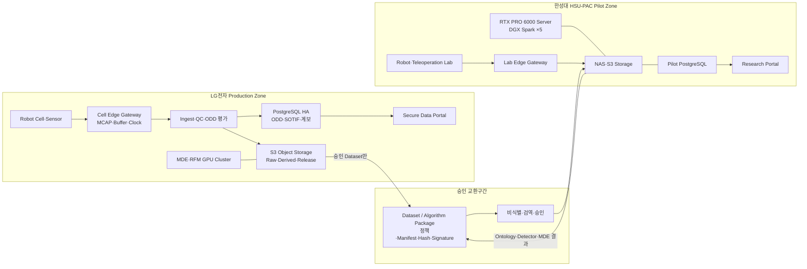
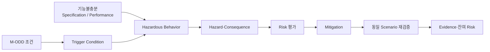

# 제조 ODD·SOTIF Episode 데이터 시스템

:material-circle-outline:{ style="color:#e0a800" } **LG전자 Production × 한성대 HSU-PAC Pilot** · ODD-aware Safety Evidence Data Platform

!!! abstract "한눈에 보기"
    제조 로봇이 **어떤 조건에서 정상 동작하고, 어떤 경계조건과 기능불충분에서 실패·위험행동을
    보이는지** Episode 단위로 저장·분석·재현하는 데이터 시스템입니다.

    실제 Robot·Teleoperation·Digital Twin·Manufacturing Deformation Engine(MDE)·RFM 평가 데이터를
    동일 시간축으로 정렬하고, 제조 ODD(M-ODD) 조건과 SOTIF 분석결과를 연결합니다. LG전자에는
    Production급 HA·대용량 인프라를, 한성대 HSU-PAC에는 교육·연구·Pilot 환경을 두고 승인된
    Dataset·Algorithm Package만 양 Site 사이에서 교환합니다.

> **핵심 목표** — `조건을 저장하는 ODD`와 `실패 원인을 설명하는 SOTIF`, `재현·생성하는 MDE`,
> `학습·평가하는 RFM`을 하나의 Versioned Episode 계보로 연결합니다.

---

## 왜 ODD·SOTIF Episode가 필요한가

같은 Robot과 Model도 조명, 가림, 부품 공차, 물성, 접촉상태, 작업자 동선, Network 지연,
Calibration 상태에 따라 결과가 달라집니다. 성공·실패 Label만 저장하면 원인을 다시 찾거나 같은
조건을 재현하기 어렵습니다.

본 시스템은 각 Episode에 다음 질문의 답을 함께 저장합니다.

1. **어디서 무엇을 수행했는가?** — Site·Cell·Task·Robot·Tool·Object
2. **실제 조건은 무엇이었는가?** — 물성·조명·가림·사람·Sensor·Network·Model
3. **승인된 ODD 안이었는가?** — `IN / BOUNDARY / OUT / UNRESOLVED`
4. **무엇이 Trigger가 되었는가?** — 기능불충분·상태전이·환경·합리적으로 예견 가능한 오사용
5. **어떤 위험행동과 결과가 발생했는가?** — Near Miss·Intervention·Safety Stop·Failure
6. **어떻게 완화하고 다시 검증했는가?** — Model·Rule·ODD 축소·Fallback·MDE 재현

!!! warning "표준 적용범위"
    [ISO 21448:2022](https://www.iso.org/standard/77490.html)와
    [ISO 34503:2023](https://www.iso.org/standard/78952.html)는 도로차량용 표준입니다. 본 시스템은
    두 표준의 **기능불충분–Trigger–Validation 논리와 계층형 ODD 표현 방법을 제조 로봇 데이터
    엔지니어링에 참조 적용**하며 해당 표준 인증을 직접 주장하지 않습니다.

    산업용 Robot과 Cell 안전은 [ISO 10218-1:2025](https://www.iso.org/standard/73933.html),
    [ISO 10218-2:2025](https://www.iso.org/standard/73934.html)를 우선 준거로 사용합니다.

---

## 전체 시스템 아키텍처



### Site 분리 원칙

- LG Production 원본 DB를 한성대 DB와 직접 복제하지 않습니다.
- 제조 원본 영상·Layout·실측 물성은 기본적으로 LG Site에 보관합니다.
- 한성대에는 승인된 합성·비식별·제한 Dataset만 전달합니다.
- 한성대에서 개발한 Ontology·Detector·MDE·Model Package는 시험증적과 함께 LG로 전달합니다.
- 모든 Package는 Version, License, Manifest, Checksum, Signature와 이용조건을 가집니다.

---

## 제조 ODD(M-ODD) 9개 차원

| 차원 | 저장하는 조건 | 대표 Edge Case |
|---|---|---|
| Site·Cell | 공장, Line, Cell, Zone, Layout, 좌표계, 바닥 | Zone 침범, Layout 변경 |
| Process·Task | 공정, 단계, 순서, Cycle Time, 성공·실패 정의 | 단계 누락, 시간초과 |
| Robot·Tool | Robot, Controller, Payload, Gripper, TCP, Firmware | Payload 초과, TCP 오차 |
| Object·Material | 형상, 공차, 질량, 마찰, 강성, 변형·복원 | 미끄러짐, 영구변형 |
| Sensor·Perception | FoV, 해상도, Calibration, 가림, Noise | 가림, Calibration Drift |
| Environment | 조도, 반사, 온습도, 먼지, 진동, 바닥마찰 | 역광, 반사, 진동 |
| Human·Dynamic Agent | 작업자·Forklift·다른 Robot의 위치·속도 | 비정상 접근, 동선 교차 |
| Control·Compute·Network | Control Rate, Latency, Jitter, GPU·Model | Packet Loss, 추론지연 |
| Operation·Policy | Mode, Shift, Maintenance, Fallback, 금지조건 | 잘못된 Mode, 미점검 |

Episode 전체를 하나의 판정으로 끝내지 않고, 시간구간별로 ODD 관측값과 판정을 저장합니다.
예를 들어 정상 접근 중 Camera 가림이 증가하면 같은 Episode 안에서 `IN → BOUNDARY → OUT`으로
변하는 구간을 영상·Robot Signal 위에 표시할 수 있습니다.

---

## SOTIF Episode 인과사슬



| 단계 | 데이터 예시 |
|---|---|
| 기능불충분 | 투명·반사부품 Pose 인식 불안정, 유연물체 물성 미반영 |
| Trigger | 역광+가림, 낮은 강성+높은 마찰, Network Jitter |
| 위험행동 | 잘못된 파지, 비정상 힘 증가, 정지거리 증가 |
| Hazard | 부품 낙하, 설비 충돌, 작업자 접근 중 비정상 이동 |
| Mitigation | Model 개선, ODD 축소, Sensor 추가, Fallback·속도 제한 |
| Evidence | 실물 재시험, MDE Replay, Teleoperation Recovery, RFM 평가 |

자동 Detector는 후보를 추천하지만, 최종 Case·Risk·Mitigation 판정은 지정된 전문가가 승인합니다.

---

## Episode Package

```text
Episode
├─ Raw: MCAP·MP4·Depth·Point Cloud
├─ Signals: Robot State·Action·F/T·Tactile·Network
├─ Context: Task·Robot·Asset·Material·Model Version
├─ ODD Snapshot: 실제 조건·허용범위·구간별 판정
├─ Events: Intervention·Safety Stop·Failure·Recovery
├─ SOTIF Case: 기능불충분·Trigger·Hazard·Mitigation
├─ Provenance: Parent·Pipeline·Code·Container·Seed
└─ Evidence: 검수·시험·MDE·RFM 결과
```

### 저장 원칙

| 데이터 | 저장소 | 이유 |
|---|---|---|
| MP4·MCAP·Parquet·USD·Model | S3 호환 Object Storage | 대용량·Versioning·Streaming |
| Episode·ODD·SOTIF·Workflow | PostgreSQL | 관계·Transaction·검색·감사 |
| Cell Zone·Robot Workspace | PostGIS | 공간조건·위치·구간 검색 |
| 유사 Scene·Case Embedding | pgvector | 유사 실패·Recovery 검색 |
| Model Run·Metric | MLflow/동등 Registry | Dataset–Model–평가 계보 |

고주파 Raw Signal을 DB Row로 넣지 않고 MCAP/Parquet에 저장하며, DB에는 파일 URI·시간범위·통계·
Checksum을 둡니다. 이 구조는 DB 비대화 없이 영상과 Robot 데이터를 확장할 수 있습니다.

---

## Portal 주요 화면

| 화면 | 핵심 기능 |
|---|---|
| Dashboard | Site·공정·ODD Coverage·미해결 SOTIF Case·Storage/GPU 현황 |
| ODD Manager | 9개 차원, Constraint, Version Diff, 승인, 적용 Robot Function |
| Episode Explorer | Site·Task·Robot·Material·ODD 판정·Risk·Source 복합검색 |
| Episode Viewer | 다중 영상·Robot/F-T/Tactile·Inference·ODD Marker 동기재생 |
| SOTIF Review | 기능불충분·Trigger·Hazard Chain·Evidence·Mitigation 승인 |
| Coverage Map | 미관측·희소·Boundary·Known Unsafe 영역 시각화 |
| Scenario Generator | Coverage Gap·Case를 MDE Replay/Mutation Job으로 전환 |
| Dataset Release | 권한·Split·Schema·Checksum·Site 반출 검증 |
| Model Evaluation | Model·Dataset·ODD Version별 실패와 강건성 비교 |
| Admin/Audit | 기관·Role·정책·반출·접속·다운로드·승인 이력 |

---

## Computing 기준안

### LG전자 Production

| 구성 | 기준안 | 수량 |
|---|---|---:|
| API/Control Node | 24~32 Core, ECC 256GB, OS NVMe RAID1, 25GbE×2 | 2대 |
| PostgreSQL Node | 32 Core+, ECC 512GB, DB NVMe RAID10, 25GbE×2 | 3대 |
| Object Storage | HDD 16~22TB×12+, Metadata NVMe, 25/100GbE | 4노드+ |
| MDE/GPU Node | Dual CPU 64 Core+, ECC 1TB, RTX PRO 6000 96GB×4, 100GbE | 1대 시작 |
| Cell Edge Gateway | 16 Core, ECC 64GB, NVMe 3.84TB×2 RAID1, PTP, 10/25GbE | Cell별 |
| Backup | 별도 장애 Domain, Immutable Snapshot/Object Lock 또는 Tape | 1식 |

초기 Object Storage는 **사용가능 500TB급 적정성을 실측 후 확정**하고, 사용률 70%부터 증설 Gate를
운영합니다. [RTX PRO 6000 Blackwell Server Edition](https://www.nvidia.com/en-us/data-center/rtx-pro-6000-blackwell-server-edition/)은
GPU당 96GB GDDR7 ECC와 최대 600W 사양이므로 4GPU Server의 전원·냉각은 Vendor 인증과 현장실사를
거쳐야 합니다.

### 한성대학교 HSU-PAC Pilot

| 구성 | 기준안 | 역할 |
|---|---|---|
| 공용 GPU Server | 기존 RTX PRO 6000 96GB급 활용 | Isaac Sim·MDE·중형학습 |
| DGX Spark | 128GB Unified Memory ×5 계획기준 | 조별 VLM/VLA·대형모델 실험 |
| DB/API Server | 24~32 Core, ECC 256GB, DB NVMe RAID10 | Pilot DB·Portal·Queue |
| Standby/Utility | 16~24 Core, ECC 128GB, NVMe RAID1 | DB Standby·Monitoring·Backup |
| Object Storage/NAS | 사용가능 80TB+, Snapshot, 10GbE×2 | Raw·Derived·Dataset |
| Backup | 운영 Storage와 분리된 80TB+ 또는 Cloud Archive | 복구·장기보존 |
| Lab Edge Gateway | 16 Core, RAM 64GB, NVMe RAID1, 10GbE | Teleoperation·Sensor 수집 |

[DGX Spark 공식 사양](https://docs.nvidia.com/dgx/dgx-spark/hardware.html)의 128GB Unified Memory,
10GbE·ConnectX-7을 활용하되, 대규모 고속 Multi-GPU 학습은 공용 GPU Server 또는 승인된 Cloud
Burst로 분리합니다. 실제 GPU 수량·NAS 가용용량·NIC는 자산대장과 부하시험으로 확정합니다.

---

## 구축 순서

| 단계 | 기간 기준 | 결과 |
|---|---|---|
| 1. 현황실사·기준선 | M0~M2 | Pilot Task, ODD, Sample Episode, 보안·용량·BOM |
| 2. HSU-PAC Pilot | M3~M6 | DB·Storage·Portal·Episode Viewer·ODD 판정 |
| 3. SOTIF·MDE Closed Loop | M6~M10 | Case·Coverage·Replay·Mitigation Pair·RFM Export |
| 4. LG Production 설계·조달 | M9~M13 | HA DB·Object Cluster·GPU·Network·Backup |
| 5. Site 통합·운영이관 | M13~M15 | 교환 Gateway, HA/DR·보안·부하시험, 교육·Runbook |
| 6. 공정 확대 | 2~4차년도 | 6대 대표공정 누적, Unknown Mining, LTS·기술이전 |

### 첫 번째 End-to-End Demo

1. 실제 또는 Teleoperation Episode를 MCAP·영상·Sensor와 함께 수집
2. ODD 구간별 `IN→BOUNDARY→OUT` 판정
3. 기능불충분·Trigger·위험행동 후보 등록과 전문가 승인
4. MDE에서 동일 Asset·Material·Seed로 Replay
5. Boundary 주변 Parameter를 변형해 Edge Episode 생성
6. Mitigation 적용 전·후 동일 Scenario 비교
7. ODD/SOTIF 확장정보를 포함한 Dataset Release와 RFM 평가

이 한 바퀴를 먼저 완성한 뒤 Robot·공정·소재·Site를 확대합니다.

---

## 한성대학교의 기여

| 한성대 핵심역할 | 시스템 기여 |
|---|---|
| M-ODD·Manufacturing Ontology | 기관 간 조건·Task·Failure·Recovery 의미 통일 |
| OmniLRS 파생 MDE | 접촉·물성·변형 Ground Truth와 Edge Case 재현·생성 |
| Edge/SOTIF Intelligence | 규칙·희소성·불확실성·Domain Gap 기반 후보 발굴 |
| Human Data Engine | 학생 Teleoperation 성공·실패·Recovery Demonstration |
| HSU-PAC Shared Testbed | LG·참여기업 Asset·Model·Robot의 사전 통합·검증 |
| Dataset·RFM Interface | Versioned Episode, LeRobot Export, Model Failure 환류 |

> **차별점** — 한성대는 단순 영상 저장소가 아니라, ODD 조건·기능불충분·접촉변형·사람의 복구행동을
> 연결하여 **“왜 실패했고 어떻게 다시 검증했는지”가 남는 Episode Factory**를 구축합니다.

---

## 상세 개발 문서

- **[ODD·SOTIF SRS](odd-sotif-srs.md)** — 요구사항 138개, DB·DDL·API·Hardware·인수시험
- **[ODD·SOTIF SDP](odd-sotif-sdp.md)** — 2-Site 구축, 단계조달, DB Migration, 시험·HA/DR·운영
- [통합 데이터팩토리 SRS](srs.md)
- [통합 데이터팩토리 SDP](sdp.md)
- [기술 상세](technical.md)
- [연차별 목표](roadmap.md)

[:octicons-arrow-left-24: 대표 프로젝트로](index.md)
