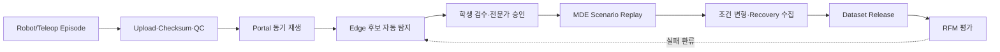
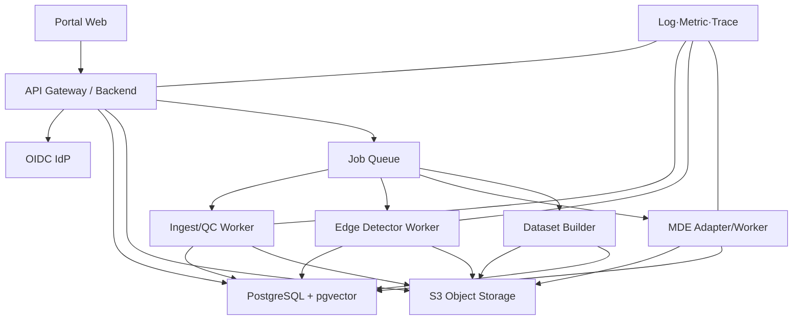
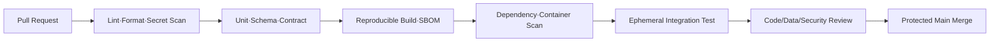

# SDP — MDE·Edge Case 로봇 데이터팩토리 소프트웨어 개발계획서

!!! abstract "문서 목적"
    본 문서는 [SRS](srs.md)를 구현·검증·배포하기 위한 **Software Development Plan(SDP)**입니다.
    43개월 연구개발사업의 연차 목표와, 실제 소프트웨어 개발팀이 수행할 2주 Sprint·Release·시험·
    형상관리·데이터 운영 절차를 함께 정의합니다.

    일정과 인력 수치는 기준안이며 컨소시엄 역할과 Pilot Use Case 확정 후 v1.0에서 동결합니다.

## 0. 문서 관리

| 항목 | 내용 |
|---|---|
| 문서 ID | HSU-RDF-SDP-001 |
| 문서명 | MDE·Edge Case 로봇 데이터팩토리 소프트웨어 개발계획서 |
| 버전 | v0.9 Draft Baseline |
| 기준일 | 2026-10-25 |
| 상위 요구사항 | [HSU-RDF-SRS-001](srs.md) |
| 작성 주체 | 한성대학교 PARC Lab |
| 적용 기간 | 착수일부터 사업 종료 및 기술이전·운영이관까지 |
| 개발 주기 | 2주 Sprint, 분기 Release Train, 연차 Phase Gate |

### 0.1 개정 이력

| 버전 | 일자 | 변경 내용 | 상태 |
|---|---|---|---|
| 0.9 | 2026-10-25 | 개발전략·WBS·일정·품질·배포 기준안 작성 | 검토 요청 |
| 1.0 | TBC | Use Case, 인력, Production 인프라, KPI 반영 | 기준선 예정 |

### 0.2 계획의 우선순위

1. 한 개의 Pilot Task로 **수집→검수→재현→생성→Release→RFM 평가**를 먼저 완성한다.
2. 원본 불변성과 데이터 계보를 기능 확장보다 먼저 확보한다.
3. MDE·Ontology·Edge Case Intelligence를 한성대의 독립 Work Package로 관리한다.
4. Kubernetes·Kafka·Graph DB 등은 측정된 병목이 있을 때 도입한다.
5. 공개 규격과 참여기관 비공개 데이터·파라미터를 Repository와 권한에서 분리한다.

---

## 1. 개발 목표와 성공 조건

### 1.1 개발 목표

- 실물 로봇, Teleoperation, Digital Twin, MDE 데이터를 동일 Episode Schema로 정규화
- 영상·센서·Event·Edge Case를 동기화해 검색·검수할 수 있는 Web Portal 제공
- Ontology 규칙과 다중 Detector를 이용해 Edge Case 후보 자동 추출
- 확정 Edge Case를 MDE에서 Replay하고 Parameter 변형 Episode 생성
- Dataset Release와 RFM 평가결과의 양방향 계보 확립
- 기관별 데이터 소유권·접근권한·반출·감사 요구 충족

### 1.2 Pilot 성공 조건

Pilot은 다음 End-to-End 시나리오가 모두 재현되면 성공으로 판정합니다.



- Pilot Robot 1종 이상, Task 1종 이상, 실환경과 Teleoperation Source 포함
- 카메라 2개 이상과 Robot State/Action 및 접촉 관련 Sensor 1개 이상 정렬
- 승인된 Edge Case 1종 이상을 MDE에서 재현
- 원본 Edge Case로부터 Version·Seed가 기록된 파생 Episode 생성
- Dataset Release와 RFM 평가 또는 Dummy Evaluation의 계보 확인
- 타 기관 Restricted 데이터에 대한 접근차단 시험 통과

정량 수집량과 정확도 목표는 SRS의 `TBC-001`, `TBC-005`, `TBC-006` 결정 후 추가합니다.

---

## 2. 개발 범위와 Work Package

| WP | 명칭 | 주관 제안 | 주요 산출물 |
|---|---|---|---|
| SW-1 | Platform Foundation | 한성대 Platform Team | 인증, API, DB, Object Storage, Queue, 관측성 |
| SW-2 | Data Ingest & QC | 한성대 Data Team + Robot 기관 | Connector, Manifest, 변환, QC Rule, Timeline Index |
| SW-3 | Portal & Review Workflow | 한성대 Platform Team | Episode Explorer, Viewer, Edge 검수, Admin |
| SW-4 | Ontology & Edge Intelligence | 한성대 | Ontology, Rule, Detector, Score, 유사검색 |
| SW-5 | MDE & Generation Orchestration | 한성대 | MDE Adapter, Calibration, Replay, Perturbation |
| SW-6 | Digital Twin/Asset Integration | 모빌테크 협력 + 한성대 검수 | Asset Registry, USD/GLB, Semantic/Physics Metadata |
| SW-7 | Dataset & RFM Interface | 한성대 + RFM 기관 | LeRobot Export, Release Manifest, 평가 Feedback |
| SW-8 | DevSecOps & Operations | 운영기관 + 한성대 | CI/CD, Backup, Monitoring, 보안, Runbook |

### 2.1 한성대학교 책임 경계

| 한성대 책임 | 입력 | 출력/Hand-off |
|---|---|---|
| MDE | Simulation-ready Asset, 물성시험, Robot/Task 조건 | 접촉·변형 Ground Truth, Replay·Generation Episode |
| Ontology | 제조공정·Asset·Task·Failure 용어 | Versioned Term/Relation/Rule Package |
| Edge Intelligence | Episode, Event, Model Feedback | 후보·Evidence·Score·Scenario Package |
| Human Data Engine | Task/Safety Protocol, Teleoperation 환경 | Demonstration, Failure/Recovery, 검수이력 |
| Data Platform | 기관별 Connector·정책 | Catalog, Portal, Release, Audit, API |

모빌테크의 원천 Geometry·현장취득·3D Asset 제작과 RFM 기관의 모델 소유·학습 책임은 별도
Interface Control Document(ICD)로 고정합니다.

---

## 3. 개발 생명주기

### 3.1 적용 방식

연구개발 불확실성이 큰 MDE·Detector는 **실험 Track**, 데이터·권한·Portal은 **제품 Track**으로
분리하되 분기 Release에서 통합합니다.

| Track | 방식 | 완료 조건 |
|---|---|---|
| Product Track | 2주 Sprint, 요구사항·시험 중심 | SRS, 자동시험, 운영성, 인수기준 충족 |
| Research Track | Hypothesis–Experiment–Evidence | Dataset·Code·Parameter·결과 재현 가능 |
| Data Operations | 수집–QC–검수–Release 반복 | 품질·계보·권한·검수 SLA 충족 |

### 3.2 Phase Gate

| Gate | 진입 조건 | 주요 활동 | 종료 조건 |
|---|---|---|---|
| G0 착수 | 컨소시엄 R&R 초안 | Use Case·데이터·보안 Workshop | Pilot Charter 승인 |
| G1 요구사항 기준선 | SRS v0.9 | TBC 결정, 위험분석, Interface 합의 | SRS/SDP v1.0 승인 |
| G2 Architecture Baseline | SRS v1.0 | PoC, ADR, 용량·성능 Benchmark | Architecture·Schema v1 승인 |
| G3 MVP | Core 인프라 준비 | Ingest, DB, Viewer, 수동 검수 | AC-E2E-001·002 통과 |
| G4 Pilot | MVP 승인 | Detector, MDE Replay, Release | AC-E2E-003~006 통과 |
| G5 Consortium Integration | Pilot Report | 다기관·다로봇 Connector, 보안·확장 | 통합시험·보안시험 통과 |
| G6 Production Readiness | 실증 Dataset | 이중화, Backup, 운영이관 | PRR 승인 |
| G7 종료·이관 | KPI 결과 | 문서·교육·기술이전·Archive | 최종 인수 |

### 3.3 2주 Sprint 절차

1. Sprint Planning: SRS ID와 인수기준이 있는 항목만 착수
2. 설계: 필요한 경우 ADR/API/Schema 변경안 승인
3. 구현: Feature Branch 또는 짧은 Topic Branch 사용
4. 검토: 최소 1인 Code Review, Core/보안 변경은 2인 검토
5. 자동검증: Unit, Integration, Migration, Security Scan
6. Demo: 실제 또는 합성 Episode로 수직기능 시연
7. Retrospective: 결함·데이터 반려·운영 Metric을 다음 Sprint에 반영

---

## 4. 일정 계획

### 4.1 착수 후 12개월 개발 일정

| 기간 | 목표 | 주요 결과 |
|---|---|---|
| M0~M1 | 요구사항·Pilot 동결 | SRS/SDP v1.0, Pilot Charter, Data Contract, Threat Model |
| M1~M2 | Architecture·PoC | DB/Object Storage PoC, Episode Schema, Upload·재생 Spike |
| M2~M4 | Core MVP | 인증, Ingest API, QC, Catalog, Viewer, Audit |
| M4~M6 | Review MVP | Event Marker, 수동 Edge 등록, 학생·전문가 Workflow |
| M5~M8 | Edge Intelligence v1 | Ontology, Rule/희소성 Detector, Score, 유사검색 |
| M6~M9 | MDE 연계 v1 | Asset·Material Registry, Replay Job, Ground Truth 수집 |
| M8~M10 | Generation·Release | Parameter Sweep, 파생계보, LeRobot Export, Dataset Release |
| M10~M11 | RFM Feedback | Model Evaluation, 실패 Episode 환류, Dashboard |
| M11~M12 | Pilot 안정화 | 부하·보안·복구시험, 운영 Runbook, Pilot 인수 |

### 4.2 43개월 연차 계획과 정렬

| 차년도 | 연구·개발 목표 | Software Release | 주요 Gate |
|---|---|---|---|
| 1차년도(9개월) | Pilot Use Case, Schema, MDE Prototype, Portal MVP | v0.1~v0.5 | G1~G4 |
| 2차년도 | Ontology·Detector 고도화, MDE Calibration, 다기관 연계 | v1.x | G5 |
| 3차년도 | 다로봇·다공정 확장, Active Edge Mining, RFM Closed Loop | v2.x | Production Trial |
| 4차년도 | 실증, KPI 검증, 안정화, 기술이전·운영이관 | v3.x/LTS | G6~G7 |

### 4.3 주요 Milestone

| ID | Milestone | 목표 시점 | 증적 |
|---|---|---|---|
| MS-01 | Pilot Charter 승인 | M1 | 승인 회의록·TBC 결정표 |
| MS-02 | Episode Schema v1 | M2 | JSON Schema·Migration·Sample Package |
| MS-03 | Portal MVP | M4 | AC-E2E-001 시연·시험성적서 |
| MS-04 | Review Workflow | M6 | AC-E2E-002 시연·감사 Log |
| MS-05 | Edge Detector v1 | M8 | 평가 Dataset·Precision/Recall Report |
| MS-06 | MDE Replay v1 | M9 | Reproduction Report·Scenario Package |
| MS-07 | Dataset Release v1 | M10 | Manifest·Checksum·LeRobot Export |
| MS-08 | Pilot Closed Loop | M12 | AC-E2E 전체·Pilot 결과서 |

---

## 5. 조직·인력·RACI

### 5.1 최소 개발조직 기준안

| 역할 | 기준 투입 | 책임 |
|---|---:|---|
| Product Owner/PI | 0.3~0.5 FTE | 범위, 우선순위, 대외 Interface, 인수 |
| Technical Lead/Architect | 1 FTE | Architecture, SRS/ADR, 통합, 기술부채 |
| Backend/Data Engineer | 1~2 FTE | API, DB, Ingest, QC, Release |
| Frontend Engineer | 0.5~1 FTE | Portal, Timeline Viewer, Review UX |
| MDE/Simulation Engineer | 1~2 FTE | MDE, Calibration, Replay, Generation |
| Ontology/ML Engineer | 1 FTE | Ontology, Detector, Embedding, 평가 |
| DevOps/Security Engineer | 0.5 FTE | CI/CD, Infra, Monitoring, Backup, IAM |
| QA/Data Quality Engineer | 0.5~1 FTE | Test, 품질규칙, Release 검증 |
| 학생 유급 참여자 | 6~9명/3개 조 | Teleoperation, 1차 검수, 재현·복구 수집 |

실제 인력은 기관별 예산과 역할분담 확정 후 조정하며, Core 역할의 단일인 의존성을 줄이기 위해
Architect–Backend, MDE–Ontology, DevOps–Data 간 교차 검토자를 지정합니다.

### 5.2 RACI

`R` 수행, `A` 최종책임, `C` 협의, `I` 공유

| 활동 | 한성대 | 모빌테크 | Robot 기관 | RFM 기관 | 수요/제조기관 |
|---|---:|---:|---:|---:|---:|
| Episode Schema·API | A/R | C | C | C | I |
| Geometry Twin·현장 Asset | C | A/R | I | I | C |
| Physics Metadata·MDE | A/R | C | C | I | C |
| Robot/Sensor Connector | C | I | A/R | I | C |
| Ontology·Edge Detector | A/R | C | C | C | C |
| Teleoperation 운영 | A/R | I | C | I | C |
| Dataset Release | A/R | C | C | C | C |
| RFM 학습·모델 평가 | C | I | C | A/R | C |
| 데이터 소유·반출 승인 | C | C | C | C | A/R |
| Production 운영 | R/TBC | C | C | C | A/TBC |

---

## 6. Software Architecture 개발계획

### 6.1 기준 서비스 구성



### 6.2 기술선정 기준

| 영역 | 초기 기준안 | 확장 판단 기준 |
|---|---|---|
| Web | React/Next.js | 조직 표준과 인력역량 |
| API | FastAPI | OpenAPI·Python Robot/ML 생태계 |
| Metadata | PostgreSQL | Transaction, JSONB, 권한, Migration |
| 유사검색 | pgvector | 데이터·Latency Benchmark 후 별도 Vector DB 검토 |
| Object | S3 호환 Storage | 용량·복제·지원정책에 따라 제품 확정 |
| Queue | Redis 기반 Queue | 지속 Event량과 재처리 요구 시 NATS/Kafka 검토 |
| Annotation | Portal 내 Review + 필요시 Label Studio 연동 | 복합 영상 Annotation 규모 증가 시 |
| Model Registry | MLflow 또는 동등 제품 | 컨소시엄 MLOps 표준 확정 시 |
| 배포 | Docker Compose/VM | HA·수평확장 요구 확인 시 Kubernetes 전환 |

### 6.3 Architecture Decision Record

다음 결정은 `ADR-xxxx-title.md`로 기록합니다.

- Metadata와 Payload 분리 원칙
- Episode ID와 Version 체계
- Object Storage 제품·배치 방식
- Graph DB 도입 또는 보류
- Queue·Workflow Engine 선택
- Timeline Streaming 방식
- Dataset Format과 확장 Field
- Multi-tenancy와 권한 모델
- MDE 실행 Resource Scheduler

ADR에는 Context, Decision, Alternative, Consequence, Security/Data Impact, 승인자를 포함합니다.

---

## 7. Repository와 형상관리

### 7.1 권장 Repository 구조

```text
robot-data-factory/
  apps/
    portal-web/
  services/
    platform-api/
    ingest-worker/
    edge-worker/
    dataset-builder/
  adapters/
    ros2-mcap/
    mde/
    digital-twin/
    rfm-evaluation/
  packages/
    schemas/
    ontology/
    sdk-python/
  infra/
    compose/
    kubernetes/
    terraform/
  migrations/
  tests/
    contract/
    integration/
    e2e/
    performance/
    security/
  docs/
    srs/
    sdp/
    adr/
    api/
    runbooks/
```

본 홈페이지 Repository에는 제안·규격 문서를 두고, 제조 원본 데이터와 Secret은 저장하지 않습니다.
Engine Source, Platform Source, 비공개 Parameter는 컨소시엄 접근통제 Repository로 분리합니다.

### 7.2 Git 규칙

- `main`은 항상 시험을 통과한 통합상태로 유지하고 보호 Branch로 설정한다.
- Feature Branch는 짧게 유지하고 Pull Request로만 병합한다.
- Pull Request는 SRS ID, 변경범위, 시험증적, Migration, 보안·데이터 영향을 기재한다.
- Release는 Semantic Version과 서명 Tag를 사용한다.
- 배포 Artifact는 Git SHA와 Container Digest를 함께 기록한다.
- Binary 원본·Dataset·Model은 Git에 넣지 않고 Object Storage/Registry URI를 기록한다.
- Secret, 개인정보, 제조사 원본 경로가 Commit에 포함되지 않도록 자동 Scan한다.

### 7.3 Branch·Release 정책

| 유형 | 예 | 목적 |
|---|---|---|
| Feature | `feat/FR-EDGE-003-score-version` | 요구사항 구현 |
| Fix | `fix/QC-timestamp-gap` | 결함 수정 |
| Research | `exp/mde-viscoelastic-v2` | 재현 가능한 실험, 제품 병합 전 검증 |
| Release Tag | `platform-v1.2.0` | 배포 기준선 |
| Schema Tag | `schema-v1.1.0` | Data Contract 기준선 |
| Ontology Tag | `ontology-v0.8.0` | 용어·Rule 기준선 |

---

## 8. 환경·인프라 계획

### 8.1 환경 분리

| 환경 | 데이터 | 용도 | 외부 접근 |
|---|---|---|---|
| Local | 합성·Fixture | 개발·Unit Test | 없음 |
| Dev | 비식별 Sample | 기능 통합 | 개발팀 |
| Staging | 승인된 Pilot 복제·합성 | E2E·성능·인수시험 | 검수자 |
| Pilot | 실제 Pilot 데이터 | 제한 실증 | 승인 참여기관 |
| Production | 운영 데이터 | 컨소시엄 서비스 | 정책 기반 |

Production 데이터를 Dev로 직접 복사하지 않으며, 필요 시 비식별·축소·승인 절차를 거칩니다.

### 8.2 초기 배포 단위

- Portal Web 1개
- Platform API 2개 이상 또는 재기동 가능한 단일 Instance(Pilot)
- PostgreSQL Primary + 정기 Backup(Pilot), Production HA는 TBC
- S3 호환 Object Storage와 Versioning/Replication
- Redis/Queue
- Ingest·Edge·Dataset Worker
- GPU 연결 MDE Worker
- OIDC IdP
- 중앙 Log·Metric·Alert

### 8.3 용량 산정식

```text
일일 원본 용량
= 일일 Episode 수
× Episode 평균 길이(초)
× Σ(카메라 Bitrate + Sensor Rate)

총 필요용량
= 일일 원본 용량 × 보존일수
+ 파생데이터
+ Dataset Release 복사본
+ Model/Checkpoint
+ 복제·Erasure Coding Overhead
+ 여유율
```

M1에 실제 Sample 20개 이상을 이용해 평균·p95 Episode 크기와 변환비율을 측정하고, TBC-002를
확정합니다.

---

## 9. DB·Schema 개발계획

### 9.1 Migration 원칙

- 모든 DB 변경은 Versioned Migration으로 수행한다.
- 운영 DB의 수동 DDL 실행을 금지한다.
- Schema 변경은 Backward Compatible 기간을 두고 `expand → migrate → contract` 순서로 진행한다.
- 대용량 Index 생성과 Backfill은 서비스 영향·Rollback 계획을 검토한다.
- Migration 전 Backup과 Staging 복원시험을 수행한다.

### 9.2 Schema 개발 순서

| 순서 | 범위 | 완료 기준 |
|---|---|---|
| 1 | Organization·Project·User·Role | 기관 격리 권한시험 통과 |
| 2 | Robot·Sensor·Task·Asset·Material | Version/참조 무결성 통과 |
| 3 | Episode·Stream·Event·QC | Pilot Package 등록·재생 |
| 4 | Ontology·Edge Case·Evidence | Review Workflow 통과 |
| 5 | Scenario·Generation Job·Lineage | MDE Replay 계보 확인 |
| 6 | Dataset Release·Model Evaluation | Closed Loop 인수시험 통과 |
| 7 | Partition·Index·Archive | 부하시험·용량시험 통과 |

### 9.3 데이터 Partition·Index 계획

- 초기 Episode·Event는 단일 Table로 시작하고 Query Plan을 계측한다.
- Event·Audit가 임계량을 넘으면 `project_id`와 시간기준 Partition을 검토한다.
- 일반 검색은 B-tree, JSONB/Ontology Tag는 GIN, 유사검색은 pgvector Index를 사용한다.
- Index 도입 전 대표 Query Set과 실제 Selectivity로 비교한다.
- 고주파 원본 Signal은 DB Row로 적재하지 않고 Parquet에 두며, DB에는 Range와 Summary만 둔다.

### 9.4 Test Data

Test Fixture는 다음을 포함합니다.

- 정상 Episode
- 필수 Stream 누락 Episode
- Timestamp Drift·Gap Episode
- Checksum 불일치 Package
- 다중 Edge Case가 중첩된 Episode
- 권한이 서로 다른 기관의 Episode
- 동일 원천에서 파생된 MDE·Generated Episode
- Split Leakage를 유발하는 Parent/Child 집합

---

## 10. MDE·Edge Intelligence 개발계획

### 10.1 MDE 개발 단계

| 단계 | 범위 | 검증 |
|---|---|---|
| MDE-P0 | Interface Skeleton, Dummy Worker | Job·Log·Result Contract 시험 |
| MDE-P1 | Material Profile·Contact Patch·기본 Response | 단위시험·단순 Coupon Test |
| MDE-P2 | 실측 Calibration·State History | 실측–Simulation 비교 |
| MDE-P3 | Edge Replay·Parameter Sweep | 동일 Seed 재현·계보시험 |
| MDE-P4 | 다소재·다Task·성능 최적화 | KPI·처리량·적용한계 Report |

각 실험은 Hypothesis, Input Dataset, Code SHA, Container Digest, Engine·Driver Version, Parameter,
Seed, Metric, 결과 Artifact를 기록합니다.

### 10.2 Edge Detector 개발 단계

| Detector | v1 | v2 | 평가 |
|---|---|---|---|
| Rule/Constraint | Ontology·Threshold | 상태전이·복합Rule | Rule별 TP/FP/FN |
| Rarity/Coverage | 빈도·구간 분포 | 조건 조합 Coverage | 승인 후보 적중률 |
| Anomaly | 단순 통계·Isolation | 시계열 Representation | AUROC/AUPRC + 검수시간 |
| Model Uncertainty | RFM Confidence 수신 | Ensemble/Disagreement | 실패 선행 탐지율 |
| Sim-to-Real Gap | 핵심 Signal 차이 | 접촉·변형 시계열 정렬 | Gap별 실패 상관 |

### 10.3 Score 관리

초기 Score는 다음 요소를 정규화해 Versioned 가중합으로 구성하되, 실제 가중치는 Pilot Label로
검증 후 확정합니다.

```text
edge_score_vN
= w_rule × rule_violation
+ w_rarity × rarity
+ w_uncertainty × model_uncertainty
+ w_gap × sim_real_gap
+ w_risk × safety_or_process_risk
```

- 가중치·Feature·Normalization·Threshold를 Detector Version에 포함한다.
- 자동 Score는 위험도·우선검수 순위를 돕는 값이며 최종 승인 자체를 대체하지 않는다.
- 학생·전문가 검수 차이를 측정하고 Annotation Guideline을 보완한다.

---

## 11. Portal·UX 개발계획

### 11.1 화면 Release 순서

| Release | 화면 | 핵심 기능 |
|---|---|---|
| UI-1 | Login·Dashboard | 인증, Project 선택, 수집·Job 상태 |
| UI-2 | Episode Explorer | Filter, 권한 적용, Saved Query |
| UI-3 | Episode Viewer | 다중 영상, Signal, Event/Edge Marker |
| UI-4 | Edge Review Queue | 할당, 1차 검수, 전문가 승인, 감사이력 |
| UI-5 | Scenario/MDE Job | Replay, Parameter Range, 실행상태, 결과 비교 |
| UI-6 | Dataset Release | 후보집합, QC, Split, Manifest, Export |
| UI-7 | Model Evaluation | Model·Dataset 비교, 실패 Episode 환류 |
| UI-8 | Admin | 사용자·기관·정책·Ontology·감사 |

### 11.2 사용성 기준

- Reviewer는 Episode 상세를 벗어나지 않고 재생·Marker 이동·Tag·판정을 완료할 수 있어야 한다.
- 단축키로 재생, 구간선택, 후보 확인·기각을 수행할 수 있어야 한다.
- 시스템 생성값, 학생 입력값, 전문가 승인값을 시각적으로 구분한다.
- 시간·힘·거리·각도 등 단위를 항상 표시한다.
- 위험한 실행·삭제·반출은 결과와 대상 범위를 재확인한다.
- 색상만으로 상태를 구분하지 않고 Text/Icon을 함께 사용한다.

---

## 12. 시험·품질보증 계획

### 12.1 시험 계층

| 시험 | 책임 | 자동화 목표 | 주요 대상 |
|---|---|---:|---|
| Unit | 개발자 | 핵심 Domain 80% 이상, 수치 자체보다 위험기반 | Parser, Rule, Score, 권한함수 |
| Schema/Contract | Data·API | 100% | Manifest, OpenAPI, MDE/RFM Interface |
| Integration | 개발팀 | 주요 경로 100% | DB, S3, Queue, IdP, Worker |
| E2E | QA/Product | SRS AC 전체 | 수집→Release→Feedback |
| Data Quality | Data QA | 필수 Rule 100% | Timestamp, 단위, 누락, Checksum |
| Performance | QA/DevOps | Release Gate | 검색, Viewer, Upload, Job Queue |
| Security | Security/DevOps | Release Gate | 인증, IDOR, 서명 URL, 격리, Secret |
| Recovery | DevOps | 분기 | DB/Object 복원, Queue 재처리 |
| Scientific Validation | MDE/ML | 주요 모델별 | 실측 대조, 재현성, Detector 평가 |

### 12.2 Release 품질 Gate

- Must 요구사항 관련 자동시험 통과율 100%
- Critical/High 보안취약점 0건 또는 승인된 Risk Acceptance
- 실패 Migration 및 Rollback/완화 절차 검증
- SRS Traceability Matrix 갱신
- API·Schema·운영문서 갱신
- Staging E2E와 권한격리 시험 통과
- 신규 Detector/MDE 모델의 재현 Package 및 평가 Report 등록
- 알려진 결함, 적용한계, 운영 변경사항을 Release Note에 기록

### 12.3 결함 우선순위

| 등급 | 정의 | 목표 대응 |
|---|---|---|
| P0 | 데이터 유출·원본 손실·안전 영향·전체 서비스 중단 | 즉시 대응, Release/운영 중단 |
| P1 | 주요 Workflow 불가·계보 훼손·반복 장애 | 1영업일 내 완화계획 |
| P2 | 우회 가능한 기능장애·성능저하 | 다음 Sprint 우선 처리 |
| P3 | UI·문서·경미한 개선 | Backlog 관리 |

---

## 13. CI/CD·Release·배포

### 13.1 Pull Request Pipeline



### 13.2 Release Pipeline

1. Main 기준 Release Candidate 생성
2. Container Image와 SBOM 생성·서명
3. Staging DB Migration
4. Sample Episode Replay와 E2E 수행
5. 보안·성능·복구 검증
6. Product Owner·운영담당 승인
7. Pilot/Production 점진 배포
8. Metric·Error·Queue 관찰
9. 성공 시 Release Tag, 실패 시 Rollback/Roll-forward

### 13.3 배포 전략

- DB 파괴적 변경 없이 Application을 먼저 호환 배포한다.
- 긴 Job은 배포 전 Drain하거나 재개 가능한 Checkpoint를 둔다.
- Portal/API는 Rolling 또는 Blue/Green, MDE Worker는 Version별 Queue 분리를 우선한다.
- 생성 Episode에는 실제 사용한 Worker Image Digest를 기록한다.
- Emergency Hotfix도 사후 Pull Request와 시험증적을 남긴다.

---

## 14. 보안·개인정보 개발계획

### 14.1 개발 단계별 활동

| 단계 | 활동 |
|---|---|
| 요구사항 | 데이터 등급, 소유권, 반출, 개인정보, Threat 정리 |
| 설계 | Trust Boundary, 권한 Matrix, Abuse Case, Secret 흐름 검토 |
| 구현 | Secure Coding, Dependency Pinning, Secret/PII Scan |
| 시험 | 인증우회, IDOR, 서명 URL 재사용, 기관격리, Log 노출 시험 |
| 배포 | 최소권한 Service Account, Network Policy, 암호화, Backup |
| 운영 | 감사, 취약점 Patch, Key Rotation, Incident Drill |

### 14.2 주요 Threat와 통제

| Threat | 통제 |
|---|---|
| 타 기관 Episode ID 추측·조회 | 서버측 Object Authorization, UUID만 신뢰하지 않음 |
| 서명 URL 공유 | 짧은 TTL, 권한 확인 후 발급, 감사 Log, 필요시 IP/Network 제한 |
| 악성 파일 Upload | 확장자·MIME·크기·Checksum 검사, 격리 Bucket, Malware Scan |
| Dataset Poisoning | Source 신뢰등급, QC, 승인, 계보, Release Freeze |
| Secret 노출 | Secret Store, Commit Scan, Log Masking, Rotation |
| 학생 개인정보 노출 | 가명 ID, 분리 저장, 최소수집, 권한·보존정책 |
| MDE/Worker Supply Chain | 고정 Image Digest, SBOM, 서명, 취약점 Scan |
| Prompt/외부 AI 데이터 유출 | Restricted 데이터의 외부 서비스 전송 차단·승인정책 |

---

## 15. 데이터 운영·학생 검수계획

### 15.1 데이터 운영 흐름

| 단계 | 담당 | SLA/기준안 | 증적 |
|---|---|---|---|
| 수집 등록 | Robot/Data Operator | 수집 직후 | Manifest·Upload Log |
| 자동 QC | Platform | Queue 상황에 따른 TBC | QC Result |
| 후보 탐지 | Detector Worker | Batch/On-demand | Detector Run |
| 학생 1차 검수 | 유급 참여자 | 할당 후 TBC | Review History |
| 전문가 승인 | 연구책임자/전문가 | 위험도 우선 | Approval Log |
| MDE 재현 | MDE Engineer | 승인 후보 기준 | Scenario/Result Package |
| Dataset Release | Data Steward | Release Train | Manifest·승인서 |

### 15.2 학생 운영 통제

- MD-3 또는 사전교육 이수자 중 유급 참여자를 별도 선발한다.
- 교육용 실습 데이터와 과제 납품 Dataset의 작업 Queue를 분리한다.
- 검수자는 자신이 생성한 데이터의 최종 승인을 할 수 없다.
- Annotation Guideline, Golden Set, 정기 일치도 평가를 운영한다.
- 일치도가 기준 미달이면 재교육 후 재검수하며 기준은 Pilot에서 확정한다.
- 모든 조가 Operator, Safety, Data, Simulation, Validation, Reporter 역할을 순환 경험한다.

### 15.3 Dataset Release 승인

Release에는 다음 승인자가 필요합니다.

- Data Steward: Schema·QC·계보·중복·Split
- 데이터 소유기관: 이용범위·반출·License
- MDE/Ontology 책임자: 생성조건·Ground Truth·Tag
- RFM 담당자: 입력호환성·Split·Metric
- 보안/IP 담당: 공개범위·민감정보·특허 선출원 여부

---

## 16. 운영·모니터링·복구

### 16.1 핵심 SLI

| 영역 | SLI |
|---|---|
| API | 요청수, p50/p95/p99 Latency, Error율 |
| Ingest | Upload 성공률, Checksum 실패, QC 시간, 재시도 |
| Queue | 대기 Job, 가장 오래된 Job, Worker 사용률 |
| Storage | 사용량, 증가율, Object Error, 복제 상태 |
| DB | Connection, Query Latency, Lock, Replication/Backup 상태 |
| Edge | 후보 수, 승인율, Detector별 FP/FN, 검수시간 |
| MDE | Job 성공률, GPU 시간, 재현율, Episode 생성량 |
| Release | QC 통과율, 중복률, Split Leakage, Export 시간 |

### 16.2 Runbook 목록

- Object Upload 실패/중단 복구
- Checksum 불일치 격리
- QC Queue 적체
- PostgreSQL 장애 및 Point-in-time 복구
- Object Storage 장애·Version 복구
- 권한 오설정·데이터 노출 사고
- MDE Worker/GPU 장애
- Dataset Release 취소·폐기
- Key/Secret Rotation
- 사용자·기관 Offboarding

### 16.3 Backup·복원시험

- DB Backup과 Object Version/Replication을 서로 독립적으로 검증한다.
- Release Manifest와 Ontology·Schema·Migration을 별도 보관한다.
- 분기 복원시험은 격리환경에서 수행하고 RPO/RTO 실측값을 기록한다.
- 원본과 Metadata 중 하나만 복원된 상태를 정상으로 판정하지 않는다.
- 복원 후 무작위 Episode의 Manifest–Object Checksum을 대조한다.

---

## 17. 위험관리

| ID | 위험 | 가능성/영향 | 조기 신호 | 대응 | Owner |
|---|---|---|---|---|---|
| R-01 | Pilot Use Case 확정 지연 | 중/상 | Sensor·Task 반복 변경 | 1개 Task 임시 동결, Adapter 분리 | PO |
| R-02 | 기관 역할·성과 귀속 중첩 | 중/상 | 동일 산출물 중복개발 | ICD·LCIV·산출물 단위 RACI | PMO |
| R-03 | 저장용량 급증 | 상/상 | 예측 대비 일일 증가율 초과 | Preview·Lifecycle·용량 Gate·증설 | Infra |
| R-04 | Timestamp/Calibration 불량 | 상/상 | QC 반려 증가 | Source SDK·사전검사·Calibration Registry | Data |
| R-05 | 물성 식별 실패 | 중/상 | 실측–Sim 오차 미감소 | 소재군 축소, 불확실성 표기, 모델 교체 | MDE |
| R-06 | MDE 처리시간 과다 | 중/상 | Queue 지연·GPU 비용 증가 | 실시간/Batch 모드 분리, Surrogate 검토 | MDE |
| R-07 | Detector False Positive 과다 | 상/중 | 승인율 저하·검수시간 증가 | Rule별 평가, Threshold 조정, Active Learning | Edge |
| R-08 | 학생 검수 편향 | 중/중 | Reviewer 간 불일치 | Golden Set·이중검수·재교육 | Data QA |
| R-09 | 데이터 유출·반출 위반 | 중/최상 | 비정상 다운로드 | RBAC·서명 URL·감사·DLP·Incident Plan | Security |
| R-10 | 외부 Framework 변경 | 중/중 | Build/API 파손 | Version Pin, Adapter, Contract Test | Architect |
| R-11 | Graph/K8s 등 조기 과설계 | 중/중 | 운영복잡도·개발지연 | MVP 기술선정 Gate, 측정 후 도입 | Architect |
| R-12 | RFM Feedback 미연계 | 중/상 | 실패 Episode ID 부재 | Evaluation Contract 선행·Dummy Adapter | RFM |

위험은 매 Sprint 검토하고, 가능성·영향·완화상태가 바뀌면 Risk Register와 관련 Issue를 갱신합니다.

---

## 18. 성과·개발 Metric

### 18.1 제품·운영 Metric

- Episode Upload 성공률과 자동 QC 통과율
- Metadata 완전성·Checksum 검증률
- 검색·Viewer p95 Latency
- Edge 후보 승인율과 검수 Lead Time
- MDE Job 성공률과 동일조건 재현율
- Release당 Episode·Edge Case·Recovery 분포
- Dataset Split Leakage 0건
- 기관 권한 위반 0건
- Backup 복원 성공률과 실측 RPO/RTO

### 18.2 연구 Metric

- 물성·접촉·변형별 실측–Simulation 오차
- Detector별 Precision, Recall, AUPRC와 검수절감 시간
- 실환경 Edge Case의 MDE 재현 가능 비율
- 변형 생성 데이터가 RFM 성능에 주는 개선량
- 정상 성능을 훼손하지 않는 Edge Case 강건성 개선량
- Robot·Task·작업자·Asset·Material Coverage

Metric 정의, 분모, 제외조건, Dataset, Code Version을 함께 관리하며 보고서 수치만 별도로 복사하지
않습니다.

---

## 19. 산출물·문서 계획

| 분류 | 산출물 | 갱신 시점 |
|---|---|---|
| 요구·계획 | SRS, SDP, Pilot Charter, RACI | 기준선·변경승인 시 |
| 설계 | Architecture, ADR, ERD, API, Data Contract, ICD | 변경 시 |
| 데이터 | Manifest Schema, Ontology, QC Rule, Annotation Guideline | Version Release 시 |
| MDE | Engine Spec, Material Schema, Calibration Protocol, 적용한계 | 모델 Release 시 |
| 시험 | Test Plan, Traceability, 성능·보안·복구·재현 Report | Release/Gate 시 |
| 운영 | Deployment Guide, Runbook, Backup·Incident Plan | 운영변경 시 |
| Release | SBOM, Image Digest, Migration, Release Note | 매 Release |
| 사업 | 연차 KPI Report, Dataset/Model 통계, 기술이전 자료 | 분기·연차·종료 |

문서는 Git에서 Version 관리하고, 승인본은 Tag 또는 불변 문서 저장소에 보존합니다. 기업 비공개
Parameter·원본 경로·Credential은 공개 문서에 포함하지 않습니다.

---

## 20. 변경관리

### 20.1 변경요청 필수 항목

- 변경 이유와 요청기관
- 영향받는 SRS ID·Interface·Schema·Dataset
- 일정·비용·인력·보안·IP 영향
- 기존 데이터와 Client 호환성
- Migration·Rollback·재처리 계획
- 시험·인수 기준
- 승인자와 적용 Release

### 20.2 변경 승인 수준

| 변경 | 승인 |
|---|---|
| 문구·UI 경미 수정 | Product Owner |
| API 추가·Backward Compatible Schema | Technical Lead + Data Steward |
| 파괴적 Schema·Dataset 의미 변경 | Architecture Board + 참여기관 Interface 담당 |
| 데이터 등급·반출·보존 정책 | 데이터 소유기관 + 보안/IP |
| MDE Ground Truth·Metric 정의 변경 | MDE 책임자 + RFM/검증기관 |
| 연차 범위·KPI·예산 영향 | PMO/컨소시엄 승인체계 |

---

## 21. 착수 체크리스트

### G0 → G1

- [ ] Pilot 제조 Use Case 1건과 성공·실패 정의
- [ ] Robot·Sensor·Sampling Rate·좌표계 목록
- [ ] Sample Episode 20건 이상 또는 동등한 초기 Sample
- [ ] 제조 원본 데이터 소유·반출·보존 정책
- [ ] 학생 참여·개인정보·안전 검토
- [ ] 모빌테크 Asset 전달형식·좌표·Scale·Version 합의
- [ ] RFM 입력 Schema와 Evaluation Feedback 형식 합의
- [ ] SRS TBC-001~008 담당자와 결정일 지정

### G1 → G2

- [ ] Architecture·Trust Boundary Review
- [ ] DB ERD·Object Key·Manifest JSON Schema v1
- [ ] 용량·Network·GPU Benchmark
- [ ] OIDC/RBAC PoC와 기관격리 시험
- [ ] MCAP→Parquet/Preview 변환 PoC
- [ ] MDE Dummy Job Contract와 Scenario Package Sample
- [ ] CI Pipeline, Secret Scan, Backup PoC

### G2 → G3

- [ ] Episode Upload·QC·Viewer 수직기능
- [ ] Event/Edge Marker와 검수이력
- [ ] 감사 Log·서명 URL·다운로드 정책
- [ ] Staging E2E·성능·권한시험
- [ ] 운영 Dashboard·Alert·Runbook 초안
- [ ] Pilot 사용자 교육과 Support 채널

---

## 22. 승인란

| 구분 | 소속/성명 | 검토 결과 | 일자 | 서명/승인 ID |
|---|---|---|---|---|
| 작성 | 한성대학교 PARC Lab |  |  |  |
| 기술 검토 |  |  |  |  |
| 데이터 검토 |  |  |  |  |
| 보안·IP 검토 |  |  |  |  |
| 운영 검토 |  |  |  |  |
| 최종 승인 |  |  |  |  |

---

## 관련 문서

- **[SRS — 시스템 요구사항 명세서](srs.md)**
- [ODD·SOTIF SRS — 제조 ODD·SOTIF Episode 전용 요구사항](odd-sotif-srs.md)
- **[ODD·SOTIF SDP — LG·한성대 2-Site 개발·구축계획](odd-sotif-sdp.md)**
- [대표 프로젝트 페이지](index.md)
- [기술 상세](technical.md)

[:octicons-arrow-left-24: 대표 프로젝트로](index.md)
