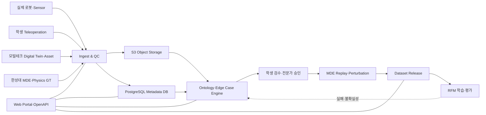
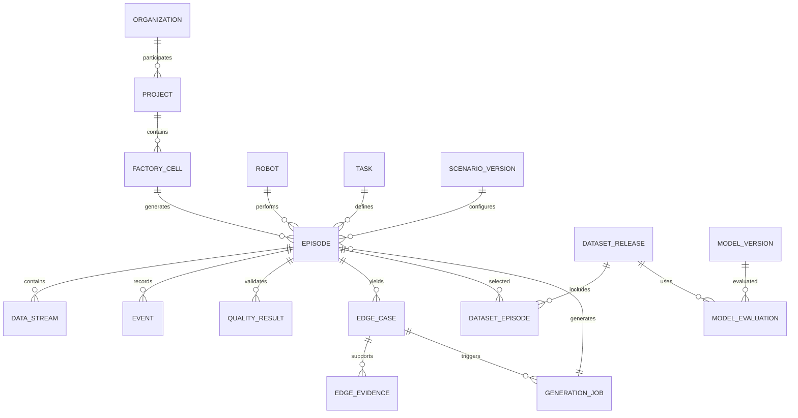
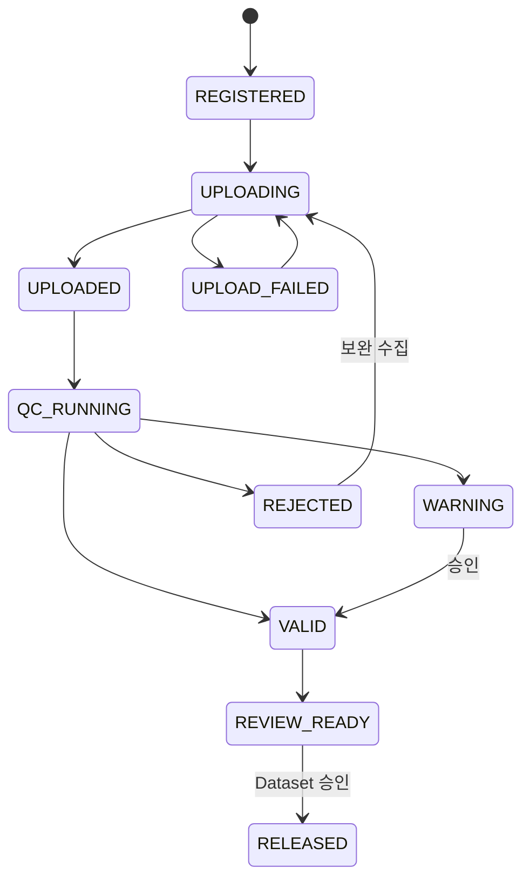
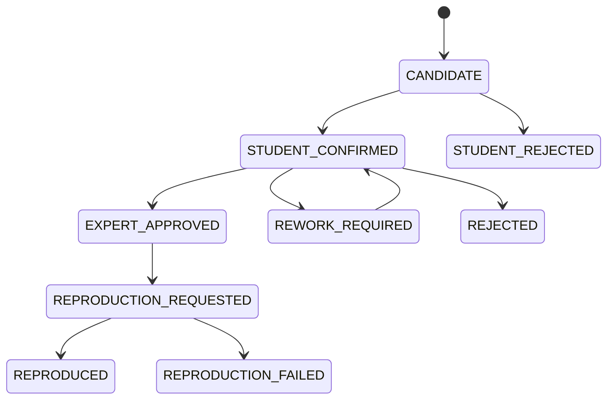

# SRS — MDE·Edge Case 로봇 데이터팩토리 시스템 요구사항 명세서

!!! abstract "문서 목적"
    본 문서는 한성대학교가 주도하는 **Manufacturing Deformation Engine(MDE)**, Ontology 기반
    Edge Case 추출·생성, 학생 Teleoperation, 제조환경 Digital Twin 및 RFM 학습데이터 운영을
    하나의 시스템으로 연결하기 위한 **Software Requirements Specification(SRS)** 기준안입니다.

    구현팀은 본 문서의 요구사항 ID를 Issue, 설계, 시험성적서와 연결해야 합니다. `TBC`는 협의 후
    확정할 항목, `TBD`는 근거 데이터 확보 후 결정할 항목입니다.

## 0. 문서 관리

| 항목 | 내용 |
|---|---|
| 문서 ID | HSU-RDF-SRS-001 |
| 문서명 | MDE·Edge Case 로봇 데이터팩토리 시스템 요구사항 명세서 |
| 버전 | v0.9 Draft Baseline |
| 기준일 | 2026-10-25 |
| 작성 주체 | 한성대학교 PARC Lab |
| 검토 주체 | 컨소시엄 PMO, 제조·로봇·RFM·Digital Twin 참여기관 |
| 승인 주체 | 컨소시엄 기술책임자 및 데이터 거버넌스 책임자(TBC) |
| 적용 단계 | Pilot → 통합개발 → 실증 → 운영 |

### 0.1 개정 이력

| 버전 | 일자 | 변경 내용 | 상태 |
|---|---|---|---|
| 0.9 | 2026-10-25 | DB·Portal·MDE·Edge Case 요구사항 최초 기준안 | 검토 요청 |
| 1.0 | TBC | 컨소시엄 Use Case, KPI, 보안등급 반영 | 기준선 예정 |

### 0.2 요구사항 표기 규칙

| 구분 | 접두어 | 예시 |
|---|---|---|
| 기능 요구사항 | FR | FR-ING-001 |
| 데이터 요구사항 | DR | DR-EPI-001 |
| 외부 인터페이스 | IF | IF-MDE-001 |
| 비기능 요구사항 | NFR | NFR-PERF-001 |
| 업무 규칙 | BR | BR-REL-001 |
| 인수 기준 | AC | AC-E2E-001 |

우선순위는 `Must`, `Should`, `Could`로 관리하며, `Must` 미충족 항목은 해당 Release의 인수를
제한합니다. 각 요구사항의 검증 방법은 `시험`, `분석`, `검사`, `시연` 중 하나 이상을 사용합니다.

---

## 1. 개요

### 1.1 시스템 목적

시스템은 실환경 로봇, 학생 Teleoperation, 모빌테크 Digital Twin, MDE 및 RFM 기관에서 발생하는
멀티모달 데이터를 Episode 단위로 수집·검증·검색·재생하고, Edge Case를 추출·승인·재현·생성하여
버전화된 RFM Dataset으로 제공해야 합니다.

### 1.2 범위

**포함 범위**

- ROS 2/MCAP, 영상, 시계열 센서, Digital Twin Asset, MDE Ground Truth 수집
- Object Storage와 PostgreSQL 기반 데이터 카탈로그
- Episode 중심 영상·센서 동기 재생 Portal
- Manufacturing Ontology 및 데이터 제약조건 관리
- 규칙·희소성·상태전이·모델 불확실성·Sim-to-Real Gap 기반 Edge Case 후보 추출
- 학생 1차 검수, 전문가 승인, 반려 및 재검수 Workflow
- 확정 Edge Case의 MDE Replay, 조건 변형, 합성 Episode 생성
- LeRobotDataset 계열 Dataset Release와 RFM 평가 연계
- 기관별 접근통제, 감사, 반출승인, 계보 및 버전 관리

**제외 범위**

- RFM 자체의 범용 사전학습 모델 개발
- 제조기업의 MES·PLM·ERP 전체 기능 대체
- 원본 제조데이터의 임의 공개 또는 소유권 이전
- MDE가 사용하지 않는 범용 CAD 저작·편집 기능
- 로봇 Safety PLC나 비상정지 장치의 기능 대체

### 1.3 용어

| 용어 | 정의 |
|---|---|
| Episode | 하나의 Task 시도에 포함된 관측·상태·행동·이벤트·결과의 시간 동기화 단위 |
| MDE | 로봇 접촉에 의한 물체·표면의 변형·복원·누적상태를 재현하고 Ground Truth를 생성하는 엔진 |
| Edge Case | 빈도가 낮거나 위험도가 높고, 모델 실패·불확실성·Domain Gap을 유발하는 조건 또는 상태전이 |
| Scenario Version | Asset, Material, 환경, Task, 로봇, Sensor, Random Seed의 고정된 조합 |
| Dataset Release | 승인된 Episode 집합, Schema, Split, Manifest, Checksum을 동결한 학습·평가 배포 단위 |
| Ground Truth | Simulation 또는 실측·검수로 확정한 상태, 접촉, 변형, 성공·실패 등의 기준값 |
| Provenance | 데이터의 원천, 변환, 승인, 생성, 학습 사용 이력을 추적하는 계보 정보 |
| ODD | 로봇 기능이 의도대로 작동해야 하는 환경·작업·물성·설비·운영 조건의 범위 |

### 1.4 참조 기준

- [대표 프로젝트 페이지](index.md)
- [기술 상세](technical.md)
- [LeRobotDataset v3](https://huggingface.co/docs/lerobot/lerobot-dataset-v3)
- [MCAP ROS 2 가이드](https://mcap.dev/guides/getting-started/ros-2)
- [W3C SHACL](https://www.w3.org/TR/shacl/)
- [NVIDIA Isaac Sim](https://docs.isaacsim.omniverse.nvidia.com/latest/)

---

## 2. 시스템 개요

### 2.1 시스템 컨텍스트



### 2.2 사용자 역할

| 역할 | 주요 권한 |
|---|---|
| Platform Administrator | 전역 설정, 기관·사용자·정책 관리, 장애 대응 |
| Organization Administrator | 소속기관 사용자, Namespace, 반출승인 관리 |
| Data Engineer | 수집 Connector, Schema, 변환·품질 Job 운영 |
| MDE Engineer | Material·Scenario·Engine 버전 및 생성 Job 관리 |
| Student Reviewer | 할당 Episode 재생, 후보 태깅, 1차 확인·반려 요청 |
| Expert Reviewer | Edge Case 최종 승인, 병합, 재현 요청, 품질 판정 |
| RFM Engineer | Dataset 조회·승인본 Export, 모델 평가결과 등록 |
| Auditor/Viewer | 허용된 Metadata·Report 열람, 감사증적 조회 |

### 2.3 설계 원칙

1. **원본 불변** — 수집된 Raw Object는 덮어쓰지 않는다.
2. **Episode 중심** — 폴더가 아니라 Episode ID가 검색·검수·학습의 기준이다.
3. **Metadata와 Payload 분리** — 대용량 영상·MCAP·Parquet은 Object Storage, 관계와 상태는 DB에 둔다.
4. **재현 가능성** — Asset·Material·Scenario·Model·Schema·Seed 버전을 모두 고정한다.
5. **사람이 최종 승인** — 자동 탐지 결과는 후보이며 전문가 승인 전 확정 데이터로 사용하지 않는다.
6. **기관 격리** — 소유기관과 데이터 등급에 따라 열람·다운로드·생성을 분리한다.
7. **표준 우선** — REST/OpenAPI, S3, ROS 2/MCAP, Parquet, MP4, USD, LeRobotDataset을 우선 사용한다.

### 2.4 전제 및 제약

- HSU-PAC은 개발·검증 Seed Platform이며, Production 규모는 컨소시엄 인프라 확정 후 산정한다.
- 대상 로봇·센서·Use Case·초기 저장용량은 `TBC`이다.
- 제조사 원본 데이터의 외부 반출·공개는 소유기관 승인 없이는 금지한다.
- 학생 교육 데이터와 과제 Dataset 생산 데이터는 사용자·품질·비용·승인 흐름을 구분한다.
- 안전제어는 로봇 제어기와 현장 안전시스템이 담당하고 Portal은 이를 대체하지 않는다.

---

## 3. 목표 아키텍처와 기준 기술

### 3.1 논리 계층

| 계층 | 책임 | 기준 기술 |
|---|---|---|
| Data Source | 실물·Teleoperation·Simulation·Asset 생성 | ROS 2, MCAP, Isaac Sim, MDE, USD |
| Ingest | 등록, Upload URL, Manifest, Checksum, 변환 Job | FastAPI, Worker Queue |
| Storage | 대용량 Payload·Metadata·검색 Index | S3 호환 Storage, PostgreSQL, pgvector |
| Intelligence | Ontology 검증, 후보 탐지, Score, 유사검색 | Rule Engine, SHACL, ML Inference |
| Application | 검색, Timeline 재생, 검수, 생성, Release | Web Portal, REST/OpenAPI |
| MLOps | 학습·평가 Run과 Model 계보 | MLflow 또는 동등 기능 |
| Operations | 인증, 감사, 관측성, Backup | OIDC, RBAC, Metrics, Log, Trace |

### 3.2 데이터 배치 원칙

| 데이터 | 저장 위치 | DB 저장 내용 |
|---|---|---|
| MP4·RGB-D·Image | Object Storage | URI, Codec, FPS, 시간범위, Checksum |
| ROS Bag·MCAP | Object Storage | URI, Topic 목록, 시작·종료, Checksum |
| Joint·Action·F/T·Tactile | Parquet/Object Storage | Schema, 단위, Sampling Rate, Row Range |
| USD·GLB·Texture | Object Storage | Asset ID, Version, Semantic, License |
| Episode·Event·Edge Case | PostgreSQL | 관계, 상태, 점수, 승인, 계보 |
| 유사검색 Embedding | pgvector | Model Version, 차원, 대상 ID, Vector |
| Model·Checkpoint | Object Storage/Registry | Run, Dataset Release, Metric, Artifact URI |

---

## 4. 기능 요구사항

### 4.1 데이터 수집·등록

| ID | 요구사항 | 우선순위 | 검증 |
|---|---|---:|---|
| FR-ING-001 | 시스템은 모든 수집 시도에 전역 고유 `episode_id`를 발급해야 한다. | Must | 시험 |
| FR-ING-002 | Client는 Episode Metadata를 먼저 등록하고 Payload용 제한시간 Upload URL을 받아야 한다. | Must | 시험 |
| FR-ING-003 | 시스템은 MP4, MCAP, Parquet, JSON, USD/GLB와 승인된 확장자를 수집해야 한다. | Must | 시험 |
| FR-ING-004 | 수집 단위는 `manifest.json`을 포함하고 Schema Version을 명시해야 한다. | Must | 검사 |
| FR-ING-005 | 시스템은 업로드 완료 시 파일별 크기와 SHA-256 Checksum을 검증해야 한다. | Must | 시험 |
| FR-ING-006 | 중복 Checksum 또는 동일 Source Event ID가 입력되면 중복 후보로 표시해야 한다. | Must | 시험 |
| FR-ING-007 | 수집 실패 시 완료된 Object를 삭제하지 않고 재개 가능한 상태로 보존해야 한다. | Should | 시험 |
| FR-ING-008 | 로봇·Sensor·Calibration·Task·Scenario의 미등록 Version 참조를 거부하거나 격리해야 한다. | Must | 시험 |
| FR-ING-009 | 시스템은 Real, Teleoperation, MDE, Isaac Sim, Generated Source를 구분해야 한다. | Must | 검사 |
| FR-ING-010 | 수집 완료 후 QC·Thumbnail·Preview·Parquet 변환 Job을 비동기로 실행해야 한다. | Must | 시연 |
| FR-ING-011 | 실패한 Job은 원인·재시도 횟수·최종 상태를 기록해야 한다. | Must | 검사 |
| FR-ING-012 | 관리자는 Source별 동시 Upload와 Job 우선순위를 설정할 수 있어야 한다. | Should | 시험 |

### 4.2 품질검사·시간 동기화

| ID | 요구사항 | 우선순위 | 검증 |
|---|---|---:|---|
| FR-QC-001 | 필수 Stream 존재 여부를 Task Profile 기준으로 검사해야 한다. | Must | 시험 |
| FR-QC-002 | 영상·센서 Timestamp의 단조 증가, Gap, 중복, Drift를 검사해야 한다. | Must | 시험 |
| FR-QC-003 | 단위·좌표계·Sampling Rate·Calibration Version을 검사해야 한다. | Must | 시험 |
| FR-QC-004 | NaN, Infinity, 물리범위 이탈 및 비정상 고정값을 검출해야 한다. | Must | 시험 |
| FR-QC-005 | QC 결과는 Rule ID, 결과, 측정값, 임계값, 증거 URI로 기록해야 한다. | Must | 검사 |
| FR-QC-006 | QC 상태는 `PENDING/VALID/WARNING/REJECTED`로 관리해야 한다. | Must | 시험 |
| FR-QC-007 | QC Rule과 임계값은 Version으로 관리되고 과거 결과의 적용 Version을 보존해야 한다. | Must | 검사 |
| FR-QC-008 | 권한 보유자는 사유를 남기고 WARNING을 승인할 수 있으나 REJECTED를 직접 VALID로 변경할 수 없어야 한다. | Must | 시험 |

### 4.3 카탈로그·검색·재생

| ID | 요구사항 | 우선순위 | 검증 |
|---|---|---:|---|
| FR-CAT-001 | Project, 기관, Cell, Robot, Task, Source, 성공 여부, 날짜로 Episode를 검색해야 한다. | Must | 시험 |
| FR-CAT-002 | Asset, Material, Scenario, Edge Type, Review 상태, Score 범위로 복합 검색해야 한다. | Must | 시험 |
| FR-CAT-003 | 검색 결과는 권한이 없는 Episode의 존재·Metadata·Thumbnail을 노출하지 않아야 한다. | Must | 보안시험 |
| FR-CAT-004 | Episode 상세에서 다중 영상과 시계열을 하나의 Timeline으로 탐색해야 한다. | Must | 시연 |
| FR-CAT-005 | Event와 Edge Case 구간을 Timeline Marker로 표시해야 한다. | Must | 시연 |
| FR-CAT-006 | 원본·파생·생성 Episode 간 Parent/Child 계보를 표시해야 한다. | Must | 시연 |
| FR-CAT-007 | 승인된 사용자는 Metadata와 Annotation을 CSV/JSON으로 내보낼 수 있어야 한다. | Should | 시험 |
| FR-CAT-008 | 사용자는 자연어·Tag·Embedding 기반 유사 Episode 검색을 수행할 수 있어야 한다. | Could | 시연 |

### 4.4 Ontology와 의미 검증

| ID | 요구사항 | 우선순위 | 검증 |
|---|---|---:|---|
| FR-ONT-001 | Asset, Process, Task, State, Material, Failure, Recovery 용어를 전역 ID로 관리해야 한다. | Must | 검사 |
| FR-ONT-002 | 용어의 한·영 명칭, 정의, 상위개념, 동의어, 폐기 상태를 관리해야 한다. | Must | 시험 |
| FR-ONT-003 | Ontology Term과 Relation 변경은 Version과 변경 사유를 보존해야 한다. | Must | 검사 |
| FR-ONT-004 | Episode·Event·Edge Case는 승인된 Ontology Term을 참조해야 한다. | Must | 시험 |
| FR-ONT-005 | 필수 속성·허용 관계·금지 상태전이를 기계 검증 가능한 Rule로 관리해야 한다. | Must | 시험 |
| FR-ONT-006 | Rule 위반 결과를 Episode QC 및 Edge Case Evidence와 연결해야 한다. | Must | 시연 |
| FR-ONT-007 | RDF/JSON-LD 등 교환 형식 Export를 지원해야 한다. | Should | 시험 |

### 4.5 Edge Case 추출·검수

| ID | 요구사항 | 우선순위 | 검증 |
|---|---|---:|---|
| FR-EDGE-001 | 규칙 위반, 희소 조합, 상태전이 이상, RFM 불확실성, Sim-to-Real Gap을 후보 근거로 사용해야 한다. | Must | 시험 |
| FR-EDGE-002 | 후보는 Episode 내 시작·종료 Timestamp와 Evidence를 가져야 한다. | Must | 검사 |
| FR-EDGE-003 | Score 계산식과 가중치는 Version으로 관리해야 한다. | Must | 검사 |
| FR-EDGE-004 | 동일 시간대·유형의 중복 후보를 병합하되 원 Evidence를 보존해야 한다. | Must | 시험 |
| FR-EDGE-005 | Student Reviewer는 확인, 수정제안, 병합제안, 기각제안을 수행할 수 있어야 한다. | Must | 시험 |
| FR-EDGE-006 | Expert Reviewer만 최종 승인·기각·재현요청을 할 수 있어야 한다. | Must | 권한시험 |
| FR-EDGE-007 | 모든 상태 변경은 Actor, 시각, 이전·이후 상태, 사유를 기록해야 한다. | Must | 검사 |
| FR-EDGE-008 | 승인 Edge Case는 Ontology Tag와 Risk·Rarity·Reproducibility를 가져야 한다. | Must | 검사 |
| FR-EDGE-009 | 모델별 False Positive·False Negative 검수 결과를 탐지기 개선 데이터로 축적해야 한다. | Should | 시연 |
| FR-EDGE-010 | 유사 Edge Case와 기존 Recovery Demonstration을 제시해야 한다. | Should | 시연 |
| FR-EDGE-011 | 탐지 Job은 Detector, Code, Model, Parameter, Input Dataset Version을 기록해야 한다. | Must | 검사 |

### 4.6 MDE 재현·생성

| ID | 요구사항 | 우선순위 | 검증 |
|---|---|---:|---|
| FR-MDE-001 | 승인 Edge Case로부터 재현 가능한 Scenario Package를 생성해야 한다. | Must | 시험 |
| FR-MDE-002 | Package는 Asset, Material, Robot, Sensor, Task, 초기상태, Seed Version을 포함해야 한다. | Must | 검사 |
| FR-MDE-003 | MDE Job은 Queue, 실행, 성공, 실패, 취소, 검수대기 상태를 지원해야 한다. | Must | 시험 |
| FR-MDE-004 | MDE 출력은 접촉력, Contact Patch, 변형량, 잔류상태, 실패 Event Ground Truth를 저장해야 한다. | Must | 검사 |
| FR-MDE-005 | 동일 Version·Seed·실행환경으로 재실행했을 때 허용오차 내 결과를 재현해야 한다. | Must | 시험 |
| FR-MDE-006 | 승인된 Parameter Range 내에서 물성·형상·Pose·속도·Sensor 조건을 변형 생성해야 한다. | Must | 시험 |
| FR-MDE-007 | 생성 Episode는 원본 Edge Case와 Generation Job을 Parent로 연결해야 한다. | Must | 검사 |
| FR-MDE-008 | Physics Ground Truth와 외관 증강 데이터의 Source를 구분해야 한다. | Must | 검사 |

### 4.7 Dataset Release·RFM 연계

| ID | 요구사항 | 우선순위 | 검증 |
|---|---|---:|---|
| FR-REL-001 | 승인 사용자는 Query 결과를 Dataset 후보로 저장해야 한다. | Must | 시험 |
| FR-REL-002 | Release 전 QC, 권한, 중복, Split Leakage, 필수 Field를 검사해야 한다. | Must | 시험 |
| FR-REL-003 | Dataset은 Train/Validation/Test Split과 분할 근거를 저장해야 한다. | Must | 검사 |
| FR-REL-004 | 동일 작업자·동일 원천 Episode의 파생물이 서로 다른 Split에 섞이지 않도록 해야 한다. | Must | 시험 |
| FR-REL-005 | Release는 Manifest, Schema, 통계, License, Checksum, Episode 목록을 포함해야 한다. | Must | 검사 |
| FR-REL-006 | Release 후 내용 변경을 금지하고 변경 시 새 Version을 생성해야 한다. | Must | 시험 |
| FR-REL-007 | 표준 Field를 보존한 LeRobotDataset 계열 Export를 지원해야 한다. | Must | 시험 |
| FR-REL-008 | 접촉력·변형·물성·Edge Case ID는 확장 Field로 제공해야 한다. | Must | 검사 |
| FR-RFM-001 | Model Evaluation은 Model Version과 Dataset Release Version을 함께 기록해야 한다. | Must | 검사 |
| FR-RFM-002 | 평가결과에서 실패 Episode와 신규 Edge Case 후보를 역추적해야 한다. | Must | 시연 |
| FR-RFM-003 | Metric 정의·계산 Code·Threshold를 Version 관리해야 한다. | Must | 검사 |

### 4.8 관리·감사

| ID | 요구사항 | 우선순위 | 검증 |
|---|---|---:|---|
| FR-ADM-001 | OIDC 기반 사용자 인증과 Role/기관/Project 기반 접근통제를 지원해야 한다. | Must | 보안시험 |
| FR-ADM-002 | 데이터마다 소유기관과 `PUBLIC/CONSORTIUM/ORGANIZATION/RESTRICTED` 등급을 가져야 한다. | Must | 시험 |
| FR-ADM-003 | 열람·다운로드·승인·반출·정책변경을 감사 Log로 기록해야 한다. | Must | 검사 |
| FR-ADM-004 | 감사 Log는 일반 사용자가 수정·삭제할 수 없어야 한다. | Must | 보안시험 |
| FR-ADM-005 | 반출 제한 데이터의 다운로드는 승인 Workflow를 거쳐야 한다. | Must | 시험 |
| FR-ADM-006 | 관리자는 보존·Archive·삭제 정책을 Project별로 설정할 수 있어야 한다. | Should | 시험 |
| FR-ADM-007 | 삭제는 Soft Delete와 승인된 물리삭제를 구분하고 계보 참조를 검사해야 한다. | Must | 시험 |

---

## 5. 데이터 요구사항

### 5.1 핵심 Entity



### 5.2 필수 Table과 식별자

| Table | PK | 주요 필드 |
|---|---|---|
| organization | organization_id | name, type, status |
| project | project_id | owner, security_policy, retention_policy |
| factory_cell | cell_id | project_id, site, line, coordinate_frame |
| robot | robot_id | embodiment, manufacturer, model, controller_version |
| sensor | sensor_id | modality, model, serial_alias, calibration_version |
| task | task_id | ontology_term, instruction, required_stream_profile |
| asset_version | asset_version_id | asset_id, version, uri, semantic_id, license, checksum |
| material_profile | material_profile_id | version, parameter, unit, uncertainty, evidence_uri |
| scenario_version | scenario_version_id | task, asset/material/robot/sensor version, seed |
| episode | episode_id | source, time range, result, QC/review state, parent |
| data_stream | stream_id | modality, uri, format, rate, time offset, checksum |
| event | event_id | type, timestamp range, severity, state_before/after |
| edge_case | edge_case_id | time range, type, scores, status, ontology tags |
| generation_job | job_id | engine/environment version, parameter set, seed, status |
| dataset_release | dataset_release_id | version, manifest, schema, split policy, checksum |
| model_evaluation | evaluation_id | model, dataset, metric version, result |
| audit_log | audit_id | actor, action, resource, before/after, time, result |

### 5.3 Episode 필수 Field

| Field | 형식 | 필수 | 설명 |
|---|---|---:|---|
| episode_id | UUID | Y | 전역 고유 ID |
| project_id | UUID | Y | 소속 Project |
| owner_organization_id | UUID | Y | 원본 소유기관 |
| task_id | UUID | Y | 수행 Task |
| source_type | Code | Y | REAL/TELEOP/MDE/ISAAC_SIM/GENERATED |
| scenario_version_id | UUID | 조건부 | Simulation·재현 데이터는 필수 |
| robot_id | UUID | Y | 로봇 기준정보 |
| started_at/ended_at | UTC timestamp | Y | 수집 시간범위 |
| result | Code | Y | SUCCESS/FAILURE/ABORTED/UNKNOWN |
| quality_status | Code | Y | PENDING/VALID/WARNING/REJECTED |
| review_status | Code | Y | UNREVIEWED/STUDENT_REVIEWED/EXPERT_APPROVED/REJECTED |
| parent_episode_id | UUID | 조건부 | 파생·생성 데이터의 원천 |
| schema_version | SemVer | Y | Manifest·Dataset Schema |
| raw_manifest_uri | S3 URI | Y | 원본 Manifest |
| security_level | Code | Y | 접근 등급 |
| checksum | SHA-256 | Y | Manifest 또는 Package Hash |

### 5.4 상태 전이





### 5.5 Object Key 규칙

```text
s3://{bucket}/projects/{project_id}/raw/{source_type}/{episode_id}/...
s3://{bucket}/projects/{project_id}/derived/{episode_id}/{pipeline_version}/...
s3://{bucket}/projects/{project_id}/assets/{asset_id}/{version}/...
s3://{bucket}/projects/{project_id}/scenarios/{scenario_version_id}/...
s3://{bucket}/projects/{project_id}/datasets/{release_id}/{version}/...
s3://{bucket}/projects/{project_id}/models/{model_id}/{version}/...
```

Object Key는 표시용 이름이 아니라 불변 ID와 Version을 사용해야 하며, 사람 친화적 이름은 DB Metadata로
관리합니다.

### 5.6 Manifest 최소 Schema

```json
{
  "schema_version": "1.0.0",
  "episode_id": "uuid",
  "project_id": "uuid",
  "owner_organization_id": "uuid",
  "source_type": "TELEOP",
  "task_id": "uuid",
  "robot_id": "uuid",
  "scenario_version_id": null,
  "started_at": "2026-10-25T01:00:00Z",
  "ended_at": "2026-10-25T01:01:12Z",
  "streams": [
    {
      "name": "front_rgb",
      "modality": "RGB",
      "uri": "video/front.mp4",
      "format": "mp4",
      "fps": 30,
      "checksum": "sha256:..."
    },
    {
      "name": "joint_state",
      "modality": "JOINT_STATE",
      "uri": "signals/joint_state.parquet",
      "sampling_rate_hz": 100,
      "checksum": "sha256:..."
    }
  ]
}
```

### 5.7 계보·버전 규칙

- Schema, Detector, Ontology, QC Rule, Asset, Material, Scenario, Dataset, Model은 Version을 갖는다.
- 코드 Release는 Git Commit SHA와 Container Image Digest를 기록한다.
- Simulation은 Engine Version, GPU/Driver, Physics Step, Seed, Parameter Set을 기록한다.
- Dataset Release는 Episode 목록과 파일 Hash를 포함한 불변 Manifest를 갖는다.
- Metadata 수정은 현재 값뿐 아니라 변경 전·후와 변경자를 감사 Log에 남긴다.

---

## 6. 외부 인터페이스 요구사항

| ID | Interface | 요구사항 |
|---|---|---|
| IF-API-001 | REST/OpenAPI | API는 Versioned Path(`/api/v1`)와 OpenAPI 명세를 제공해야 한다. |
| IF-AUTH-001 | OIDC/OAuth 2.0 | 사용자 인증은 기관 SSO 또는 독립 IdP와 연동해야 한다. |
| IF-OBJ-001 | S3 API | Payload Upload·Download는 S3 호환 API와 서명 URL을 사용해야 한다. |
| IF-ROS-001 | ROS 2/MCAP | ROS Topic 원본을 MCAP으로 수집하고 Topic·Schema Index를 등록해야 한다. |
| IF-MDE-001 | MDE Job API | Scenario Package, Parameter Range, Seed, Resource Profile을 입력받아야 한다. |
| IF-MDE-002 | MDE Result | Ground Truth, Event, Log, Output Episode Manifest를 반환해야 한다. |
| IF-ASSET-001 | Digital Twin | USD/GLB, Coordinate Frame, Scale, Semantic ID, Collision, License Metadata를 교환해야 한다. |
| IF-RFM-001 | Dataset Export | LeRobot 표준 Field와 제조 확장 Field를 분리해 제공해야 한다. |
| IF-RFM-002 | Evaluation | Model Version, Run ID, Metric, Failure Episode를 수신해야 한다. |

### 6.1 주요 API 자원

```text
POST   /api/v1/episodes
POST   /api/v1/episodes/{id}/upload-complete
GET    /api/v1/episodes
GET    /api/v1/episodes/{id}
GET    /api/v1/episodes/{id}/timeline
GET    /api/v1/episodes/{id}/streams/{stream_id}/signed-url

POST   /api/v1/edge-cases/detection-jobs
GET    /api/v1/edge-cases
PATCH  /api/v1/edge-cases/{id}/review
POST   /api/v1/edge-cases/{id}/reproduction-jobs

POST   /api/v1/generation-jobs
GET    /api/v1/generation-jobs/{id}
POST   /api/v1/dataset-releases
POST   /api/v1/dataset-releases/{id}/validate
POST   /api/v1/dataset-releases/{id}/publish
```

---

## 7. 비기능 요구사항

아래 수치는 Pilot 기준선 제안이며 실증 인프라 Benchmark 후 v1.0에서 확정합니다.

### 7.1 성능·확장성

| ID | 요구사항 | 목표 | 검증 |
|---|---|---|---|
| NFR-PERF-001 | Metadata 단순 검색 응답 | Pilot 데이터 기준 p95 2초 이내 | 부하시험 |
| NFR-PERF-002 | Episode 상세 Metadata 응답 | p95 2초 이내 | 부하시험 |
| NFR-PERF-003 | 영상 재생 시작 | 내부망·Preview 기준 p95 3초 이내 | 부하시험 |
| NFR-PERF-004 | 업로드 | Multipart와 중단 후 재개 지원 | 장애시험 |
| NFR-PERF-005 | 동시 사용자 | Pilot 30명, Production TBC | 부하시험 |
| NFR-PERF-006 | 용량 | 연간 Episode·평균 크기·복제계수 기반 산정, TBC | 용량분석 |
| NFR-PERF-007 | 수평 확장 | API·Worker는 Stateless 확장 가능해야 함 | 설계검사 |

### 7.2 데이터 무결성·재현성

| ID | 요구사항 | 목표 |
|---|---|---|
| NFR-DATA-001 | 수집 파일 Checksum 검증률 | 100% |
| NFR-DATA-002 | Release Manifest 포함 파일 Hash | 100% |
| NFR-DATA-003 | 영상–센서 정렬 허용오차 | Profile별 설정, 기본 33.3 ms 이하 |
| NFR-DATA-004 | MDE 재현 허용오차 | 지표별 Baseline 시험으로 TBC |
| NFR-DATA-005 | 원본 Object 덮어쓰기 | 0건 |
| NFR-DATA-006 | 승인·생성·학습 계보 연결률 | Release 포함 데이터 100% |

### 7.3 가용성·복구

| ID | 요구사항 | Pilot 목표 |
|---|---|---|
| NFR-AVL-001 | 계획정지 제외 운영시간 가용성 | 99.5%/월, Production TBC |
| NFR-AVL-002 | Metadata DB RPO | 24시간 이하, Production TBC |
| NFR-AVL-003 | Metadata DB RTO | 4시간 이하, Production TBC |
| NFR-AVL-004 | Object Storage 복구 | Versioning/Replication 정책에 따라 TBC |
| NFR-AVL-005 | Backup 복원시험 | 분기 1회 이상 |

### 7.4 보안·개인정보

| ID | 요구사항 |
|---|---|
| NFR-SEC-001 | 전 구간 TLS 1.2 이상을 적용해야 한다. |
| NFR-SEC-002 | 저장 데이터는 플랫폼이 지원하는 서버측 암호화를 적용해야 한다. |
| NFR-SEC-003 | 서명 URL의 기본 유효기간은 15분 이내이며 정책으로 단축할 수 있어야 한다. |
| NFR-SEC-004 | 최소권한 원칙과 기관·Project·Role·데이터 등급을 함께 평가해야 한다. |
| NFR-SEC-005 | 학생·작업자 식별자는 가명화하고 원 식별정보와 분리해야 한다. |
| NFR-SEC-006 | Secret은 코드·Manifest·Log에 저장하지 않고 Secret Store로 관리해야 한다. |
| NFR-SEC-007 | 관리자·반출승인자 계정에 다중요소 인증을 적용해야 한다. |
| NFR-SEC-008 | 감사 Log 보존기간과 접근자는 데이터 거버넌스 정책으로 확정해야 한다. |
| NFR-SEC-009 | 취약점 Scan 결과 Critical은 Release 전 0건이어야 한다. |
| NFR-SEC-010 | 제조 원본 데이터는 승인 없이 공용 AI 서비스로 전송하지 않아야 한다. |

### 7.5 유지보수·관측성

| ID | 요구사항 |
|---|---|
| NFR-MNT-001 | API, DB Migration, Schema는 자동시험과 Version을 가져야 한다. |
| NFR-MNT-002 | 서비스 Log는 Correlation ID, Episode ID, Job ID를 포함해야 한다. |
| NFR-MNT-003 | Metric은 API 지연, Error율, Queue 길이, Job 시간, Storage 사용량을 포함해야 한다. |
| NFR-MNT-004 | 분산 Job은 실행환경·입력·출력·오류를 추적할 수 있어야 한다. |
| NFR-MNT-005 | 장애 Alert는 담당자·심각도·대응 Runbook과 연결되어야 한다. |
| NFR-MNT-006 | DB Migration은 순방향과 Rollback 또는 Roll-forward 절차를 제공해야 한다. |

---

## 8. 업무 규칙

| ID | 규칙 |
|---|---|
| BR-RAW-001 | Raw Object는 교체하지 않고 보완 수집 시 새 Episode 또는 새 Object Version을 만든다. |
| BR-EDGE-001 | 자동 탐지 결과는 `CANDIDATE`이며 Expert 승인 전 Gold Label로 사용할 수 없다. |
| BR-EDGE-002 | 학생은 자신이 직접 생성한 Episode의 최종 전문가 승인을 수행할 수 없다. |
| BR-MDE-001 | Material Parameter가 실측인지 추정인지 출처를 구분해야 한다. |
| BR-MDE-002 | 동일 Edge Case에서 생성한 파생 Episode는 원본과 Dataset Split을 공유한다. |
| BR-REL-001 | RELEASED Dataset은 수정할 수 없고 변경 시 새 Version을 생성한다. |
| BR-REL-002 | 권한·License가 다른 데이터를 하나의 Release에 포함할 경우 가장 제한적인 정책을 적용한다. |
| BR-SEC-001 | 데이터 소유기관의 반출 금지 조건은 Platform 관리자도 우회할 수 없다. |
| BR-AUD-001 | 승인·기각·반출·삭제 행위는 사유 없이 완료할 수 없다. |

---

## 9. 인수 기준과 추적성

### 9.1 End-to-End 인수 시나리오

| ID | 인수 시나리오 | 성공 기준 | 연결 요구사항 |
|---|---|---|---|
| AC-E2E-001 | 실물/Teleoperation Episode 등록 | Manifest·Payload 등록, Checksum·QC 완료, Portal 재생 | FR-ING, FR-QC, FR-CAT |
| AC-E2E-002 | Edge Case 후보 검수 | 자동 후보가 Timeline에 표시되고 학생·전문가 이력이 남음 | FR-EDGE, FR-ADM |
| AC-E2E-003 | MDE 재현 | 승인 Edge Case에서 Scenario Package 생성 후 결과 Episode 계보 연결 | FR-MDE |
| AC-E2E-004 | 조건 변형 생성 | Parameter 범위와 Seed를 기록한 다수 파생 Episode 생성 | FR-MDE-006~008 |
| AC-E2E-005 | Dataset Release | QC·권한·Split 검사 후 불변 Manifest와 LeRobot Export 생성 | FR-REL |
| AC-E2E-006 | RFM Feedback | 평가 실패 Episode가 신규 후보로 환류되고 Model·Dataset Version 추적 | FR-RFM |
| AC-SEC-001 | 기관 격리 | 타 기관 Restricted Episode 검색·재생·URL 발급 차단 | FR-CAT-003, FR-ADM |
| AC-REC-001 | Backup 복원 | 격리환경에서 DB와 Release Manifest 복원 성공 | NFR-AVL |

### 9.2 Definition of Done

하나의 요구사항은 다음을 모두 만족해야 완료로 판정합니다.

- 요구사항 ID가 Issue와 Pull Request에 연결됨
- 설계 또는 ADR이 필요한 경우 승인됨
- Unit·Integration·권한·오류경로 시험이 자동화됨
- API/Schema 문서와 Migration이 갱신됨
- 운영 Metric·Log·Alert가 추가됨
- 보안·개인정보 영향이 검토됨
- Product Owner 또는 지정 검수자의 인수 결과가 기록됨

---

## 10. 기준선 확정 전 미결항목

| ID | 미결항목 | 결정 주체 | 결정 시점 |
|---|---|---|---|
| TBC-001 | Pilot 대상 Robot·Task·Sensor 구성 | 컨소시엄 기술위원회 | 요구사항 기준선 전 |
| TBC-002 | 연간 Episode 수, 평균 크기, 보존기간, 복제계수 | 데이터 거버넌스/인프라 | 상세설계 전 |
| TBC-003 | 기관별 데이터 등급·반출승인 절차 | 데이터 소유기관/PMO | Pilot 수집 전 |
| TBC-004 | Production 동시사용자·가용성·RPO/RTO | 운영기관 | Production 설계 전 |
| TBC-005 | Edge Score 가중치와 승인 Threshold | 한성대·RFM·수요기업 | Detector 검증 전 |
| TBC-006 | MDE 지표별 재현 허용오차 | 한성대·실증기관 | Calibration Baseline 후 |
| TBC-007 | Dataset License와 외부 공개범위 | 컨소시엄/IP 담당 | Release 전 |
| TBC-008 | 개인정보·연구윤리 검토 필요 범위 | 한성대 담당부서 | 학생 수집 전 |

---

## 11. 문서 승인란

| 구분 | 소속/성명 | 검토 결과 | 일자 | 서명/승인 ID |
|---|---|---|---|---|
| 작성 | 한성대학교 PARC Lab |  |  |  |
| 데이터 검토 |  |  |  |  |
| MDE 검토 |  |  |  |  |
| RFM 검토 |  |  |  |  |
| 보안·IP 검토 |  |  |  |  |
| 최종 승인 |  |  |  |  |

---

## 관련 문서

- **[SDP — 소프트웨어 개발계획서](sdp.md)**
- [대표 프로젝트 페이지](index.md)
- [기술 상세](technical.md)

[:octicons-arrow-left-24: 대표 프로젝트로](index.md)
