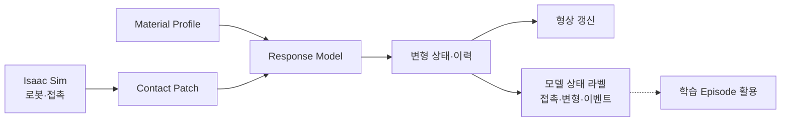

# Manufacturing Deformation Engine (MDE)

:material-circle:{ style="color:#2e9e44" } **연구개발 진행 중** · 한성대학교 PARC Lab · 기준일 **2026-10-23**

!!! tip "실험 결과 사이트"
    영상·이미지·접촉력·관절 토크 등 시뮬레이션 실험 결과는 **[MDE 실험 결과 사이트](https://parclab-hsu.github.io/hsu-mde/)**에 모아 두었습니다.

!!! abstract "요약"
    MDE는 RFM 정부과제의 **컨소시엄 휴머노이드 통합을 준비하는 제조 접촉·변형 엔진**입니다.
    NVIDIA Isaac Sim 위에서 **로봇의 접촉으로 부품이 어떻게 변형되고, 그 변형이 무엇을 남기는지**를
    계산하는 엔진입니다. PARC Lab이 로봇 시뮬레이션에서 접촉·변형을 직접 구동·계측해 온 경험을 제조 환경으로 확장합니다.

    - **대상** — 금속·수지·포장재·탄성체 부품 표면의 접촉 변형과 누적 이력
    - **산출** — 변형된 형상과 모델 상태에서 산출한 학습용 라벨(접촉·변형량·설정 한계 초과 이벤트)
    - **현황** — 기준 모델(v0) 재현을 완료했고, 제조 소재용 응답 모델을 구현해 Isaac Sim의 Allegro Hand 장면에서
      소재 5종 가압과 종이컵 쥐기를 시험했습니다. 실제 컨소시엄 로봇 모델은 미확정이며,
      실측 보정과 단계별 통합 검증을 계획하고 있습니다.

    특허 출원과 논문 투고를 준비하는 단계이며, 실제 출원·등록 완료는 확인되지 않았습니다. 이 페이지는 기존 공개 수준의 구조와 진행 현황만 다룹니다.

---

## 1. 왜 필요한가

로봇이 부품을 누르고, 끼우고, 집을 때 대상물은 변형됩니다. 가스켓은 눌린 만큼 복원되지 않고, 포장재는 접힌 자국이
남으며, 반복 사용된 부품은 공차가 달라집니다. 이러한 **접촉에 의한 상태 변화**가 시뮬레이션에 없으면
파지 실패·삽입 실패 같은 사건이 데이터에 나타나지 않고, 그 사건을 학습할 기회도 사라집니다.

범용 물리엔진은 변형 계산 자체를 제공합니다. MDE는 소재별 물성 관리와 교정 절차, 누적 이력,
그리고 변형 결과를 **로봇 학습용 모델 상태 라벨**로 제공하는 계층을 연구합니다. 모델 상태 라벨은 실측 정답과 구분합니다.

## 2. 구성

- **Material Profile** — 소재군의 물성값을 단위·허용 범위·출처·확정 여부와 함께 보관합니다. 지원 응답 모델의 범위에서는 Profile을 바꿔 소재 조건을 구성합니다.
- **Contact Patch** — 접촉 위치·방향·하중을 대상 표면의 국소 좌표로 표본화합니다.
- **Response Model** — 접촉에 대한 변형 응답입니다. 단계별로 교체됩니다.
- **변형 상태·이력** — 변형과 일부 누적 이력 배열을 저장·불러옵니다. 로봇·제어기까지 포함한 전체 시뮬레이션을 그대로 재개하는 기능은 아닙니다.
- **모델 상태 라벨** — 접촉 개시·해제, 모델상 영구변형 발생, 설정한 잔류 한계 초과를 기록합니다. 실제 재료의 항복이나 일반적인 작업 실패를 검증한 정답은 아닙니다.

점선은 라벨의 학습 episode 활용 방향을 나타내며, 모든 이벤트와 출처 정보가 학습 데이터셋에 포함되었다는 뜻은 아닙니다.

## 3. Isaac Sim 실험 결과 (2026-10-22 ~ 10-23)

**Allegro Hand**(Wonik Robotics, 16자유도)의 Isaac Sim 5.0 시뮬레이션 asset으로 세 가지 장면을 시험했습니다.
모든 결과는 시뮬레이션이며 실물 시편·실제 로봇 시험이 아닙니다. 물성은 잠정값입니다. 영상과 데이터는
[MDE 실험 결과 사이트](https://parclab-hsu.github.io/hsu-mde/)에 있습니다.
핸드는 시험 장면용 asset이며, 컨소시엄 휴머노이드 모델의 선정·전신 제어·실물 동작 검증을 나타내지 않습니다.

<figure markdown>
  { loading=lazy }
  <figcaption>대표 데모 — 종이컵을 빠르게 쥐고 들었다가 놓쳐 떨어뜨리기(4.8 s, 실제 시간)</figcaption>
</figure>

**소재별 손가락 가압.** 같은 손·같은 동작으로 패드의 Material Profile만 바꿔 세 손가락으로 세 번 눌렀다 뗐습니다.

<figure markdown>
  { loading=lazy }
  <figcaption>위: 누르고 있는 상태, 아래: 손가락을 뗀 뒤</figcaption>
</figure>

| 소재 Profile | 계열 | 눌린 깊이 | 뗀 뒤 남은 자국 | 거동 |
|---|---|---|---|---|
| Silicone rubber (soft) | 탄성체 | 3.0 mm | 0.0 mm | 깊게 눌리고 완전히 복원 |
| Elastomer pad | 탄성체 | 0.8 mm | 0.0 mm | 단단해 얕게 눌리고 복원 |
| Soft foam | 폴리머 폼 | 3.1 mm | 1.1 mm | 일부 영구변형 |
| Dense foam | 폴리머 폼 | 1.7 mm | 0.5 mm | 일부 영구변형 |
| Clay / plasticine | 점토 | 4.4 mm | 4.1 mm | 대부분 영구변형 |

**종이컵 쥐기.** 관절 토크 0.10 N·m로 쥐면 접촉력 합 17 N, 테두리 변형 5.6 mm로 들어 올리고, 0.35 N·m로 꽉 쥐면
77 N에서 테두리가 타원(안쪽 9.1 mm·바깥 8.0 mm)이 되며, 놓으면 원래 모양으로 돌아옵니다. 컵 벽은 탄성만 표현해
실제 컵의 주름·찌그러짐은 나타나지 않습니다.

**플라스틱 컵·물병 쥐기 (2026-10-24).** 같은 동작으로 투명 PET 컵과 500 ml PET 생수병을 쥐었습니다.
PET 컵 16 oz는 0.03 N·m로 쥐어 접촉력 5.4 N에 테두리가 1.3 mm, 0.06 N·m로 꽉 쥐어 10.6 N에 3.4 mm 변형됩니다(2026-10-25 수정 후).
물을 2/3(310 ml) 채우면 0.03 N·m로는 들지 못해 0.05 N·m로 쥐었고, 들고 있는 동안 마찰 여유는 최소 1.4배입니다. 컵 크기
9·16·20·24 oz를 같은 토크로 쥐면 접촉력은 비슷하고(쥘 때 4.5–5.4 N), 꽉 쥔 테두리 변형은 3.1–3.7 mm입니다. 생수병(벽 0.16 mm,
12 g)은 0.35 N·m로 꽉 쥐어 벽 변위가 2.7–3.1 mm이고, 마개를 닫으면 병 안 압력이 1.9 kPa 올라 벽이 덜 들어갑니다. 빈 병·물 1/3·
물 2/3·가득(마개 닫음/엶)을 비교했습니다. PET 컵과 병의 강성은 실측값이 아니라 공개 문헌 범위에서 고른 추정값입니다. 영상과 데이터는 [플라스틱 컵](https://parclab-hsu.github.io/hsu-mde/plastic-cup/) ·
[PET 물병](https://parclab-hsu.github.io/hsu-mde/bottle/)에 있습니다.

**데모 영상·점검 (2026-10-25).** 모든 실험을 매 스텝 다시 찍은 영상 37편(장면과 접촉력·변형·관절 토크 그래프, 네 방향, 회전 카메라,
단계를 맞춘 비교)을 [데모 영상](https://parclab-hsu.github.io/hsu-mde/videos/)에 모았습니다. 추정값을 공개 문헌과 대조해 PET 컵
옆벽 강성(0.7 → 3.2 N)과 물병의 벽 두께·질량(0.25 → 0.16 mm, 14 → 12 g)을 문헌 범위로 고치고, 관절 토크 조절·엄지 회전 관절·
들고 있는 동안의 힘 평형 계산을 손본 뒤 13개 실험과 영상을 모두 다시 만들었습니다. 전후 비교는
[추정값·힘 점검](https://parclab-hsu.github.io/hsu-mde/check/)에 있습니다.

**강화학습 병렬 학습 영상 (2026-10-27).** Isaac Lab에서 Allegro Hand가 PET 컵 16 oz를 집어 드는 동작을 강화학습(PPO)으로
배우는 과정을 찍었습니다. 같은 장면 1024개를 GPU 한 장에서 동시에 돌려 1500회 학습했고 렌더링 포함 약 22분 걸렸습니다.
영상은 [데모 영상](https://parclab-hsu.github.io/hsu-mde/videos/#2026-10-27)에 있습니다. 보상 구성과 수치 결과는 아직 공개하지 않습니다.

**강화학습 데모 — 구슬·달걀·젤리 집기 (2026-10-27).** Allegro Hand가 지름 16 mm 유리구슬, 달걀(60 g), 젤리(25 mm 정육면체)를
집어 10 cm 드는 동작을 PPO로 학습했습니다(각 1024개 병렬 환경 × 1500회). 물체가 눌리는 정도는 MDE가 계산합니다 — 손가락 접촉력이 매 스텝
물체의 MDE 소재 모델(유리·달걀 껍데기·젤라틴)로 들어가 눌림 깊이·남는 자국·금/찢어짐을 판정합니다. 받침 위에서는 구슬 128/128회, 달걀
127/128회를 들었고 달걀에 금이 간 episode는 없었습니다. 받침 없이 탁자 위에서 바로 집기도 학습해 구슬 127/128, 눕힌 달걀 128/128(금 0.8 %),
젤리 128/128(찢어짐 1.6 %)회를 들었습니다. 영상과 조건은 [강화학습 데모](https://parclab-hsu.github.io/hsu-mde/rl-grasp/)에 있습니다.

**강화학습 데모 — 수건 접기 (2026-10-31).** Allegro Hand가 탁자 위 20 cm 수건의 모서리를 집어 대각선으로 접는 동작을 학습했습니다(1024개 병렬 환경).
수건은 MDE 천 모델이 1024개 환경을 GPU에서 한꺼번에 계산하며, 집은 자리·접힘 오차·늘어남·찢김·남은 주름을 냅니다.
10-30 결과는 잡은 동안 손끝이 천에 닿지 않던 결함이 있어, 천이 두 손끝 사이에 실제로 끼어야 잡히도록 고쳐 다시 학습했습니다
(잡은 동안 엄지–검지 손끝 사이 중앙값 0 mm). 1번 접기는 127/128회 1.37 s(정해 둔 동작 3.42 s), 속도 상한을 올린 1번 접기는
128/128회 **0.87 s**, 둘 다 찢김 0회입니다. 2번 접기는 고친 집기로 아직 성공하지 못했습니다.
영상과 조건은 [수건 접기](https://parclab-hsu.github.io/hsu-mde/towel/)에 있습니다.

**강화학습 데모 — 뭉툭한 손끝으로 수건 집기 (2026-10-31).** 탁자에 펼친 얇은 수건을 집는 자리·방법을 정하지 않고 1024개 병렬 환경에서
학습했습니다. MDE 천 모델에 접촉 집기(천이 두 패드 사이에 끼고 양쪽에 닿아야 잡힘)와 좌굴(눌려 압축된 천이 솟음)을 더해, 손끝을
눌러 오므려 솟은 천을 잡게 했습니다. 10-30 결과는 패드가 손끝 밖으로 튀어나와 실제 손끝이 떨어져 있었기에, 패드를 손끝의 집는 면에
맞춰 다시 학습했습니다. 엄지와 검지 끝이 천을 사이에 두고 붙어(손끝 사이 거리 중앙값 0 mm) 1024회 중 86 % 들어 올려 유지,
흔들기 검사 89 % 유지. 끝단에서 집도록 800회 더 학습해 끝단 15 mm 안에서 집은 비율을 5 %에서 71 %로 올렸습니다(성공 85 %, 흔들기 88 % 유지). 엄지와 손가락 두 쌍 이상으로 잡는 집기는 여섯 번 학습해 모두 실패했습니다(정책은 늘 한 쌍만 씀). 이 수건에서는 한 쌍으로도 흔들기 검사를 96–98 % 버텨 손가락을 더 쓸 이유가 없었고, 천 모델에서는 이미 잡힌 천 옆에 둘째 쌍이 물 천이 남지 않았습니다. 이 조건에서는 엄지와 손가락 한 쌍이 최적이라는 결론으로 여러 손가락 집기 학습을 마쳤고, 실패·찢김 영상과 원인도 함께 공개합니다. 학습 과정 영상과 조건은 [수건 집기 — 뭉툭한 손끝](https://parclab-hsu.github.io/hsu-mde/towel-pick/)에 있습니다.

**냉장고 문 여닫기 (2026-10-27).** Allegro Hand가 냉장고 막대 손잡이를 감아 쥐고 문을 95° 열었다 닫습니다(문 각도는 스크립트).
문이 닫힐 때 문 패킹이 눌리는 정도를 MDE가 계산해 영상에 함께 보입니다 — 닫힌 상태 2.0 mm, 패킹 반력 48.7 N(패킹 강성은 가정값). 문의 위치 프로파일과, 그 움직임에 손이 손잡이에 내야 하는 힘을 문 무게 5·10·15 kg별로 계산해 그래프로 붙였습니다(최대 약 14 N, 무게가 세 배여도 2 N 정도만 늘어남).
영상은 [데모 영상](https://parclab-hsu.github.io/hsu-mde/videos/)에 있고, 문의 운동 방정식과 패킹·자석·힌지 모델, 질량별 결과는 [부록 A](#appendix-fridge-door)에 논문 형식으로 정리했습니다.

**대표 데모 — 빠르게 쥐었다 놓치기.** 한 스텝을 1/30 s로 두고 쥐기·60 mm 들기·놓치기를 4.8 s에 수행했습니다. 손가락을 여는 첫
스텝에 접촉이 끊기고 컵은 0.13 s 만에 탁자로 떨어집니다. 스텝당 계산 시간을 함께 기록했으며, 손이 컵에 닿아 있는 동안은
스텝당 99–143 ms로 **아직 실시간(33 ms)이 아닙니다**(접촉 구간 실시간 대비 약 0.23–0.33배).

| 실험 (2026-10-25) | 관절 토크 (시뮬레이션 계산값) | Allegro 한계 0.7 N·m 대비 |
|---|---|---|
| 종이컵 쥐기 0.10 N·m 설정 | 최대 0.26 N·m | 안 |
| 종이컵 꽉 쥐기 0.35 N·m 설정 | 순간 최대 0.80 N·m (넘은 스텝 3) | 초과(순간) |
| PET 컵 쥐기·꽉 쥐기 0.03–0.05 / 0.06–0.08 N·m 설정 | 최대 0.12–0.19 N·m | 안 |
| PET 물병 500 ml 꽉 쥐기 0.35 N·m 설정 | 순간 최대 0.73–0.85 N·m (넘은 스텝 1–8) | 초과(순간) |

관절 토크는 관절 센서로 잰 값이 아니라 시뮬레이션의 접촉력에서 계산한 값입니다(컵·물병은 들고 있는 동안 무게를 받치는 마찰도 포함).
Isaac Lab 손 모델의 설정 0.5 N·m 기준이면 종이컵·물병의 꽉 쥐기는 한계를 넘습니다.

!!! warning "해석 시 주의"
    - 물성값은 추정값·미확인 값을 포함한 **잠정값**입니다. 위 수치는 특정 제품의 예측이 아니라 모델 동작을 보여 주는 예시입니다.
    - 손가락 가압은 목표 각도까지 움직이는 위치 제어라, 소재가 달라도 손가락 힘은 비슷하고 차이는 눌린 깊이와 남은 자국에 드러납니다.
    - 2026-10-22 이전 공개판의 「간격 약 0.04 mm」는 당시 손끝 장면의 첫 가압 중앙값이며, 현재 구현의 오차 상한이 아닙니다.

## 4. 개발 단계

| 단계 | 재현 범위 | 검증 방법 | 현황 |
|---|---|---|---|
| **v0** 기준선 | 기준 하중–변형 모델 | 고정 참조 fixture 대조 | :material-check-circle:{ style="color:#2e9e44" } 기준선 재현 (2026-10) |
| **v1** 탄성·항복 | 가압·파지 시의 변형과 항복 | 기준 시편 접촉력–변위 시험 | 모델 구현, 실계측 보정 준비 |
| **v2** 소성·잔류·구조 | 영구변형·반복하중, 얇은 벽 용기 | 반복하중 시험·형상 스캔 대조 | 일부 구현 |
| **v3** 이력·마모 | 장기 사용 상태·마모·공차 변화 | 장시간 반복운전 로그 대조 | 계획 |

개발 방향의 초기 공개 배경은 [Robot RFM 데이터팩토리 과제 제안](manufacturing-data-factory-rfm/technical.md)의 Deformation Engine 계획에서 확인할 수 있습니다. 이 페이지의 기술 단계는 과제의 연차별 승인 목표나 달성 실적을 뜻하지 않습니다.

!!! note "확인되지 않은 것"
    - 제조 소재의 물성값은 아직 실측 보정 전입니다. 현재 값은 파이프라인 동작 확인용 잠정값입니다.
    - 추가 실행 성능 자료의 공개 여부와 범위는 출원·공개 검토 후 정합니다.
    - 곡면 부품 표면과 체적 변형체 결합은 미구현입니다.

## 5. 초기 MDE 단위연구의 공개 계획

아래는 초기 MDE 단위연구에서 공개한 계획입니다. RFM 정부과제의 전체 성과목표, 최종 협약 목표 또는 달성 실적과 구분합니다.

- 특허 출원 목표 1건 (준비 계획이며, 출원 접수·등록 완료의 확인이 아님)
- 학술대회 논문 목표 1편 (출원·공개 범위 확인 후 투고 계획)
- 대표 작업 검토 후보: 탄성체 삽입(가스켓·O-ring) — 과제 대표 공정 확정과 실계측 보정은 별도 확인

## 6. 컨소시엄 휴머노이드 통합 방향

실제 모델·작업·제어 및 센서 인터페이스를 확정한 뒤, robot asset 수용, 부분 접촉 simulation,
전신 simulation, HILS, 제한된 실물 시험과 RFM 데이터 인수 순으로 검증할 계획입니다.
각 단계에서 원자료·시간 동기·물성 및 데이터 출처·품질 판정을 연결하고, 실물 안전 책임과 시험 조건을 관계 기관과 확정합니다.
현재 접촉 시험 장면이나 학습 adapter가 전신 동작·실물 안전·RFM 성능 향상을 입증하는 것은 아닙니다.
새 기술·결과의 공개 범위는 별도 검토합니다.

## 부록 A. 냉장고 문 여닫기의 동역학 모델 { #appendix-fridge-door }

*기준일 2026-10-28 · 3절 「냉장고 문 여닫기」 데모의 계산 근거*

!!! abstract "초록"
    로봇 손이 냉장고 문을 여닫을 때 손잡이에 내야 하는 힘을, 문의 위치 프로파일과 문 패킹·자석 띠·힌지 마찰을 포함한
    1자유도 회전 운동 방정식으로 계산했다. 문 패킹이 눌리는 정도와 그 반력은 MDE가 매 프레임 계산한다. 위 문(폭 0.596 m)을
    3.0 s 동안 95° 여는 cosine 프로파일에서, 문 질량 5·10·15 kg에 대해 손 힘의 최대값은 14.4·15.5·16.6 N(해석값)이고,
    이 중 문이 캐비닛에서 떨어지는 순간의 **분리 힘 13.2 N이 질량과 무관하게 대부분**을 차지했다. 문을 돌리는 동안의
    힘은 ±1–3 N으로 관성 항이 지배하며 질량에 비례했다. 이 손 힘을 PhysX 강체 문에 넣어 정방향으로 돌리면 문이 계산한 각도를 0.6° 안에서
    따라가고, 분리·안착 순간에는 손잡이 강성 500 N/m 수준의 약한 피드백이 더 필요했다. 패킹 강성·자석 세기·힌지 마찰은 실측하지 않은 가정값이다.

### A.1 서론

냉장고 문 여닫기는 가정용 휴머노이드의 대표 작업이다. 문을 여는 데 드는 힘은 문 무게보다 **문을 닫힌 채 붙잡아 두는
부품** — 문 둘레의 고무 패킹과 그 안의 자석 띠 — 에서 주로 나온다. 패킹은 닫힌 문에 눌려 문을 밀어내고, 자석은 문을
당긴다. 둘의 차이가 문이 떨어지는 순간의 힘이 된다.

이 부록은 (1) 문 각도 프로파일, (2) 문의 회전 운동 방정식, (3) MDE가 계산한 패킹 반력, (4) 가정한 자석·힌지 모델을
정리하고, 문 질량별 손 힘을 보인다. 장면에서 문과 팔은 스크립트로 움직이며(kinematic), 손 힘은 같은 움직임을 실제로
만들려면 손이 내야 하는 힘을 역동역학으로 계산한 값이다.

### A.2 모델

#### A.2.1 좌표와 위치 프로파일

문은 수직 힌지 축으로 돈다. 힌지 좌표계에서 문 안쪽 면의 점을 힌지로부터의 거리 \\(s\\)와 높이 \\(z\\)로 나타내고,
문 각도 \\(\theta\\)는 닫힌 상태에서 0, 여는 방향을 양으로 둔다. 중력은 힌지 축에 평행하므로 회전에 모멘트를 주지 않는다.

여는 구간(길이 \\(T_m\\))과 닫는 구간의 각도는 양 끝에서 속도가 0인 cosine 프로파일이다.

\[
\theta_{\text{open}}(t) = \frac{\Theta}{2}\left(1-\cos\frac{\pi t}{T_m}\right),\qquad
\theta_{\text{close}}(t) = \frac{\Theta}{2}\left(1+\cos\frac{\pi t}{T_m}\right),\qquad 0 \le t \le T_m
\tag{1}
\]

최대 각속도와 최대 각가속도는

\[
\dot\theta_{\max} = \frac{\pi\Theta}{2T_m},\qquad \ddot\theta_{\max} = \frac{\pi^2\Theta}{2T_m^2}
\tag{2}
\]

이고, 각가속도는 구간의 시작과 끝에서 최대다. \\(\Theta = 95^\circ\\), \\(T_m = 3.0\\) s에서 49.7 °/s, 52.1 °/s²이며,
손잡이(팔 길이 \\(r_h\\) = 0.548 m)의 최대 속도는 \\(r_h\dot\theta_{\max}\\) = 0.48 m/s다.

#### A.2.2 운동 방정식

힌지 축에 대한 문의 회전은

\[
I\,\ddot\theta = \tau_h + \tau_g(\theta) - \tau_m(\theta) - \tau_f\,\operatorname{sgn}\dot\theta
\tag{3}
\]

이다. \\(\tau_h\\)는 손이 손잡이에 주는 모멘트(여는 방향 양), \\(\tau_g\\)는 문 패킹이 문을 밀어내는 모멘트, \\(\tau_m\\)은
자석 띠가 문을 당기는 모멘트, \\(\tau_f\\)는 힌지 마찰 모멘트다.

문을 폭 \\(W\\), 두께 \\(D\\), 질량 \\(m\\)(선반 내용물 포함)의 균일한 판으로 보면 힌지 축(판의 한 모서리)에 대한 관성 모멘트는

\[
I = \frac{m\,(W^2 + D^2)}{3}
\tag{4}
\]

이다.

#### A.2.3 문 패킹 — MDE

패킹은 문 안쪽 면 둘레의 띠 \\(\Gamma\\)(가장자리에서 12 mm 안쪽, 폭 10 mm)로 둔다. 문이 닫혔을 때 패킹은 \\(\delta_0\\) = 2.0 mm
눌려 있다. 문이 \\(\theta\\)만큼 열리면 힌지에서 \\(s\\)만큼 떨어진 점은 캐비닛 앞면에서 \\(s\sin\theta\\)만큼 떨어지므로,
그 점의 패킹 눌림은

\[
w(s,z;\theta) = \max\!\left(0,\; \delta_0 - s\sin\theta\right),\qquad (s,z)\in\Gamma
\tag{5}
\]

이다. 이 눌림이 매 프레임 MDE에 들어가고, MDE는 패킹 소재 모델로 띠의 압력 분포 \\(p(s,z)\\)를 돌려준다(누적 이력 포함).
패킹 반력과 힌지 모멘트는 그 압력의 적분이다.

\[
F_g = \int_\Gamma p\,dA,\qquad \tau_g = \int_\Gamma p\,s\,dA
\tag{6}
\]

식 (5)에서 패킹이 닿는 조건은 \\(\sin\theta < \delta_0/s\\)다. 닫을 때 처음 닿는 곳은 힌지 쪽 띠(\\(s\\) ≈ 14.5 mm)로 약 8°에서
닿고, 문 끝(\\(s\\) ≈ 0.58 m)은 0.2° 안쪽에서야 닿는다. 반력은 마지막 1° 안에서 대부분 생긴다(0.46°에서 17.9 N, 0°에서 48.7 N).
패킹 소재의 강성은 패킹 전체가 2 mm 눌릴 때 약 50 N이 되도록 둔 **가정값**이며, 닫는 압력에서 영구 변형은 생기지 않게 두었다.

#### A.2.4 자석 띠 (가정)

자석 띠는 MDE가 아닌 가정 모델이다. 같은 띠 \\(\Gamma\\) 위에서 간격 \\(g = s\sin\theta\\)에 대해 지수적으로 약해지는 당김 압력을 둔다.

\[
p_m(s,\theta) = p_{m0}\,e^{-s\sin\theta/\lambda},\qquad
p_{m0} = \kappa\,\frac{F_g(0)}{A_\Gamma},\qquad
\tau_m = \int_\Gamma p_m\,s\,dA
\tag{7}
\]

\\(A_\Gamma\\)는 띠의 면적, \\(\kappa\\) = 1.5는 닫혔을 때 자석의 당김이 패킹의 밀어냄보다 커서 문이 닫혀 있도록 둔 비, \\(\lambda\\) = 1 mm는
감쇠 길이다. 두 값 모두 실측하지 않았다.

#### A.2.5 힌지 마찰 (가정)

아래 힌지가 문 무게 \\(mg\\)를 받고, 문 무게중심이 힌지 축에서 \\(W/2\\) 떨어져 생기는 모멘트를 높이 \\(h\\) 떨어진 두 힌지의
수평 반력 \\(mg\,W/(2h)\\)가 받친다. 핀(반지름 \\(r_p\\))의 마찰계수를 \\(\mu\\)로 두고 핀에 걸리는 하중의 합에 \\(\mu r_p\\)를 곱해

\[
\tau_f = \mu\,r_p\left(mg + 2\,mg\,\frac{W}{2h}\right) = \mu\,r_p\,m g\left(1 + \frac{W}{h}\right)
\tag{8}
\]

로 근사한다(\\(\mu\\) = 0.15, \\(r_p\\) = 6 mm, 가정값).

#### A.2.6 손잡이 힘

식 (3)을 \\(\tau_h\\)에 대해 풀고 팔 길이로 나누면, 손잡이에서 문에 수직으로 내야 하는 힘은

\[
F_h(t) = \frac{1}{r_h}\Big[\, I\,\ddot\theta - \tau_g(\theta) + \tau_m(\theta) + \tau_f\,\operatorname{sgn}\dot\theta \,\Big]
\tag{9}
\]

이다(양 = 여는 방향). 손이 손잡이를 쥔 동안만 계산하고, 문이 닫힌 채 정지해 있는 동안(\\(\theta = 0,\ \dot\theta = 0\\))은
캐비닛이 하중을 받으므로 \\(F_h = 0\\)으로 둔다.

닫힌 상태에서는 \\(w = \delta_0\\)로 띠 전체가 고르게 눌리므로 \\(\tau_g(0) = F_g(0)\,\bar s\\), \\(\tau_m(0) = \kappa\,F_g(0)\,\bar s\\)이다
(\\(\bar s\\)는 띠의 힌지로부터 평균 거리, 0.298 m). 따라서 문이 캐비닛에서 떨어지는 순간의 정적 **분리 힘**은

\[
F_b = \frac{\tau_m(0) - \tau_g(0)}{r_h} = \frac{(\kappa - 1)\,F_g(0)\,\bar s}{r_h}
\tag{10}
\]

이고, cosine 프로파일은 시작과 끝에서 각가속도가 최대이므로 여는 순간과 다 닫히는 순간의 손 힘은

\[
F_h(0^+) = F_b + \frac{I\,\ddot\theta_{\max} + \tau_f}{r_h},\qquad
F_h(T_m^-)\big|_{\text{close}} = F_b + \frac{I\,\ddot\theta_{\max} - \tau_f}{r_h}
\tag{11}
\]

이다. 닫는 끝에서 \\(F_h > 0\\)인 것은 자석이 문을 끌어당기는 것을 손이 여는 방향으로 붙잡아 문을 천천히 앉힌다는 뜻이다.

### A.3 계산 조건

| 항목 | 기호 | 값 | 근거 |
|---|---|---|---|
| 문 폭 · 두께 · 힌지 간 높이 | \\(W, D, h\\) | 0.596 m · 0.06 m · 1.025 m | 장면의 위 문 |
| 문 질량(선반 내용물 포함) | \\(m\\) | 5 · 10 · 15 kg | 비교 조건 |
| 손잡이 팔 길이 | \\(r_h\\) | 0.548 m | 힌지 축 → 막대 축 |
| 열림각 · 여닫는 시간 | \\(\Theta, T_m\\) | 95° · 3.0 s(열린 채 1.2 s) | 스크립트 |
| 닫힌 상태 패킹 눌림 · 반력 | \\(\delta_0, F_g(0)\\) | 2.0 mm · 48.7 N | MDE, 패킹 강성은 가정값 |
| 자석 당김 비 · 감쇠 길이 | \\(\kappa, \lambda\\) | 1.5 · 1 mm | 가정값 |
| 힌지 핀 마찰계수 · 반지름 | \\(\mu, r_p\\) | 0.15 · 6 mm | 가정값 |
| 표본 주기 | | 30 프레임/s | 장면과 같음 |

\\(\dot\theta,\ \ddot\theta\\)는 프레임 각도의 중심 차분으로 구했다.

### A.4 결과

닫힌 상태에서 손잡이로 환산한 패킹의 밀어냄은 26.5 N, 자석의 당김은 39.7 N이며, 식 (10)의 분리 힘은 **13.2 N**이다.

| 문 질량 | \\(I\\) [kg·m²] | 관성 항 \\(I\ddot\theta_{\max}/r_h\\) | 힌지 항 \\(\tau_f/r_h\\) | 여는 순간 \\(F_h(0^+)\\) | 다 닫히는 순간 | 문을 돌리는 동안 |
|---|---|---|---|---|---|---|
| 5 kg | 0.598 | 0.99 N | 0.13 N | 14.4 N (13.9) | 14.1 N (13.6) | −1.1 … +1.0 N |
| 10 kg | 1.196 | 1.98 N | 0.25 N | 15.5 N (14.5) | 15.0 N (14.0) | −2.2 … +1.9 N |
| 15 kg | 1.794 | 2.98 N | 0.38 N | 16.6 N (15.1) | 15.8 N (14.4) | −3.4 … +2.9 N |

괄호는 30 프레임/s 표본의 최대값이다. 각가속도의 최대가 구간 경계에 있어 표본값은 해석값보다 0.5–1.5 N 작다.
「문을 돌리는 동안」은 패킹이 떨어진 뒤(약 8° 이상)의 범위다.

*그림 A.1 왼쪽: 문 각도와 손잡이 속도(식 1). 가운데: 문 질량 5·10·15 kg의 손잡이 힘(식 9)과 그중 패킹(MDE)·자석(가정) 성분. 오른쪽: MDE가 계산한 패킹 최대 눌림과 반력. 배경색은 쥐기·열기·열린 채·닫기·놓기 구간이다.*

### A.5 PhysX 정방향 검증

식 (9)의 손 힘이 실제로 그 움직임을 만드는지 PhysX에서 확인했다. 문을 문 크기의 상자 강체(질량만 지정, 관성은 PhysX가 형상에서 계산)로
힌지 축 회전 관절에 달고, 240 Hz로 매 스텝 손 토크 \\(\tau_h(t)\\)와 나머지 토크를 걸어 문 각도를 적분했다. 세 방식을 비교했다.

- **고정 하중**: 패킹·자석·힌지 토크를 스크립트 각도를 따라 미리 정한 값으로 건다. 관성·부호·시간 간격만 검증한다.
- **상태 하중**: 패킹(MDE)·자석·힌지 토크를 시뮬레이션의 실제 각도·속도에서 계산한다. 손은 식 (9)의 피드포워드만 낸다.
- **상태 하중 + 피드백**: 위에 더해 손이 스크립트 각도 쪽으로 당기는 피드백을 낸다. 손잡이 강성 \\(k_h\\) = 500 N/m, 임계 감쇠
  (\\(K = k_h r_h^2,\ C = 2\sqrt{K I}\\)).

| 방식 | 5 kg | 10 kg | 15 kg | 비고 |
|---|---|---|---|---|
| 고정 하중 — 최대 각도 오차 | 0.56° | 0.56° | 0.57° | 관성 정의 차이(0.75 %)만큼 |
| 상태 하중 — 최대 각도 오차 | 6.4° | 1.5° | 1.0° | 5 kg 문은 6.4°에서 멈춰 다 닫히지 않음 |
| 상태 하중 + 피드백 — 최대 각도 오차 | 0.22° | 0.14° | 0.11° | |
| 피드백이 더한 손 힘 — 회전 중 | 0.06 N | 0.10 N | 0.13 N | |
| 피드백이 더한 손 힘 — 안착 순간 | 6.6 N | 5.1 N | 4.3 N | 다 닫히기 직전 0.04 s |

고정 하중의 오차는 식 (4)가 힌지 축을 판의 모서리에 두는 데 비해 장면의 상자 강체는 두께 방향 가운데에 축이 있어 관성이
\\(mD^2/4\\)(0.75 %)만큼 작은 데서 온다. 이 차이를 빼면 식 (9)의 손 힘은 PhysX에서 그대로 재현된다.

상태 하중의 오차는 분리 순간 0.1 s 안에 생긴 작은 속도 차이가 이후 적분된 것이다. 닫힘 근처에서 패킹−자석 순토크는 각도에 대해
**음의 강성**을 가진다 — 손잡이로 환산해 0°에서 0.05° 사이에 약 8 N이 변한다. 문이 조금 앞서면 자석이 약해져 더 앞서고, 조금 뒤처지면
자석에 끌려 들어간다. 같은 속도 차이라도 가벼운 문일수록 각도 오차가 크다. 피드백을 더하면 오차는 0.22° 이내로 줄고, 피드백이
더하는 힘은 회전 중에는 0.13 N 이하이며 안착 순간에만 4–7 N이다.

### A.6 논의

1. **여닫는 힘은 문 무게가 아니라 패킹과 자석이 정한다.** 최대 손 힘의 80–92 %가 분리 힘 \\(F_b\\)이고, \\(F_b\\)는 식 (10)처럼
   질량을 포함하지 않는다. 질량을 세 배로 늘려도 최대값은 14.4 N에서 16.6 N으로 2.2 N만 는다.
2. **질량은 관성 항으로만 들어온다.** 문을 돌리는 동안의 힘은 \\(I\ddot\theta/r_h\\)가 지배해 질량과 \\(\ddot\theta_{\max}\\)에
   비례한다. 같은 문을 두 배 빨리(\\(T_m\\) = 1.5 s) 열면 관성 항은 네 배가 된다.
3. **힘이 몰리는 구간이 짧다.** 패킹 반력은 마지막 1° 안에서 대부분 생기고 자석은 간격 수 mm에서 사라지므로, 손 힘의
   큰 값은 분리·안착의 0.1 s 안팎에 몰린다. 이 구간은 음의 강성 때문에 미리 계산한 힘만으로는 맞출 수 없고(A.5), 손의 쥐는 힘과
   손목 제어는 이 순간에 맞춰야 한다.
4. **패킹 반력이 MDE에서 나오므로**, 패킹 소재 모델의 강성을 바꾸면 \\(F_g(0)\\)와 첫 접촉 이후의 반력 곡선이 같이 바뀌고 식 (10)·(11)을
   통해 손 힘에 그대로 반영된다. 실측 패킹으로 보정하면 같은 계산이 제품별 예측이 된다.

### A.7 한계

- 패킹 강성(전체 50 N @ 2 mm), 자석 당김 비 1.5와 감쇠 길이 1 mm, 힌지 마찰은 **실측하지 않은 가정값**이다. 수치는 특정 제품의 예측이 아니다.
- 영상 장면에서 문과 팔은 스크립트로 움직인다. 손 힘은 역동역학 계산값이며, 손가락 접촉력이 아니다. A.5의 PhysX 검증은 문만 강체로 두고
  손 힘을 토크로 걸었다(손가락과 손잡이의 접촉은 풀지 않았다).
- 손 힘은 손잡이에서 문에 수직인 성분만 다룬다. 손잡이를 당기는 방향의 성분, 문 안 공기의 압력차, 문 닫힘 완충 장치,
  힌지의 자동 닫힘 경사는 넣지 않았다.
- 문은 균일한 판, 선반 내용물은 문에 고정된 질량으로 보았다. 병이 흔들리는 효과는 없다.

영상과 그래프 영상은 [데모 영상](https://parclab-hsu.github.io/hsu-mde/videos/)에 있다.

---

`Isaac Sim` · `Allegro Hand` · `Deformation` · `Contact Mechanics` · `Digital Twin` · `Robot Learning Data` · `Manufacturing`
