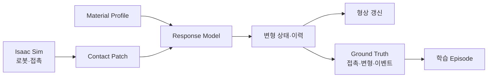
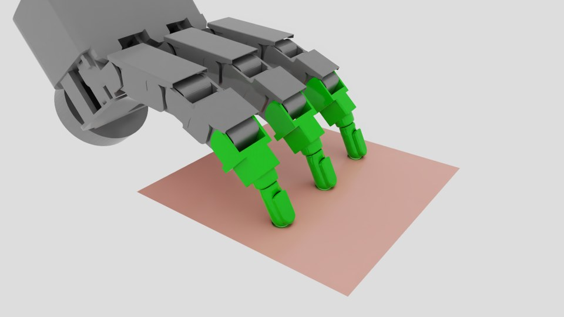
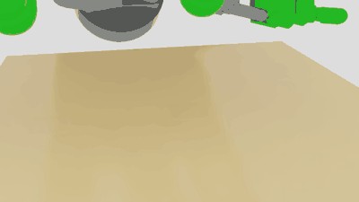
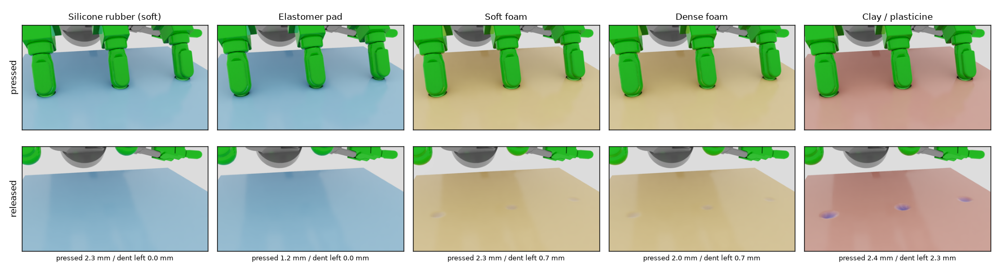
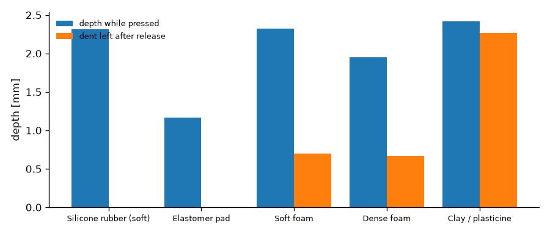

# Manufacturing Deformation Engine (MDE)

:material-circle:{ style="color:#2e9e44" } **진행 중 · 자체 연구** · 한성대학교 PARC Lab · 기준일 **2026-10-22**

!!! abstract "요약"
    MDE는 NVIDIA Isaac Sim 위에서 **제조 로봇의 접촉으로 부품이 어떻게 변형되고, 그 변형이 무엇을 남기는지**를
    계산하는 엔진입니다. 달 탐사 로버 시뮬레이터 OmniLRS의 지형 변형 엔진에서 출발하며, PARC Lab이 현대자동차
    L-Project에서 이 엔진을 직접 구동·계측·개선한 경험을 제조 환경으로 확장합니다.

    - **대상** — 금속·수지·포장재·탄성체 부품 표면의 접촉 변형과 누적 이력
    - **산출** — 변형된 형상, 그리고 학습용 Ground Truth(접촉·변형량·정상/실패 이벤트)
    - **현황** — OmniLRS 기준선(v0) 재현을 완료했고, 제조 소재용 응답 모델을 구현해 Isaac Sim의 Allegro Hand 가압
      장면에서 소재 5종을 비교했습니다. 실계측 보정을 준비하고 있습니다.

    특허 출원과 논문 투고를 준비하고 있어, 이 페이지는 구조와 진행 현황만 다룹니다.

---

## 1. 왜 필요한가

로봇이 부품을 누르고, 끼우고, 집을 때 대상물은 변형됩니다. 가스켓은 눌린 만큼 복원되지 않고, 포장재는 접힌 자국이
남으며, 반복 사용된 부품은 공차가 달라집니다. 이러한 **접촉에 의한 상태 변화**가 시뮬레이션에 없으면
파지 실패·삽입 실패 같은 사건이 데이터에 나타나지 않고, 그 사건을 학습할 기회도 사라집니다.

범용 물리엔진은 변형 계산 자체를 제공합니다. MDE가 다루는 것은 그 위의 계층입니다 — 소재별 물성의 관리와
실측 보정, 세션을 넘는 누적 이력, 그리고 변형 결과를 **로봇 학습 데이터의 정답**으로 바꾸는 일입니다.

## 2. OmniLRS에서 MDE로

| OmniLRS 지형 변형 | MDE |
|---|---|
| 바퀴 접지면(footprint) | 그리퍼·공구·부품의 Contact Patch |
| 하중–침하 회귀 | 소재별로 교체 가능한 Response Model |
| 월면토 고정 물성 | 단위·범위·출처를 함께 관리하는 Material Profile |
| 지형 높이맵 | 부품 표면의 변형 상태와 누적 이력 |
| 시각적 자국 | 형상 갱신 + 접촉·변형·실패 이벤트 Ground Truth |

OmniLRS는 BSD-3-Clause 오픈소스이며, MDE의 v0 단계는 OmniLRS 원본 엔진의 출력과 **표본 단위로 일치**하는 것을
확인했습니다. L-Project에서의 실측 경험은 [OmniLRS 지형 변형 엔진 정밀 분석](l-project-deformation.md)에 정리되어 있습니다.

## 3. 구성

- **Material Profile** — 소재군의 물성값을 단위·허용 범위·출처·확정 여부와 함께 보관합니다. 새 소재군은 코드가 아니라 Profile 추가로 확장합니다.
- **Contact Patch** — 접촉 위치·방향·하중을 대상 표면의 국소 좌표로 표본화합니다.
- **Response Model** — 접촉에 대한 변형 응답입니다. 단계별로 교체됩니다.
- **변형 상태·이력** — 부품별 누적 상태를 저장해 다음 시뮬레이션이 이전 사용 이력에서 출발할 수 있게 합니다.
- **Ground Truth** — 접촉 개시·해제, 영구변형 발생, 작업 실패 같은 이벤트를 자동으로 기록합니다.

## 4. Isaac Sim 가압 장면 — 소재별 비교

연구용으로 가장 널리 쓰이는 다지 핸드인 **Allegro Hand**(Wonik Robotics, 16자유도)가 160 × 160 mm 패드를 세 손가락으로
세 번 눌렀다 떼는 장면입니다. 손끝 접촉력을 PhysX에서 읽어 MDE가 패드 표면 변형을 계산하고, 눌린 깊이를 청색 농도로 표시합니다.
패드는 소재에 맞춘 강성으로 실제로 눌리고, 손끝이 들어간 자리와 깊이가 그대로 자국이 됩니다
(손끝과 자국 바닥 사이 간격 약 0.04 mm).
핸드 asset은 Isaac Sim 5.0 공식 asset을 그대로 사용합니다.

<figure markdown>
  { loading=lazy }
  <figcaption>Allegro Hand 가압 장면 (점토 Profile, 눌린 상태)</figcaption>
</figure>

<figure markdown>
  { loading=lazy }
  <figcaption>세 번의 가압 사이클 — 점토는 손가락을 뗀 뒤에도 자국이 남습니다</figcaption>
</figure>

같은 핸드·같은 동작에서 **패드의 Material Profile만 바꿔** 다섯 소재를 비교했습니다.

<figure markdown>
  { loading=lazy }
  <figcaption>위: 누르고 있는 상태, 아래: 손가락을 뗀 뒤. 청색이 짙을수록 깊습니다</figcaption>
</figure>

<figure markdown>
  { loading=lazy }
  <figcaption>소재별 최대 눌림 깊이와 해제 후 남은 자국 깊이</figcaption>
</figure>

| 소재 Profile | 계열 | 눌린 깊이 | 해제 후 남은 자국 | 거동 |
|---|---|---|---|---|
| Silicone rubber (soft) | 탄성체 | 2.3 mm | 0.0 mm | 깊게 눌리고 완전히 복원 |
| Elastomer pad | 탄성체 | 1.2 mm | 0.0 mm | 단단해 얕게 눌리고 복원 |
| Soft foam | 폴리머 폼 | 2.3 mm | 0.7 mm | 일부 영구변형 |
| Dense foam | 폴리머 폼 | 2.0 mm | 0.7 mm | 일부 영구변형 |
| Clay / plasticine | 점토 | 2.4 mm | 2.3 mm | 대부분 영구변형 |

- 소재 차이는 코드가 아니라 **Profile 파일 교체**만으로 만들어집니다.
- 영구변형이 생긴 폼·점토에서는 항복 개시 이벤트가, 자국이 한도(1 mm)를 넘은 점토에서는 한도 초과 이벤트가 Ground Truth로 자동 기록되었습니다.

!!! warning "해석 시 주의"
    - 물성값은 문헌 범위에서 고른 **잠정값**입니다. 위 수치는 특정 제품의 예측이 아니라 파이프라인 동작을 보여 주는 예시입니다.
    - 손가락은 목표 각도까지 움직이는 위치 제어라, 소재가 달라도 눌린 깊이는 비슷하고 차이는 해제 후 자국에 드러납니다.
    - 접촉력은 근사입니다. 패드의 무름은 반영하지만 소재 모델의 힘–깊이 관계와 정확히 일치하지는 않습니다.

## 5. 개발 단계

| 단계 | 재현 범위 | 검증 방법 | 현황 |
|---|---|---|---|
| **v0** 기준선 | OmniLRS 하중–변형 모델 | OmniLRS 원본 출력 대조 | :material-check-circle:{ style="color:#2e9e44" } 완료 (2026-10) |
| **v1** 탄성·항복 | 가압·파지 시의 변형과 항복 | 기준 시편 접촉력–변위 시험 | 모델 구현, 실계측 보정 준비 |
| **v2** 소성·잔류변형 | 영구변형·반복하중 | 반복하중 시험·형상 스캔 대조 | 일부 구현 |
| **v3** 이력·마모 | 장기 사용 상태·마모·공차 변화 | 장시간 반복운전 로그 대조 | 계획 |

단계 구성과 검증 기준은 [Robot RFM 데이터팩토리 과제 제안](manufacturing-data-factory-rfm/technical.md)의 Deformation Engine 계획과 같습니다.

!!! note "확인되지 않은 것"
    - 제조 소재의 물성값은 아직 실측 보정 전입니다. 현재 값은 파이프라인 동작 확인용 잠정값입니다.
    - Isaac Sim 결합 실행 성능의 정량 평가 결과는 특허 출원 후 공개합니다.
    - 곡면 부품 표면과 체적 변형체 결합은 미구현입니다.

## 6. 연구 산출물 계획

- 특허 출원 1건 (준비 중)
- 학술대회 논문 1편 (특허 출원 후 투고)
- 대표 작업: 탄성체 삽입(가스켓·O-ring) — 실계측 보정과 함께 진행

`Isaac Sim` · `Allegro Hand` · `OmniLRS` · `Deformation` · `Contact Mechanics` · `Digital Twin` · `Robot Learning Data` · `Manufacturing`
